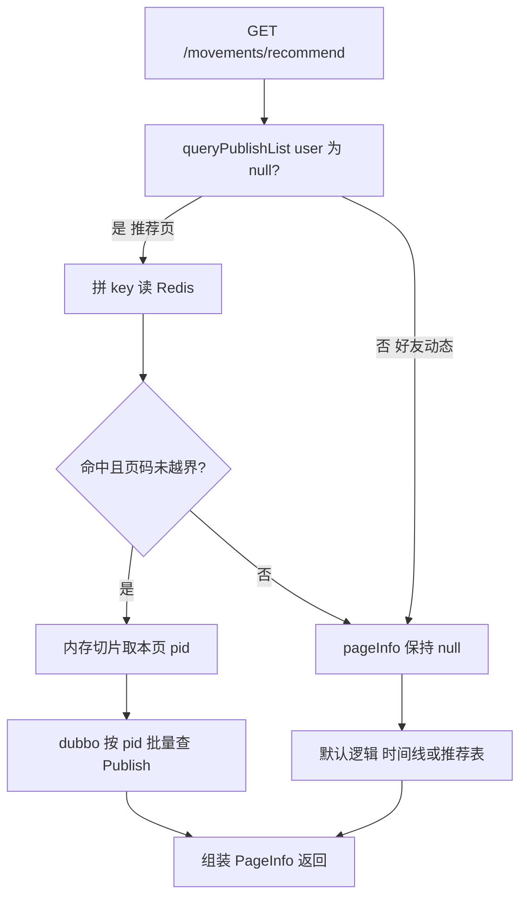

# 把推荐结果接进圈子查询：Redis 命中分页与兜底回退

推荐列表已经躺在 Redis 里，每个用户一个 key，value 是按预测分降序排列的 pid 串。但圈子列表接口对此一无所知，推荐页发起的请求依旧落回老逻辑。改造的判断点其实只有一个：查询方法收到的 user 参数是否为 null。为 null 就是推荐页来了，先去 Redis 命中推荐 pid，命中则按分数序在内存里切页、按 pid 批量取正文；没命中、页码越界或者压根没有推荐数据的用户，一律回退原有查询逻辑，行为与改造前完全一致。整个改造不新增接口契约，App 端零感知。

## 先给结论

- 改造集中在 server 的 MovementsService 私有方法 `queryPublishList`，Controller 与响应结构不动。
- user 为 null 表达推荐查询：用 `QUANZI_PUBLISH_RECOMMEND_ + 登录用户id` 拼 key 读 Redis，value 是逗号分隔的 pid 串。
- 命中后在内存分页：`startIndex = (page - 1) * pageSize`，`endIndex = startIndex + pageSize - 1`，两端都要做边界保护。
- dubbo 侧新增 `queryPublishByPids(List<Long>)`，实现用 pid 的 in 条件批量查询，避免按 id 逐条循环。
- 未命中或越界时 pageInfo 保持 null，走原有默认逻辑（好友时间线或推荐表），旧路径不受影响。
- 查询完成后重新 `UserThreadLocal.get()` 取登录用户，卡片组装用的始终是真实登录人。

## 一、查询入口的分流设计

改造前的查询结构是 day08 前段定下的形态：Controller 的 `queryRecommendPublishList` 传 null 进来，`queryUserPublishList` 传登录用户，两个公开入口共用私有方法 `queryPublishList`，方法内部按 user 的空与不空分流。本次改造往这条已有缝隙里加一层 Redis 命中，分流逻辑变成下图：



这张图讲的是新旧行为的汇合方式。关键路径在中间的菱形判断：只有「命中且未越界」才走推荐通道，其余一切情况都落进同一个默认逻辑出口，这正是改动不伤旧功能的关键设计。讲义里的版本用布尔值标记是否推荐查询，与判 user 是否为 null 是同一件事的两种写法，语义完全等价。

推荐序的来源要说清楚：Spark 侧 `recommendProducts` 按预测分降序返回，写进 Redis 时顺序原样保留，所以 Redis 里的 pid 串本身就是分数序。查询侧拿到它，等于拿到了「按推荐得分排序的动态清单」，分页只是在这个清单上切窗口。

## 二、Redis 命中与内存分页

推荐分支的完整代码如下，先是命中与分页切片：

```java
private PageResult queryPublishList(User user, Integer page, Integer pageSize) {
    PageResult pageResult = new PageResult();
    Long userId = null; //默认查询动态
    PageInfo<Publish> pageInfo = null;

    if (null == user) {
        //查询推荐动态：先从 Redis 命中推荐 pid 列表
        String key = "QUANZI_PUBLISH_RECOMMEND_" + UserThreadLocal.get().getId();
        String value = this.redisTemplate.opsForValue().get(key);
        if (StringUtils.isNotEmpty(value)) {
            //命中：逗号拆出 pid 数组，在内存里按页切片
            String[] pids = StringUtils.split(value, ',');
            int startIndex = (page - 1) * pageSize;
            if (startIndex < pids.length) {
                int endIndex = startIndex + pageSize - 1;
                //末页可能不满，endIndex 收敛到数组末尾
                if (endIndex >= pids.length) {
                    endIndex = pids.length - 1;
                }
                List<Long> pidList = new ArrayList<>();
                for (int i = startIndex; i <= endIndex; i++) {
                    pidList.add(Long.valueOf(pids[i]));
                }
                //按 pid 批量查询动态正文
                List<Publish> publishList = this.quanZiApi.queryPublishByPids(pidList);
                pageInfo = new PageInfo<>();
                pageInfo.setRecords(publishList);
            }
        }
    }
```

三处细节值得逐个拆。**第一，key 用的是登录用户而不是入参。** 推荐页进来时 user 是 null，能标识身份的只有 `UserThreadLocal.get().getId()`，这里拼出来的 key 必须与 Spark 写入端一字不差，前缀与 userId 拼接方式任何一处漂移，命中就永远不发生。**第二，为什么在内存里分页。** Redis 里存的是分数序的全量 pid，MongoDB 的 skip 与 limit 只会按自己的排序规则切，感知不了这份外部分数序；一次 get 已经把整个列表拿在手里，按下标切片是零成本操作，把 pid 数组直接当分页数据源是最自然的做法。**第三，两道边界保护各有含义。** startIndex 不小于数组长度说明页码翻过了推荐总量，直接放弃切片，pageInfo 留 null 交给兜底；endIndex 收敛到 `length - 1` 处理的是末页不满十条的普通情形，没有这道修正，最后一页会抛数组越界。页码从 1 起、下标从 0 起，`(page - 1)` 的减一与 `endIndex` 的减一各自对应这两个基准，多一个少一个都是错位。

## 三、按 pid 批量取正文：dubbo 接口扩展

pid 不是 Publish 的主键 ObjectId，按 pid 取正文属于新语义，dubbo 接口要加一个方法。接口声明：

```java
/**
 * 根据自增长 pid 批量查询动态
 * @param pids
 * @return
 */
List<Publish> queryPublishByPids(List<Long> pids);
```

dubbo 服务实现里用 in 条件一次拿全：

```java
@Override
public List<Publish> queryPublishByPids(List<Long> pids) {
    //按自增长 pid 批量查询，in 匹配一次拿全
    Query query = Query.query(Criteria.where("pid").in(pids));
    return this.mongoTemplate.find(query, Publish.class);
}
```

不复用现有查询方法的理由很直接：`queryPublishById` 吃的是 ObjectId、一次一条，拿来循环调用就是 N 次往返，推荐页每页十条，放大到并发就是十倍请求量；in 条件把十个 id 打包成一次查询，dubbo 只跑一趟。查询条件挂在 `pid` 字段上，与造数、消费落库时写进去的自增长 pid 对应。

这里埋着一个不显眼的坑：in 查询的返回顺序由 MongoDB 决定，不保证与传入 pidList 一致。推荐场景里传入顺序就是分数序，若前端严格按推荐分展示，需要在内存里按 pidList 的顺序把 publishList 重排一遍；课程实现直接把查询结果装进 PageInfo，演示环境下列表顺序与推荐序的偏差不显眼，生产上对「顺序即体验」的场景必须补上重排。

## 四、未命中的兜底与联调验证

推荐通道没走通的所有情形，最终都汇到同一个判断：

```java
if (pageInfo == null) {
    //未命中推荐，回退原有默认查询逻辑
    if (user != null) {
        userId = user.getId();
    }
    pageInfo = this.quanZiApi.queryPublishList(userId, page, pageSize);
}

//查询完成后重新获取登录用户，组装卡片时要用
user = UserThreadLocal.get();
```

兜底覆盖三种情形：新用户没有任何行为，Redis 里根本没有他的 key；有 key 但 value 是空串；页码越界没切出数据。三种情况的共同点是 pageInfo 仍为 null，于是进入原有逻辑，userId 有值查好友时间线、为 null 查推荐表，与改造前的行为逐字节一致。方法末尾重新执行 `UserThreadLocal.get()` 也有一层用意：推荐路径里 user 入参是 null，而后续卡片组装要用登录人的昵称头像等信息，这一行把「查询身份」与「组装身份」两个角色分开，谁为空都兜得住。

联调环境把三样跑起来：dubbo 服务、SSO、server，command 服务本次用不到不用启动；跑一遍 Spark 任务保证 Redis 里有推荐数据。用 REST 客户端发起请求：

```bash
# 登录换取 token 后，请求推荐列表
GET http://example.com/movements/recommend?page=1&pageSize=10
Authorization: Bearer <token>
```

在方法入口打断点单步跟进，验证过程与预期严丝合缝：user 为 null 进入推荐分支，拼出的 key 是 `QUANZI_PUBLISH_RECOMMEND_1`，get 返回一串逗号分隔的 pid，命中成立；split 得到数组后 startIndex 算出 0，endIndex 相加减一得到 9，一页十条正好是下标 0 到 9；循环收齐 pidList 调扩展的批量查询，publishList 拿到十条正文；pageInfo 非 null 跳过默认逻辑，user 重新取到登录人，组装返回。响应结构与改造前完全一样，App 端不需要改一行代码，推荐数据就这样无感地接进了圈子列表。

## 常见误区

- **认为 in 查询会保持传入顺序。** 错例：直接把 publishList 装进 PageInfo，推荐分高的动态被 MongoDB 的返回顺序打乱。正解：in 不保证顺序，严格分数序要按 pidList 的下标在内存里重排后再返回。
- **endIndex 不做收敛。** 错例：推荐列表 25 条、每页 10 条，第三页切下标 20 到 29，数组越界直接抛异常。正解：endIndex 大于等于数组长度时收敛到 `length - 1`，末页允许不满。
- **推荐分支后直接用 null 的 user 组装卡片。** 错例：命中推荐后一路用入参 user 往下走，卡片归属信息为空或报错。正解：查询完成后重新 `UserThreadLocal.get()`，组装身份始终取真实登录人。
- **key 拼接两端各自维护。** 错例：Spark 端与查询端各写一份前缀字符串，某次重构只改了一端，推荐永远未命中还查不出原因。正解：key 约定固化成常量或文档，联调时先 redis-cli 验货再接接口。

## 面试可能被问到的问题

1. 面试官追问：「为什么在应用内存里分页，而不是把 pid 传给 MongoDB 做 skip 和 limit？」
   答：分页的依据是推荐分数序，这个顺序只存在于 Redis 的列表里，MongoDB 不知道全局分数序，skip 加 limit 切的是它自己排序的结果。一次 get 拿全量 pid 后按数组下标切片成本极低，而且每页正文只有一条批量查询，整体开销可控。
2. 面试官追问：「推荐未命中的时候系统怎么表现？」
   答：三种情形都会兜底：新用户没有 key、value 为空、页码越界。共同点是 pageInfo 保持 null，随后走原有默认查询逻辑，有好友查时间线、没有就查推荐表，返回结构与推荐路径完全一致，用户端无感知。
3. 面试官追问：「dubbo 为什么要新增 queryPublishByPids，复用按 id 查询不行吗？」
   答：现有方法吃 ObjectId 且一次一条，循环调用就是 N 次网络往返，是典型的 N 加一问题。按自增长 pid 的批量 in 查询一次拿全一页数据，dubbo 只跑一趟；这也是推荐体系用 pid 而非 ObjectId 做 item 标识带来的配套需求。
4. 面试官追问：「in 查询返回的动态顺序会乱吗，怎么处理？」
   答：MongoDB 的 in 查询不保证按传入顺序返回，推荐场景的传入顺序就是分数序，所以需要按 pidList 的顺序对结果做一次内存重排。用 map 存 pid 到对象的映射，再按 pidList 逐个取出，时间复杂度线性。
5. 面试官追问：「用户看到的推荐列表多久更新一次？」
   答：取决于离线训练任务的调度周期，本方案是全量覆盖写，新一轮训练完成 Redis 里的列表整体被顶掉，典型间隔为每天一次。两次训练之间用户的新行为不会反映到列表，属于离线推荐的固有延迟，需要实时性时要引入流式增量修正。

## 配套资料

- 学习目标：`materials/code/07/day08 探花交友-实现推荐功能/day08/学习目标.md`，「独立实现圈子的推荐逻辑」的查询侧接入即本节改造内容。
- 契约承接：`materials/code/07/day07 探花交友-SparkMLlib推荐系统快速入门/` 之后的 day08 主线代码为按本课画面与主流写法补全，本节的 Controller 契约与私有方法结构沿用圈子推荐接口篇的口径。
- 说明：day08 资料包仅含学习目标，无源码包；MovementsService 改造、dubbo 扩展方法与断点验证过程为按本课画面与主流写法补全，key 前缀与分页口径沿用本章约定。
