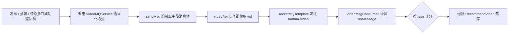

# 小视频行为进推荐链路：给视频补 vid、发送行为消息、消费计分落库

圈子推荐的完整链路已经跑通：业务代码埋点发消息，推荐工程消费计分，Spark 离线训练，Redis 存结果。小视频作为第二种内容形态，推荐方案照搬同一套模式，动手时会发现差异集中在三个地方：视频同样缺一个推荐模型认的数字 id；行为类型比圈子少，计分规则得单独定一条；topic、评分集合、消费者类都要一套新的，不能和圈子混用。

两个视频连讲这段链路的两端：发送侧改造视频实体并埋点发消息，接收侧在推荐工程里把消息解析成评分记录落库。两端对着写，才能看清消息体里每个字段是被谁消费的。

## 先给结论

- `Video` 实体新增 `Long vid` 字段，复用圈子侧已有的 Redis 自增发号器 `IdService`，type 传 `video` 独立计数，一行代码接入。
- 小视频计分规则四条：发视频 2 分、点赞 5 分、取消点赞 -5 分、评论 10 分，type 编号与之一一对应，未知 type 记 0 分。
- 发送收口在 `VideoMQService`：私有 `sendMsg` 组装 videoId、userId、date、vid、type 五个字段，发往 topic `tanhua-video`；发送前按主键反查一次视频才能拿到 vid。
- 消费端 `VideoMsgConsumer` 落库 `RecommendVideo`，按天写 `recommend_video_yyyyMMdd`；发布分固定 2 分，消费端不需要回查视频正文。
- 埋点铁律与圈子一致：业务成功之后才发消息，`saveVideo` 因此从返回布尔值改为返回主键。

## 一、给 Video 补上自增长 vid

ALS 矩阵分解只认整数编号，动态当年靠自增长 pid 解决了这个问题，视频的主键同样是二十四位的 ObjectId，类型墙原样摆在面前。圈子侧为此建的 `IdService` 是按 type 参数化的发号器：Redis `INCR` 出号，Hash 登记 ObjectId 与数字 id 的映射。这套服务天生就是给后续内容形态留的口子，视频接入只需要把 type 从 `publish` 换成 `video`，号尺 `TANHUA_ID_VIDEO` 与映射 `TANHUA_HASH_ID_VIDEO` 各自独立计数，互不干扰。

实体改造放在 dubbo 服务工程的 pojo 模块，`Video` 在原有字段中间插入一个 vid：

```java
@Data
@NoArgsConstructor
@AllArgsConstructor
@Document(collection = "video")
public class Video implements java.io.Serializable {

    private static final long serialVersionUID = -3137323368493387L;

    private ObjectId id; //主键id
    private Long vid; //自增长id，供推荐系统使用
    private Long userId; //用户id
    private String title; //标题
    private Integer seeType; //谁可以看：1-公开，2-私密
    private String picUrl; //封面图
    private String videoUrl; //视频地址
    private String longitude; //经度
    private String latitude; //纬度
    private String locationName; //位置名称
    private Long created; //创建时间
}
```

保存逻辑同步改造，两件事一起办：生成 vid，返回值换成主键。`VideoApi.saveVideo` 的返回类型从 `Boolean` 改成 `String`，实现类在保存前先把 vid 领出来：

```java
@Override
public String saveVideo(Video video) {
    if (video.getUserId() == null) {
        return null;
    }
    video.setId(ObjectId.get());
    video.setCreated(System.currentTimeMillis());
    //生成vid：type 为 video，映射键取主键的十六进制字符串
    video.setVid(this.idService.createId("video", video.getId().toHexString()));
    this.mongoTemplate.save(video);
    return video.getId().toHexString();
}
```

返回值改造在发送侧还没出场，但它马上就要用：埋点必须知道刚发布的视频是哪一个，布尔值给不了这个信息。另外发送侧还要按主键反查视频，所以 `VideoApi` 里同时补一个查询方法：

```java
/** 根据id查询视频 */
Video queryVideoById(String id);
```

实现就是一次 `findById`，后续取 vid、回查详情都靠它。

## 二、计分规则与发送收口 VideoMQService

计分规则是消费端算分的唯一依据，先把表定下来再写代码：

| type | 行为 | 分值 |
| --- | --- | --- |
| 1 | 发视频 | 2 |
| 2 | 点赞 | 5 |
| 3 | 取消点赞 | -5 |
| 4 | 评论 | 10 |

与圈子规则对照，有两处刻意的不同。小视频没有浏览与喜欢两类行为，七条规则缩成四条；发布分固定 2 分，不再按文字长度与图片数折算，视频的内容质量靠封面与时长，文本规则套不上。取消点赞给 -5 分延续了圈子的对称设计，抵消掉之前那次点赞的正分，行为流水才能表达净偏好。

发送逻辑收口在 server 工程新建的 `VideoMQService`，结构与圈子的消息服务如出一辙：私有 `sendMsg` 负责组装与发送，公开方法用语义化命名包住 type 编号：

```java
@Service
public class VideoMQService {

    private static final Logger LOGGER = LoggerFactory.getLogger(VideoMQService.class);

    @Autowired
    private RocketMQTemplate rocketMQTemplate;

    @Reference(version = "1.0.0")
    private VideoApi videoApi;

    /**
     * 通用发送：组装消息体并发往小视频 topic
     * @param type 行为类型，与计分规则编号一致
     * @param videoId 视频主键（ObjectId 的字符串形式）
     */
    private Boolean sendMsg(Integer type, String videoId) {
        try {
            User user = UserThreadLocal.get();
            //消息体里没有 vid，先按主键反查一次视频
            Video video = this.videoApi.queryVideoById(videoId);
            Map<String, Object> msg = new HashMap<>();
            msg.put("videoId", videoId);
            msg.put("userId", user.getId());
            msg.put("date", System.currentTimeMillis());
            msg.put("vid", video.getVid());
            msg.put("type", type);
            this.rocketMQTemplate.convertAndSend("tanhua-video", msg);
            return true;
        } catch (Exception e) {
            //发送消息不能影响业务主流程，失败只记日志
            LOGGER.error("小视频消息发送失败，type = " + type + ", videoId = " + videoId, e);
        }
        return false;
    }

    /** 发送发布小视频消息，type = 1 */
    public Boolean videoMsg(String videoId) { return this.sendMsg(1, videoId); }

    /** 发送点赞消息，type = 2 */
    public Boolean likeVideoMsg(String videoId) { return this.sendMsg(2, videoId); }

    /** 发送取消点赞消息，type = 3 */
    public Boolean disLikeVideoMsg(String videoId) { return this.sendMsg(3, videoId); }

    /** 发送评论消息，type = 4 */
    public Boolean commentVideoMsg(String videoId) { return this.sendMsg(4, videoId); }
}
```

消息体五个字段各有归属：`videoId` 是 ObjectId 主键字符串，留给需要回查正文的场景；`vid` 是推荐模型里的 item 标识；`userId` 从 `UserThreadLocal` 取当前登录用户；`date` 是行为发生时间，训练集与测试集的切分依据；`type` 决定分值。topic 定为 `tanhua-video`，与圈子的 topic 并列，两侧消费者互不串台。

发送链路全景如下图：



关键路径在反查那一步：消费端要用 vid 算分，发送端不把 vid 塞进消息体，消费端就得每条消息回查一次视频，互动高峰下白白放大 MongoDB 压力。

## 三、Controller 埋点：业务成功之后才发消息

埋点位置有一条铁律，先落库成功，再发消息，失败的操作不产生评分。四个接口的埋点方式各有代表性。

发布视频的埋点依赖返回值改造，保存成功后拿到主键再发消息：

```java
@Autowired
private VideoMQService videoMQService;

@PostMapping
public ResponseEntity<Void> saveVideo(@RequestParam(value = "videoThumbnail", required = false) MultipartFile picFile,
                                      @RequestParam(value = "videoFile", required = false) MultipartFile videoFile) {
    try {
        //saveVideo 已改造为返回视频主键
        String videoId = this.videoService.saveVideo(picFile, videoFile);
        if (StringUtils.isNotEmpty(videoId)) {
            //发布成功后发送推荐消息
            this.videoMQService.videoMsg(videoId);
            return ResponseEntity.ok(null);
        }
    } catch (Exception e) {
        e.printStackTrace();
    }
    return ResponseEntity.status(HttpStatus.INTERNAL_SERVER_ERROR).build();
}
```

点赞接口的埋点难点在于它复用了动态点赞逻辑：视频的点赞直接委托给 `MovementsController` 的同名方法，把视频 id 当动态 id 传进去，计数落在同一套 Redis 点赞体系里。复用没问题，但要判断委托调用是否真的成功再发消息：

```java
@PostMapping("/{id}/like")
public ResponseEntity<Long> likeComment(@PathVariable("id") String videoId) {
    //复用动态点赞逻辑，入参换成视频id
    ResponseEntity<Long> entity = this.movementsController.likeComment(videoId);
    if (entity.getStatusCode().is2xxSuccessful()) {
        //点赞成功后发送推荐消息
        this.videoMQService.likeVideoMsg(videoId);
        return entity;
    }
    return ResponseEntity.status(HttpStatus.INTERNAL_SERVER_ERROR).build();
}
```

取消点赞的同款写法换成 `disLikeVideoMsg`。评论接口同样复用动态评论体系，把视频 id 塞进请求参数的 `movementId` 字段，评论保存成功后发 type 4 的消息：

```java
@PostMapping("/{id}/comments")
public ResponseEntity<Void> saveComments(@RequestBody Map<String, String> param,
                                         @PathVariable("id") String videoId) {
    //评论落在动态评论体系里，把视频id塞进movementId字段
    param.put("movementId", videoId);
    ResponseEntity<Void> entity = this.commentsController.saveComments(param);
    if (entity.getStatusCode().is2xxSuccessful()) {
        //评论成功后发送推荐消息
        this.videoMQService.commentVideoMsg(videoId);
    }
    return entity;
}
```

小视频评论列表接口不发消息，查询行为不计分，这是与圈子规则一致的选择。

## 四、消费端：解析、计分、落库

推荐工程 `tanhua-recommend` 在圈子消费者旁边新增视频消费者。落库结构 `RecommendVideo` 与圈子的评分实体同构，三元组加时间戳，只是 item 字段换成 vid：

```java
@Data
@NoArgsConstructor
@AllArgsConstructor
public class RecommendVideo {
    //MongoDB 主键
    private ObjectId id;
    //操作人 id
    private Long userId;
    //视频的自增长 vid，即推荐模型里的 item 标识
    private Long videoId;
    //本条行为对应的得分
    private Double score;
    //行为发生时间戳，用于按时间切分训练集与测试集
    private Long date;
}
```

消费者实现 `RocketMQListener<String>`，注解声明监听 `tanhua-video`、属于消费组 `tanhua-video-consumer`：

```java
@Component
@RocketMQMessageListener(topic = "tanhua-video",
        consumerGroup = "tanhua-video-consumer")
public class VideoMsgConsumer implements RocketMQListener<String> {

    private static final Logger LOGGER = LoggerFactory.getLogger(VideoMsgConsumer.class);
    private static final ObjectMapper MAPPER = new ObjectMapper();

    @Autowired
    private MongoTemplate mongoTemplate;

    @Override
    public void onMessage(String msg) {
        try {
            //消息体是 JSON 字符串，readTree 解析出所需字段
            JsonNode jsonNode = MAPPER.readTree(msg);
            Long userId = jsonNode.get("userId").asLong();
            Long vid = jsonNode.get("vid").asLong();
            Integer type = jsonNode.get("type").asInt();
            //1-发视频，2-点赞，3-取消点赞，4-评论
            RecommendVideo recommendVideo = new RecommendVideo();
            recommendVideo.setId(ObjectId.get());
            recommendVideo.setUserId(userId);
            //推荐模型认的是自增长 vid，不是 ObjectId
            recommendVideo.setVideoId(vid);
            recommendVideo.setDate(System.currentTimeMillis());
            switch (type) {
                case 1: { recommendVideo.setScore(2d);  break; } //发视频
                case 2: { recommendVideo.setScore(5d);  break; } //点赞
                case 3: { recommendVideo.setScore(-5d); break; } //取消点赞
                case 4: { recommendVideo.setScore(10d); break; } //评论
                default: { recommendVideo.setScore(0d); break; }
            }
            //按天分表写入
            String collectionName = "recommend_video_" + new DateTime().toString("yyyyMMdd");
            this.mongoTemplate.save(recommendVideo, collectionName);
        } catch (Exception e) {
            LOGGER.error("小视频消息处理失败！msg = " + msg, e);
        }
    }
}
```

与圈子消费者有一处值得对照的差异：这里没有回查正文的分支。圈子的发动态消息要回查 `Publish` 算内容分，而视频的发布分固定 2 分，消息里带 vid 就够写库，消费路径全程零回查，吞吐反而更好。消息体里的 videoId 字段在计分时确实用不到，留着它是给需要正文的下游场景备的。

重启 dubbo 服务工程与 server 工程（SSO 与 MQ 集群不动），用 REST 客户端带两个文件参数发布一条小视频，在消费者 `onMessage` 与保存动作上打断点单步走：断点里能看到消息解析出的 userId、vid、type，落库对象的 score 是 2.0；刷新 MongoDB 的 `recommend_video_20191007` 集合，出现第一条评分记录。再对一个已有视频的点赞接口发 POST 请求，第二条记录落库，score 为 5.0。发送与接收两端各自验证通过，评分流水开始积累。

## 常见误区

- **type 编号直接照抄圈子的。** 错例：把点赞写成 3，沿用圈子的编号习惯。正解：两套规则各自独立，视频的 2 是点赞、3 是取消点赞，发送端与消费端的编号表必须逐条对齐，否则计分整体错位。
- **消息体里只放 videoId 不放 vid。** 错例：消费端拿 ObjectId 字符串当 item 写进评分表。正解：算法侧只认整数，发送端反查时把 vid 一并放进消息体，消费端落库取 vid。
- **发送逻辑不做异常兜底。** 错例：`convertAndSend` 抛出连接异常，用户发视频直接收到 500。正解：sendMsg 全程包在 try-catch 里，失败只记 error 日志，主业务照常成功。
- **把取消点赞漏掉。** 错例：只埋点赞消息，取消点赞不产生任何记录。正解：取消类行为必须落负分流水，只记正分会让用户画像虚高，之前点过赞再取消的偏好完全丢失。

## 面试可能被问到的问题

1. 面试官追问：「小视频的发布分为什么固定 2 分，而动态发布要按文字与图片折算？」
   答：动态的内容主体是文本与图片，字数、图数可以直接量化成内容贡献；小视频的内容主体是视频本身，文本字段很弱，硬套长度规则没有意义，课程选择给固定的 2 分。规则本质是可配置的业务决策，两种形态各自定表即可。
2. 面试官追问：「消息体里 videoId 和 vid 为什么同时存在？」
   答：两者是同一视频的两套标识。videoId 是 ObjectId 字符串，用于回查视频详情；vid 是自增长数字 id，推荐模型里的 item 标识。发送端一次反查把两个都放进消息体，消费端计分只取 vid，需要正文时用 videoId 回查，避免逐条消息打数据库。
3. 面试官追问：「视频点赞直接复用动态点赞逻辑，这种复用有什么隐患？」
   答：复用省了代码，但评论场景里视频 id 塞进 movementId 字段后，评论集合里混着两类业务数据，后续按动态统计或做数据迁移时必须区分来源，否则数据语义会串。更清晰的做法是独立评论集合或加业务类型字段。
4. 面试官追问：「消费端每条消息插一行新记录，同一用户反复点赞怎么办？」
   答：点赞、取消点赞、再点赞会落成三条流水，正负分都有。离线计算时按用户与视频分组做评分合并，净分自然归一；流水不丢过程数据，规则调整后可以随时重算。
5. 面试官追问：「为什么视频的消费者可以做到零回查，圈子的不行？」
   答：计分所需的信息是否都在消息体里决定要不要回查。视频四类行为的分值全是常量，消息带上 vid 就够；圈子的发动态分依赖正文的文字长度与图片数，必须回查 Publish。想让消费者零回查，就把算分需要的字段在发送端备齐。

## 配套资料

- 学习目标：`materials/code/07/day08 探花交友-实现推荐功能/day08/学习目标.md`，「独立实现小视频的推荐功能」的前两个环节即发送消息与接收消息。
- 小视频业务口径：`materials/code/07/day04 探花交友-实现评论、小视频/day04/学习目标.md`，小视频发布、点赞、评论的既有链路来自 day04。
- 说明：day08 资料包仅含学习目标，无源码包；代码为按本课画面与主流写法补全，`IdService`、消息体结构与按天分表命名沿用圈子推荐链路的既有口径。
