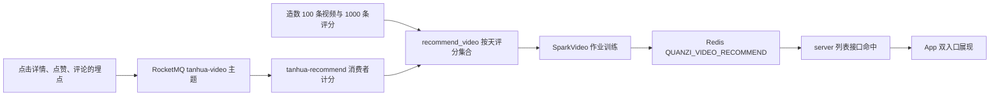

# App 端全链路验收：小视频推荐从造数到列表的真实跑通

单点验证全绿不等于链路打通。造数用例、Spark 作业、Redis 写回、列表分页各自都跑通过，只能说明每个部件在自己的工程里正常工作；把它们串成一条真实请求，中间任何一环错位，key 对不上、序列化不一致、消费者没启动，都会在最终列表上现形。整合测试就是把 App 当验收终端，按固定顺序点亮整条链路，顺带确认兜底逻辑没有丢。

## 先给结论

- 验收顺序：造数数据就位，dubbo 与 `tanhua-recommend`、server 工程启动，Spark 作业跑完写回 Redis，接口分页核对，App 双入口验证。
- 推荐生效的直观标志是序列不连续：列表条目的 pid 或 vid 跨度跳跃，不再是按时间的连续排布。
- 接口核对以 Redis 里的推荐串为基准，page 1 取前 10 个、page 2 取后 10 个，两页拼起来等于完整序列才算对齐。
- 测试时点击动态详情会触发埋点消息，行为持续回流到评分集合，验收过程本身也在给下一轮训练喂数据。
- 推荐条数与分页大小都是可调参数，按业务量级调整即可，链路各环节不感知这类变化。

## 一、验收前的链路检查单

链路涉及四个工程与三个基础服务，谁在跑、跑对没有，动手测之前先过一遍检查单。基础服务层面，Redis 集群与 MongoDB 常驻，RocketMQ 的 NameServer 与 Broker 在线；工程层面，dubbo 服务提供者先起，`tanhua-recommend` 工程随后启动并监听 `tanhua-video` 主题，server 工程最后以 debug 方式起，方便下断点，sso 工程在侧供 App 登录换 token；数据层面，`recommend_video_` 按天集合里要有造数产出的评分，Redis 里要有 Spark 写回的推荐串。整条链路的站点与依赖关系如下：



图里最值得留意的是回到 B 的那条回流边：验收不是只读不写，每一次详情浏览、点赞、评论都会产生新消息，评分集合持续增长，下一次 Spark 作业的输入就来自这些真实行为。

## 二、接口层核对：以 Redis 推荐串为基准对账

接口核对的对账基准在 Redis。进集群节点查目标用户的 key，拿到完整的 vid 推荐串：

```bash
redis-cli -c
127.0.0.1:6379> get QUANZI_VIDEO_RECOMMEND2
"1019,1041,1088,1023,1028,1065,1031,1086,1046,1052,1053,1056,1063,1048,1061,1073,1027,1036,1077,1059"
```

20 个 vid 就是这个用户的全部推荐。REST 客户端请求列表接口，GET 带上 `page=1&pagesize=10` 与 Authorization 头，返回的 content 里逐条对账，条目顺序应与推荐串的顺序一致（响应为脱敏示例，id 取推荐串中的 vid，昵称按编号改写为 user_N，图片地址以 example.com 占位）：

```json
{
  "code": 0,
  "message": "success",
  "data": {
    "content": [
      {
        "id": 1019,
        "cover": "http://example.com/images/20200808/1596874888656.jpg",
        "title": "【视频】",
        "author": "user_3",
        "authorId": 3,
        "commentCount": 0
      }
    ]
  }
}
```

把 page 换成 2 再请求一次，取到的是推荐串后 10 个 vid 对应的视频，两页拼起来正好覆盖 20 条推荐。如果 Redis 串与接口返回对不齐，问题必然出在 key 的拼接、序列化器或截取逻辑上，倒着查就是了。

## 三、App 端双入口验证与行为回流

App 里有两个入口消费这份推荐。圈子页切到「推荐」标签，下拉浏览时相邻动态的 pid 跳跃明显，3、4 之后直接跳到 16、27，这就是推荐顺序，与按时间倒序的默认列表一眼可辨；点击某条动态进详情页，返回再滚动，顺序依旧稳定，说明数据来自 Redis 里的固定串而不是每次现查。切到「发现」页进入小视频入口，缩略图的排列同样不再是最新发布在前，先后顺序对应推荐串里的 vid 次序。

详情浏览这个动作本身还在给推荐系统回血。单条动态详情接口在返回数据之前顺手发了一条消息：

```java
@GetMapping("id")
public ResponseEntity<Movements> queryMovementsById(
        @RequestParam("id") Long id) {
    Movements movements = this.movementService.queryById(id);
    if (null != movements) {
        // 发送消息，浏览行为作为埋点进入圈子推荐链路
        this.quanziMQService.sendMovements(movements);
        return ResponseEntity.ok(movements);
    }
    return ResponseEntity.notFound().build();
}
```

小视频侧同理，点赞与评论的行为经 `tanhua-video` 主题流向消费者。验收期间的真实操作都会变成评分流水，等下一轮离线作业执行，推荐结果就会体现出测试期间的行为偏好，这才是「在线产生行为、离线消化行为」的完整闭环。

## 四、三把尺子：推荐真的生效了吗

**第一把尺子是逐位对账。** Redis 串与接口返回的 vid 序列逐位比对，全部一致说明查询侧读写的 key、截取、回查都对。

**第二把尺子是序列形态。** 推荐列表的 pid、vid 序列天然不连续，跨度跳跃且与时间无关；若看到的仍是连续编号按时间排布，多半是没命中推荐走了兜底路径。

**第三把尺子是兜底可用。** 换一个没有推荐数据的用户再请求，列表仍有内容且按时间倒序，说明命中与未命中两条路径并存，推荐系统任何一环挂掉都不会让首页空白。

数量层面还有一处自由度：每用户推荐 20 条、每页展示 10 条都是参数，业务上想首屏更丰富就把推荐条数与分页调大，链路其他环节不感知这类变化。

## 常见误区

- **只看接口不看 App。** 错例：REST 客户端返回结构正确就认为整合完成，App 端实际登录的账号与接口验证用的用户不一致，看到的仍是另一份数据。正解：App 用真实账号登录走一遍，接口与端两侧都确认。
- **Redis 有值但接口未命中。** 错例：redis-cli 里 key 存在，断点里 `redisValue` 却是 null，常见原因是 key 拼接差一个下划线或 value 序列化器不匹配。正解：key 前缀抽成常量两端共用，序列化与 Spark 写入的字节形态对齐。
- **验收期间忽略消费者状态。** 错例：`tanhua-recommend` 没启动，测试期间的点赞评论没人消费，评分集合不变，下一轮推荐毫无变化，还误以为是模型问题。正解：验收前确认消费者在线，MQ 控制台看消费位点在动。
- **把兜底路径误判成推荐生效。** 错例：序列连续、按时间排序，却当成推荐结果展示成功。正解：记住推荐序列不连续这个形态特征，不确定就回到 Redis 对账。

## 面试可能被问到的问题

1. 面试官追问：「推荐功能上线前，你的验收方案怎么设计？」
   答：按数据流分层验收。先核对离线产物，Redis 里每个用户一把 key、20 个 vid 与造数区间吻合；再核对在线接口，两页请求与 Redis 串逐位对账；最后在真实 App 上确认展现与兜底。每层都有明确的基准数据，出问题能定位到层。
2. 面试官追问：「怎么判断用户看到的是推荐列表还是兜底列表？」
   答：看序列形态。推荐列表的 id 序列不连续且与时间无关，兜底列表按时间倒序；代码层面在 Service 命中判断处打日志或断点，命中时记录 key 与串长度，统计个性化覆盖率也靠这个口径。
3. 面试官追问：「测试期间的用户行为会被下次推荐用到吗？」
   答：会。行为埋点发往 MQ，消费者算分落库到按天评分集合，Spark 作业每次训练都读最新的集合，用户在测试期间的偏好会在下一轮推荐里体现。这也是离线推荐天然的数据飞轮，只是生效周期取决于作业调度频率。
4. 面试官追问：「推荐结果的数量和分页大小怎么定？」
   答：推荐条数取决于离线侧 recommendProducts 的 topN 参数，考虑首屏加翻页的消费量即可，太长则尾部置信度低还浪费存储；分页大小与前端交互有关，每页 10 条在移动端瀑布流是常见取值。两者解耦，改动互不影响。

## 配套资料

- 学习目标：`materials/code/07/day08 探花交友-实现推荐功能/day08/学习目标.md`，「独立实现小视频的推荐功能」的整合验证环节即本节内容。
- 小视频列表与埋点口径：`materials/code/07/day04 探花交友-实现评论、小视频/day04/学习目标.md`，小视频列表与动态详情的原始逻辑来自 day04。
- 说明：day08 资料包仅含学习目标，无源码包；接口响应与验收步骤按本课画面整理，昵称与图片地址已脱敏为 user_N 与 example.com 占位。
