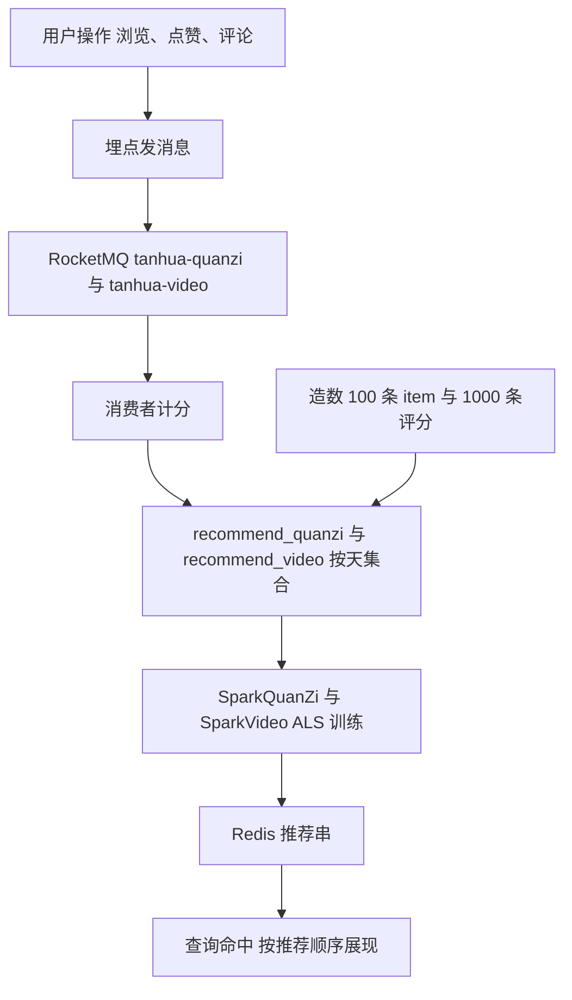

# day08 复盘：一条 ALS 链路撑起两种内容推荐

day08 的主题只有一句话：把推荐从算法课上的示例变成项目里跑得通的功能。圈子动态与小视频两种内容形态，共用一套骨架各落位一次，编码、造数、训练、命中、整合测试全部走完，链路在 App 端闭环。收尾这一课用复盘视角把骨架重新串一遍，把「哪些代码要会写、哪些看懂就够」的边界划清楚，再交代遗留问题与 day09 的走向。

## 先给结论

- day08 完成两条推荐链路：圈子动态推荐与小视频推荐，同一套骨架两次落位，差异只在参数。
- 骨架七站：数字身份（pid、vid）、行为计分规则、消息埋点与消费、按天评分集合、Spark ALS 训练、Redis 结果、查询命中。
- 造数是训练前提：100 条 item 配 1000 条评分，item 区间与评分引用区间必须严格对齐。
- 模型层代码（MLlibRecommend 训练择优）看懂即可，业务推荐代码（两个 Spark 计算类、消费与查询改造）要求能独立编写。
- 遗留问题明确：没有推荐数据的用户首页可能空白，day09 以默认推荐列表开篇补齐。

## 一、全景复盘：行为到列表的七站

整条链路的功能起点是用户对内容的交互。用户对动态或视频产生浏览、点赞、评论等操作，这些操作带着权重被记成分数，分数随消息流动、被消费落库，最终由 Spark 训练成推荐写回 Redis。两条内容形态的站点完全对称：



图里从 A 到 I 的每一站都是模式里的固定桩位，将来接入第三种内容形态，照图填参数即可。逐站复盘：

**第一站，数字身份。** MongoDB 的 ObjectId 没法进 ALS 的 Rating，圈子给动态加了自增长的 pid，小视频给视频加了自增长的 vid，整型数字身份是推荐模型可用的前提。这一步的实体设计在动态对象上体现得最直接：

```java
@Data
@AllArgsConstructor
public class Publish implements java.io.Serializable {
    private static final long serialVersionUID = 8732108321082804771L;
    private ObjectId id; //主键
    private Long pid; //long类型id，用于推荐能使用
    private Long userId;
    private String text; //文字
    private List<String> medias; //媒体url
    private Integer seeType; //谁可以看，1-公开，2-私密，3-部分可见，4-不给谁看
    private String longitude; //经度
    private String latitude; //纬度
    private String locationName; //位置名称
}
```

pid 字段的注释把设计意图写得很清楚，id 与 pid 并存，一个是文档主键，一个是推荐用的数字身份。

**第二站，计分规则。** 浏览、点赞、评论各按权重记分，规则在动态计分规则一节定死，发送端与消费端按同一张表执行，谁发什么消息、记多少分都有据可依。

**第三站，消息埋点与消费。** 业务动作发生时发消息到 topic，圈子是 `tanhua-quanzi`，小视频是 `tanhua-video`；推荐工程的 QuanZiMsgConsumer 与 VideoMsgConsumer 各监听一个主题，解析消息、按规则算分、写按天集合。

**第四站，按天评分集合。** `recommend_quanzi_` 与 `recommend_video_` 加日期后缀，一天一个集合，Spark 读哪个集合由配置决定，日期也天然给了训练集与测试集切分的依据。

**第五站，ALS 训练。** 评分合并去重后交给 MLlibRecommend 的 bestModel，多组参数训练、按误差择优，返回矩阵分解模型。

**第六站，Redis 结果。** 逐用户取 top20，拼成逗号分隔串写进 `QUANZI_PUBLISH_RECOMMEND_` 与 `QUANZI_VIDEO_RECOMMEND` 两个前缀的 key，写完关闭集群连接。

**第七站，查询命中。** Service 内部分叉，命中走推荐顺序分页，未命中走原有逻辑，接口契约不变，App 无感知。

## 二、两种内容形态只差参数

两条链路同构，「复用」二字落在哪些参数上，对照表一眼看穿：

| 桩位 | 圈子动态 | 小视频 |
| --- | --- | --- |
| 数字身份 | pid | vid |
| topic | tanhua-quanzi | tanhua-video |
| 消费者 | QuanZiMsgConsumer | VideoMsgConsumer |
| 评分集合 | recommend_quanzi_日期 | recommend_video_日期 |
| Spark 计算类 | SparkQuanZi | SparkVideo |
| Redis key 前缀 | `QUANZI_PUBLISH_RECOMMEND_` | `QUANZI_VIDEO_RECOMMEND` |

复用的方法论可以提炼成一句话：先为一种内容形态把七站打通，第二种形态按表逐项换参数，链路代码几乎零改动。day08 的编码量主要集中在第一条链路，第二条链路以拷贝加替换完成，前后速度的差异就是模式价值的直接证据。

## 三、能力分级：看懂与会写的边界

课程对这一天的代码给了明确的能力要求。MLlib 模型层，包括 bestModel 里的数据切分、多参数训练与择优，这部分逻辑在 day07 已经写过一遍，day08 只是封装复用，能看懂即可；业务推荐层，从计分消费者、Spark 计算类到查询改造，要求能独立编写，因为这才是把 MLlib 套到具体业务上的那一段。套用面收敛成三行代码：

```java
MLlibRecommend mllibRecommend = new MLlibRecommend();
MatrixFactorizationModel bestModel = mllibRecommend.bestModel(ratings);
Recommendation[] recommendations = bestModel.recommendProducts(userId.intValue(), 20);
```

判断标准也很实用：给定第三种内容形态，能否不看旧代码独立把七站铺出来。能，就说明学到位了；不能，回去把业务层的拷贝替换过程亲手再走一遍。

## 四、遗留问题与 day09 走向

链路闭环后还剩一个显眼的空白：推荐只覆盖出现在评分集合里的用户，新注册用户、清库后的测试环境，查询侧永远走兜底，首页个性化区域可能无内容可展示。day09 的第一件事就是补默认推荐列表，给无推荐用户一份可用的数据。再往后是推荐对象的转向：从推荐内容转向推荐人，好友推荐要用同样的 Spark MLlib 套路回答「把谁推给谁」，与内容推荐的差异会在当天展开。谁看过我、今日佳人详情、聊一下、上报地理位置四个功能也排在 day09 的清单里，项目功能版图由此补全。

## 常见误区

- **把复用理解成重写。** 错例：做小视频推荐时从头再写一遍消费者与训练逻辑，工作量翻倍。正解：按对照表逐项换参数，主干拷贝改名，差异点集中检查。
- **区间对齐被忽略。** 错例：造数时 item 区间 1000 到 1099，评分却引用了区间外的 id，ALS 训练报错或产出悬空推荐。正解：造数代码里两个区间用同一个常量或表达式生成。
- **两类 key 前缀混用。** 错例：视频结果写进圈子的 `QUANZI_PUBLISH_RECOMMEND_` 前缀，查询侧互相串数据。正解：每种形态一套独立前缀，读写两端用常量约定。
- **模型层代码死记硬背。** 错例：逐行背 bestModel 的调参细节，业务层反而写不出来。正解：按课程的能力分级要求，模型层看懂、业务层会写，精力分配要对。

## 面试可能被问到的问题

1. 面试官追问：「项目里推荐功能的技术方案一句话怎么说？」
   答：用户行为经 MQ 埋点进入推荐系统，消费者按规则计分落库到按天评分集合，Spark 离线用 ALS 矩阵分解训练模型并逐用户生成 topN 推荐，结果写 Redis，在线查询优先命中推荐串、未命中回落原有查询逻辑。
2. 面试官追问：「为什么要给文档加自增长 pid、vid？」
   答：ALS 的 Rating 要求用户与物品都是可计算的整型标识，MongoDB 的 ObjectId 不满足；自增长数字身份轻量、可预测，造数与对账都方便。ObjectId 与 pid 在文档里并存，各司其职。
3. 面试官追问：「两种内容形态共用一条链路，好处是什么？」
   答：工程上少维护一套模式，埋点、消费、训练、命中每个环节的行为都是已知且被验证过的，新形态接入只换参数；质量上，第二条链路的验证成本极低，因为模式的每个坑都已经踩过一遍。
4. 面试官追问：「评分数据按天存集合有什么讲究？」
   答：一是读写隔离，当天的行为写当天集合，历史集合不可变，利于增量计算；二是训练时可按日期选取输入范围，天然形成时间切分，训练集与测试集的划分依据就在这里。
5. 面试官追问：「推荐功能目前还有哪些不足？」
   答：覆盖面有限，没有行为的新用户拿不到个性化结果，需要默认推荐兜底；结果更新依赖离线作业周期，实时性有限；模型超参与 topN 都是经验值，缺少在线评估闭环。这些缺口在后续课程里逐步补。

## 配套资料

- 学习目标：`materials/code/07/day08 探花交友-实现推荐功能/day08/学习目标.md`，从「了解圈子推荐功能的流程」到「独立实现小视频的推荐功能」即 day08 全部主线。
- ALS 编码主线：`materials/code/07/day07 探花交友-SparkMLlib推荐系统快速入门/day07/资料/ml-100k/`，bestModel 的训练择优逻辑承接 day07 的编码实战。
- 说明：day08 资料包仅含学习目标，无源码包；Publish 实体与链路代码为按本课画面整理补全，包名统一改写为 `com.study.tanhua` 系。
