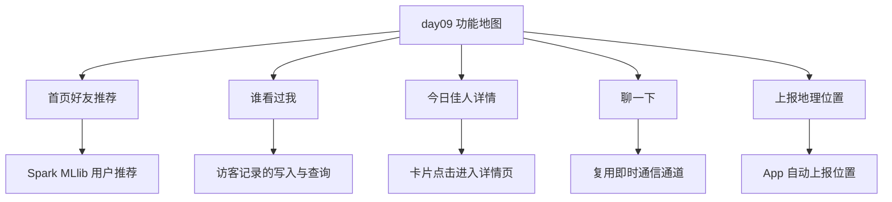

# day09 功能地图：从内容推荐转向好友推荐的一天

day08 把内容推荐闭环之后，day09 的重心发生了一次转向：推荐对象从动态、视频这些内容变成「人」。首页好友推荐要用 Spark MLlib 回答把谁推给谁，同时还有四个补全型功能排在清单里：谁看过我、今日佳人详情、聊一下、上报地理位置。课程说明一课信息密度不高，但功能边界与目标划分值得在动手前先想清楚，五个交付物各对应什么技术点，本节一次理顺。

## 先给结论

- day09 的功能清单：首页好友推荐、谁看过我、今日佳人详情、聊一下、上报地理位置，与 day09 学习目标五条逐一对得上。
- 好友推荐复用 Spark MLlib 套路，但推荐对象从内容变成用户，数据源与评分语义都要重新定义。
- 今日佳人与推荐列表此前只做了取数与展现，点击卡片之后的详情页与「聊一下」入口是本轮补全的重点。
- 上报地理位置是支撑型功能，App 自动把用户位置上报给服务端，为后续按地理位置查询用户的功能铺路。
- 课程说明画面里已经出现 `tanhua.sso.default.recommend.users` 配置项，无推荐数据时的默认列表策略即将落地。

## 一、五块功能与目标映射

学习目标给 day09 定了五条可验收的产出，对应到功能与支撑关系：



图里五个叶子节点就是当天的交付物。好友推荐占据编码量的大头，其余四个属于补全与支撑性质，但一个都不能少：地理位置尤其特殊，它服务的不是当天的页面，而是后续按位置搜人这类功能的前置条件。

## 二、好友推荐与内容推荐差在哪

圈子与小视频推荐的推荐对象是 item，用户对内容的行为就是评分来源，ALS 的三元组是「用户、内容、分」。好友推荐把 item 换成了人，三元组变成「用户、用户、缘分分」，评分语义从「对内容的兴趣强度」变成「两个人之间的匹配程度」，匹配的依据是双方的基础资料、活跃度与互动记录。骨架仍是那七站：userId 天然就是数字身份，省掉了造 pid、vid 的一步，计分、落库、Spark 训练、结果存储、查询命中照旧走。差异集中在输入端：内容推荐的评分集合来自行为埋点，好友推荐的缘分数据来自用户画像与关系计算的产出。动手前先把三问答清楚，推荐什么、评分从哪来、结果给谁看，后面的编码就有了靶心。

## 三、谁看过我、今日佳人详情与聊一下

谁看过我是首页的第二块新功能：其他用户查看我的资料时记一条访客记录，我可以查询最近谁看过我，写入与查询两头都要做。今日佳人在 day02 已实现取数与展现，当时卡片上那位缘分值最高的用户点不出详情，本轮把点击后的详情页补全，头像、昵称、年龄、标签与缘分值一应展示。聊一下则是从列表或详情页直接向对方发起会话，即时通信通道此前已接入，本轮做的是入口与业务链路的串联。

## 四、上报地理位置：为搜附近铺路

地理位置上报的逻辑是 App 在使用过程中自动把定位信息上报给服务端，服务端存下来才有得查。它为什么必须先做：后续要实现按地理位置查询附近用户的功能，距离计算依赖每个用户的经纬度，没有上报就没有数据，搜附近无从谈起。这个功能在当天只做上报与存储的通道，查询侧留给后续课程，属于典型的先铺路、后跑车。

课程说明的画面里还出现了下一节的配置项，无推荐数据时的默认名单已经提前预告：

```properties
#application.properties
tanhua.sso.default.recommend.users=2,3,4,5,6,7,8,9,10,11,12,13
```

默认推荐列表正是 day09 编码的第一站，配置化的白名单让没有任何行为的新用户也能看到一份可用的推荐。

## 常见误区

- **把好友推荐当成内容推荐的换皮。** 错例：直接把动态评分集合换成好友集合就开训，评分语义根本不同，模型学不到有效信号。正解：先重新定义缘分分的来源与含义，再复用骨架。
- **轻视支撑型功能。** 错例：认为上报地理位置只是个小接口，排到最后再做，结果后续功能全被卡住。正解：没有位置数据，所有按位置查询的功能都没有输入，优先级要按依赖关系排。
- **目标清单不对照。** 错例：只顾写好友推荐，把谁看过我、聊一下漏掉，day09 的验收目标不完整。正解：以学习目标五条为清单，动手前逐条规划。

## 面试可能被问到的问题

1. 面试官追问：「用户推荐和内容推荐在系统设计上有什么不同？」
   答：骨架可以复用，差异在输入与语义。内容推荐的三元组是用户、内容、行为分，评分来自埋点；用户推荐的三元组是用户、用户、缘分分，评分来自画像匹配与互动记录。存储、训练、服务形态一致，输入管道要重建。
2. 面试官追问：「为什么 App 要主动上报地理位置？」
   答：服务端的按位置查询、附近的人这类功能都依赖用户的经纬度数据，数据只能来自端上定位。上报是采集通道，缺了它，服务端任何地理计算都是空转，所以它是前置功能。
3. 面试官追问：「谁看过我这个功能的数据该怎么设计？」
   答：一条访客记录至少包含访客 id、被访者 id、访问时间，写入在查看资料的链路里顺手完成，查询按被访者维度倒序取最近若干条；量级上来后要考虑按被访者分桶或限制保留时长，避免无限增长。
4. 面试官追问：「新用户没有任何行为，好友推荐怎么给他结果？」
   答：两条路。一是默认推荐列表，用配置的白名单手工拼推荐数据，保证有内容；二是随他填写的资料做冷启动匹配，按性别、年龄、地域筛选候选。课程里先做前者，配置项已经出现在课程说明的画面里。

## 配套资料

- 学习目标：`materials/code/07/day09 探花交友-好友推荐、今日佳人/day09/学习目标.md`，好友推荐、谁看过我、佳人信息、聊一下、地理位置五条目标即 day09 的完整清单。
- 说明：day09 资料包仅含学习目标，无源码包；功能地图与技术点映射按本课画面整理，配置示例为画面原样抄录，key 命名沿用课程口径。
