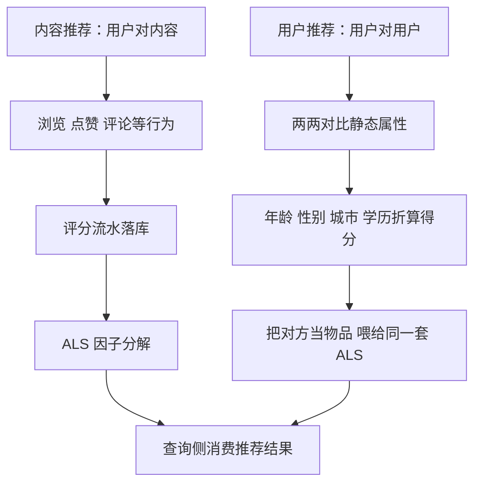
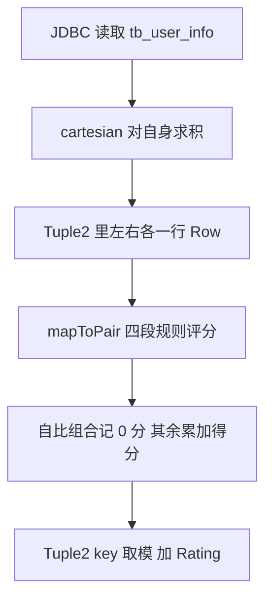
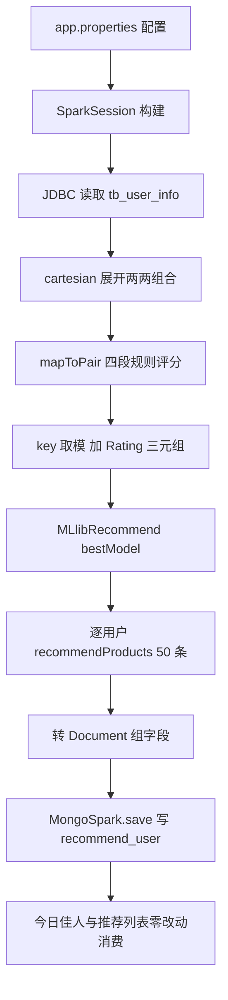

# 好友推荐全流程：属性相似度打分、Spark 两两对比与 recommend_user 落库

> 🔒 安全提示：文中示例的口令/密钥均为课程教学环境演示口径，生产环境的安全要求见《安全与合规须知》。

首页的推荐列表与今日佳人卡片早就能出数据，但那批数据是 day2 造数灌进去的 99 条 mock 记录，`toUserId` 清一色是 1；day9 开篇接上的默认推荐解决了「没数据也能看」，个性化依然无从谈起。缺的不是查询，是生产者：得有一个角色按真实用户数据算出「谁和谁有缘分」，把结果写进 `recommend_user`，查询侧一行不改就能从 mock 切换到真实推荐。这个生产者就是 Spark 程序 `SparkUserRecommend`。

它与 day8 的圈子、小视频推荐共用 `MLlibRecommend` 这套工具类，流程却不能照搬：内容推荐吃的是行为流水，用户推荐连一条行为都没有，可比的只剩人本身的属性。把「没有行为数据怎么算相似」想清楚，后面的代码只是把规则翻译成 RDD 算子。

## 先给结论

- 用户推荐与内容推荐的根本差异在数据：内容有浏览、点赞、评论这类行为可记分，用户之间没有直接行为，只能拿静态属性两两对比算相似度。
- 评分规则四条：年龄差 0～2 岁 30 分、3～5 岁 20 分、5～10 岁 10 分、10 岁以上 0 分；异性 30 分；同城 20 分；同学历 20 分，四项加起来恰好满分 100。
- Spark 程序用 SparkSession 的 JDBC 读取 MySQL 的 `tb_user_info`，`cartesian` 展开笛卡尔积两两对比，`mapToPair` 里按规则累加得分，自己与自己的组合记 0 分占位。
- 模型与落库：`MLlibRecommend.bestModel` 训出最优模型，逐用户 `recommendProducts` 50 条，转成 Document 写进 `recommend_user`；`JavaSparkContext` 必须从 SparkSession 派生，不能二次构建。
- 跑完数据，今日佳人换成得分最高的推荐用户，推荐列表按缘分值 96、92、86 倒序呈现，查询侧与默认推荐兜底全部零改动生效。

## 一、用户推荐与内容推荐的分野

内容推荐能跑起来，靠的是一张评分流水表：用户对每一条小视频或动态都可能有浏览、点赞、评论、喜欢这些操作，每次操作记一笔分，流水攒多了就是一张「用户 × 内容」的评分矩阵，ALS 拿它做因子分解就能预测用户对没见过的内容的兴趣。day8 的两条链路全建立在这个前提上。

用户推荐没有这个前提。用户与用户之间不存在「点赞了另一个用户」这类被系统记录的操作，没有操作就记不了分，评分矩阵无从谈起。但推荐的本质没变：先找到「相似」，再按相似程度排序。内容推荐里「相似」指口味相近，用户推荐里「相似」指条件相配，既然没有行为可比，就只剩人自身的属性可比：



关键的一步在图右下角：把「别的用户」当成「物品」，把「属性相似度得分」当成「评分」，用户推荐就变成了一个标准的评分预测问题，day7 以来的 ALS 流水线原封不动复用。这一步想通了，后面所有代码都只是机械劳动。

## 二、相似度评分规则：四项加满 100 分

具体怎么算相似，产品定义规则，课堂定下的口径是四项：

| 对比项 | 记分口径 |
| --- | --- |
| 年龄差 | 0～2 岁 30 分，3～5 岁 20 分，5～10 岁 10 分，10 岁以上 0 分 |
| 性别 | 异性 30 分，同性 0 分 |
| 城市 | 同城 20 分，不同 0 分 |
| 学历 | 相同 20 分，不同 0 分 |

每一条背后都是交友场景的常识。年龄差越小代沟越小、喜欢的内容越接近，差得越多分越低；交友平台的用户绝大多数对异性感兴趣，同性直接记 0；同城意味着线下见面的成本低，相似性和可交往性都更高；学历相同通常话题重合度更高。四项权重 30、30、20、20，合计正好 100，与查询侧缘分值 `fateValue` 的展示量纲天然对齐，不需要再做比例换算。

规则本身不是铁律。换一个产品定位，比如以兴趣社群为主的应用，学历和城市的权重可能整个掉个头，权重表跟着产品定义走，代码只需要改几个常量。课程反复强调这一点：规则是业务输入，程序负责忠实地执行规则。

这套规则还有一层对照价值。day2 造的 99 条 mock 推荐数据里，缘分值是随机撒的数字，只为把接口链路打通；本课算出来的分值每一分都对应一条业务语义，96 分能拆出「年龄差 1 岁、异性、同城、同本科」的解释，卡片上的缘分值从装饰数字变成可解释的推荐理由。mock 数据支撑开发联调，规则分支撑产品可信度，两者的分工在切换的那一刻看得最清楚。

## 三、工程准备：输出源换 MongoDB，输入源换 MySQL

Spark 工程在 day8 已经搭好，这一课做两件事：配置文件追加输出源与 JDBC 连接信息，工程引入 MySQL 驱动。`app.properties` 追加的部分：

```properties
# MongoDB 输出源：推荐结果写入 recommend_user 集合
spark.mongodb.output.uri = mongodb://192.168.31.81:27017/tanhua.recommend_user

# MySQL 连接信息：读取用户资料表
jdbc.url = jdbc:mysql://192.168.31.81:3306/tanhua?useUnicode=true&characterEncoding=utf8&useSSL=false&serverTimezone=Asia/Shanghai
jdbc.username = root
jdbc.password = 123456
jdbc.driverClassName = com.mysql.cj.jdbc.Driver
```

与 day8 的两个程序对照着看差别就清楚了：圈子与小视频是「读 MongoDB、写 Redis」，注册的是 `spark.mongodb.input.uri`；这一课反过来，「读 MySQL、写 MongoDB」，注册的是 `spark.mongodb.output.uri`。输出 URI 指向 `tanhua` 库的 `recommend_user` 集合，集合结构与 day2 今日佳人设计表结构时立下的口径完全一致，查询侧才能无缝衔接。驱动依赖只有一条：

```xml
<dependency>
    <groupId>mysql</groupId>
    <artifactId>mysql-connector-java</artifactId>
</dependency>
```

程序骨架与既有程序同款，先读配置再建上下文，唯一的新面孔是 SparkSession：

```java
public class SparkUserRecommend {

    public static void main(String[] args) throws Exception {
        //加载外部配置文件，与圈子、小视频程序同一套姿势
        InputStream inputStream = SparkUserRecommend.class.getClassLoader()
                .getResourceAsStream("app.properties");
        Properties properties = new Properties();
        properties.load(inputStream);

        //构建 Spark 配置：本程序只写 MongoDB，注册 output uri
        SparkConf sparkConf = new SparkConf()
                .setAppName("SparkUserRecommend")
                .setMaster("local[*]")
                .set("spark.mongodb.output.uri",
                        properties.getProperty("spark.mongodb.output.uri"));

        //构建 SparkSession，JDBC 读取靠它完成
        SparkSession sparkSession = SparkSession.builder()
                .config(sparkConf)
                .getOrCreate();
    }
}
```

`getOrCreate` 的语义是「有就复用、没有才创建」，这正是后文要复用的一个特性。

## 四、JDBC 读取 tb_user_info：Row 与列下标

读 MySQL 不再走 `MongoSpark.load`，改用 SparkSession 的 JDBC 数据源，连接参数装进一个 `Properties`：

```java
//通过 JDBC 读取 MySQL 中的用户信息表
String url = properties.getProperty("jdbc.url");
Properties connectionProperties = new Properties();
connectionProperties.put("driver", properties.getProperty("jdbc.driverClassName"));
connectionProperties.put("user", properties.getProperty("jdbc.username"));
connectionProperties.put("password", properties.getProperty("jdbc.password"));
JavaRDD<Row> userInfoRdd = sparkSession.read().format("jdbc")
        .option("url", url)
        .option("dbtable", "tb_user_info")
        .options(connectionProperties)
        .load();
```

返回的每一条记录是一个 `Row`，没有对象映射，取字段全靠列下标。业务工程里读 MySQL 走 MyBatis-Plus，一行数据落成一个 `UserInfo` 对象；Spark 这边不同，JDBC 数据源面向的是通用计算，不给 ORM 那层映射，一行就是一行 `Row`，字段名与 Java 属性名的对应关系要自己维护。写业务前先把数据打出来数一遍：

```java
//打印验证数据可读，并确认列下标
userInfoRdd.foreach(row -> System.out.println(row));
```

控制台能看到整行数据，按列数下来：下标 0 是 `id`，下标 1 是 `user_id`，下标 5 是 `sex`，下标 6 是 `age`，下标 7 是 `edu`，下标 8 是 `city`。课堂现场就是拿着一行输出逐列数的，这几个下标马上要在评分逻辑里硬编码，数错一位后面全部错位。连接串里的 `serverTimezone=Asia/Shanghai` 也值得留一眼：MySQL 驱动 8.x 起不指定时区就在读取阶段报错，这是 JDBC 配置里最常见的一处启动失败。

数据本身也要做准备。课堂把测试库的城市调出了北京与南京，性别与学历也做了差异化，婚姻状态等字段一并列出备用。属性全员一致时相似度没有区分度，算出来的分都一样，推荐排序就失去意义；造出有差异的数据，评分规则才有发挥空间。

## 五、笛卡尔积：把两两对比展开

对比要覆盖所有用户对，工具就是笛卡尔积，RDD 自带 `cartesian` 算子，对自身求积：

```java
//两两对比：对自身求笛卡尔积，得到全部用户对
JavaRDD<Tuple2<Row, Row>> cartesian = userInfoRdd.cartesian(userInfoRdd);

//打印观察数据形态，确认后去掉
cartesian.foreach(tuple -> System.out.println(tuple));
```

控制台的输出形态值得认真看一遍：79 号用户先与 43 号配对，再与 44 号、45 号一路配下去，79 配完整表才轮到 80，80 又从第一行开始。n 个用户产出 n² 个组合，接近百人的测试表就是近万条组合。组合里必然混着自己与自己的配对，占 n 条，这类组合没有对比价值，需要在评分时处理掉。



处理自比组合的思路不是丢弃。`mapToPair` 的 lambda 里没有 `continue` 可用，也没有把元素从 RDD 里现场剔除的语法，最干净的办法是给这类组合返回一个得分为 0 的 Rating：0 分在推荐排序里天然沉底，效果等价于剔除，还不破坏数据流。

规模账也在这里算清楚。笛卡尔积是 n² 量级，一百个用户是万级组合，一万用户就是一亿组合，`cartesian` 要对两份全量数据做一次重量级的 shuffle。课程环境百人规模毫无压力，真实产品的用户量上来之后，这类全量两两对比通常要改成分桶策略：按城市、年龄段先分组，只在桶内做笛卡尔积，组合数随分桶规模平方和增长，远小于全局平方，牺牲一点全局视野换算力，这与评分规则里同城加分的产品逻辑刚好同向，属于规则与工程互相成全的典型。

## 六、mapToPair 里的四段评分

核心评分逻辑全部在 `mapToPair` 里完成，逐段对着规则表实现：

```java
JavaPairRDD<Long, Rating> javaPairRDD = cartesian.mapToPair(row -> {
    Row row1 = row._1();
    Row row2 = row._2();
    //下标 1 是 user_id，取出两个用户的 id
    Long userId1 = row1.getLong(1);
    Long userId2 = row2.getLong(1);
    //自己与自己对比：得分记 0，不参与推荐
    if (userId1.longValue() == userId2.longValue()) {
        return new Tuple2<>(0L, new Rating(userId1.intValue(), userId2.intValue(), 0d));
    }

    double score = 0d;
    //年龄差得分：先取绝对值再分段记分
    int ageDiff = Math.abs(row1.getInt(6) - row2.getInt(6));
    if (ageDiff <= 2) {
        score += 30;
    } else if (ageDiff <= 5) {
        score += 20;
    } else if (ageDiff <= 10) {
        score += 10;
    }
    //性别得分：异性才有缘分，加 30
    if (row1.getInt(5) != row2.getInt(5)) {
        score += 30;
    }
    //城市得分：城市存的是「城市-区县」，取横杠前缀比较
    String city1 = StringUtils.substringBefore(row1.getString(8), "-");
    String city2 = StringUtils.substringBefore(row2.getString(8), "-");
    if (StringUtils.equals(city1, city2)) {
        score += 20;
    }
    //学历得分：相同加 20
    String edu1 = row1.getString(7);
    String edu2 = row2.getString(7);
    if (StringUtils.equals(edu1, edu2)) {
        score += 20;
    }

    //伪时间 key：没有时间维度，用 id 之和加随机数模拟，再对 10 取模
    long key = userId1 + userId2 + RandomUtils.nextLong();
    return new Tuple2<>(key % 10, new Rating(userId1.intValue(), userId2.intValue(), score));
});
```

几处细节值得逐个放大。**第一，Rating 三元组的填法。** `Rating` 的三个参数是用户、物品、评分，这里 user 位填 `userId1`，product 位填 `userId2`：把「被对比的那个用户」当物品，把「算出来的相似度」当评分，模型视角下与「用户给电影打分」没有任何区别。**第二，年龄差先取绝对值。** 相减的结果可正可负，不取绝对值，29 岁对 30 岁会得出 -1，「差 1 岁」与「大 1 岁」是同一件事。**第三，城市只比横杠前的部分。** 城市字段存的是「北京-海淀」这类拼串格式，比同城要的是城市级相等，`StringUtils.substringBefore` 把横杠后的区县切掉再比，工具类用 commons-lang3 的 `org.apache.commons.lang3.StringUtils`。

key 的来历也要交代。day8 的程序用 `date % 10` 打 key，供 `bestModel` 内部把数据按 key 范围切成训练集与评估集，key 分布均匀，切分才稳定。用户推荐没有时间字段，就用 `userId1 + userId2 + 随机数` 造一个分布均匀的伪时间值，同样对 10 取模，切分约定原样生效。顺带一提，课堂现场第一版把 3～5 岁段的 20 分写成了 10 分，对照规则表逐项核对后改回：规则与代码对账是这类评分程序的例行动作，写完必查一遍。

## 七、训练模型与批量写库

评分数据就绪，后半段是生成与落库。`bestModel` 一行拿到最优模型，用户列表从最原始的 `userInfoRdd` 收集：

```java
//MLlib 进行计算最佳的推荐模型
MLlibRecommend mLibRecommend = new MLlibRecommend();
MatrixFactorizationModel bestModel = mLibRecommend.bestModel(javaPairRDD);

//从用户信息 RDD 里收集用户列表，逐人生成推荐
List<Long> userIds = userInfoRdd.map(v -> v.getLong(1)).distinct().collect();

//从 SparkSession 派生 JavaSparkContext，与应用共用同一个上下文
JavaSparkContext jsc = new JavaSparkContext(sparkSession.sparkContext());
```

第三行藏着一课的坑。写库要用 `MongoSpark.save`，而它要求传入 `JavaSparkContext`，顺手 `new JavaSparkContext(sparkConf)` 是多数人的第一反应，但 Spark 不允许同一个应用里出现两个上下文：SparkSession 在 `getOrCreate` 时已经建好了运行时，再 new 一个等于重起一套。正确姿势是从 SparkSession 身上把已有的 `SparkContext` 取出来包一层，`sparkSession.sparkContext()` 返回的就是那个现成的上下文，包装出的 `jsc` 与 SparkSession 共享同一套资源。

循环体里三步走：逐用户推荐、转 Document、写 MongoDB：

```java
//为每个用户推荐 50 个相似用户，转成 Document 写入 MongoDB
for (Long userId : userIds) {
    Rating[] ratings = bestModel.recommendProducts(userId.intValue(), 50);
    JavaRDD<Document> documentJavaRDD = jsc.parallelize(Arrays.asList(ratings)).map(v1 -> {
        Document document = new Document();
        document.put("_id", ObjectId.get());
        document.put("userId", v1.product());     //被推荐的用户
        document.put("toUserId", v1.user());      //推荐给谁
        //得分保留两位小数
        double score = new BigDecimal(v1.rating())
                .setScale(2, BigDecimal.ROUND_DOWN).doubleValue();
        document.put("score", score);
        document.put("date", new DateTime().toString("yyyy/MM/dd"));
        return document;
    });
    MongoSpark.save(documentJavaRDD);
}
```

字段方向是最后一个容易翻车的地方。`recommendProducts(1, 50)` 返回的 Rating 里，user 位是发起请求的 1 号用户，product 位是被推荐的对方；落到 `recommend_user` 的字段语义上，「推荐给谁」是 `toUserId` 对应 user，「被推荐的人」是 `userId` 对应 product，两边一反查询侧就全错。得分用 `BigDecimal` 收敛到两位小数；课堂还出过一段插曲：写代码时一度以为满分是 50 要乘 2 放大到 100，核算规则发现 30 加 30 加 20 加 20 本来就是 100，乘法当场删掉。量纲在规则定下来的时候就算清楚，比在代码里补救便宜得多。

`MongoSpark.save` 读取 SparkConf 里注册的 output uri 完成写入，写的是追加语义：每条文档都带新生成的 ObjectId，重复执行会叠出新一批数据，这个特性在跑数时要用起来心里有数。

循环里那行 `jsc.parallelize(Arrays.asList(ratings))` 也值得多看一眼。`recommendProducts` 是一次模型查询，返回的是驱动端内存里的一个 Rating 数组，`parallelize` 把这个数组重新变成分布式集合，后面的 `map` 才有 RDD 可操作。数据量小的时候这一来一回像是为了形式，但它保住了「算子在集群跑、driver 只做调度」的形态：真把 `map` 换成普通 for 循环在 driver 端逐条转换，数据规模一大，driver 内存先扛不住。骨架保持分布式形态，扩容时只换资源参数不改代码，这是批处理程序留后路的标准做法。日期字段用的 `DateTime` 来自 joda-time，Spark 生态自带依赖，`toString` 直接按模板格式化，无需再引入格式化工具。

## 八、跑数验证与查询侧闭环

程序跑起来，控制台先在打印验证阶段给出推荐对与得分：给 1 号用户推荐的结果里，得分最高的是 57 号用户。正式循环跑完，`recommend_user` 里每个用户名下都多了 50 条推荐记录，`userId` 是被推荐人，`toUserId` 依次是各个用户，每条带 score 与 date。

结果可不可信，拿规则人工对账最有说服力。57 号与 1 号对比：年龄 30 对 29 差 1 岁，记 30 分；性别一个 1 一个 2，异性，记 30 分；同城北京，记 20 分；同为本科，记 20 分，按规则是满分。11 号与 1 号对比：年龄差 4 岁记 20 分，异性、同城、同学历照记，规则分 90。而模型给出的预测分是 96 与 92，大小关系与规则分完全一致，数值上的出入来自 ALS 矩阵分解的近似重构：模型学的是低秩近似，预测分不必与输入分严格相等，排序方向正确才是验收标准。

带着 token 重新登录，请求首页接口。今日佳人从 mock 时代的老面孔换成了 57 号用户；推荐列表响应的缘分值是 96、92、86，从高到低排列：

```json
{
  "counts": 0,
  "pagesize": 10,
  "pages": 2,
  "page": 1,
  "items": [
    { "id": 57, "nickname": "user_57", "avatar": "https://example.com/images/logo/10.jpg", "fateValue": 96 },
    { "id": 11, "nickname": "user_11", "avatar": "https://example.com/images/logo/9.jpg", "fateValue": 92 },
    { "id": 76, "nickname": "user_76", "avatar": "https://example.com/images/logo/3.jpg", "fateValue": 86 }
  ]
}
```

查询侧一行代码没改：day2 立好的 `queryWithMaxScore` 与 `queryPageInfo` 本来就按 `toUserId` 过滤、按 `score` 倒序，mock 数据换成真实计算结果，接口行为无缝切换；day9 开篇接入的默认推荐继续保护没有任何推荐数据的新用户。上线形态也顺理成章：Spark 程序交给定时调度每天跑一次，新结果写入 `recommend_user`，业务系统只管查集合，业务系统与推荐系统之间靠这一张集合解耦。



## 常见误区

- **自比组合当异常处理。** 错例：判断到 `userId1` 等于 `userId2` 时直接抛异常或试图 `continue`，前者让整个任务中断，后者在 lambda 里编译不过。正解：返回得分为 0 的 Rating 占位，0 分在排序中自然沉底，数据流不断。
- **Row 下标凭感觉写。** 错例：拿 `getInt(5)` 取年龄，实际 5 是性别，年龄分与性别分互相污染，结果看似合理实则全错。正解：先打印一行按列数下标，代码里用注释钉死每个下标的含义，表结构变更时全量复查。
- **二次构建 JavaSparkContext。** 错例：写库前 `new JavaSparkContext(sparkConf)`，同一应用出现两个上下文，资源翻倍、行为不可预期。正解：`new JavaSparkContext(sparkSession.sparkContext())` 从现有会话派生，两者共享同一运行时。
- **追加写造成新旧推荐并存。** 错例：第二次跑数直接 save，昨天的 50 条与今天的 50 条叠在一起，同一用户名下出现重复推荐，缘分值各说各话。正解：跑数前清理 `recommend_user` 旧数据，或按 date 字段约定只消费最新一批。

## 面试可能被问到的问题

1. 面试官追问：「用户之间没有行为数据，为什么还能复用 ALS？」
   答：把「其他用户」当物品、把「属性相似度得分」当评分，用户推荐就转换成标准的评分预测问题。评分由规则引擎产出（年龄、性别、城市、学历四段打分），ALS 负责在含噪的评分矩阵上学出低秩结构，预测分既保留规则的方向性，又能抹平个别字段的缺失。
2. 面试官追问：「key 对 10 取模起什么作用？没有时间维度时怎么打 key？」
   答：bestModel 内部按 key 范围把数据切分成训练集与评估集，key 分布均匀切分才稳定。有行为流水时用日期取模；用户推荐没有时间字段，就用双方 id 之和加随机数造一个分布均匀的伪时间值，同样取模，切分约定原样生效。
3. 面试官追问：「ALS 预测出的相似度分与规则算出的分为什么不完全相等？」
   答：ALS 是低秩矩阵分解，本质是对原始评分矩阵的近似重构，预测分带有拟合误差。验收时看排序而不看绝对值：规则分高的用户对，预测分排名也靠前，就说明模型学到了规则的结构；分值精度对推荐场景没有业务意义。
4. 面试官追问：「推荐结果为什么写 MongoDB，而小视频推荐写 Redis？」
   答：查询形态决定存储。小视频列表按推荐顺序翻页，一个用户一个 key、一次 get 拿一串 id 最高效；好友推荐要按「推荐给谁」条件过滤、按缘分值排序分页，还要支持今日佳人取最高分一条，条件加排序正是 MongoDB 的强项，而且缘分值要随文档一起返回，存文档结构最自然。
5. 面试官追问：「全量用户每人推荐 50 条，数据量大了怎么扩展？」
   答：recommendProducts 的代价随用户数线性增长，扩展方向有三层：调度上分批跑，按用户活跃度决定谁先拿到推荐；数量上按分层调低 num，冷用户给少量高置信推荐；架构上把批量预测搬到 Spark 集群并行执行，driver 只做调度，写入用 foreachPartition 在 executor 端分片完成。

## 配套资料

- 学习目标：`materials/code/07/day09 探花交友-好友推荐、今日佳人/day09/学习目标.md`，「独立完成好友推荐功能」即本课主线。
- 工具类与 ALS 口径：`materials/code/07/day07 探花交友-SparkMLlib推荐系统快速入门/`，`MLlibRecommend.bestModel` 的切分与调参约定沿自该阶段实战，day8 抽取复用。
- 说明：day09 资料包仅含学习目标，无源码包；`SparkUserRecommend` 与配置项为按本课画面与主流写法补全，`recommend_user` 集合结构与 day2 今日佳人的表结构设计保持一致，MySQL 连接按课程环境 root/123456。
