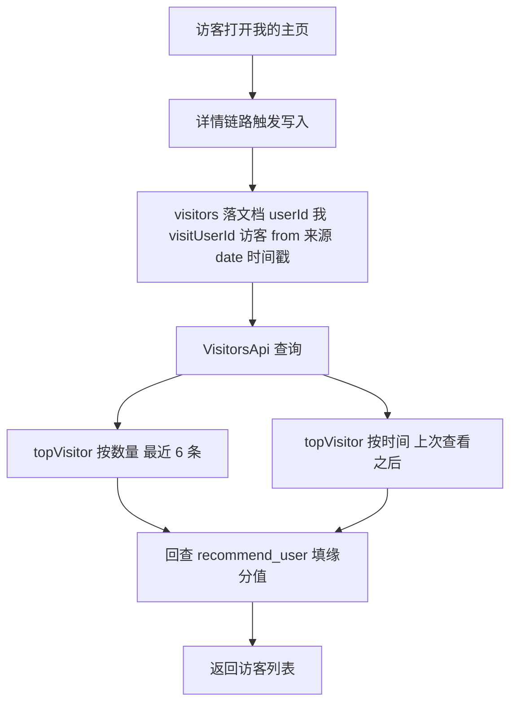

# 谁看过我的数据底座：visitors 集合与 VisitorsApi 的 dubbo 实现

首页横幅上那句「最近六人来访，快去查看」是纯前端文案，它背后要回答四个问题：谁来看过我、什么时候来的、从哪个页面进来的、这个人与我的缘分值是多少。前三个落在一张访客记录表里，第四个要借 `recommend_user` 现查现填。这一课把读写两头的能力做成 dubbo 服务：写入由「查看他人详情」的动作触发，查询供 App 接口消费，横幅与访客列表都从它取数。

## 先给结论

- 集合 `visitors` 一个文档记一次来访：`userId` 是被访问的「我」，`visitUserId` 是访客，`from` 记来源页面，`date` 记时间戳；`score` 不落库，查询时从 `recommend_user` 现查填充。
- `VisitorsApi` 三个方法：`saveVisitor` 保存来访，`topVisitor(userId, num)` 按时间倒序取最近 num 条，`topVisitor(userId, date)` 取上次查看之后的新访客。
- 两个查询共用一套私有逻辑：先查 `visitors`，再逐条回 `recommend_user` 补缘分值，查不到给默认值 30。
- 缘分值回查的方向别搞混：`recommend_user` 里 `userId` 是访客、`toUserId` 是我，条件写反永远空集。

## 一、集合设计：一条文档一个来访

访客记录没有历史包袱，直接落 MongoDB。实体类五个字段加一个查询时才用的得分位：

```java
package com.study.tanhua.dubbo.server.pojo;

import lombok.Data;
import org.bson.types.ObjectId;
import org.springframework.data.annotation.Id;
import org.springframework.data.mongodb.core.mapping.Document;

import java.io.Serializable;

@Data
@Document(collection = "visitors")
public class Visitors implements Serializable {

    private static final long serialVersionUID = 1L;

    @Id
    private ObjectId id;         // 主键
    private Long userId;         // 被访问的用户，也就是「我」
    private Long visitUserId;    // 来访的用户，也就是「访客」
    private String from;         // 来源，如首页、圈子
    private Long date;           // 来访时间戳
    private Double score;        // 缘分值，不存储，查询时填充
}
```

字段语义里最有分量的是 `userId` 与 `visitUserId` 的方向：记录的是「谁来访问了我的主页」，所以 `userId` 永远是被访问者，`visitUserId` 才是动作的发起方。方向在写入与查询两头必须咬合，稍后回查缘分值时还要用到这对语义。

`score` 单独说明。缘分值由推荐系统产出，每次 Spark 重训都会更新；访客表里存一份副本，用不了几天就是旧值，属于典型的静态快照反模式。所以设计成不存储、查询时现查：`visitors` 只回答「谁来过」，缘分值这类随推荐变化的动态属性，一律以 `recommend_user` 为唯一真相源。



这张图把集合的角色画清了：`visitors` 是流水账，写多读少；`recommend_user` 是动态属性源，被横向借用。两个集合各管一件事，靠 id 对上号。

## 二、接口契约与 dubbo 骨架

接口三方法，写一个查两个，两个查询的差异只在条件段：

```java
public interface VisitorsApi {

    /** 保存访客数据 */
    String saveVisitor(Visitors visitors);

    /**
     * 按照时间倒序排序，查询最近的访客信息
     * @param userId 用户 id
     * @param num    查询条数
     */
    List<Visitors> topVisitor(Long userId, Integer num);

    /**
     * 查询指定时间之后的访客信息
     * @param userId 用户 id
     * @param date   上次查看的时间点
     */
    List<Visitors> topVisitor(Long userId, Long date);
}
```

实现类按本章惯例暴露为 dubbo 服务，版本号与消费方的 `@Reference` 对齐：

```java
@Service(version = "1.0.0")
public class VisitorsApiImpl implements VisitorsApi {

    @Autowired
    private MongoTemplate mongoTemplate;

    @Override
    public String saveVisitor(Visitors visitors) {
        visitors.setId(ObjectId.get());
        visitors.setDate(System.currentTimeMillis());
        this.mongoTemplate.save(visitors);
        return visitors.getId().toHexString();
    }
}
```

`saveVisitor` 里主键与时间都由服务端补齐：调用方只给 `userId`、`visitUserId`、`from` 三件事，`ObjectId.get()` 生成主键，`System.currentTimeMillis()` 生成来访时间。时间以服务器为准是刻意的，客户端时钟各说各话，「最近来访」的排序就失真了。返回值用 `toHexString()` 把 ObjectId 转成字符串，调用方拿它做日志追踪足够。

## 三、两个 topVisitor 与公共的缘分值填充

按数量查的版本用分页对象一次取最近 num 条：

```java
@Override
public List<Visitors> topVisitor(Long userId, Integer num) {
    //第 0 页取 num 条，按 date 倒序就是最近来访
    Pageable pageable = PageRequest.of(0, num, Sort.by(Sort.Order.desc("date")));
    Query query = Query.query(Criteria.where("userId").is(userId)).with(pageable);
    return this.queryVisitorsList(query);
}
```

`PageRequest.of` 的页码是 0 基，这里天然就是 0，day2 在推荐列表接口上踩过的 off-by-one 在这个写法里没有立足之地。按时间查的版本不翻页，条件里多一段：

```java
@Override
public List<Visitors> topVisitor(Long userId, Long date) {
    //date 是上次查看的时间点，查这之后的新访客
    Query query = Query.query(Criteria.where("userId").is(userId)
            .and("date").gt(date))
            .with(Sort.by(Sort.Order.desc("date")));
    return this.queryVisitorsList(query);
}
```

`gt` 的方向要盯紧。需求是「点开看过之后，横幅不再提示同一批人，只提示之后来的新访客」，所以查的是大于上次查看时间点的记录。这里要是顺手写成 `lt`，查回来的全是旧访客，横幅永远提示同一批人，新客反而永远无声，方向性 bug 在小数据量下肉眼难辨，联调阶段就要拿时间戳对一次。

两个查询的收尾都落在私有方法上，缘分值填充是它存在的理由：

```java
private List<Visitors> queryVisitorsList(Query query) {
    //查询访客记录
    List<Visitors> visitorsList = this.mongoTemplate.find(query, Visitors.class);
    for (Visitors visitors : visitorsList) {
        //缘分值在 recommend_user 里：userId 是访客，toUserId 是我
        Query recommendQuery = Query.query(Criteria.where("userId").is(visitors.getVisitUserId())
                .and("toUserId").is(visitors.getUserId()));
        RecommendUser recommendUser = this.mongoTemplate.findOne(recommendQuery, RecommendUser.class);
        if (null != recommendUser) {
            visitors.setScore(recommendUser.getScore());
        } else {
            //没有推荐关系时给默认缘分值，量纲与 score 保持一致
            visitors.setScore(30d);
        }
    }
    return visitorsList;
}
```

回查条件是把第一节说的方向落到代码：`recommend_user` 里 `userId` 是访客、`toUserId` 是我，条件一旦写反， findOne 永远空手而归，列表上所有人的缘分值都成了默认值，现象是「有数据但缘分值清一色 30」，比报错更难察觉。默认值 30 是课堂与产品口径对齐前的临时值，取值要与产品确认，并且量纲必须落在 0 到 100 的缘分值区间内。

## 四、测试：先造数再验证，顺带修一个 NPE

测试类造 100 条数据铺底：被访问用户取 1 到 10，访客取 11 到 50，来源固定「首页」，跑之前先在客户端把 `visitors` 集合 drop 掉，保证数据干净：

```java
@RunWith(SpringJUnit4ClassRunner.class)
@SpringBootTest
public class TestVisitors {

    @Autowired
    private VisitorsApi visitorsApi;

    @Test
    public void testSaveVisitor() {
        //先在客户端 drop visitors 集合，再执行本用例
        for (int i = 0; i < 100; i++) {
            Visitors visitor = new Visitors();
            visitor.setUserId((long) RandomUtils.nextInt(1, 11));        // 被访问者 1～10
            visitor.setVisitUserId((long) RandomUtils.nextInt(11, 51));  // 访客 11～50
            visitor.setFrom("首页");
            this.visitorsApi.saveVisitor(visitor);
        }
    }

    @Test
    public void testQueryVisitor() {
        List<Visitors> visitorsList = this.visitorsApi.topVisitor(1L, 10);
        for (Visitors visitors : visitorsList) {
            System.out.println(visitors);
        }
    }
}
```

运行前要把独立运行的 dubbo 服务进程停掉：测试类本身会拉起整个 Spring Boot 应用，端口与服务注册都与常驻进程冲突，先停再跑。造数用例跑完，客户端里 `visitors` 集合出现 100 条文档，`userId` 与 `visitUserId` 各在自己的区间，`date` 是毫秒时间戳。

查询用例第一跑就翻车，NPE。原因在私有方法的判空对象上：当时判的是 `recommendQuery` 这个 Query 对象，而 Query 是自己构造出来的，永远不为 null；真正可能为空的是 `findOne` 的返回值，`recommendUser` 为 null 时再点 `.getScore()` 就是空指针。把判空挪到 `recommendUser` 上再跑，控制台打出 1 号用户的最近访客，每条记录的缘分值都填充到位。这个错误很小，但它把「判空要判业务结果，不要判过程对象」这个习惯钉实了。

## 常见误区

- **缘分值落库成静态副本。** 错例：`saveVisitor` 里顺手把 score 一并写入，Spark 重训后访客列表展示的还是旧缘分值。正解：`visitors` 只存来访事实，缘分值查询时从 `recommend_user` 现查，一份真相一处维护。
- **缘分值回查条件方向写反。** 错例：`where("userId").is(visitors.getUserId())`，把自己当访客查，findOne 永远为空，全列表缘分值都是默认值。正解：`userId` 位放 `visitUserId`，`toUserId` 位放 `userId`，与写入语义咬合。
- **判空判在过程对象上。** 错例：`if (null != recommendQuery)`，Query 是构造出来的永非空，空指针照样发生在 `recommendUser.getScore()`。正解：判空对象必须是 findOne 这类可能无结果的调用返回值。
- **默认分超量纲。** 错例：查不到推荐关系时随手写个 300，比满分 100 还高，没有缘分的访客反而排到最前。正解：默认值与产品确认，取 30～40 一类的常规区间，与 score 同一量纲。

## 面试可能被问到的问题

1. 面试官追问：「访客记录为什么不存缘分值？」
   答：缘分值由推荐系统产出且随训练更新，存副本必然过期，还会出现同一人在两个集合里分值不一致的解释成本。访客表只存来访事实，缘分值查询时向 `recommend_user` 现查，代价是查询侧多一次 findOne，换来的是单一数据源。
2. 面试官追问：「访客记录的写入时机为什么放在查看他人详情时？」
   答：「谁看过我」的业务语义就是主页访问行为，查看详情是唯一准确的触发点。放在登录或刷新首页时写，会把大量没有浏览意图的请求算成来访，数据失真；放在客户端上报，又拦不住改接口的恶意调用，服务端在详情接口里写入最稳。
3. 面试官追问：「两个 topVisitor 重载分别服务什么场景？」
   答：按数量查的是「最近来访」列表本身，页面上直接渲染；按时间查的是「上次查看之后的新访客」，服务横幅的未读提醒。前者有 num 上限、走分页对象，后者条件过滤加倒序、不限条数，返回后由调用方决定怎么用。
4. 面试官追问：「查完访客还要逐条查缘分值，这是 N+1 查询吗？」
   答：形态上是，但一页访客只有几条到几十条，findOne 都走 `userId` 加 `toUserId` 的复合索引，单次代价极小。真要优化，可以把访客 id 收集起来对 `recommend_user` 做一次 in 加 `toUserId` 条件的批量查询，内存里配对，把 N 次往返压成一次。
5. 面试官追问：「造数测试为什么先 drop 集合？」
   答：`visitors` 的查询按时间倒序取最近几条，历史残留数据会混进结果里，让断言失去基准。先 drop 再造数，集合里的每一条都是本次用例写入的，查询结果可以逐条对账，这是集成测试保持可重复的基本功。

## 配套资料

- 学习目标：`materials/code/07/day09 探花交友-好友推荐、今日佳人/day09/学习目标.md`，「独立完成谁看过我的功能」即本课主线。
- 说明：day09 资料包仅含学习目标，无源码包；`Visitors` 实体、`VisitorsApi` 契约与实现、测试类均为按本课画面与主流写法补全，包名统一为 `com.study.tanhua` 系，集合结构与字段语义按本课画面线整理；缘分值默认值 30 为课堂临时口径，正式取值需与产品确认。
