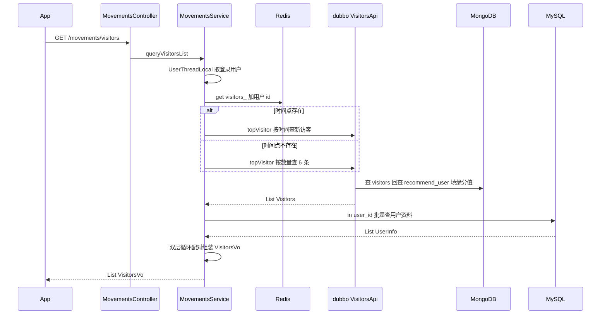

# 谁看过我的 App 接口：Redis 时间点分流与访客卡片组装

dubbo 服务把读写能力备齐了，App 端要的是一行接口：`GET /movements/visitors`，不带任何业务参数，token 就是身份，响应直接是可以渲染的访客卡片数组。中间还藏着一层体验设计：横幅只提示「上次查看之后的新访客」，看过的不再重复提醒，这个「上次查看」的状态存在 Redis 里，查询前要先探它一次。这一课把接口从契约写到组装。

## 先给结论

- 接口挂在 `MovementsController` 下，路径 `GET /movements/visitors`，无业务参数，`UserThreadLocal.get()` 取登录用户。
- 查询前先探 Redis：key 为 `visitors_` 加用户 id，存的是上次查看的时间点；有值按时间查新访客，无值按数量查最近 6 条。
- 卡片组装两步走：收集访客 id 用 `in("user_id", userIds)` 批量回查 MySQL 用户资料，双层循环按 id 配对填充头像、昵称、性别、年龄、标签与缘分值。
- 空列表返回 `Collections.emptyList()` 而不是 null，前端拿到 null 直接崩，拿到空数组只是少渲染几张卡。

## 一、接口契约与视图对象

接口文档平台的 mock 树里，这个接口挂在 Movements 目录下，请求参数一栏是空的，响应是一组访客卡片。按契约定义视图对象：

```java
package com.study.tanhua.server.vo;

import lombok.AllArgsConstructor;
import lombok.Data;
import lombok.NoArgsConstructor;

@Data
@NoArgsConstructor
@AllArgsConstructor
public class VisitorsVo {

    private Long id;          // 访客用户 id
    private String avatar;    // 头像
    private String nickname;  // 昵称
    private String gender;    // 性别 man / woman
    private Integer age;      // 年龄
    private String[] tags;    // 标签数组
    private Integer fateValue; // 缘分值
}
```

字段与今日佳人的 `TodayBest` 高度相似，但没有复用它：访客卡片是独立的产品位，字段演进节奏不同，强行共用会在某一次改版时互相拖累。`gender` 是小写的 man、woman，`tags` 是数组，这两处的翻译工作照旧放在组装环节。

## 二、Controller：一行转发

`MovementsController` 已在圈子功能时建好，类上有 `@RequestMapping("movements")`，追加一个 GET 方法即可：

```java
/**
 * 查询访客列表
 */
@GetMapping("visitors")
public List<VisitorsVo> queryVisitorsList() {
    return this.movementsService.queryVisitorsList();
}
```

方法签名里没有 token 也没有用户 id：token 校验在拦截器里统一完成，用户身份由 `UserThreadLocal` 随线程携带，Controller 只剩一行转发。这是 day3 统一处理 token 之后的标准形态，新接口从写下的第一行就享受这套红利。

## 三、Redis 时间点分流

Service 先取用户，再探 Redis：

```java
public List<VisitorsVo> queryVisitorsList() {
    User user = UserThreadLocal.get();
    //如果 redis 中存在上一次查询的时间点就按时间查询，否则按数量查询
    String redisKey = "visitors_" + user.getId();
    String data = this.redisTemplate.opsForValue().get(redisKey);

    List<Visitors> visitorsList;
    if (StringUtils.isEmpty(data)) {
        //按数量查询：最近 6 条，与横幅文案「最近六人来访」对应
        visitorsList = this.visitorsApi.topVisitor(user.getId(), 6);
    } else {
        //按时间查询：只取上次查看之后的新访客
        visitorsList = this.visitorsApi.topVisitor(user.getId(), Long.parseLong(data));
    }
    if (CollectionUtils.isEmpty(visitorsList)) {
        //空列表也要返回结构完整，避免前端拿到 null
        return Collections.emptyList();
    }
    return this.buildVisitorsVo(visitorsList);
}
```

分流逻辑对应两种状态。第一次查看的用户的 Redis 里没有时间点，走按数量分支，拿最近 6 条铺满横幅；看过之后时间点写入 Redis，后续请求全走按时间分支，只有新来的访客才会上榜，提示行为与「看过就不再提醒」的产品预期严格一致。数字 6 不是随手写的：横幅文案是「最近六人来访」，接口取几条、文案写几人，两边必须一起定，课堂顺口提了一句这个数要与产品确认。工具类的 import 也踩了一脚刹车：IDE 自动补全把 dubbo 包里的 `StringUtils` 带了进来，它的 `isEmpty` 与 commons-lang3 的行为并不一致，显式写 `org.apache.commons.lang3.StringUtils`；判空集合用 `CollectionUtils.isEmpty`，返回空集合用 `Collections.emptyList()`。



这张时序图把三次存储访问的分工划清：Redis 决定「怎么查」，MongoDB 回答「谁来过、缘分值多少」，MySQL 回答「这个人长什么样」。任何一个环节缺数据，出口都是结构完整的空数组或默认值，接口永远可渲染。

## 四、组装访客卡片

组装方法先收集 id，再批量回查，最后配对填充：

```java
private List<VisitorsVo> buildVisitorsVo(List<Visitors> visitorsList) {
    //收集访客的用户 id
    List<Long> userIds = new ArrayList<>();
    for (Visitors visitors : visitorsList) {
        userIds.add(visitors.getVisitUserId());
    }
    //批量回查 MySQL 的用户资料
    QueryWrapper<UserInfo> queryWrapper = new QueryWrapper<>();
    queryWrapper.in("user_id", userIds);
    List<UserInfo> userInfos = this.userInfoService.queryUserInfoList(queryWrapper);

    //双层循环按 id 配对，组装访客卡片
    List<VisitorsVo> result = new ArrayList<>();
    for (Visitors visitors : visitorsList) {
        for (UserInfo userInfo : userInfos) {
            if (visitors.getVisitUserId().longValue() == userInfo.getUserId().longValue()) {
                VisitorsVo vo = new VisitorsVo();
                vo.setId(userInfo.getUserId());
                vo.setAvatar(userInfo.getLogo());
                vo.setNickname(userInfo.getNickName());
                vo.setGender(userInfo.getSex().name().toLowerCase());
                vo.setAge(userInfo.getAge());
                vo.setTags(StringUtils.split(userInfo.getTags(), ','));
                vo.setFateValue((int) Math.floor(visitors.getScore()));
                result.add(vo);
                break;
            }
        }
    }
    return result;
}
```

两处老朋友值得点名。`in("user_id", userIds)` 是 day2 推荐列表立好的批量回查模板，MySQL 对 in 不承诺顺序，好在访客顺序由外层 `visitorsList` 的 date 倒序决定，配对循环只往里塞数据不动外层顺序，列表天然按来访时间排列。配对时比较的是 `longValue()` 而不是对象本身，包装类型超缓存区间用等号比较会恒为假，这个坑在缘分值取整那次已经踩过一遍。双层循环是 m 乘 n 的比较量，一页六条访客毫无压力，数据量大了再把 `userInfos` 先转成以 id 为键的 Map，配对降成 O(1)，模板放在那里，需要时再换。

## 五、时间点的写入契约

按时间分支消费的 `visitors_<userId>`，写入动作挂在「用户点开访客列表」这个交互上：看过一眼，本次时间就该记录下来。课程在查询侧先按约定消费这个 key，写入一行就够：

```java
//用户点开访客列表后记录本次查看时间，之后只提示这之后的新访客
this.redisTemplate.opsForValue().set(redisKey, String.valueOf(System.currentTimeMillis()));
```

这行写入是按本课约定补全的示例，落点在访客列表或他人详情的查看链路里均可，与查询侧唯一的耦合就是 key 拼法与时间戳格式，两端用同一套常量维护即可。写入缺位的表现很有辨识度：Redis 里永远没有时间点，接口永远走按数量分支，产品上「看过不再提醒」的预期静默失效。

## 常见误区

- **空列表返回 null。** 错例：查不到访客时 `return null`，前端序列化出字面量 null，渲染直接报错。正解：`Collections.emptyList()`，接口任何情况下返回结构完整的数组。
- **配对用等号比较 Long。** 错例：`visitors.getVisitUserId() == userInfo.getUserId()`，超出缓存区间的 id 配对恒为假，卡片少了头像昵称。正解：拆箱比较 `longValue()`，或用 `Objects.equals`。
- **按时间分支永远查不到数据。** 错例：Redis 时间点从未写入，或写入时机晚于查询，分流形同虚设。正解：写入挂在查看动作上，与查询共用一处 key 常量，联调时先在客户端确认 key 的值再验接口。
- **StringUtils 导错包。** 错例：自动补全带进 dubbo 包里的同名类，`isEmpty` 行为与预期不一致，空值判断时灵时不灵。正解：显式 import `org.apache.commons.lang3.StringUtils`，判集合用 `CollectionUtils.isEmpty`。

## 面试可能被问到的问题

1. 面试官追问：「上次查看时间为什么存 Redis 而不存数据库？」
   答：它是高频读写的会话型状态，每次打开首页都要读，每次查看都要写，语义上随时可重建（重新查看一次就覆盖），丢了不影响数据正确性。这类状态放 MySQL 徒增写入压力，Redis 一条 string 恰好匹配，key 按用户隔离也没有并发冲突。
2. 面试官追问：「按数量查与按时间查两个分支怎么设计的？」
   答：以 Redis 里有没有上次查看时间为分流条件。首次使用走数量分支，保证横幅不空白；有了时间点走时间分支，只提示增量。两个分支都落在 dubbo 的 topVisitor 上，服务端一个接口两个重载，查询侧只换参数不换调用方式。
3. 面试官追问：「访客接口为什么不带分页参数？」
   答：产品形态是首页横幅下的固定访客位，展示最近 6 条就够，不构成信息流。分页是完整访客列表的需求，真要做再加 page 与 pagesize，dubbo 侧已经有按数量与按时间两种取数能力，扩展时接口形态不用推翻。
4. 面试官追问：「访客顺序由谁决定？in 查询不保序怎么办？」
   答：顺序由 dubbo 查询的 date 倒序决定，visitorsList 出来就是按来访时间排好的。MySQL 的 in 回查只提供资料不提供顺序，组装时外层循环走 visitorsList、内层只做资料匹配，不动外层迭代顺序，最终列表天然按时间排列。
5. 面试官追问：「跨 MongoDB 与 MySQL 的卡片组装有什么通用套路？」
   答：先把两个数据源各查一次，用 id 集合 in 查询避免逐条往返；再以主查询的顺序为准做内存配对填充；出口统一成视图对象。要点有三个：批量查、内存配对、顺序跟主查询走，推荐列表、点赞列表、访客列表都是同一个模子。

## 配套资料

- 学习目标：`materials/code/07/day09 探花交友-好友推荐、今日佳人/day09/学习目标.md`，「独立完成谁看过我的功能」的接口服务环节即本课内容。
- 说明：day09 资料包仅含学习目标，无源码包；Controller、Service 与 `VisitorsVo` 为按本课画面与主流写法补全，包名统一为 `com.study.tanhua` 系；Redis 时间点写入为按本课约定补全的示例，key 拼法与查询侧保持一致。
