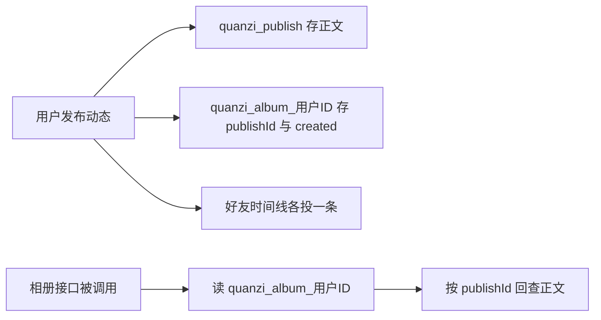

# 用户相册展现：翻一张指针表，查出一个人发过的所有动态

> 🔒 安全提示：文中示例的口令/密钥均为课程教学环境演示口径，生产环境的安全要求见《安全与合规须知》。

上一课收在详情页的一个报错上：资料、标签、缘分值都渲染出来了，页面底部的「动态」区域却请求失败。那里要展示的是这位用户发布过的所有动态，对应 mock 文档里的 `/movements/all` 接口。听起来像是从发布表按用户 id 过滤一把梭，真正的实现却绕了一下：动态正文从来不是按人查的，按人查的是另一张相册表。这一课把这个接口补上，也顺带在同一个坑里摔了第二次。

## 先给结论

- 相册的数据来源在发布动态那天就埋好了：每次 `savePublish` 都往 `quanzi_album_<userId>` 写一条指针，存 `publishId` 与时间，相册接口读的就是它。
- 接口契约是 `PageInfo<Publish> queryAlbumList(Long userId, Integer page, Integer pageSize)`，查的是相册指针表，返回的是动态正文对象，两层对象不能混。
- 实现是两段查询：先分页查相册表收集 `publishId`，再用 `id in` 批量回发布表取正文，两段各自带 `created` 倒序。
- `total` 继续占位为 0，前端靠「返回空列表即停止加载」翻页，与推荐列表、好友动态的口径一字不差。
- 本课的坑是页码没有减一：`PageRequest.of` 从 0 起算的老规矩，day2 与 day5 各强调过一次，这次在相册查询上又真实翻车一回。

## 一、相册数据从哪来：发布时埋下的指针

按人查动态之所以不去发布表过滤，答案在发布链路的写入动作里。每次发布动态，`savePublish` 落三处：正文整体存进 `quanzi_publish`；自己的相册集合 `quanzi_album_<userId>` 记一条 `Album` 文档，字段就三个，`publishId` 指向正文、`created` 记发布时间；再把动态投递到每个好友的时间线集合。相册是「一个人发过什么」的物化索引，用户翻自己的主页、别人看这位用户的详情页，查的都是这张指针表。



写入时多存一份指针，读取时少扫一遍大表，这笔账在好友动态那一课已经算过一遍，相册是同一套写扩散设计里的另一张受益表。接口要做的只是消费这份红利：给定 `uid`，翻他那张相册集合，拿指针回查正文。mock 契约的参数 `page`、`pageSize`、`uid` 正好对应「翻谁的、翻第几页、每页多大」三个问题，响应结构与圈子其他分页接口一致。

## 二、dubbo 实现：两段查询拼出分页动态

`QuanziApi` 契约新增一个方法，实现在 `QuanziApiImpl` 里完成两段查询：

```java
@Override
public PageInfo<Publish> queryAlbumList(Long userId, Integer page, Integer pageSize) {
    PageInfo<Publish> pageInfo = new PageInfo<>();
    pageInfo.setPageNum(page);
    pageInfo.setPageSize(pageSize);
    pageInfo.setTotal(0L); //不提供总数

    //第一段：查自己的相册指针表，一人一张集合
    String collectionName = "quanzi_album_" + userId;
    //相册查询没有过滤条件，分页与倒序一次给足；页码减一转 0 基索引
    Pageable pageable = PageRequest.of(page - 1, pageSize,
            Sort.by(Sort.Order.desc("created")));
    Query query = new Query().with(pageable);
    List<Album> albumList = this.mongoTemplate.find(query, Album.class, collectionName);
    if (CollectionUtils.isEmpty(albumList)) {
        //records 默认空集合，直接返回即可
        return pageInfo;
    }
    //第二段：收集动态指针，批量回查正文
    List<ObjectId> publishIds = new ArrayList<>();
    for (Album album : albumList) {
        publishIds.add(album.getPublishId());
    }
    Query publishQuery = Query.query(Criteria.where("id").in(publishIds))
            .with(Sort.by(Sort.Order.desc("created")));
    List<Publish> publishList = this.mongoTemplate.find(publishQuery, Publish.class);
    pageInfo.setRecords(publishList);
    return pageInfo;
}
```

第一段查询的 `Query` 里没有条件对象，相册表里全是「这个人发过的动态」，没有过滤一说，唯一的控制维度就是分页与排序。`find` 用的是三参版本，第三个参数显式指定集合名，这个能力是按用户分表能落地的关键，集合名在运行期由 `userId` 拼出。空集合的短路判断放在第二段之前，查不到指针就不必发起第二次查询。

第二段与好友动态那课的套路完全一致：`Criteria.where("id").in(publishIds)` 表达主键批量命中，一次往返取回当页全部正文。值得注意的是两段各自都挂了倒序，`in` 查询对返回顺序没有任何承诺，不排序的话同一页动态的先后每次刷新都在洗牌；指针表的 `created` 与发布表的 `created` 各管各的表，语义上都要压住。

返回类型还有一层容易想岔的设定：查的是 `Album`，返回的却是 `PageInfo<Publish>`。指针表的数据撑不起页面渲染，相册接口真正的「结果」是动态正文，`Album` 只是取数路径上的中间对象。分页对象把页码、页大小与正文列表打包一起走网络，消费方拿到的是自解释结构。

## 三、App 接口：复用既有的封装方法

Controller 按契约路径落在 `MovementsController`：

```java
/**
 * 查询用户相册（他人详情页的动态列表）
 */
@GetMapping("all")
public ResponseEntity<PageResult> queryAlbumList(@RequestParam("page") Integer page,
                                                 @RequestParam("pagesize") Integer pageSize,
                                                 @RequestParam("uid") Long uid) {
    return this.movementsService.queryAlbumList(uid, page, pageSize);
}
```

`MovementsService` 里先调 dubbo 拿 `PageInfo`，`records` 为空直接返回空 `PageResult`；非空则进入组装。组装这步没有重写：早前实现动态列表与评论列表时封装过一个私有方法 `fillMovement(records)`，里面已经包含 `Publish` 转 `Movements` 的字段映射、遍历收集用户 id 批量查资料、点赞评论喜欢等计数回填的全部逻辑。相册接口直接把 `records` 递进去，拿到现成的 `Movements` 列表再包一层 `PageResult` 即可。封装在第三次被复用时开始回本，动态、评论喜欢列表、相册三处共用一段用户信息补全，改动计数口径只需要动一处。

## 四、调试：页码减一的老坑，第三次遇到

接口写完立刻测试，57 号用户的相册里明明有一条动态，接口却返回空。排查沿断点走：在 `queryAlbumList` 里打断点跟进去，第一段查询执行完，`albumList` 没拿到数据，问题锁定在这一段。代码肉眼看上去没有毛病，于是另写测试用例做 debug 单步，一步步看变量，真相在 `Pageable` 上：`PageRequest.of(page, pageSize, ...)`，页码原样传入。

Spring Data 的页码从 0 起算，业务传来的 1 进去就成了「跳过第一条再取」，实际查的是第二页。57 号用户的相册只有一条记录，第二页自然是空的。这个坑课程里出现过不止一回，day2 的推荐列表分页现场踩过一次，day3 的时间线分页实现时顺手把 `page - 1` 做了，相册这处是新方法新抄写，又把减一抄丢了。把构造改成 `PageRequest.of(page - 1, pageSize, ...)`，测试用例立刻出数据，`publishList` 也按预期拿到那条 `publishId` 尾号 173 的动态。

修复后按完整流程重验：重启 dubbo 服务，REST 工具带 `uid=57` 请求，第一次响应超时，重试一次返回 200 与正确数据，超时属于服务刚起时的冷启动抖动，不改动实现。最后整合 APP：登录测试手机号（打码）加固定验证码 123456，进首页点今日佳人卡片，详情页底部不再报错，57 号用户发布过的动态以列表形式出现在资料下方。上一课留下的尾巴就此收掉，佳人信息的展现全部闭环。

## 常见误区

- **页码不减一直接传给 `PageRequest.of`。** 错例：业务页码原样传入，第一页永远查空或少一条，数据只有一页时表现成「明明有数据却查不到」。正解：Spring Data 页码 0 基，入口处统一做 `page - 1`，新方法从既有查询里抄实现时把这个减法一起抄走。
- **把相册对象当返回值。** 错例：`List<Album>` 塞进分页对象直接返回，前端拿到的只有 id 和时间，没有文字图片。正解：`Album` 是指针，必须第二段查询回 `quanzi_publish` 取正文再返回。
- **省掉第二段的排序。** 错例：认为 `in` 会按传入顺序返回，页面动态顺序每次刷新都在变。正解：`in` 只约束结果集合不约束顺序，第二段显式带 `created` 倒序，顺序由数据库保证。
- **空结果继续发起第二次查询。** 错例：不判空直接收集指针，空集合的 `in` 查询白跑一趟还可能拼出非法条件。正解：指针列表为空即短路返回，`records` 让分页对象保持空集合语义。

## 面试可能被问到的问题

1. 面试官追问：「查某人发过的动态，为什么不直接在发布表按 userId 过滤？」
   答：发布表是全量动态的集合，按人过滤要依赖 userId 索引扫出所有文档再分页，热点用户动态多时代价持续走高。相册表把「一个人发过什么」在写入侧物化成独立的小集合，读取退化成单表分页扫描，配合分表设计集合体量小、无竞争，是读多写少场景的标准空间换时间。
2. 面试官追问：「两段查询之间数据可能变化，会不会不一致？」
   答：会。第一段翻页到第二段回查之间，动态若被删除，`in` 命中会少几条，当页比 pageSize 短。这类最终一致的缝隙在本场景可接受，页面本来也没有严格对齐分页条数的诉求；要严格处理就在第二段后按缺失 id 回填占位或直接容忍短页，分页游标式设计能进一步收窄窗口。
3. 面试官追问：「同一个页码减一的坑在课程里出现三次，工程上怎么根治？」
   答：把换算收进统一入口，比如封装一个分页工具方法或仓库层的 `findPage(userId, page, pageSize)`，业务代码只传业务页码，Spring Data 的 0 基语义被隔离在一处。再配合代码评审清单把 `PageRequest.of` 列为敏感 API，凡是裸出现必须确认页码来源，抄写型失误就没了生存空间。
4. 面试官追问：「相册、时间线这种按用户分集合的设计，规模大了怎么办？」
   答：集合数量随用户线性增长，元数据与运维成本都会上来。演进方向是合并为单集合、以 userId 加 created 建复合索引，逻辑分表变物理分片，查询语义不变而集合数量收敛；写入侧的指针结构可以原样保留。教学项目选分集合是为了把分表语义讲直白，上生产前要按数据量重估。
5. 面试官追问：「接口的 total 一直是占位 0，什么时候必须补上？」
   答：前端出现页码条、搜索结果计数、空态文案里需要「共 N 条」的任一场景，就必须提供精确 total，实现上是在同样条件下补一次 `count`。下拉刷新式瀑布流不需要它，靠空列表判断到底即可。字段先占位、按需补齐，避免为没人消费的指标付 count 的代价，这个取舍要在接口文档里写清楚。

## 配套资料

- 学习目标：`materials/code/07/day09 探花交友-好友推荐、今日佳人/day09/学习目标.md`，「独立完成佳人信息功能」包含详情页动态列表的展现。
- 原型：`materials/code/07/day01 探花交友-项目搭建以及登录完善个人信息/day01/资料/探花交友移动端原型V1.2/`，详情页动态列表与九宫格图片的页面形态出处。
- 学习目标：`materials/code/07/day03 探花交友-实现圈子功能/day03/学习目标.md`，相册指针表随发布动态三步写入的来历可回溯。
- 说明：day09 资料包仅含学习目标，无工程源码，本课 dubbo 实现与 Controller 均按课程画面逐行整理，包名统一为 `com.study.tanhua` 系；测试手机号属敏感信息已打码。
