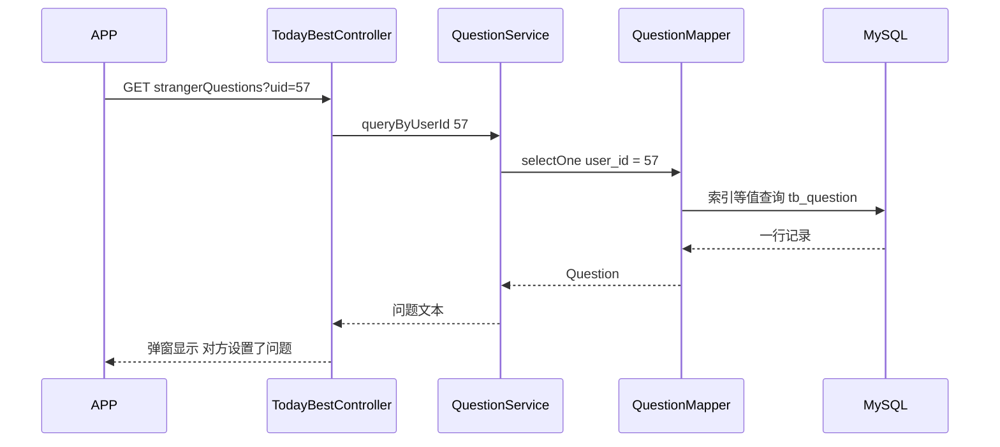

# 聊一下之查询陌生人问题：一张 MySQL 小表撑起破冰问答

> 🔒 安全提示：文中示例的口令/密钥均为课程教学环境演示口径，生产环境的安全要求见《安全与合规须知》。

详情页的资料与动态都就位后，页面还剩最后一个交互按钮：聊一下。产品的设定很有意思，陌生人之间不是直接开聊，而是先答一道题：对方在个人设置里留了一个问题，访客点开弹窗看到题目，输入自己的回答提交，回答会以消息的形式送到对方手里。这个功能要两个接口支撑，一个查问题，一个提交答案并把消息发出去。这一课先把第一个接口做出来，弹窗里能显示「对方设置了问题」就算验收通过。

## 先给结论

- 聊一下拆成两个接口：查询对方设置的问题、提交答案并转发消息，本课只做前者，问题存 MySQL 的 `tb_question` 表。
- 表结构四件套：`id`、`user_id`、`txt`、时间戳，主键外加 `user_id` 索引，按用户查问题只走索引等值。
- `Question` 实体继承 `BasePojo` 拿到 `created` 与 `updated` 两个公共字段，Mapper 继承 `BaseMapper` 零 XML。
- 查询用 `selectOne` 加 `QueryWrapper.eq("user_id", userId)`，约定一个用户只设一道题，多于一条会直接抛错，这条约束值得用唯一索引钉死。
- 弹窗验收只到「显示问题、能输入答案」为止，提交与发消息是下一个接口的事。

## 一、破冰为什么要先答题

直接给陌生人发消息，社交产品里通常被收得很紧：没有关系链的约束，谁都能开口，骚扰信息就会泛滥。探花交友用一道题把开口的动作变成「答题」：问题由被搭讪的人预设，答案由搭讪的人现写，双方的关系还没建立，消息以系统身份代发，接不接由对方决定。破冰的仪式感是产品层的巧思，落到技术上却是两个再朴素不过的接口，查一道字符串，存一条回复，再把回复打包发到 IM 通道。

mock 契约把查询接口的形态压到最简：请求参数一个 `uid`，返回值就是一个字符串，即问题本身。没有对象包装、没有列表、没有分页，前端弹窗只需要一句话。接口越简单，越要把边界想清楚：用户没设过问题怎么办、`uid` 传空怎么办、问题改了旧缓存怎么算，这些在实现里都要有明确的答案。

## 二、表结构：一用户一题的 MySQL 小表

问题数据量小、结构规整、随用户资料一并维护，落 MySQL 比塞 MongoDB 合适。建表语句按画面整理如下：

```sql
CREATE TABLE `tb_question` (
  `id` bigint(20) NOT NULL AUTO_INCREMENT COMMENT '主键id',
  `user_id` bigint(20) DEFAULT NULL COMMENT '用户id',
  `txt` varchar(500) DEFAULT NULL COMMENT '问题内容',
  `created` datetime DEFAULT NULL,
  `updated` datetime DEFAULT NULL,
  PRIMARY KEY (`id`),
  KEY `user_id` (`user_id`)
) ENGINE=InnoDB DEFAULT CHARSET=utf8;
```

列名取 `txt` 而不是 `text`，避开与 MySQL 类型名同名的别扭。索引建在 `user_id` 上，因为全表只会有一种查询姿势：按用户找他的问题。测试数据插入两条，1 号用户与 57 号用户各一道题，57 的题目正是详情页演示要用的「你喜欢什么颜色?」；给今日佳人预设题目，是为了让测试账号在页面上一定有东西可看，造数始终为验收路径服务。

一个用户对应一道题，这个一比一约定在查询层会变成一条硬规则，表结构里最好再补一层保障：给 `user_id` 建唯一索引而不是普通索引，重复插入直接被数据库拒绝。课堂按普通索引演示，这个加固属于阅读时的顺手思考，两条路径的成本相同，约束力天差地别。

## 三、实体、Mapper 与 Service：三层各司其职

实体类挂 Lombok 三件套，继承公共父类拿时间字段：

```java
package com.study.tanhua.server.pojo;

import com.baomidou.mybatisplus.annotation.TableName;
import lombok.AllArgsConstructor;
import lombok.Data;
import lombok.EqualsAndHashCode;
import lombok.NoArgsConstructor;

@Data
@NoArgsConstructor
@AllArgsConstructor
@EqualsAndHashCode(callSuper = true)
@TableName("tb_question")
public class Question extends BasePojo {

    private Long id;
    private Long userId;
    private String txt;
}
```

`BasePojo` 里带 `created` 与 `updated` 两个公共字段，与项目里其他 MySQL 实体共用同一套时间语义，实体自己只声明业务字段。Mapper 继续走 MyBatis-Plus 的零 XML 路线：

```java
package com.study.tanhua.server.mapper;

import com.baomidou.mybatisplus.core.mapper.BaseMapper;
import com.study.tanhua.server.pojo.Question;

public interface QuestionMapper extends BaseMapper<Question> {
}
```

Service 层把查询收敛成一个方法，按用户找问题：

```java
@Service
public class QuestionService {

    @Autowired
    private QuestionMapper questionMapper;

    public Question queryByUserId(Long userId) {
        QueryWrapper<Question> queryWrapper = new QueryWrapper<>();
        queryWrapper.eq("user_id", userId);
        return this.questionMapper.selectOne(queryWrapper);
    }
}
```

`selectOne` 的选择暗含契约：约定一个用户只有一道题，这个方法就永远返回唯一那条。风险也在同一个地方，一旦数据里出现重复的 `user_id`，`selectOne` 直接抛 `TooManyResultsException`，接口从「查到」变成「报错」。唯一索引正是为了不让这种数据出现，存储层拒绝重复，查询层才敢用单数语义。

## 四、Controller 与端到端验收

查询接口挂在 `TodayBestController` 里，详情页的几个接口都住在这一个类中：

```java
/**
 * 查询陌生人问题（聊一下弹窗）
 */
@GetMapping("strangerQuestions")
public ResponseEntity<String> queryStrangerQuestions(@RequestParam("uid") Long userId) {
    try {
        Question question = this.questionService.queryByUserId(userId);
        if (question != null) {
            return ResponseEntity.ok(question.getTxt());
        }
    } catch (Exception e) {
        e.printStackTrace();
    }
    return ResponseEntity.status(HttpStatus.INTERNAL_SERVER_ERROR).build();
}
```

返回值就是问题文本，与 mock 契约的字符串响应一一对应；没设过问题的用户走到 null 分支返回 500，前端弹窗拿不到内容自然不展示，兜底行为简单但可预期。Service 注入进 Controller 后，服务重启即可开测。



验收分两步。REST 工具先打头：把 `uid` 换成 57 请求，返回的问题与表里那条测试数据一致，换成 1 再试，返回的是另一道题，查询按参数走人，契约本身成立。随后整合 APP：登录测试手机号（打码）加固定验证码 123456，进首页点今日佳人卡片，详情页里点「聊一下」，弹窗弹出「对方设置了问题」，题目正是「你喜欢什么颜色?」，输入框里敲下回答，点提交的动作此刻还没有接口可走，按钮先挂在那里，等下一个接口把消息通道接通。

## 常见误区

- **按用户查问题不建索引。** 错例：`user_id` 裸列查询，表一大就是全表扫描。正解：这个表的天生使命就是按 `user_id` 查，索引从建表第一天就位；升级成唯一索引还能一并锁死一用户一题的约束。
- **selectOne 撞上重复数据。** 错例：历史数据里同一 `user_id` 插了两条，接口偶发抛 `TooManyResultsException`，排查半天发现是造数脚本跑了两遍。正解：唯一索引防重复插入；存量数据清洗后，查询层保持单数语义。
- **问题表设计成列表却不改接口。** 错例：数据库里给一个用户存多道题，接口还是返回单个字符串，第 n 道题永远查不到。正解：一比一约定贯穿表结构、查询方法与接口契约；要支持多题，三处要一起改成返回列表并明确选择题的策略。
- **弹窗没内容时前端报错。** 错例：后端对未设问题的用户返回 500，前端把 500 当异常弹提示，体验割裂。正解：明确「未设置问题」是正常业务态，用业务码或空体区分，前端按「对方没有设置问题」渲染引导。

## 面试可能被问到的问题

1. 面试官追问：「这个问题表为什么放 MySQL，项目里动态、缘分值不都在 MongoDB 吗？」
   答：选型看数据形态与访问方式。问题是一用户一条的结构化小数据，主键加索引的等值查询是 MySQL 最舒服的场景，还能和用户资料放在同一个事务边界里维护；MongoDB 的优势在文档结构多变、写入量大，动态与推荐属于那类。跟着访问姿势选库，而不是项目里用了什么就都用什么。
2. 面试官追问：「selectOne 底层是怎么工作的，什么情况会出错？」
   答：MyBatis-Plus 的 selectOne 执行的仍是普通列表查询，取回结果后判断条数，恰好一条返回对象，多于一条抛 TooManyResultsException，零条返回 null。它表达的是业务上的单数语义，能不能用取决于数据约束是否保证唯一，没有约束就要换 selectList 加自选策略。
3. 面试官追问：「QueryWrapper 拼条件与手写 SQL 各有什么取舍？」
   答：QueryWrapper 让简单条件查询零 XML、列名集中在 Java 侧可重构，类名改了编译器能追；代价是复杂 SQL 可读性差，多表、子查询、窗口函数写起来费劲。团队实践通常是单表 CRUD 走 Wrapper，复杂分析走 XML 或注解 SQL，边界按复杂度划。
4. 面试官追问：「用户没设置问题时，接口返回什么更合适？」
   答：返回业务态而不是 500。500 语义是服务器异常，未设置问题属于正常分支，前端要按它渲染引导而不是弹错误。落地可以是空体 200 加约定的业务码，或一个 null 字段的 JSON，让客户端能区分「出错了」与「没有数据」。
5. 面试官追问：「这道题的答案提交后怎么送到对方手里，双方还不是好友？」
   答：走系统代发。答案由服务端组装成约定结构的消息载荷，以管理员身份调 IM 平台的 REST 接口发给对方，对方的 APP 弹出卡片，选择回应才建立好友关系。发送方的身份是系统账号而非发起用户，正是为了绕开「非好友不能互发」的平台约束，也把骚扰拦截的开关留在服务端。

## 配套资料

- 学习目标：`materials/code/07/day09 探花交友-好友推荐、今日佳人/day09/学习目标.md`，「独立完成聊一下功能」的第一段即本课的查询接口。
- 原型：`materials/code/07/day01 探花交友-项目搭建以及登录完善个人信息/day01/资料/探花交友移动端原型V1.2/`，详情页聊一下弹窗的交互形态出处。
- 数据库：`materials/code/07/day01 探花交友-项目搭建以及登录完善个人信息/day01/代码/mytanhua.sql`，用户表与测试账号数据，`tb_question` 的测试数据按其 userId 对齐。
- 说明：day09 资料包仅含学习目标，无工程源码，`tb_question` 建表语句、实体与三层实现均按课程画面与讲解整理补全，包名统一为 `com.study.tanhua` 系；`user_id` 唯一索引为写作时补充的工程建议，课程按普通索引演示；测试手机号属敏感信息已打码。
