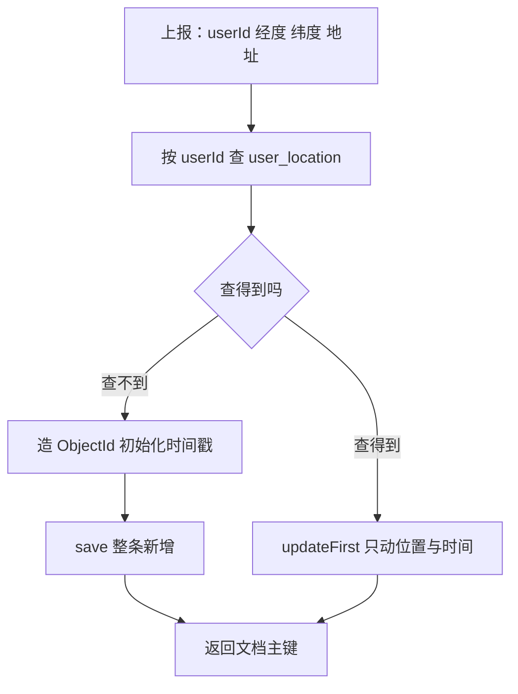

# 给位置安个家：UserLocation 与 2dsphere 索引下的 dubbo 服务

搜附近功能要按距离找人，比如筛出两公里以内的用户，前提是服务端握着每个人的位置。手机带着人在走，位置随时在变，服务端不可能主动去问，于是约定由客户端上报：位移超过 500 米，或者距上次上报满 5 分钟，就推一次经纬度，服务端以此近似实时地掌握每个人的落脚点。这一课先解决「存」：位置以什么结构进 MongoDB，dubbo 接口怎么做到有则更新无则新增，按距离查询的接口留到后续搜附近再展开。

## 先给结论

- 位置存 MongoDB 的 `user_location` 集合，`GeoJsonPoint` 承载坐标，构造参数 x 是经度、y 是纬度，顺序写反位置就飞了。
- `location` 字段上建 2dsphere 球面地理索引，`userId` 单独建普通索引，一个管算距离、一个管按人找记录。
- dubbo 接口 `updateUserLocation(userId, longitude, latitude, address)` 返回文档主键字符串；实现按 userId 先查，查不到走新增、查到走 `updateFirst` 部分更新。
- 上报节奏由客户端把控：位移超 500 米或每 5 分钟一次，服务端只管接得稳、存得对。

## 一、位置数据为什么这样存

**第一，索引选球面。** MongoDB 的 2dsphere 是球面地理索引，把经纬度当作地球表面上的点，距离按球面大圆计算；相对把坐标当平面处理的 2d 索引，它在真实地理场景下的距离更准。两公里内找人正是典型的球面场景，所以集合定义里就用它。

**第二，存储选 MongoDB 而不是别的。** Redis 的 GEO 结构同样能做附近的人，但位置记录要与用户业务长期绑定（后续搜附近要回查用户资料、按位置持续分析），选 MongoDB 与项目的文档存储栈统一，索引、查询、聚合能力都是现成的。

POJO 一锤定音：

```java
@Document(collection = "user_location")
@CompoundIndex(name = "location_index", def = "{ 'location' : '2dsphere' }")
public class UserLocation implements java.io.Serializable {
    private static final long serialVersionUID = 4508668382007529970L;
    @Id
    private ObjectId id;
    @Indexed
    private Long userId;           //用户 id
    private GeoJsonPoint location; //x:经度 y:纬度
    private String address;        //位置描述，如 北京
    private Long created;          //创建时间
    private Long updated;          //更新时间
    private Long lastUpdated;      //上次更新时间
}
```

（lombok 的 `@Data`、`@NoArgsConstructor`、`@AllArgsConstructor` 省略。）几个字段各有讲究。`GeoJsonPoint` 是 spring-data-mongodb 对 GeoJSON Point 的封装，构造参数两个 double，前者 x 是经度、后者 y 是纬度，地球的经度范围是负 180 到 180、纬度是负 90 到 90，拿北京 116.404、39.915 一对照就能记住谁在前。`@CompoundIndex` 的 `def` 里嵌的是 JSON 结构描述，指明对 `location` 字段建 2dsphere 索引，索引名叫 `location_index`。三个时间戳的分工：`created` 只在首次落库时写一次，`updated` 记录本轮上报时间，`lastUpdated` 记录上一轮的时间，两两相减能看出用户位置变化的节奏。

## 二、dubbo 接口定义

接口放在 dubbo 服务的 api 包里，与前面访客、推荐那些接口同住一个屋檐下：

```java
public interface UserLocationApi {

    /**
     * 更新用户地理位置
     *
     * @param userId    用户 id
     * @param longitude 经度
     * @param latitude  纬度
     * @param address   位置描述
     * @return 位置数据的主键
     */
    String updateUserLocation(Long userId, Double longitude, Double latitude, String address);
}
```

返回值是文档主键的十六进制串，调用方将来可以拿它做幂等比对或问题追踪。四个入参里 `userId` 是定位记录的归属，其余三个是位置本身。

## 三、有则更新，无则新增

实现类用 dubbo 的 `@Service(version = "1.0.0")` 发布，注入 `MongoTemplate` 后，逻辑分两条支路：

```java
@Service(version = "1.0.0")
public class UserLocationApiImpl implements UserLocationApi {

    @Autowired
    private MongoTemplate mongoTemplate;

    @Override
    public String updateUserLocation(Long userId, Double longitude, Double latitude, String address) {
        UserLocation userLocation = new UserLocation();
        userLocation.setAddress(address);
        userLocation.setUserId(userId);
        userLocation.setLocation(new GeoJsonPoint(longitude, latitude));
        //按 userId 查询用户现有位置
        Query query = Query.query(Criteria.where("userId").is(userId));
        UserLocation ul = this.mongoTemplate.findOne(query, UserLocation.class);
        if (null == ul) {
            //新增用户位置数据
            userLocation.setId(ObjectId.get());
            userLocation.setCreated(System.currentTimeMillis());
            userLocation.setLastUpdated(userLocation.getCreated());
            this.mongoTemplate.save(userLocation);
            return userLocation.getId().toHexString();
        } else {
            //更新
            Update update = Update.update("location", userLocation.getLocation())
                    .set("updated", System.currentTimeMillis())
                    .set("lastUpdated", ul.getLastUpdated());
            this.mongoTemplate.updateFirst(query, update, UserLocation.class);
            return ul.getId().toHexString();
        }
    }
}
```



一张图两条支路：查不到说明这个用户第一次上报，造一个 `ObjectId`、把 `created` 与 `lastUpdated` 都钉在当前时间，`save` 整条写入；查得到则走 `updateFirst`，只更新 `location` 与时间字段，主键和 `created` 原封不动。这里不用 `upsert` 而是先查后定，是因为新增分支要初始化主键与两个时间戳，分支逻辑写开比把 `$setOnInsert` 揉进一个 update 对象里更直白，返回值也顺理成章。

一个语义上的细节值得留意：更新分支把旧记录的 `lastUpdated` 原样写回，效果是保持不变。如果业务要的是严格的「上一轮更新时间」，这里应该取旧记录的 `updated` 写入 `lastUpdated`，让两个时间戳真正错开一轮；目前 `updated` 承担了记录本轮时间的全部职责，读数据时以它为准即可。

## 四、测试：断点看新增，getIndexes 看索引

Spring 测试类把 dubbo 实现当本地 bean 调：

```java
@RunWith(SpringJUnit4ClassRunner.class)
@SpringBootTest
public class TestUserLocation {

    @Autowired
    private UserLocationApi userLocationApi;

    @Test
    public void testUpdateUserLocation() {
        String locationId = this.userLocationApi.updateUserLocation(1L, 116.404, 39.915, "北京");
        System.out.println(locationId);
    }
}
```

经纬度不用背，网页上搜一个经纬度查询工具，输入地名解析出坐标即可，课堂就是拿北京解析出的 116 与 39 开头的两组小数填进用例。测试前先把 `user_location` 集合 drop 掉，保证走的是新增分支，在实现里打断点单步跟：`findOne` 返回 null，进入新增支路，`save` 之后方法返回，控制台打印出一串主键。回库确认，`user_location` 里有了唯一一条文档，`location` 字段是 GeoJSON 的点结构，坐标成对出现。

索引是否真的建上了，用 shell 问一下数据库自己：

```bash
db.user_location.getIndexes()
```

结果列出三个索引：`_id_` 是默认主键索引，`location_index` 是 `@CompoundIndex` 声明的 2dsphere 地理索引，`userId_1` 是 `@Indexed` 生成的普通索引。注解索引由 spring-data 在应用启动时保证创建，搜附近的距离计算与按 userId 的查找，届时都能吃到索引红利。

## 常见误区

- **经纬度顺序写反。** 错例：`new GeoJsonPoint(39.915, 116.404)` 把纬度放前面，位置落到大洋上，搜附近查出的结果全部失真。正解：记牢构造参数 x 在前是经度，用北京 116.404、39.915 这组数自检。
- **已存在还用 save 覆盖。** 错例：不做查询判断，每次都 `save` 一条新文档，主键与 `created` 全被冲掉，一个用户的位置攒出一堆记录。正解：先按 userId 查，存在走 `updateFirst` 部分更新。
- **以为注解加了索引就一定生效。** 错例：`def` 里字段名拼错，启动不报错，直到搜附近慢查询才暴露没索引。正解：启动后用 `getIndexes()` 核对索引名与类型，把验证纳入流程。
- **时间戳随手一 set。** 错例：新增分支里 `created` 与 `updated` 各取一次当前时间，两个值相差几毫秒，后续按时间分析出现毛刺。正解：同一个时间点取一次复用，语义干净。

## 面试可能被问到的问题

1. 面试官追问：「2dsphere 和 2d 索引有什么区别，这里为什么选 2dsphere？」
   答：2d 把经纬度当平面坐标算距离，2dsphere 按地球球面算大圆距离。地理范围大时两者偏差明显，交友这类按公里算距离的场景用 2dsphere 更贴近真实；代价是索引与计算稍重，但换来的精度是搜附近功能必需的。
2. 面试官追问：「位置为什么存 MongoDB，不存 MySQL 或 Redis？」
   答：位置记录要长期沉淀并与用户业务绑定，MySQL 存坐标要靠应用层算距离，缺少地理索引；Redis GEO 能做附近的人但定位是缓存型结构，位置还要参与后续分析。MongoDB 原生支持 2dsphere 与地理查询，与项目既有存储栈统一，一条文档同时装坐标、地名与时间线，读写都顺。
3. 面试官追问：「先查再决定新增或更新，为什么不用 upsert 一步到位？」
   答：upsert 配合 `$setOnInsert` 技术上可行，但新增分支要造 ObjectId、初始化 created 与 lastUpdated，update 对象会把插入与更新两种语义揉在一起，可读性差；先查后定让两条支路各自直白，返回主键的取法也清晰。并发上报场景下再考虑以 userId 唯一约束兜底。
4. 面试官追问：「三个时间戳字段分别怎么用？」
   答：created 只在首次上报写一次，标识位置数据从何时开始积累；updated 记录最近一次上报；lastUpdated 保留上一轮时间的槽位。用 updated 减去 created 可看覆盖时长，相邻两次 updated 的间隔可分析上报节奏，判断用户是移动中还是驻留，都是纯读操作，不增加写入负担。

## 配套资料

- 学习目标：`materials/code/07/day09 探花交友-好友推荐、今日佳人/day09/学习目标.md`，「独立完成地理位置功能」的数据层即本课内容。
- 说明：day09 资料包仅含学习目标，无源码包；POJO、dubbo 接口、实现与测试类为按本课画面整理补全的可编译示例，包名统一 `com.study.tanhua` 系；`lastUpdated` 的语义取舍见正文说明，搜附近的查询接口在后续课程展开。
