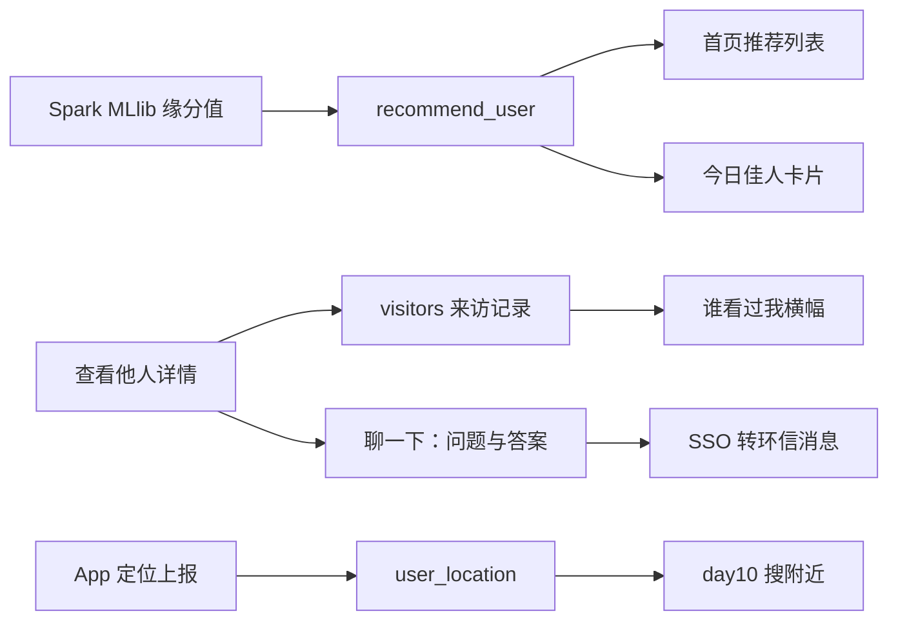

# day09 复盘：推荐、互动、位置三线并进，首页从此有血有肉

day09 是探花交友里功能密度最高的一天：首页从一张静态壳子变成有推荐、有访客、有互动的完整页面，地理位置的上报又给后续的搜附近埋好了数据伏笔。功能一口气铺了五个，收尾如果不复盘，代码跟着视频敲完就散了，这里按数据线把五张功能卡片重新归位，理清它们共享什么、各管什么、往哪里去。

## 先给结论

- 好友推荐是本日重头戏：默认推荐列表兜底冷启动，Spark MLlib 算缘分值撑起智能推荐，两层合流成首页的推荐列表与今日佳人。
- 谁看过我、佳人信息、聊一下构成互动三件套：一次「查看他人详情」的页面访问同时喂养访客链路与问题问答，消息经 SSO 抵达环信。
- 地理位置上报打通，`user_location` 靠 2dsphere 索引与有则更新无则新增持续沉淀，搜附近只差一个查询接口。
- day10 进入搜附近与探花配对：MongoDB 版先行、Elasticsearch geo 版对照，外加用户信息维护与 Nginx 路径配置。

## 一、五张功能卡片对号入座

课堂总结页给出的目录结构是五段：首页好友推荐（内含默认推荐列表与好友管理）、谁看过我、今日最佳、聊一下、地理位置。按数据落点重新排列，五段功能在三种存储上的分布一目了然：

| 功能 | 核心实现 | 数据落点 |
| --- | --- | --- |
| 好友推荐 | 默认推荐兜底 加 Spark MLlib 缘分值 | `recommend_user` 集合 |
| 谁看过我 | dubbo 读写 加 Redis 时间点分流 | `visitors` 集合 加 Redis |
| 佳人信息 | 详情页卡片组装 | MySQL 用户资料 加推荐分值 |
| 聊一下 | 问题问答 加 SSO 转环信消息 | 环信聊天记录 加 MySQL 问题表 |
| 地理位置 | 2dsphere 索引 加有则更新无则新增 | `user_location` 集合 |

五段功能没有一段是从零开始的孤岛：推荐消费 day06 到 day08 打底的 Spark 能力，聊一下复用消息功能里的好友建立逻辑，地理位置为 day10 的搜附近供数。



这张图把 day09 的产出与去向连成三线：推荐线以缘分值为源头铺满首页两个产品位，互动线由一次页面访问同时点亮访客与问答，位置线独立成线直通 day10。

## 二、推荐线：本日的重头戏

好友推荐被课堂反复强调为「重点学习内容」，要求能独立完成编码与程序设计。它分两层，兜底层与智能层。

兜底层解决冷启动：Spark 程序还没跑出数据、或新用户没有任何推荐结果时，首页不能空白。配置里预置一批默认用户，查询逻辑查不到推荐就取这份名单补齐资料后返回：

```properties
#默认推荐的用户，查不到推荐数据时兜底
tanhua.sso.default.recommend.users=2,3,4,5,6,7,8,9,10,11,12,13
```

消费侧的入口是推荐列表查询，token 解出用户、分页取推荐、筛选条件判空拼接，这条链路在 day2 立过模板：

```java
/**
 * 查询推荐用户列表
 *
 * @param queryParam 筛选条件
 * @param token      登录令牌
 */
public PageResult queryRecommendUserList(RecommendUserQueryParam queryParam, String token) {
    //获取当前登录用户
    User user = this.userService.queryUserByToken(token);
    if (null == user) {
        return null;
    }
    //查询推荐列表并按条件过滤
    ...
}
```

智能层是 Spark 侧的两两对比打分：把用户的行为数据两两比对算出缘分值，写回 `recommend_user`，首页按缘分值倒序消费。Spark 程序的骨架在总结页里再次亮相，外部配置进 SparkConf、本地模式起 SparkSession、输出指向 MongoDB：

```java
public class SparkUserRecommend {
    public static void main(String[] args) throws Exception {
        //读取外部配置文件
        InputStream inputStream =
                SparkUserRecommend.class.getClassLoader().getResourceAsStream("app.properties");
        Properties properties = new Properties();
        properties.load(inputStream);
        //构建 Spark 配置
        SparkConf sparkConf = new SparkConf()
                .setAppName("SparkUserRecommend")
                .setMaster("local[1]")
                .set("spark.mongodb.output.uri", properties.getProperty("spark.mongodb.output.uri"));
        //构建 Spark 上下文环境
        SparkSession sparkSession = SparkSession.builder().config(sparkConf).getOrCreate();
        ...
    }
}
```

两层合流的判断标准很具体：Spark 跑完，推荐列表出现真实缘分值；把集合清空，列表回落到默认名单，两个形态都能稳定复现，推荐线才算验收。

## 三、互动三件套：一次页面访问串起三个功能

谁看过我、佳人信息、聊一下三件套在页面上是三个入口，在数据上共享同一个动作。用户从推荐列表或今日佳人点进他人详情页时，三件事同时发生：详情接口组装出对方资料与缘分值卡片；来访记录落进 `visitors`，供对方首页的横幅与列表消费；详情页上的问题卡读出对方预设的问题，答案提交后经 SSO 投递到环信，消息写入双方聊天记录并推给对方账号。

对方收到问题卡片后回复并点击添加，好友建立的逻辑沿消息功能的既有实现走，聊一下不重复造轮子。三件套的验收同样可以列成断言：A 查看B 的详情，B 的访客记录多一条；B 打开首页横幅能看到 A；A 在详情页提交答案，B 的消息列表收到带问题与答案的卡片。三段各自可验，串起来就是一次完整的产品闭环。

## 四、位置线与 day10 预告

地理位置的闭环在本日完成一半：客户端按位移超 500 米或每 5 分钟的节奏上报，dubbo 接口有则更新无则新增，`user_location` 持续沉淀每个人的最新坐标、地名与时间线，2dsphere 与 userId 两个索引就位。剩下一半是消费：按距离筛选附近的人，这是 day10 的开场内容。

day10 的学习目标已经列出：MongoDB 版本的搜附近、Elasticsearch 集群搭建与 Elasticsearch 版本的搜附近（同一个需求两种实现对照，MongoDB 的 2dsphere 与 ES 的 geo 能力正面对比）、探花功能的编码（滑动配对的产品形态）、维护用户信息的功能，以及 Nginx 中不同路径的配置。位置数据线在本日埋好，day10 一上来就能消费。

## 五、自检清单

复盘是否到位，用五条自检验收：

- 默认推荐配置项与查询兜底逻辑能脱稿讲出，清空推荐集合后首页不空白。
- 缘分值的生产端（Spark 落库）与消费端（分页、今日佳人、详情页卡片）字段口径一致。
- `visitors` 的写入时机、Redis 时间点分流、最近六人的数量约定三处能对齐。
- 聊一下消息体的四个字段与两个用户 id 的方向说得清。
- `user_location` 的三个时间戳、两个索引、两条更新支路各自的条件能画出来。

## 常见误区

- **把 day09 当五个孤立功能记。** 错例：五个模块分别背代码，背完即忘。正解：按推荐、互动、位置三条数据线归位，记住每个功能的源头与去向，代码只是线上的节点。
- **忽略兜底与降级形态。** 错例：只验 Spark 跑通后的首页，冷启动形态从未看过。正解：每个有兜底的功能都要验两个形态，数据在与不在，页面都应可渲染。
- **只复盘代码不复盘口径。** 错例：能敲出方法体，却说不出两个 userId 谁是目标、三个时间戳谁记什么。正解：口径是联调与面试时最先被问的部分，放进自检清单逐条过。

## 面试可能被问到的问题

1. 面试官追问：「day09 的好友推荐整体方案怎么概括？」
   答：两层结构。默认推荐层用配置好的用户名单兜底冷启动；智能推荐层由 Spark 程序对用户行为做两两对比打分，缘分值写入 MongoDB 的推荐集合，服务端按分值倒序分页消费，叠加筛选条件时先取推荐再过滤。两层合流保证首页任何状态下都有内容。
2. 面试官追问：「谁看过我、佳人信息、聊一下为什么能算一条链路？」
   答：三者共用「查看他人详情」这一个动作。详情页渲染时消费推荐分值与用户资料，同一个动作写入访客记录，问题卡与答案提交又挂在同一页面。一次交互喂饱三个功能，数据链路上互相勾稽，验收时能跨功能对账。
3. 面试官追问：「地理位置功能在整体架构里的位置是什么？」
   答：上报侧已完成，App 按位移 500 米或 5 分钟的节奏把坐标与地名交上来，MongoDB 以 2dsphere 索引沉淀在 user_location；消费侧是搜附近，按距离筛选附近用户，后续会用 MongoDB 与 Elasticsearch geo 两种实现对照。它是典型的先沉淀后消费的数据线。
4. 面试官追问：「这一天的功能横跨 MySQL、MongoDB、Redis、Spark、环信，怎么向面试官讲清选型？」
   答：按数据形态对号入座：强关联的结构化资料放 MySQL；推荐分值、访客记录、位置这类文档型数据放 MongoDB，地理与地理索引是决定性理由；高频读写的时间点状态放 Redis；离线批量打分交给 Spark；即时消息与长连接外包给环信，业务侧只管投递。每个选型都能落到数据特征上，而不是堆名词。

## 配套资料

- 学习目标：`materials/code/07/day09 探花交友-好友推荐、今日佳人/day09/学习目标.md`，五项「独立完成」即本日验收清单。
- 学习目标：`materials/code/07/day10 探花交友-Elasticsearch geo实现搜附近/day10/学习目标.md`，day10 的搜附近与探花功能预告以此为准。
- 说明：day09 资料包仅含学习目标，无源码包；配置项、Spark 程序骨架与查询方法签名为按本课画面整理补全的示例，包名统一 `com.study.tanhua` 系；功能复盘按课堂总结的讲解归纳。
