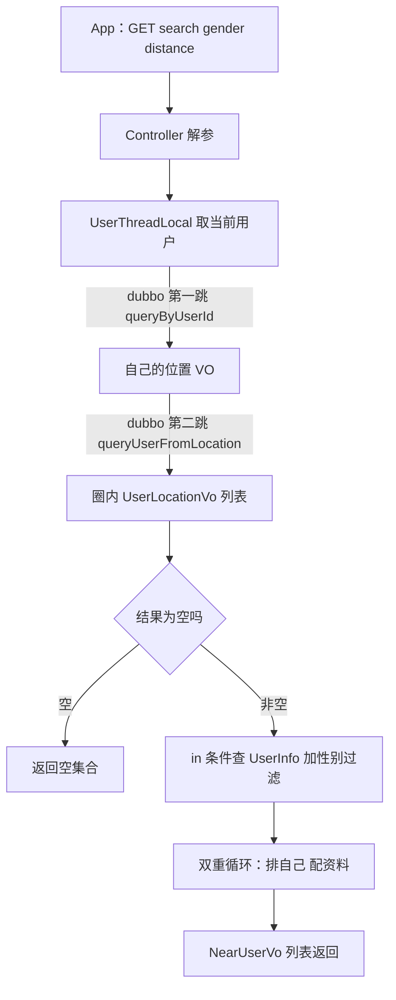

# 附近的人接口：从圈内查询到 App 卡片列表

> 🔒 安全提示：文中示例的口令/密钥均为课程教学环境演示口径，生产环境的安全要求见《安全与合规须知》。

dubbo 侧已经能把圈内用户捞出来，但 App 不直接调 dubbo。搜附近页面要的是一份带昵称与头像的卡片列表，位置数据在 MongoDB、资料在 MySQL、身份在 token 里，需要一层接口服务把三方缝起来。这一课按 mock 契约从上往下写：Controller 收参，Service 两跳 dubbo 加一次批量回查，双重循环完成排自己与配资料，最后装进模拟器与真实 App 联调。

## 先给结论

- 契约是 GET `search`，两个可选参数：gender 与 distance，distance 不传默认 2000 米；返回 NearUserVo 数组，字段只有 userId、nickname、avatar 三个。
- Controller 只做解参与状态码，业务集中在 `TodayBestService.queryNearUser`：两跳 dubbo（查自己位置、查圈内用户）加一次用户资料批量回查。
- 资料回查用 in 条件批量查，gender 为 man 或 woman 时追加 eq 条件；双重循环完成排自己与配资料，内层命中即 break。
- 联调两条经验：性别条件决定结果有没有；断点调试会拖垮 App 请求超时，换接口工具回测更稳。

## 一、契约先行：两个可选参数

mock 文档给出三件事：路径挂在探花入口下名为 `search`；参数 gender 与 distance 都可空；返回数据是数组。distance 是筛选半径，gender 决定只要男性、女性还是不限。Controller 按契约落码：

```java
@GetMapping("/search")
public ResponseEntity<List<NearUserVo>> queryNearUser(
        @RequestParam(value = "gender", required = false) String gender,
        @RequestParam(value = "distance", required = false) String distance) {
    try {
        List<NearUserVo> list = this.todayBestService.queryNearUser(gender, distance);
        return ResponseEntity.ok(list);
    } catch (Exception e) {
        e.printStackTrace();
    }
    return ResponseEntity.status(HttpStatus.INTERNAL_SERVER_ERROR).build();
}
```

方法挂进既有的 TodayBestController，返回值类型直接就是 List。NearUserVo 里三个属性：userId、昵称、头像。卡片只喂列表页展示，点进详情是另一套接口，契约在这里刻意做薄。

## 二、Service 组装：两跳 dubbo 加一次资料回查

Service 沿用 `@Reference` 注入 dubbo 接口，token 拦截器已把当前用户放进 ThreadLocal。第一步查自己的位置，第二步以自己的坐标为圆心查圈内人：

```java
@Reference(version = "1.0.0")
private UserLocationApi userLocationApi;

public List<NearUserVo> queryNearUser(String gender, String distance) {
    //距离不传，默认两公里
    if (StringUtils.isBlank(distance)) {
        distance = "2000";
    }
    User user = UserThreadLocal.get();
    //第一跳：查当前用户自己的位置
    UserLocationVo userLocation = this.userLocationApi.queryByUserId(user.getId());
    //第二跳：以自己的坐标为圆心查询范围内用户
    List<UserLocationVo> userLocationVoList = this.userLocationApi.queryUserFromLocation(
            userLocation.getLongitude(), userLocation.getLatitude(),
            Integer.valueOf(distance));
    if (CollectionUtils.isEmpty(userLocationVoList)) {
        return Collections.emptyList();
    }
    //收集 userId，回查用户资料
    List<Long> userIds = new ArrayList<>();
    for (UserLocationVo locationVo : userLocationVoList) {
        userIds.add(locationVo.getUserId());
    }
    QueryWrapper<UserInfo> queryWrapper = new QueryWrapper<>();
    queryWrapper.in("user_id", userIds);
    if (StringUtils.isNotBlank(gender)) {
        if (StringUtils.equalsIgnoreCase(gender, "man")) {
            queryWrapper.eq("sex", SexEnum.MAN);
        } else if (StringUtils.equalsIgnoreCase(gender, "woman")) {
            queryWrapper.eq("sex", SexEnum.WOMAN);
        }
    }
    List<UserInfo> userInfoList = this.userInfoService.queryUserInfoList(queryWrapper);
    return this.assembleNearUser(user, userLocationVoList, userInfoList);
}
```



图里两跳 dubbo 是关键：第一跳拿到圆心，第二跳画出圆。空结果提前短路，后面只剩资料组装。契约里的 distance 是字符串，dubbo 参数是 Double，`Integer.valueOf` 转换后自动加宽，类型边界在服务层显式处理。

## 三、双重循环：排自己、配资料

非空意味着圈内有人，昵称头像却在 MySQL 的用户表里，组装环节是一个两层循环。外层走位置列表，内层在资料列表里找同一个人，两处细节决定正确性：

```java
private List<NearUserVo> assembleNearUser(User user,
        List<UserLocationVo> userLocationVoList, List<UserInfo> userInfoList) {
    List<NearUserVo> result = new ArrayList<>();
    for (UserLocationVo locationVo : userLocationVoList) {
        //搜附近会把自己也查出来，先排除自己
        if (locationVo.getUserId().longValue() == user.getId().longValue()) {
            continue;
        }
        for (UserInfo userInfo : userInfoList) {
            if (locationVo.getUserId().longValue() == userInfo.getUserId().longValue()) {
                NearUserVo nearUserVo = new NearUserVo();
                nearUserVo.setUserId(userInfo.getUserId());
                nearUserVo.setNickname(userInfo.getNickName());
                nearUserVo.setAvatar(userInfo.getLogo());
                result.add(nearUserVo);
                break;
            }
        }
    }
    return result;
}
```

以自己坐标画圆，自己必然在圆内，所以 userId 等于当前用户时直接 continue；内层匹配到对应资料就 new 一个 NearUserVo 填三个字段并 break，防止重复添加。性别过滤拼进 SQL 的 eq 条件而不是放在内存里筛，是这层组装的巧处：圈内查询归 MongoDB，资料与性别归 MySQL，两个存储各干各的活，应用层只做缝合。

双重循环是朴素的 O(n×m) 写法，数据规模小时直白可靠；圈里人一多，把 userInfoList 转成 `Map<Long, UserInfo>` 再按键取值是顺手的优化，面试聊到批量组装时值得主动提。

## 四、联调：条件与效果对表

dubbo 服务与接口服务起来后，先用接口工具带 token 请求 search，返回的数组三件套齐全（头像域名用占位地址表示）：

```json
[
  {
    "userId": 25,
    "nickname": "helma_25",
    "avatar": "https://example.com/avatar_25.jpg"
  },
  {
    "userId": 27,
    "nickname": "helma_27",
    "avatar": "https://example.com/avatar_27.jpg"
  }
]
```

再装进模拟器走真实 App：测试账号登录（课程环境验证码固定 123456），进入首页点开搜附近，默认距离 500 米时提示附近 0 个好友；距离调到 2000 依然空，问题不在距离而在性别，数据里的用户性别与筛选值对不上；调整性别后再查，列表出来了。断点观察一轮：筛选男性、3000 米时圈内查到 6 人，排除自己 5 人；去掉断点用接口回测，distance 传 2000 与 2500 都稳定返回 5 人，与断点观察的结果对上。

App 联调时打断点要克制：请求在服务端断点处挂住，App 侧等不到响应就超时报错，现象像是接口挂了，其实是调试节奏问题。断点验证逻辑、接口工具验证结果，两条路分开走，联调效率反而高。

## 常见误区

- **忘了排除自己。** 错例：以自己的坐标画圆，自己一定在圆内，列表第一个永远是本人。正解：循环里比对 userId，命中即 continue，附近的人不含自己。
- **性别过滤放进内存。** 错例：资料全查回来再在 Java 里筛性别，人多时白白搬运数据。正解：性别条件拼进 QueryWrapper，过滤交给 MySQL。
- **distance 用字符串直传。** 错例：契约里 distance 是字符串，直接塞给 dubbo 的 Double 参数，类型对不上。正解：`Integer.valueOf` 转换后自动加宽成 Double，契约层与服务层的类型边界显式转换。
- **空结果不判空直接往下走。** 错例：不判空就循环取值，空指针一路打到 500。正解：`CollectionUtils.isEmpty` 短路返回空集合，接口永远返回合法数组。

## 面试可能被问到的问题

1. 面试官追问：「搜附近的接口为什么要两跳 dubbo，不能一次查完？」
   答：第一跳拿自己的位置作为圆心，第二跳画圆查人，两个查询职责不同、复用场景也不同，单人位置查询还被其他页面复用。合并成一次需要在接口里耦合定位逻辑或让客户端透传坐标，边界就乱了。
2. 面试官追问：「附近的人列表为什么不带距离字段？」
   答：本课契约只喂列表页展示，卡片只需要 userId、昵称、头像。要展示距离，可以让 dubbo 返回带距离的结果，比如聚合 geoNear，或用两点经纬度在应用层按 Haversine 公式补算，契约按页面需要加字段即可。
3. 面试官追问：「in 条件查用户资料，userId 特别多时怎么办？」
   答：in 的长度要有上限，搜附近通常先按距离截断，只取最近的一批；更大规模走分页或缓存热门用户资料。数量受控时，in 命中 user_id 索引是最高效的批量回查方式。
4. 面试官追问：「性别筛选放在 MongoDB 一侧做行不行？」
   答：可以，但需要把性别冗余进位置文档，业务字段一变就要同步，一致性负担上来了。课程选择位置归 MongoDB、资料归 MySQL，应用层用 userId 缝合，存储各司其职，扩展性更好。

## 配套资料

- 学习目标：`materials/code/07/day10 探花交友-Elasticsearch geo实现搜附近/day10/学习目标.md`，「独立完成 MongoDB 版本的搜附近功能」的接口层即本课内容。
- 说明：day10 资料包仅含学习目标，无源码包；Controller、Service 与 VO 为按本课画面整理补全的可编译示例，包名统一 `com.study.tanhua` 系；联调数据取自课堂演示值，头像域名以占位地址表示。
