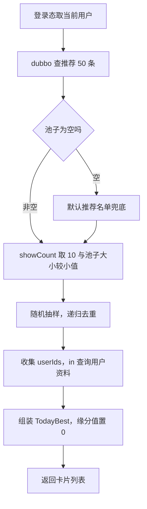

# 探花卡片接口：从推荐池随机抽人，给左滑右滑备好数据

> 🔒 安全提示：文中示例的口令/密钥均为课程教学环境演示口径，生产环境的安全要求见《安全与合规须知》。

首页顶部的第一个入口就是探花。它的产品形态是一叠卡片：系统把推荐好友随机抽出来铺在页面上，用户对每张卡片做两个动作，左滑表示不喜欢，右滑表示喜欢；如果双方都右滑了对方，两人就互为好友。好友注册的逻辑在消息功能里已经就位，这一课先把前置的数据接口做出来：推荐池怎么建、怎么随机抽 10 个人、怎么组装成卡片返回。左滑右滑的落库动作留给后续两课。

看起来简单的接口里藏着两个工程问题：推荐池可能不足 10 人，硬取 10 个会下标越界；随机抽样可能抽到同一个人，卡片出现重复。这两个问题的解法构成了本课的主体。

## 先给结论

- 接口响应复用 `TodayBest` vo，mock 文档只约定 id、头像、昵称三个字段，缘分值不返回，组装时置 0 以防 APP 端解析报错。
- 数据池来自 dubbo 的推荐查询，一次取 50 条；池子为空时回退到配置里的默认推荐名单，与首页推荐列表同一套兜底。
- 展示数量用 `Math.min(10, records.size())` 计算，池子不足 10 人时按实际数量出牌，天然防越界。
- 随机抽样配递归去重：抽到已选过的人就重随一次，直到凑齐不重复的卡片集合。
- 用户资料用 in 条件批量查一次，双重循环只剩一层，组装逻辑复用今日佳人的口径。

## 一、左滑右滑背后的数据契约

卡片页没有筛选条件、没有分页，一次请求返回一批卡片就够。mock 文档把响应字段压到最少：id、头像、昵称，三个字段支撑卡片正面渲染。响应结构却不必新建模型，与今日佳人是同一个 `TodayBest` vo，多出来的字段（年龄、性别、标签、缘分值）可以带上也可以不带，前端渲染卡片正面只读那三个字段。

复用 vo 有个小代价：vo 里的 `fateValue` 字段在探花场景没有数据来源，推荐分值在卡片接口里用不上。字段不赋值时序列化成 null，部分客户端对 null 数值的解析不友好，所以组装时给缘分值置 0，让 JSON 里永远是一个合法数字。



图上两个菱形是健壮性所在：池子空了有兜底，池子小了有 min 保护。剩下的随机抽样与组装是纯业务逻辑，顺着箭头读即可。

## 二、推荐池：50 条推荐与默认名单兜底

入口在 `TodayBestController` 里新增一个 GET 接口，方法直接透传 service 结果（路径以 mock 文档为准，示例按本课写法补全）：

```java
/**
 * 探花卡片：随机推荐好友列表
 */
@GetMapping("queryCardsList")
public ResponseEntity<List<TodayBest>> queryCardsList() {
    try {
        List<TodayBest> list = this.todayBestService.queryCardsList();
        return ResponseEntity.ok(list);
    } catch (Exception e) {
        e.printStackTrace();
    }
    return ResponseEntity.status(HttpStatus.INTERNAL_SERVER_ERROR).build();
}
```

service 的第一步是建池。从线程上下文取当前登录用户，调 dubbo 的推荐查询，页码固定第 1 页、每页 50 条：

```java
public List<TodayBest> queryCardsList() {
    //当前登录用户
    User user = UserThreadLocal.get();
    //查询推荐数据，一次取 50 条作随机池
    PageInfo<RecommendUser> pageInfo =
            this.recommendUserService.queryRecommendUserList(user.getId(), 1, 50);
    List<RecommendUser> records = pageInfo.getRecords();
    if (CollectionUtils.isEmpty(records)) {
        //推荐池为空，回退默认推荐名单
        String[] ss = StringUtils.split(this.defaultRecommendUsers, ',');
        for (String s : ss) {
            RecommendUser recommendUser = new RecommendUser();
            recommendUser.setUserId(Long.valueOf(s));  //被推荐的人
            recommendUser.setToUserId(user.getId());   //推荐给当前用户
            records.add(recommendUser);
        }
    }
    ...
}
```

池子取 50 而不是直接取 10，是给随机性留余地：每次进页面都从 50 人里抽 10 个，两次刷新看到的卡片大概率不同，这正是探花「随机推荐」的产品语义；如果按页固定取 10 条，用户每次看到的都是同一批人，随机性就没了。

兜底分支与首页推荐列表的口径完全一致：配置项里的默认用户名单按逗号拆开，逐个构造 `RecommendUser`，`userId` 是被推荐的人，`toUserId` 是当前用户，方向与 `recommend_user` 集合的字段语义对齐。默认名单没有缘分值，这里也用不上，卡片接口不消费 score 字段。

## 三、随机抽样：Math.min 防越界与递归去重

抽样先算数量。目标随机 10 个，但池子可能只有三五个，循环写死 10 次、每次按下标取值，越界异常立刻报到。取两者的较小值：

```java
//最多展示 10 张卡片，池子不足 10 时以实际数量为准
int showCount = Math.min(10, records.size());
List<RecommendUser> newRecommendUserList = new ArrayList<>();
for (int i = 0; i < showCount; i++) {
    //随机取一个，重复则递归重随
    this.createRecommendUser(newRecommendUserList, records);
}
```

单次抽取与去重收进一个私有递归方法：

```java
/**
 * 递归随机生成推荐好友，保证不重复
 */
private void createRecommendUser(List<RecommendUser> newRecommendUserList, List<RecommendUser> records) {
    RecommendUser recommendUser = records.get(RandomUtils.nextInt(0, records.size()));
    if (!newRecommendUserList.contains(recommendUser)) {
        newRecommendUserList.add(recommendUser);
    } else {
        //已选过，再随一次
        this.createRecommendUser(newRecommendUserList, records);
    }
}
```

`RandomUtils.nextInt(0, records.size())` 是左闭右开区间，返回值正好可以当集合下标用。去重靠 `contains`，它背后调 `equals`，`RecommendUser` 上的 lombok `@Data` 生成的是全字段 equals，池子里的对象 `toUserId` 都相同、默认名单又没有分值，同一个人抽两次构造出的对象字段完全一致，`contains` 判得准。更稳妥的写法是拿 `Set<Long>` 记 userId 判重，不依赖 equals 的字段口径，值得作为改进项记住。

递归的终止条件藏在分支里：没选过就放入并结束，选过就再随一次。最坏情况是池子里只剩一个人没选过而运气一直抽到别人，递归深度会涨，但 showCount 不超过 10、池子有兜底保障，实际不可能失控。讲义里的实现没有做这一层去重，直接随机塞入；课堂补上递归是为了更贴近真实产品，两种实现都认可，去重与否是产品决策不是技术对错。

## 四、in 查询组装卡片

选中的人已去重，资料查询可以一步到位：收集 userIds，用 MyBatis-Plus 的 QueryWrapper 拼 in 条件，一次带回所有资料：

```java
//收集选中用户的 id，批量查资料
List<Long> userIds = new ArrayList<>();
for (RecommendUser recommendUser : newRecommendUserList) {
    userIds.add(recommendUser.getUserId());
}
QueryWrapper<UserInfo> queryWrapper = new QueryWrapper<>();
queryWrapper.in("id", userIds);
List<UserInfo> userInfoList = this.userInfoService.queryUserInfoList(queryWrapper);
//组装卡片：复用今日佳人的补全口径，缘分值不返回
List<TodayBest> result = new ArrayList<>();
for (UserInfo userInfo : userInfoList) {
    TodayBest todayBest = new TodayBest();
    todayBest.setId(userInfo.getId());
    todayBest.setAvatar(userInfo.getLogo());
    todayBest.setNickname(userInfo.getNickName());
    todayBest.setGender(userInfo.getSex().name().toLowerCase());
    todayBest.setAge(userInfo.getAge());
    todayBest.setTags(StringUtils.split(userInfo.getTags(), ','));
    todayBest.setFateValue(0L);  //mock 不含缘分值，置 0 防 APP 解析报错
    result.add(todayBest);
}
return result;
```

组装段是今日佳人那套补全逻辑的复述：头像取 `logo` 列，性别枚举名转小写，标签按逗号拆数组。区别在缘分值：今日佳人从推荐集合查真实分值，卡片接口没有这个诉求，置 0 交差。`tags` 列的逗号分隔约定与 `tb_user_info` 的表结构保持同一份口径，资料查询走的是既有的 dubbo 用户资料服务，本课不新开数据通道。

## 五、联调：数据先就位，滑动后行

服务重启后先在 REST 工具里请求一次，返回的数组字段齐整、条数正常。随后在安卓模拟器里走真实流程：测试手机号（敏感信息已打码）加固定验证码 123456 登录，进首页点顶部探花入口，卡片页弹出，头像、昵称、年龄、标签依次渲染，多刷新几次能看到卡片组合在变化，随机性生效。

页面上左滑右滑两个动作目前没有接口支撑，滑动之后不会有任何落库，这是预期中的半成品状态：本课交付的是卡片数据接口，喜欢与不喜欢的读写链路是紧随其后的两课。数据先就位、交互后接入，前后端按这个顺序推进时互不阻塞。

## 常见误区

- **循环写死 10 次。** 错例：池子只有 5 条也循环 10 次，`records.get(i)` 在第 6 次抛下标越界。正解：`Math.min(10, records.size())` 算出实际展示数，池小按池出牌。
- **池子为空直接返回。** 错例：查不到推荐就返回空列表甚至 null，新用户进探花页一片空白。正解：回退默认推荐名单，与首页推荐列表共用一份配置。
- **缘分值不赋值。** 错例：vo 的 `fateValue` 留 null，客户端解析数值字段报错或显示异常。正解：无数据来源的字段置默认值 0，保证 JSON 结构稳定。
- **随机不去重。** 错例：连续随机往结果里塞，同一个人出现两三张卡，用户滑到重复卡片观感很差。正解：contains 判重加递归重随，或用 Set 记已选 userId。

## 面试可能被问到的问题

1. 面试官追问：「从 50 条里随机抽 10 条且不重复，还有什么别的写法？」
   答：可以把集合用 `Collections.shuffle` 打乱后取前 10 个，一次洗牌天然不重复，复杂度低于反复重随；或者拿 Set 记录已选下标，重随直到塞满。递归重随的写法直观，但池子接近目标数时冲突概率上升，洗牌法在这类「部分抽样」场景里是更工程化的选择。
2. 面试官追问：「推荐池为空的兜底为什么要与首页推荐列表共用一份配置？」
   答：默认名单表达的是产品的冷启动策略，同一份策略在所有推荐出口保持一致，用户无论从首页还是探花页进来看到的兜底人群都相同，避免出现两套口径。配置集中也方便运营统一调整冷启动名单。
3. 面试官追问：「卡片接口和今日佳人接口共用 TodayBest，有什么约束？」
   答：vo 必须保持字段中性，不能沾上某一场景的专有逻辑；每个场景对没有数据来源的字段给出明确默认值，序列化结构保持稳定。好处是前端复用一套渲染模型，坏处是字段语义要靠文档约束，字段膨胀后应考虑按场景裁剪。
4. 面试官追问：「探花为什么从 50 人池子里随机抽，而不是按缘分值取 top10？」
   答：产品语义是随机曝光，让用户每次刷新看到不同的人，扩大接触面；缘分值排序已经在首页的今日佳人与推荐列表里承担了精确曝光的职责，探花补的是「多看看别人」的探索场景。两个出口各有数据策略，避免同一批人霸屏。

## 配套资料

- 学习目标：`materials/code/07/day10 探花交友-Elasticsearch geo实现搜附近/day10/学习目标.md`，「独立完成探花功能的编码」的数据接口部分即本课验收对象。
- 原型：`materials/code/07/day01 探花交友-项目搭建以及登录完善个人信息/day01/资料/探花交友移动端原型V1.2`，探花卡片页与左滑右滑交互形态的出处。
- 数据库：`materials/code/07/day01 探花交友-项目搭建以及登录完善个人信息/day01/代码/mytanhua.sql`，`tb_user_info` 资料列与 `tags` 逗号分隔的存储约定。
- 说明：day10 资料包仅含学习目标，无源码包；Controller、Service、抽样与组装逻辑为按课程画面整理补全的可编译示例，包名统一 `com.study.tanhua` 系；接口路径以课程 mock 文档为准；测试手机号属敏感信息已打码。
