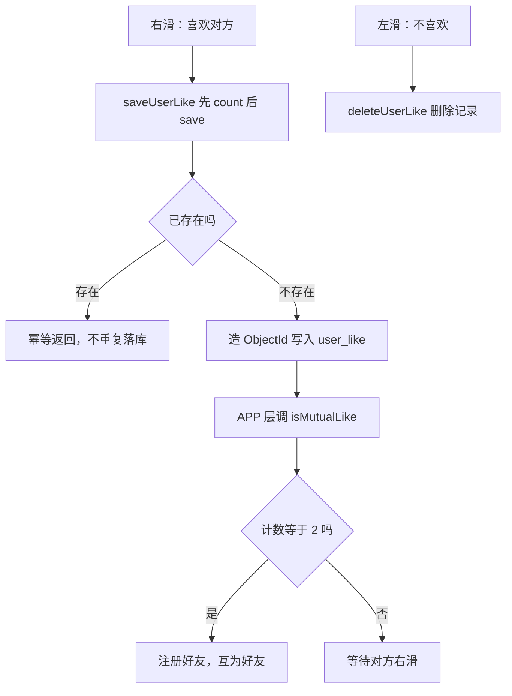

# 右滑喜欢落库：UserLike 集合与双向喜欢的判定

探花页的卡片数据已经就位，左滑右滑要开始动数据了。产品交互约定得很清楚：左滑不喜欢，右滑喜欢；如果两个人都朝右滑了对方，两人互为好友。好友注册的逻辑在消息功能里已经实现过，所以这一课要立起来的是喜欢关系本身的数据层：喜欢以什么结构存，dubbo 接口怎么读写，双向喜欢用什么条件判定。本课只做 dubbo 接口实现，APP 接口层与好友注册的编排紧随其后。

一个容易想岔的点先摆平：喜欢是单向的，A 喜欢 B 与 B 喜欢 A 是两条独立记录；双向喜欢不是一种存储形态，而是一个查询结论。

## 先给结论

- 喜欢关系存 MongoDB 的 `user_like` 集合，一行记录一个单向关系，字段只有 id、`userId`（自己）、`likeUserId`（对方）、创建时间。
- dubbo 接口 `UserLikeApi` 三个方法：`saveUserLike` 幂等保存并返回主键，`isMutualLike` 判定双向喜欢，`deleteUserLike` 删除记录供左滑使用。
- 保存前先按双条件 count，已存在直接返回，同一对方向的喜欢永远只落一条。
- 双向喜欢的判定是 or 串起两个方向的等值条件后计数，等于 2 即成立。
- 左滑只做删除；若日后要把不喜欢当推荐减分项，得单独沉淀不喜欢数据，那是另一个集合的事。

## 一、一行单向记录表达喜欢

喜欢关系的结构越小越好，`UserLike` 只有四个字段：

```java
package com.study.tanhua.dubbo.server.pojo;

import lombok.AllArgsConstructor;
import lombok.Data;
import lombok.NoArgsConstructor;
import org.bson.types.ObjectId;
import org.springframework.data.mongodb.core.mapping.Document;

@Data
@NoArgsConstructor
@AllArgsConstructor
@Document(collection = "user_like")
public class UserLike implements java.io.Serializable {

    private static final long serialVersionUID = 673996663629466523L;

    private ObjectId id;
    private Long userId;      //用户 id，自己
    private Long likeUserId;  //喜欢的用户 id，对方
    private Long created;     //创建时间
}
```

`userId` 是动作的发出者，`likeUserId` 是被喜欢的人，方向语义钉死在这两个字段上。存储选 MongoDB 与项目文档栈一致：喜欢关系是典型的行为型数据，结构简单、写入频繁、按用户维度查询，没有跨表事务诉求。只存单向记录是刻意的：双向信息由两条单向记录组合查询得出，避免了双向表里「A 与 B 互相喜欢」这类冗余状态在维护时出现两个方向不一致的尴尬。

至于左滑的不喜欢，当前版本不落库，删除即表达态度。留一个思考在结尾：如果推荐系统日后要把「不喜欢」当减分项，就需要把不喜欢也存下来，那时候的结构设计与此处的喜欢对称。

## 二、dubbo 接口与三个方法

接口定义放在 dubbo 服务工程的 api 包里，与位置、访客那些接口同住：

```java
public interface UserLikeApi {

    /**
     * 保存喜欢
     *
     * @param userId     用户 id，自己
     * @param likeUserId 喜欢的用户 id，对方
     * @return 喜欢数据的主键
     */
    String saveUserLike(Long userId, Long likeUserId);

    /**
     * 判断两个用户是否相互喜欢
     */
    Boolean isMutualLike(Long userId, Long likeUserId);

    /**
     * 删除用户喜欢
     */
    Boolean deleteUserLike(Long userId, Long likeUserId);
}
```

实现类标注 `@Service(version = "1.0.0")`，注入 `MongoTemplate`。保存方法先查后写，把幂等做在入口：

```java
@Override
public String saveUserLike(Long userId, Long likeUserId) {
    //同一对方向的喜欢只存一条，已存在则不再落库
    Query query = Query.query(Criteria.where("userId").is(userId)
            .and("likeUserId").is(likeUserId));
    long count = this.mongoTemplate.count(query, UserLike.class);
    if (count > 0) {
        return null;  //已存在，幂等返回
    }
    UserLike userLike = new UserLike();
    userLike.setId(ObjectId.get());
    userLike.setUserId(userId);
    userLike.setLikeUserId(likeUserId);
    userLike.setCreated(System.currentTimeMillis());
    this.mongoTemplate.save(userLike);
    return userLike.getId().toHexString();
}
```

已存在分支返回 null，语义是「无需再落库」，上层不拿它当失败；如果调用方希望拿到已有记录的主键，把 count 换成 findOne、返回查到记录的 id 是更好的形态，两种写法都能自洽，关键是幂等这层判断不能省。新记录用 `ObjectId.get()` 造主键，创建时间取当前毫秒值，保存后把主键的十六进制串交出去，调用方可用它做日志追踪。

删除方法同样用双条件定位，看删除计数说话：

```java
@Override
public Boolean deleteUserLike(Long userId, Long likeUserId) {
    Query query = Query.query(Criteria.where("userId").is(userId)
            .and("likeUserId").is(likeUserId));
    DeleteResult deleteResult = this.mongoTemplate.remove(query, UserLike.class);
    return deleteResult.getDeletedCount() == 1;
}
```

条件精确到一条文档，删除计数为 1 才算成功；传进来的方向本来就没有记录时计数为 0，方法返回 false，左滑一个从未右滑过的人也得到明确应答。

双向喜欢的判定把两个方向的等值条件用 or 串起来：

```java
@Override
public Boolean isMutualLike(Long userId, Long likeUserId) {
    //方向一：我喜欢对方
    Criteria criteria1 = Criteria.where("userId").is(userId)
            .and("likeUserId").is(likeUserId);
    //方向二：对方喜欢我
    Criteria criteria2 = Criteria.where("userId").is(likeUserId)
            .and("likeUserId").is(userId);
    Criteria criteria = new Criteria().orOperator(criteria1, criteria2);
    Query query = Query.query(criteria);
    //两个方向各一条记录，计数为 2 即双向成立
    long count = this.mongoTemplate.count(query, UserLike.class);
    return count == 2;
}
```

判定逻辑念出来就是一句话：我喜欢你这条记录在，你喜欢我这条记录也在，计数为 2，双向成立。参数顺序颠倒不影响结论，条件一与条件二互换后 or 的结果不变，判定天然对称，这与「互相喜欢」的业务语义正好同构。



图上右滑主线的终点没有直接落在好友注册上，而是停在 `isMutualLike` 的判定旁，注册动作由 APP 接口层在判定为真后触发，dubbo 层只提供原子读写。这一层职责划分下一节展开。

## 三、单元测试：三条数据验证双向判定

测试类把 dubbo 实现当本地 bean 调，三份喜欢数据覆盖了双向与单向两种形态：

```java
@RunWith(SpringJUnit4ClassRunner.class)
@SpringBootTest
public class TestUserLikeApiImpl {

    @Autowired
    private UserLikeApi userLikeApi;

    @Test
    public void testSave() {
        //11 喜欢 21，11 喜欢 31，21 喜欢 11
        this.userLikeApi.saveUserLike(11L, 21L);
        this.userLikeApi.saveUserLike(11L, 31L);
        this.userLikeApi.saveUserLike(21L, 11L);
    }

    @Test
    public void testIsMutualLike() {
        System.out.println(this.userLikeApi.isMutualLike(11L, 21L));  //true
        System.out.println(this.userLikeApi.isMutualLike(21L, 11L));  //true
        System.out.println(this.userLikeApi.isMutualLike(11L, 31L));  //false
    }

    @Test
    public void testDeleteUserLike() {
        System.out.println(this.userLikeApi.deleteUserLike(11L, 21L));  //true
        System.out.println(this.userLikeApi.deleteUserLike(11L, 31L));  //true
        System.out.println(this.userLikeApi.deleteUserLike(21L, 11L));  //true
    }
}
```

测试前做两件事保证环境干净：把 MongoDB 里的 `user_like` 集合 drop 掉，避免旧数据干扰计数判定；把已启动的 dubbo 提供者服务停掉，因为测试类以 Spring Boot 方式启动会重复注册同一个 dubbo 服务，端口与注册中心都会冲突。

执行顺序对应三个测试方法。`testSave` 跑完回库看，`user_like` 集合三条文档：11 喜欢 21、11 喜欢 31、21 喜欢 11。`testIsMutualLike` 打印三个结果：11 与 21 为 true，21 与 11 也为 true，参数顺序对称成立；11 与 31 为 false，因为 31 没有喜欢 11 的记录，单向喜欢不算数。`testDeleteUserLike` 打印三个 true，回库确认集合已清空。保存、判定、删除三个方法在一次完整的测试循环里各自兑现了行为。

## 四、双向喜欢之后：好友注册的交接

dubbo 层交付的是三个原子能力，完整的产品闭环在 APP 接口层编排：右滑请求进来，先调 `saveUserLike` 落库，再调 `isMutualLike` 问一句是否互相喜欢，返回 true 就走消息功能里已有的好友建立逻辑，把两个人注册成好友，此后双方的动态与消息按好友链路走。判定为 false 就安静返回，等待对方也右滑的那一刻。

把好友注册留在业务层而不是塞进 dubbo 的 `saveUserLike` 里，是职责划分的取舍：喜欢落库是原子操作，好友建立涉及另一个领域的数据写入，耦合在一起会让 dubbo 方法的事务边界与失败语义都变得模糊。业务层编排的好处是每一步的成败都有明确的补偿位置。

不喜欢这条线在当前版本只删除记录。推荐侧的延伸值得预埋一句：如果「不喜欢」要参与推荐打分，减分项需要以数据为原料，那时应单独沉淀不喜欢记录而非依赖删除动作的痕迹，这是后续可以扩展的方向。

## 常见误区

- **把 user_like 当双向表用。** 错例：以为 A 与 B 互相喜欢存一条记录，存的时候分不清 userId 填谁，查询时两个方向都要模糊匹配。正解：一行只表达一个单向关系，双向是查询结论不是存储形态。
- **保存不做幂等。** 错例：每次右滑都 save 一条，同一对方向攒出多条记录，`isMutualLike` 的计数不再等于 2，双向判定直接失真。正解：保存前按双条件 count，已存在就返回。
- **双向判定写成计数大于 0。** 错例：or 条件查到一条就判定互相喜欢，单方面的暗恋被当成两情相悦，好友注册被错误触发。正解：两个方向各一条，计数等于 2 才成立。
- **删除结果不看计数。** 错例：`remove` 执行完无脑返回 true，方向传反或记录不存在时上层拿到虚假成功。正解：以 `getDeletedCount()` 是否为 1 作为删除成功的判据。

## 面试可能被问到的问题

1. 面试官追问：「喜欢关系为什么单向存储，双向怎么判定？」
   答：单向记录是原子事实，A 喜欢 B 是一个动作，B 喜欢 A 是另一个动作，各自独立发生、独立变化。双向关系由两条单向记录组合查询得出，or 两个方向的条件后计数等于 2 即成立。这样存储避免了双向状态与两条单向事实之间的一致性维护。
2. 面试官追问：「计数等于 2 的判定有什么隐患？」
   答：它依赖每对方向最多一条记录的前提。保存没有幂等或并发重复写入时，同一方向出现多条，计数失真，双向判定可能漏判。改进是给 userId 加 likeUserId 建唯一索引从存储层兜底，或把判定改为两个方向各做一次存在性查询，两个都命中才算双向。
3. 面试官追问：「先 count 再 save 有并发窗口，怎么补？」
   答：两个请求同时通过 count 检查会双写，唯一索引是最终防线，重复插入直接报错，业务上捕获后视为已喜欢。追求更平滑的可以用 findAndModify 或 upsert 把查写合一，课程先查后写的版本胜在逻辑直白，配合唯一索引即可投产。
4. 面试官追问：「好友注册为什么放在 APP 接口层，不放进 dubbo 的保存方法里？」
   答：dubbo 层定位是原子数据服务，保存喜欢只做落库；好友建立是跨领域的业务编排，有自己的校验与通知诉求。放业务层让每一步的失败都有明确的处理位置，dubbo 方法也更容易被测试与复用，比如清理数据的任务可以单独调删除而不牵动好友关系。
5. 面试官追问：「不喜欢为什么当前只做删除，不做记录？」
   答：产品上不喜欢的直接诉求是这张卡别再出现，删除即达成。要把态度喂给推荐系统做减分，才需要持久化不喜欢记录，那是一份新的数据资产，涉及量级与隐私的考量，值得单独立项而不是顺手塞进喜欢集合里加个字段。

## 配套资料

- 学习目标：`materials/code/07/day10 探花交友-Elasticsearch geo实现搜附近/day10/学习目标.md`，「独立完成探花功能的编码」中喜欢关系的数据层即本课验收对象。
- 说明：day10 资料包仅含学习目标，无源码包；实体、dubbo 接口、实现类与测试类为按课程画面整理补全的可编译示例，包名统一 `com.study.tanhua` 系；好友注册复用消息功能的既有实现，在本课中仅作流程预告。
