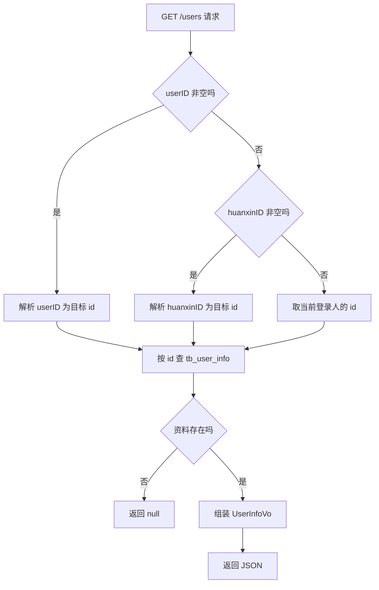

# 用户资料查询：一个接口兼容自己、他人与环信 ID 三种视角

「我的」模块里第一个要落地的接口是用户资料的读取。看似一个按 id 查表的小接口，契约里却放了两个可选参数：`userID` 与 `huanxinID`。为什么要放两个入参、都不传时查谁、环信 ID 怎么能当用户 id 用，这一课把参数解析、表查询与字段组装三段串起来，顺带修正讲义里的一处类型笔误。

## 先给结论

- 接口 `GET /users`，两个参数全部可选：不带参数查当前登录人，带 `userID` 查任意用户，带 `huanxinID` 按环信 ID 反查。
- 参数优先级：`userID` 高于 `huanxinID`，都不传时回落到线程上下文里的登录人，三种视角共用一条查询路径。
- `huanxinID` 存在的原因是 IM 场景：用户第一次收到环信推来的消息时，消息里不带用户资料，端上只能拿环信 ID 来补查。
- 后台把用户 id 与环信 ID 设计成一对一相等，反查因此退化为一次普通的按 id 查询，不需要额外的映射表。
- 组装有三处转换：年龄整型转字符串、收入拼上 K 单位、婚姻从库里的中文转成 1 与 0；vo 的 marriage 是 int，讲义此处笔误写成字符串，联调前已修正。

## 一、接口契约与 vo：mock 字段照单全收

mock 文档给这张接口列了完整的返回字段：id、头像、昵称、生日、年龄、性别、城市、学历、收入、行业、婚姻状况，并附了每个字段的校验规则。按这份契约建 vo（mock 文档地址以课程资料为准，站点域名以 example.com 占位）：

```java
@Data
public class UserInfoVo implements java.io.Serializable {
    private Long id;           //用户 id
    private String avatar;     //头像
    private String nickName;   //昵称
    private String birthday;   //生日
    private String age;        //年龄，字符串
    private String gender;     //性别：man / woman
    private String city;       //城市
    private String education;  //学历
    private String income;     //月收入，带 K 单位
    private String profession; //行业
    private Integer marriage;  //婚姻状况：1 已婚，0 未婚
}
```

字段类型不是照抄数据库，而是照抄端上的消费习惯：年龄在端上按字符串渲染，婚姻按数字渲染，vo 里就分别是 String 与 Integer。controller 层薄薄一层：

```java
@GetMapping
public ResponseEntity<UserInfoVo> queryUserInfo(
        @RequestParam(value = "userID", required = false) String userID,
        @RequestParam(value = "huanxinID", required = false) String huanxinID) {
    UserInfoVo userInfoVo = this.usersService.queryUserInfo(userID, huanxinID);
    if (null == userInfoVo) {
        return ResponseEntity.ok(null);
    }
    return ResponseEntity.ok(userInfoVo);
}
```

`required = false` 不能省：两个参数都是可选的，默认的必填校验会让不带参数的请求直接 400，查自己的主路径就走不通。

## 二、参数解析：三级优先一条路

**为什么查自己还要两个参数？** `userID` 服务于「看别人的主页」这类场景，端上把目标用户的 id 传进来；`huanxinID` 服务于 IM 场景，环信推来的第一条消息只带环信 ID 不带资料，端上收到消息要展示对方的头像昵称时，只能拿环信 ID 来查。两个参数指向同一次查询，解析逻辑收敛成一个默认值加两级覆盖：

```java
public UserInfoVo queryUserInfo(String userID, String huanxinID) {
    //默认查自己
    User user = UserThreadLocal.get();
    Long userId = user.getId();
    //传了 userID 查别人，否则传了 huanxinID 就按环信 ID 反查
    if (StringUtils.isNotBlank(userID)) {
        userId = Long.valueOf(userID);
    } else if (StringUtils.isNotBlank(huanxinID)) {
        userId = Long.valueOf(huanxinID);
    }
    ...
}
```

环信 ID 能直接当用户 id 用，靠的是一个后台设计：用户 id 与环信 ID 一对一相等，注册环信用户时就是拿站内 uid 去注册的。于是「按环信 ID 查资料」不需要映射表，退化为与按 id 查询完全相同的路径，后台处理被这个约定简化到了极致。约定换简单的思路值得记住，代价是两套 id 从此绑死，将来换 IM 平台时要动迁移方案。



三条支路在同一个查询点汇合，后面全是共享逻辑，这是把多入口收敛成单出口的标准做法。

## 三、查询与组装：三处类型转换

资料表是 MySQL 的 `tb_user_info`，MyBatis-Plus 的 `selectById` 一步到位：

```java
public UserInfo queryUserInfoById(Long id) {
    return this.userInfoMapper.selectById(id);
}
```

拿到实体后组装 vo，转换集中在三处：

```java
UserInfo userInfo = this.userInfoService.queryUserInfoById(userId);
if (null == userInfo) {
    return null;
}
UserInfoVo userInfoVo = new UserInfoVo();
userInfoVo.setId(userInfo.getUserId());
userInfoVo.setAge(userInfo.getAge() == null ? null : userInfo.getAge().toString());
userInfoVo.setAvatar(userInfo.getLogo());
userInfoVo.setBirthday(userInfo.getBirthday());
userInfoVo.setCity(userInfo.getCity());
userInfoVo.setEducation(userInfo.getEdu());
userInfoVo.setGender(userInfo.getSex().name().toLowerCase());
userInfoVo.setIncome(userInfo.getIncome() + "K");
userInfoVo.setMarriage(StringUtils.equals(userInfo.getMarriage(), "已婚") ? 1 : 0);
userInfoVo.setNickName(userInfo.getNickName());
userInfoVo.setProfession(userInfo.getIndustry());
return userInfoVo;
```

三处转换各有来路。**年龄**在库里是整型，端上要字符串，转换时用三元判空，没填过年龄的用户不会在这里抛空指针。**收入**在库里只存数字不带单位，mock 契约要求展示成 `30K` 这样的形态，所以出口统一拼 K；单位不进库是正确的取舍，数值参与比较与计算时不该背着字符串走。**婚姻**在库里存的是「已婚」「未婚」这样的中文值，mock 契约用 1 与 0 表达，出口做一次映射；讲义里 vo 的 marriage 写成了 String，与端上的数字契约对不上，联调时按 int 修正。这也解释了为什么封装代码要对着 mock 文档逐字段核类型，而不是看着讲义抄完就跑。

`avatar` 对应库里的 `logo` 列、`profession` 对应 `industry` 列，纯命名映射。实体属性与 `mytanhua.sql` 的列名对齐（`edu`、`industry`），mock 字段名是另一套词汇，组装层就是两套词汇的翻译官。这层翻译放在 service 而不是散在 controller，换字段时只动一处。

## 四、测试：三种入参逐一走

服务重启后在 REST 工具里验证三条路径：不带参数，返回当前登录人自己的资料，收入形如 `30K`；追加 `?userID=2`，返回 id 为 2 的用户资料，视角切换生效；把参数换成 `?huanxinID=3`，查到的是环信 ID 为 3 的那个用户，与按 id 查同一个结果，一对一约定的直接证据。三条路径都通后，打开模拟器登录进「我的」页面，点修改信息，头像、昵称、生日、城市逐项回显，说明端上已经吃到这张接口。资料还没有保存修改的入口，编辑后的落库是下一课的内容。

## 常见误区

- **参数忘设 required = false。** 错例：`@RequestParam` 默认必填，不带参数查自己直接 400，带参数的两个场景反而正常，问题藏得很深。正解：可选参数逐个声明 `required = false`。
- **marriage 用 String 接。** 错例：讲义笔误照抄，端上传来的数字 1 与 0 反序列化失败或类型不匹配。正解：vo 类型以 mock 契约为准，int 接 1 与 0，service 里映射中文。
- **Long.valueOf 不设防。** 错例：参数里混进非数字串，`NumberFormatException` 冒泡成 500。正解：对外部入参先做数字校验再转换，或全局异常处理器兜底。
- **字段转换散落各处。** 错例：controller 转一次、组装工具类再转一次，K 单位拼出两个口径。正解：实体与 vo 的翻译集中在一个组装方法里，出口唯一。

## 面试可能被问到的问题

1. 面试官追问：「为什么要同时支持 userID 与 huanxinID 两个查询入口？」
   答：userID 覆盖站内看主页的场景，huanxinID 覆盖 IM 推送补查资料的场景，两条业务线的上游能拿到的标识不同，接口把它们收敛到同一个查询出口。参数都可选并约定优先级，三个视角共用一套组装逻辑。
2. 面试官追问：「uid 与环信 ID 相等的设计有什么利弊？」
   答：利是免掉一张映射表，反查退化为按 id 查询，注册同步逻辑也最简单。弊是两套系统的标识绑死，环信侧有格式约束时 uid 必须能原样注册，换 IM 供应商时扩展性受限。正规做法是独立映射表加唯一索引，本项目选择了约定换效率。
3. 面试官追问：「vo 与实体为什么分开，转换写在 service 合理吗？」
   答：实体对表，vo 对契约，两边的字段类型与生命周期不同步，混用会把数据库结构直接暴露给端上。转换集中在 service 的组装方法里，字段变更只改一处，controller 保持纯转发。
4. 面试官追问：「这个接口能查任意用户的资料，有没有越权风险？」
   答：昵称、头像、城市这类公开资料本就是产品要互相可见的内容，不算越权。若契约里混入手机号等敏感字段，就必须按字段做可见性控制与脱敏，接口入口统一收敛正好为这类控制留了位置。
5. 面试官追问：「收入字段为什么库里不存单位？」
   答：数值字段保持纯数值，比较、排序、统计都不用先剥字符串，单位属于展示层约定，在 vo 组装时拼上。存了单位的 varchar 字段会让所有数值运算退化成字符串处理。

## 配套资料

- 数据库：`materials/code/07/day01 探花交友-项目搭建以及登录完善个人信息/day01/代码/mytanhua.sql`，`tb_user_info` 的列名与取值约定（sex 数字、marriage 中文、income 不带单位）。
- 学习目标：`materials/code/07/day10 探花交友-Elasticsearch geo实现搜附近/day10/学习目标.md`，「独立完成维护用户信息的功能」的读取部分即本课验收对象。
- 原型：`materials/code/07/day01 探花交友-项目搭建以及登录完善个人信息/day01/资料/探花交友移动端原型V1.2`，「我的」页面与编辑资料界面。
- 说明：day10 资料包仅含学习目标，无源码包；vo、controller、service 为按课程画面整理补全的可编译示例，包名统一 `com.study.tanhua` 系，实体字段命名与 `mytanhua.sql` 列名对齐；mock 文档站点域名以 example.com 占位。
