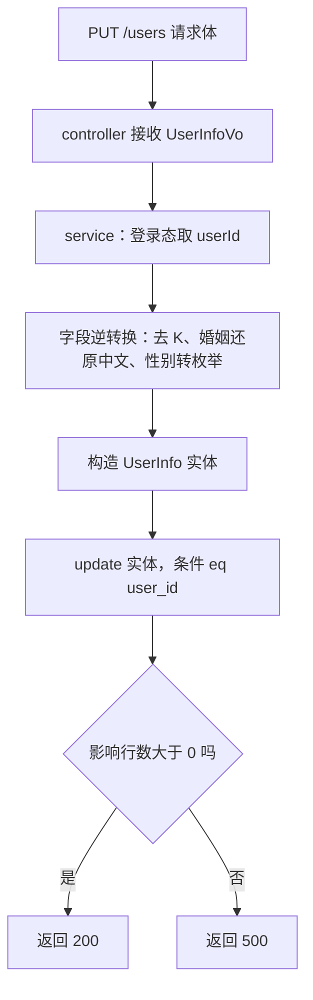

# 用户资料的保存更新：PUT 入参的字段还原与按 user_id 更新

资料查出来能看不能改，编辑资料页就只是摆设。保存修改的接口契约很友好：提交的 JSON 与查询响应同构，都是 `UserInfoVo` 那份字段，于是入参直接复用 vo，service 里把查询时做过的转换逐一还原：K 单位去掉、婚姻 1 与 0 还原成中文、性别 man 与 woman 转回枚举。真正的看点在更新语句怎么写：为什么不用 `updateById`，为什么返回值要大于 0 才算成功，`saveOrUpdate` 为什么在这里不适用。

## 先给结论

- 接口 `PUT /users`，`@RequestBody UserInfoVo` 收参，请求体与查询响应共用一份结构，转换逻辑与查询侧对称。
- 更新谁由登录态决定：userId 从 `UserThreadLocal` 取，客户端传什么都无效，归属权不在请求体里。
- 更新不用 `updateById` 而用 `update` 加 `QueryWrapper`：条件是 `user_id` 列，因为 vo 携带不了资料行的主键 id，两者也不是同一个数。
- `saveOrUpdate` 在这个场景不适用：它按主键判断存在与否，主键为空就 insert，会插出一人多份资料。
- 更新成功的判据是影响行数大于 0；前端目前只开放了性别与生日的编辑，其余字段接口已就绪。

## 一、controller：PUT 与请求体

mock 契约把保存定义为 PUT，提交的是 JSON 表单，字段与查询响应完全一致，所以入参直接用 `UserInfoVo` 接收：

```java
@PutMapping
public ResponseEntity<Void> updateUserInfo(@RequestBody UserInfoVo userInfoVo) {
    try {
        Boolean bool = this.usersService.updateUserInfo(userInfoVo);
        if (bool) {
            return ResponseEntity.ok(null);
        }
    } catch (Exception e) {
        e.printStackTrace();
    }
    return ResponseEntity.status(HttpStatus.INTERNAL_SERVER_ERROR).build();
}
```

PUT 语义与这个场景是匹配的：表单提交是全量覆盖式的修改，重复提交同一份表单结果一致，天然幂等。

## 二、service：把查询侧的转换逐一还原

查询时做了三件事：年龄转字符串、收入拼 K、婚姻转 1 与 0。保存时全部倒过来：

```java
public Boolean updateUserInfo(UserInfoVo userInfoVo) {
    //更新谁由登录态决定，客户端说了不算
    User user = UserThreadLocal.get();
    UserInfo userInfo = new UserInfo();
    userInfo.setUserId(user.getId());
    //年龄：端上传字符串，库里是整型
    userInfo.setAge(Integer.valueOf(userInfoVo.getAge()));
    //性别：man / woman 转回枚举
    userInfo.setSex(StringUtils.equalsIgnoreCase(userInfoVo.getGender(), "man")
            ? SexEnum.MAN : SexEnum.WOMAN);
    userInfo.setBirthday(userInfoVo.getBirthday());
    userInfo.setCity(userInfoVo.getCity());
    //mock 字段与实体属性的名字映射
    userInfo.setEdu(userInfoVo.getEducation());
    userInfo.setIndustry(userInfoVo.getProfession());
    //收入：去掉展示层拼的 K 单位
    userInfo.setIncome(StringUtils.replaceAll(userInfoVo.getIncome(), "K", ""));
    //婚姻：1 与 0 还原成库里的中文
    userInfo.setMarriage(userInfoVo.getMarriage() == 1 ? "已婚" : "未婚");
    userInfo.setNickName(userInfoVo.getNickName());
    return this.userInfoService.updateUserInfoByUserId(userInfo);
}
```

对照查询侧的组装方法看，每一行都是逆运算：`toString()` 对上 `Integer.valueOf()`，`+ "K"` 对上 `replaceAll("K", "")`，已婚转 1 对上 1 转已婚。**转换成对出现，是 vo 与实体分工的直接收益：**出口怎么翻译，入口就怎么翻译回去，两份代码放在一起互为校对，哪边漏了单位或类型立刻能看出来。

性别这一行还有个隐藏语义：`equalsIgnoreCase` 对 null 返回 false，端上漏传 gender 时实体会被设成 WOMAN 而不是报错。当前契约是全量表单提交，字段齐全，这个隐患可以容忍；一旦前端改成局部提交，这里就是数据污染点。

## 三、为什么不用 updateById：条件是 user_id 不是主键

`tb_user_info` 的主键是自增的 `id` 列，与 `user_id` 不是同一个数：注册流程先建 user 再补资料，资料行的主键从 1 开始自增，与用户 id 没有对应关系。客户端的 vo 里没有这行资料的主键，`updateById` 无从下手；就算把主键查出来让端上回传，也是把数据库内部实现泄露给了前端。课程的做法是按业务条件更新：

```java
public Boolean updateUserInfoByUserId(UserInfo userInfo) {
    QueryWrapper<UserInfo> queryWrapper = new QueryWrapper<>();
    //更新条件：user_id 等于当前登录人
    queryWrapper.eq("user_id", userInfo.getUserId());
    int update = this.userInfoMapper.update(userInfo, queryWrapper);
    //影响行数大于 0 才算成功
    return update > 0;
}
```

MyBatis-Plus 的 `update(entity, wrapper)` 生成 `UPDATE ... SET ... WHERE user_id = ?`，实体里非 null 的字段才进 SET 子句，null 字段自动跳过。这个默认策略顺带解释了部分更新的可行性：哪天前端只提交性别与生日，service 只 set 这两个字段，其余列不会被误清空。`saveOrUpdate` 之所以不能拿来兜底，是因为它按主键有无决定 insert 还是 update，vo 不带主键，每次都会走 insert，一个人反复保存就攒出多行资料。



## 四、联调：改完重登才算数

重启接口服务后在模拟器里走完整流程：登录进「我的」，点修改信息，把性别改成女性，确认保存；为排除本地缓存干扰，把应用直接杀掉重新登录，再进编辑资料页，性别回显已是女性；接着把生日改成 9 月 30 日，保存后重进，回显一致。改完顺手回 MySQL 看 `tb_user_info`，对应行的 sex 与 birthday 两列已经更新，其余列保持原值，按条件更新的行为肉眼可见。

前端目前的编辑表单只开放了性别与生日两项，婚姻状况、学历、收入这些字段接口侧都已支持，端上没做交互而已。服务端不必等前端，契约先行，字段留好口子，后续端上补齐时后端零改动。

**更新与推荐系统的联动值得预埋一句。** 年龄、性别、城市这些资料列是推荐侧构造用户特征的原料，但特征由 Spark MLlib 的离线作业批量读取，本次保存只落 MySQL，推荐结果不会实时变化，新资料要等下一次跑批才反映到推荐打分里。接口层与推荐引擎之间隔着一条批处理管道，理解这条管道的节奏，比在保存接口里硬接推荐逻辑更接近真实生产。

## 常见误区

- **拿 saveOrUpdate 兜底。** 错例：主键为空就 insert 的默认行为，让每次保存都新增一行资料，一人多份，查询侧查出多条无从取舍。正解：按 user_id 条件 update，insert 职责留在注册流程里。
- **直接 Integer.valueOf(vo.getAge())。** 错例：端上漏传年龄，NPE 冒泡成 500，日志里只见空指针不见业务原因。正解：先判空再转换，或对必填字段做统一校验。
- **忘了去 K 与转码。** 错例：库里存进 `30K`、婚姻列存进数字 1，查询侧再拼一次 K、再比一次中文，两边全乱。正解：入库前完成逆转换，库里的口径永远与表结构注释一致。
- **归属用客户端传的 id。** 错例：vo 里带个 userId 就照单全收，改的是别人的资料，水平越权。正解：userId 一律取登录态，请求体里的身份字段直接忽略。

## 面试可能被问到的问题

1. 面试官追问：「更新为什么用 update 加 Wrapper，不用 updateById？」
   答：资料行的主键不在客户端手里，能确定的业务标识是 user_id；updateById 只按主键 where，条件更新的 wrapper 一行 eq 就表达清楚。这也避免把数据库主键暴露给端上，接口契约保持业务语义。
2. 面试官追问：「saveOrUpdate 什么场景合适，什么场景不合适？」
   答：合适于客户端持有主键、或业务键唯一且可先查后定的场景；不合适本例这种主键未知、user_id 又只是资料行业务归属的场景，它会按主键为空一律 insert。要语义化的 upsert，应按 user_id 判断，存在则 update，不存在才 insert。
3. 面试官追问：「MyBatis-Plus 的 update 对 null 字段怎么处理？」
   答：默认更新策略 NOT_NULL，实体里 null 的字段不进 SET 子句，等于自动支持部分更新。要把某列显式置空，得用 UpdateWrapper 的 set 指定，或在字段上调整更新策略，指望传 null 生效是不对的。
4. 面试官追问：「资料更新后推荐为什么没变化？」
   答：特征由离线作业批量读取，保存只写 MySQL，两者之间隔着批处理周期，新资料要等下一次跑批才进入特征矩阵。实时联动要么加特征服务的在线读取，要么在更新后发消息触发增量计算，成本与收益要按业务权衡。
5. 面试官追问：「PUT 与 POST 在这个接口上的取舍？」
   答：PUT 语义是幂等的全量替换，表单整体提交符合；POST 语义偏向创建或非幂等处理。mock 契约定为 PUT，客户端重复提交不产生副作用，与 update 的幂等行为一致。

## 配套资料

- 学习目标：`materials/code/07/day10 探花交友-Elasticsearch geo实现搜附近/day10/学习目标.md`，「独立完成维护用户信息的功能」的保存部分即本课验收对象。
- 数据库：`materials/code/07/day01 探花交友-项目搭建以及登录完善个人信息/day01/代码/mytanhua.sql`，`tb_user_info` 主键 id 与 user_id 分列、marriage 中文取值的直接出处。
- 原型：`materials/code/07/day01 探花交友-项目搭建以及登录完善个人信息/day01/资料/探花交友移动端原型V1.2`，编辑资料页的表单形态。
- 说明：day10 资料包仅含学习目标，无源码包；controller、service 与更新方法为按课程画面整理补全的可编译示例，包名统一 `com.study.tanhua` 系，实体字段命名与 `mytanhua.sql` 列名对齐。
