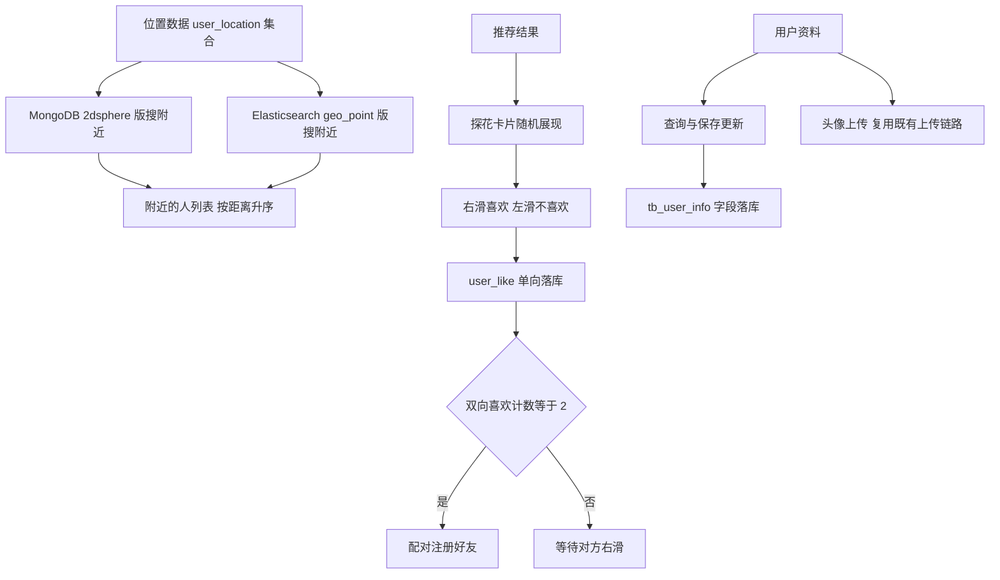

# day10 复盘：搜附近两套实现、探花配对与资料维护收口

day10 是项目里内容密度最高的一天：搜附近做了两遍、探花左右滑接上了数据层、用户资料维护顺手收尾。隔天想复述时最容易串不成线，复盘就按「做了什么、为什么这么做、还欠什么」三层来盘：功能地图先铺开，选型理由单独讲透，遗留问题登记成下一天的输入。

## 先给结论

- day10 三块产出：搜附近的 MongoDB 与 Elasticsearch 双实现、探花的卡片与左右滑、用户资料维护的查询保存与头像上传。
- 重中之重是搜附近。它示范的是「位置查询」这类需求的通用解法，网约车、外卖、社交平台全都绕不开。
- MongoDB 2dsphere 与 Elasticsearch geo_point 两条路线没有本质优劣，按项目存量技术栈与查询形态做选择。
- 探花是产品的招牌交互：喜欢以单向记录落库，双向判定成立才配对成好友。
- 资料维护只完成了基础部分，「我的」模块的统计、粉丝、设置与黑名单进入下一天。

## 一、一天的功能地图

把三条线并排摆开，一天的产出一目了然。



搜附近线消费 day09 埋好的位置数据，两套实现殊途同归；探花线从推荐结果出发，经卡片滑动落库，终点是好友配对；资料维护线独立成块，头像上传以路由复用收口。三条线没有相互阻塞，可以并行推进。

## 二、搜附近：重点中的重点

总结里对全天的权重给出了明确排序：搜附近与探花是重点，搜附近又是重中之重。原因不在功能本身，而在它示范的这类需求的普遍性。移动互联网里带位置属性的产品俯拾皆是：网约车要算车与人的距离，外卖要圈出配送范围内的商家，社交平台要找附近的人。掌握了「坐标怎么存、圆内怎么查、距离怎么排」，换一个业务领域这套方法照样成立。

解决方案课程给了两条，对照着看差异才清楚：

| 维度 | MongoDB 2dsphere | Elasticsearch geo_point |
| --- | --- | --- |
| 定位 | 业务文档库，位置与业务数据同库 | 检索分析引擎，常需从主库同步数据 |
| 索引 | 2dsphere 球面地理索引 | geo_point 字段类型 |
| 查询形态 | 地理查询与聚合管道 | geo 过滤加距离排序 |
| 顺手做的事 | 增删改查一体化 | 全文检索、聚合分析 |

MongoDB 版的查询核心是按距离由近到远取列表：

```java
//MongoDB 版：geoNear 按距离由近到远返回，结果自带 distance
NearQuery nearQuery = NearQuery.query(geoJsonPoint, Metrics.KILOMETERS)
        .maxDistance(distanceInKm);
GeoResults<UserLocation> results = this.mongoTemplate.geoNear(nearQuery, UserLocation.class);
```

Elasticsearch 版换一套词汇，但语义一一对应：圆内过滤对应 `maxDistance`，距离升序对应 `geoNear` 的近远排序：

```java
//Elasticsearch 版：geo 圆内过滤 + 按距离升序
GeoDistanceQueryBuilder distanceBuilder = new GeoDistanceQueryBuilder("location");
distanceBuilder.point(latitude, longitude);
distanceBuilder.distance(distance / 1000, DistanceUnit.KILOMETERS);
GeoDistanceSortBuilder sortBuilder =
        new GeoDistanceSortBuilder("location", latitude, longitude);
sortBuilder.unit(DistanceUnit.KILOMETERS);
sortBuilder.order(SortOrder.ASC);
```

两套各走一遍完整链路之后，选型的判断标准也浮出水面：业务数据都在 MongoDB 里、查询形态简单，一套存储顺手闭环；检索需求重、要按距离排序打分，Elasticsearch 的检索体系更趁手。两种方案没有本质上的优点或缺点，只有与现状的匹配程度，项目里已有哪套基础设施，就优先顺着哪套走。

## 三、探花：招牌交互的数据动作

探花是这个平台最具特色的功能，特色就落在左滑右滑的交互上。数据层的动作在 day10 后半段全部接通：右滑写一条单向喜欢记录，同一对方向先查后存保证幂等；双向喜欢用 or 串起两个方向的等值条件计数判定，等于 2 即成立；判定为真后交接给消息功能里已有的好友注册逻辑；左滑删除对应记录。

```java
//右滑主流程：落库、判双向、配对成好友
String id = this.userLikeApi.saveUserLike(user.getId(), likeUserId);
if (this.userLikeApi.isMutualLike(user.getId(), likeUserId)) {
    this.imService.contactUser(likeUserId);  //互相喜欢，注册好友
}
```

复盘这段设计要抓住一个点：喜欢是单向事实，双向关系是查询结论而不是存储形态。把「互相喜欢」当成一条冗余状态存起来，两个方向的一致性就要靠代码维护；两条单向记录加一个计数判定，数据层天然自洽。计数判定的前提是每对方向最多一条记录，幂等检查是它的保障，两者绑在一起理解才完整。

## 四、资料维护：以复用收尾

用户资料维护是三段式：资料查询、保存更新、头像上传。前两段是标准的表单读写，落 `tb_user_info` 对应字段；头像上传的看点在取舍上。APP 端「我的」模块的上传路径与完善信息那条不同，重写一套校验加上传逻辑是明显的重复劳动，最终方案是在 Nginx 加一条 `location /users/header` 把请求路由到 SSO 服务，SSO 侧加一个委托式的入口方法，人像校验、OSS 上传、落库三个环节一行逻辑都没复制。

这类「能力已有归属、路径不一致」的场景，路由转发加薄委托是通用解法，比复制代码便宜得多。非人像拒绝、错误提示这些既有行为也原样继承，新旧两个入口的用户体验保持一致。

## 五、遗留问题与下一天预告

资料维护完成的是基础字段，「我的」模块的全貌远不止于此：顶部还挂着相互关注、喜欢、粉丝三个统计数字，点进去是三个带分页的列表；通用设置里还有通知开关与陌生人问题；黑名单、更新手机号也都在产品原型里占着位置。这些是下一天的主菜，顺带还有一堂 CDN 原理课：企业使用 CDN 需要已备案的域名，课程环境不具备条件，所以只讲清楚它能带来什么提升，动手环节留给真实项目。

复盘时把「已收口」与「未开工」分开记账：day10 结束时，探花、搜附近、基础资料维护三块可以划掉；我的中心的统计与列表、设置、黑名单整队待命，进入收官一天。

## 常见误区

- **把双实现当重复劳动，复盘只记结论。** 错例：能背出「两套都实现了」，说不出两套在索引、查询形态、数据同步上的差异。正解：对照表里的每一行都能展开讲两句，面试与选型时才用得上。
- **把双向喜欢当存储形态。** 错例：设计「互相喜欢」表或在单向记录上加双向标记。正解：单向记录是原子事实，双向是两条记录的查询结论，计数等于 2 即成立。
- **把位置查询当实时定位。** 错例：以为搜附近是查询瞬间去请求用户定位。正解：定位在客户端，服务端消费的是按节奏上报沉淀的位置数据，查询的新鲜度取决于上报策略。
- **资料维护只记住「简单」。** 错例：认为查询保存头像都是增删改查，没什么可复盘。正解：头像上传的路由复用是一次网关层的架构决策，值得单独回味。

## 面试可能被问到的问题

1. 面试官追问：「项目里你做过哪些位置相关的功能，两套实现怎么选？」
   答：搜附近做了 MongoDB 2dsphere 与 Elasticsearch geo_point 两版。选型看三点：项目存量技术栈、位置与业务数据的耦合度、查询形态。位置与业务同库、查询简单选 MongoDB；检索需求重、要距离排序聚合选 ES。两套都掌握后，选择是自由的。
2. 面试官追问：「左滑右滑在数据层要做什么，为什么喜欢单向存储？」
   答：右滑写一条单向喜欢记录并做幂等，双向喜欢由两条单向记录的计数判定得出，等于 2 即互相喜欢，触发好友注册；左滑删除记录。单向存储让每个方向独立变化，避免双向冗余状态的一致性维护。
3. 面试官追问：「搜附近的数据是实时的吗，怎么设计上报？」
   答：不是实时定位，服务端消费的是客户端按节奏上报的位置沉淀。上报策略要在新鲜度与成本间权衡，本项目按位移超阈值或定时节奏上报。查询端以用户坐标为圆心做范围查询，新鲜度完全由上报侧决定。
4. 面试官追问：「头像上传为什么复用单点登录工程的链路，而不是在接口服务重写？」
   答：两次上传的请求参数完全一致，只有路径不同。路径层差异在网关解决成本最低：Nginx 加一条 location 把新路径转到已有服务，服务侧加一个委托入口。重写一套会让校验规则、密钥配置在两处演化，维护成本翻倍。
5. 面试官追问：「用户资料维护这类功能，工程上真正值得注意的点是什么？」
   答：字段读写本身不难，值得设计的是头像这类文件字段的归属：图片进对象存储、数据库只存外链、入口路由统一复用。这三件事决定了后续多入口、多端场景下资料体系是否会分叉。

## 配套资料

- 学习目标：`materials/code/07/day10 探花交友-Elasticsearch geo实现搜附近/day10/学习目标.md`，六条「独立完成」即本日验收清单，逐条对照自查。
- 说明：day10 资料包仅含学习目标，无源码包；文中代码片段为 day10 各课画面整理示例的复盘摘录，包名统一 `com.study.tanhua` 系。
