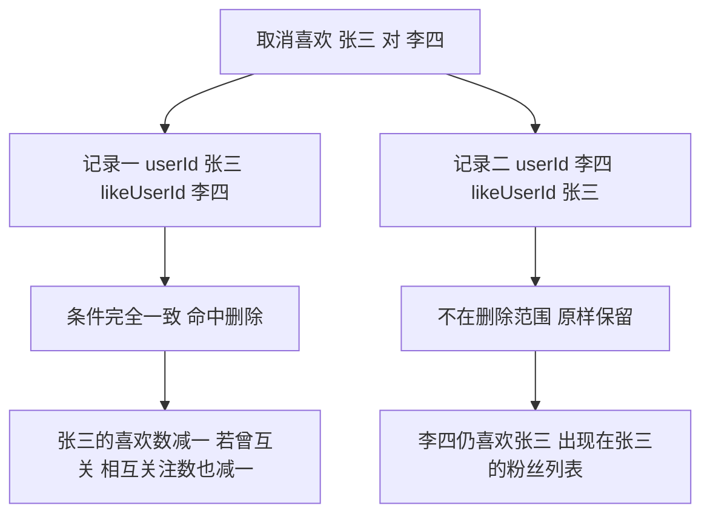

# 取消喜欢：只删半条关系，让互关退回粉丝状态

喜欢列表的每个卡片右侧都挂着一个「取消喜欢」按钮。它看起来是四张列表里最不起眼的交互，实现也确实只有几行，但它的语义值得掰开：取消喜欢撤回的是「我喜欢对方」这半个动作，不是把两个人之间的所有关系抹掉。删错范围，喜欢数与粉丝数会一起掉，用户的粉丝凭空消失。这一课把这几行代码背后的方向边界讲清楚。

存储侧没有任何新东西。`user_like` 集合在 day10 探花功能里就立起来了，右滑喜欢落库、左滑不喜欢删除，dubbo 的 `UserLikeApi` 早就有对应的 `deleteUserLike` 方法。本课做的事是把这个既有能力从探花页接到我的中心列表上来。

## 先给结论

- 接口是 `DELETE /users/like/{uid}`，路径上的 `uid` 是要取消喜欢的对方用户 id，无请求体，token 定位当前用户。
- Service 核心一行：`this.userLikeApi.deleteUserLike(user.getId(), userId)`，完全复用 day10 的删除方法，不新增存储逻辑。
- 删除范围只有一条记录：我指向对方的喜欢。对方喜欢我的那条记录原样保留，取消后对方从互关状态退回粉丝状态。
- 计数联动是推演出来的结果：喜欢数减一，粉丝数不变，若两人此前互为关注则相互关注数同时减一。
- MongoDB 的 remove 按条件删除、无记录命中也不报错，重复点击与并发取消天然幂等。

## 一、两行代码的接口

Controller 挂在 `UsersController` 末尾，DELETE 动词与 REST 语义对齐：

```java
/**
 * 取消喜欢
 * @param userId 对方用户 id
 * @return
 */
@DeleteMapping("like/{uid}")
public ResponseEntity<Void> dislike(@PathVariable("uid") Long userId) {
    try {
        this.usersService.dislike(userId);
        return ResponseEntity.ok(null);
    } catch (Exception e) {
        e.printStackTrace();
    }
    return ResponseEntity.status(HttpStatus.INTERNAL_SERVER_ERROR).build();
}
```

Service 层同样短小，从 `UserThreadLocal` 拿当前用户，参数顺序决定了删除方向：

```java
public void dislike(Long userId) {
    User user = UserThreadLocal.get();
    this.userLikeApi.deleteUserLike(user.getId(), userId);
}
```

dubbo 侧的 `deleteUserLike` 承接自 day10 探花功能的编码，实现是按两个 id 的完全匹配做条件删除：

```java
//承接 day10 编码：删除我指向对方的喜欢记录
@Override
public void deleteUserLike(Long userId, Long likeUserId) {
    Query query = Query.query(Criteria.where("userId").is(userId)
            .and("likeUserId").is(likeUserId));
    this.mongoTemplate.remove(query, UserLike.class);
}
```

三个方法各干各的事：controller 管协议与异常兜底，Service 管当前用户上下文，dubbo 实现管存储。取消喜欢没有独立的新逻辑，这正是分层带来的复用形态，列表上的按钮只是把探花页已有的能力换了个入口。

## 二、删的是哪半条关系

喜欢关系在 `user_like` 里是两条单向记录：张三喜欢李四存一条，李四喜欢张三另存一条。取消喜欢动的是其中一条，方向由方法参数钉死。用两个方向的记录把删除范围摆出来：



推演一遍计数联动：张三的喜欢数减一；李四指向张三的记录还在，李四在张三这里的粉丝身份不变，粉丝数不动；两人此前互为关注时，互关判定需要的两个方向少了一个，相互关注数同步减一。李四在张三的页面上从「相互喜欢」列表掉进「粉丝」列表，他对张三的喜欢没有受到任何影响。

这个边界与互关判定的两步查询对得上：相互关注统计是「我喜欢的人里面喜欢我的人」，取消喜欢拆掉的是第一个条件，第二个条件完好无损，所以互关必然失效、粉丝必然保留。

## 三、跑一遍验证口径

REST 工具带上 token 发 `DELETE /users/like/11`，返回 200。真机投屏验证交互侧：登录进入我的模块，相互喜欢列表里第三个用户（id 为 11）右侧点「取消喜欢」，该行从列表消失；回到首页再进我的模块，喜欢数从 13 变成 12，统计与删除在同一条数据链路上闭合。

再补两组边界操作。对同一个用户连点两次取消喜欢，第二次请求同样返回 200：remove 按条件删除，没有命中记录时什么都不做也不报错，幂等是存储语义自带的，不需要业务代码额外判断。被取消的用户李四那边，打开粉丝列表能看到他仍然在列，这正是上一节的边界推演落到了界面上。

讲义里这一节编号 1.5，内容就是上面这三段：Controller、Service 加一个测试用例，与课堂代码一一对应。

## 常见误区

- **把两个方向的记录都删掉。** 错例：觉得「取消喜欢就是绝交」，按「userId 等于我或 likeUserId 等于我」的范围删除，对方的粉丝关系凭空消失，粉丝数骤降。正解：删除条件是两个 id 的完全匹配，只覆盖我指向对方的那一条。
- **参数顺序写反。** 错例：`deleteUserLike(userId, user.getId())`，删掉的变成了对方对我的喜欢，自己从对方列表里消失，方向语义整体翻转。正解：约定第一个参数是动作发出者，调用处永远 `user.getId()` 打头。
- **把「没有记录可删」当异常。** 错例：先 count 判断存在再删除，两次查询之间记录被并发删掉时再次报错或重复处理。正解：remove 条件删除天然幂等，无需存在性前置检查。
- **期待取消喜欢后对方从粉丝列表消失。** 错例：联调时发现对方还在粉丝列表，以为删除没生效。正解：取消喜欢只撤回我的动作，对方喜欢我的记录独立存在，他留在粉丝列表才是正确表现。

## 面试可能被问到的问题

1. 面试官追问：「这个删除接口的幂等性靠什么保证？」
   答：靠 MongoDB remove 的条件删除语义，条件不命中时影响行数为零且不抛错。重复请求、网络重试、并发点击都收敛到同一个最终状态，业务层不需要加防重逻辑。若底层换成关系库，同样是按唯一键条件 delete，天然幂等。
2. 面试官追问：「双向关系存两条单向记录，还是一条记录加方向位，你怎么选？」
   答：两条单向记录把每个方向的动作用一条数据表达，喜欢、取消、计数都是单条操作，语义干净；一条记录加标志位省一半存储，但双向操作时要锁同一行，喜欢与取消互相覆盖的边界更复杂。社交关系高频变化时，两条单向记录更稳。
3. 面试官追问：「删除之后，各处冗余的计数字段怎么保持一致？」
   答：本项目的三个数字是实时 count 出来的，删除即时反映，没有一致性问题。若为了性能改成用户维度冗余计数，就要在删除成功的同一事务或同一链路里同步减一，再加定时对账兜底，避免计数与记录漂移。
4. 面试官追问：「取消喜欢要不要通知对方？」
   答：产品语义上谨慎。撤回动作通常不推送，避免打扰；但互关降级涉及对方可见的状态，可以在对方下次拉取列表时自然体现。若做通知，走设置表里的喜欢通知开关判断，这层的开关字段在通用设置功能里会落地。

## 配套资料

- 学习目标：`materials/code/07/day11 探花交友-我的中心/day11/学习目标.md`，「独立完成我的喜欢中的交互功能」涵盖取消喜欢。
- 说明：day11 资料包不含工程源码，controller 与 service 为按课程画面整理补全的可编译示例，包名统一 `com.study.tanhua` 系；`user_like` 集合结构与 `deleteUserLike` 实现承接自 day10 探花功能的编码，`UserThreadLocal` 与 dubbo 配置承接自接口服务工程的既有代码。
