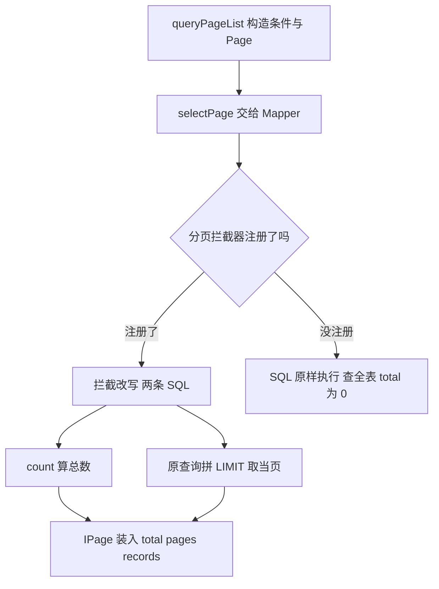

# 黑名单的底座：tb_black_list 表结构与 MyBatis-Plus 分页查询

社交产品聊得再热闹，也躲不开一类用户：不想再被搭讪的人。拉黑是他们共同给的答案，而拉黑功能的第一步不是按钮，是底座：拉黑关系存在哪、怎么按人查出来。这一课建表、插数、写查询，一张只有两个用户 id 的关系表，配上 MyBatis-Plus 的分页查询，把黑名单的数据面铺好，接口面留给后面两课。

## 先给结论

- 黑名单落 MySQL 的 `tb_black_list` 表，除主键外只有两个用户 id：`user_id` 是拉黑动作发出者，`black_user_id` 是被拉黑的人，方向语义与喜欢表的 `userId` 与 `likeUserId` 一模一样。
- 索引建在 `user_id` 上，这张表的全部查询只有一种姿势：按拉黑的人分页取名单，等值条件直接走索引。
- 实体继承 `BasePojo` 拿时间字段，Mapper 继承 `BaseMapper` 拿全套单表 CRUD，Service 一个 `queryPageList` 返回 `IPage<BlackList>`。
- `selectPage` 能真正分页的前提是注册分页拦截器，没配的话 SQL 原样执行变成查全表，这是 MyBatis-Plus 最经典的静默坑。
- MyBatis-Plus 的页码从 1 开始，与 Spring Data MongoDB 的 0 起页不同，项目里两套分页并存，换算规则各自记牢。

## 一、表结构：一张只有两个 id 的关系表

关系类数据在项目里有个清晰的分界：行为与推荐类的关系进 MongoDB，用户关系与资料类的关系进 MySQL。黑名单是用户主动维护的强一致关系，一拉就生效、一删就消失，量小而结构规整，落 MySQL 合适。建表语句来自课程资料包的库脚本：

```sql
CREATE TABLE `tb_black_list` (
  `id` bigint(20) NOT NULL AUTO_INCREMENT,
  `user_id` bigint(20) DEFAULT NULL,
  `black_user_id` bigint(20) DEFAULT NULL,
  `created` datetime DEFAULT NULL,
  `updated` datetime DEFAULT NULL,
  PRIMARY KEY (`id`),
  KEY `user_id` (`user_id`)
) ENGINE=InnoDB DEFAULT CHARSET=utf8 COMMENT='黑名单';
```

方向语义先钉死：张三把李四拉黑，张三是 `user_id`，李四是 `black_user_id`，方向与 `user_like` 里喜欢关系的编码完全同构，动作发出者打头、被作用者跟随。全部查询都站在拉黑者的角度展开，我的黑名单就是 `user_id` 等于我的那些行，索引建在 `user_id` 上正对着这条唯一查询路径，等值命中直取目标行，不需要为反向查询另建索引。

测试数据按验收路径造：给 1 号用户拉黑 22、23、24 三个人，插三条记录。三条数据够把分页、排序、列表拼装都验出来，后面接口课的真机测试全部吃这份造数。

## 二、实体、Mapper 与 Service

实体与 `Question` 同款套路，业务字段只有两个 id，时间字段从父类继承：

```java
@Data
@NoArgsConstructor
@AllArgsConstructor
@EqualsAndHashCode(callSuper = true)
@TableName("tb_black_list")
public class BlackList extends BasePojo {

    private Long id;
    private Long userId;        //拉黑动作发出者
    private Long blackUserId;   //被拉黑的用户
}
```

表名注解这次显式写出来，与全局 `table-prefix=tb_` 配置殊途同归；显式声明的好处是实体与表名的对应关系一目了然，不依赖全局配置的记忆。Mapper 继续零 XML：

```java
public interface BlackListMapper extends BaseMapper<BlackList> {
}
```

Service 层一个方法承担全部查询职责，返回值用 MyBatis-Plus 的 `IPage` 分页对象：

```java
@Service
public class BlackListService {

    @Autowired
    private BlackListMapper blackListMapper;

    public IPage<BlackList> queryPageList(Long userId, Integer page, Integer pageSize) {
        QueryWrapper<BlackList> queryWrapper = new QueryWrapper<>();
        queryWrapper.eq("user_id", userId);
        //排序，根据创建时间倒序排序
        queryWrapper.orderByDesc("created");
        //分页的参数
        Page<BlackList> pager = new Page<>(page, pageSize);
        return this.blackListMapper.selectPage(pager, queryWrapper);
    }
}
```

方法体三段式：条件、排序、分页。`eq("user_id", userId)` 的列名是数据库列，不是 Java 属性名，Wrapper 拼的是 SQL 片段，驼峰与下划线在这里不能混写。`orderByDesc("created")` 让最新拉黑的人排前面，页面语义自然。`Page` 对象两个参数，当前页与每页条数，丢给 `selectPage` 后返回值既是分页参数也是结果容器：`getRecords()` 拿当页数据，`getTotal()` 与 `getPages()` 拿总条数与总页数，接口层要的元信息一次带齐。

## 三、selectPage 背后的分页机制

`selectPage` 不是 Mapper 里现成的方法签名变了什么魔法，它仍是一条普通查询，分页能力全部来自 MyBatis-Plus 的拦截器插件。拦截器挂在 MyBatis 的执行链路上，拦到带分页参数的查询后把 SQL 改写成两条：一条同条件的 count 算总数填进 total，一条拼上 LIMIT 取当页数据。



没注册拦截器那条岔路就是经典的静默坑：不报错、不抛异常，数据照常返回，只是返回的是全表而且 total 恒为 0，页面翻页永远翻不动。排查这类问题先看配置类里有没有分页插件。MyBatis-Plus 3.4 之后的写法是统一的 `MybatisPlusInterceptor` 挂内部分页拦截器：

```java
@Configuration
public class MybatisPlusConfig {

    @Bean
    public MybatisPlusInterceptor mybatisPlusInterceptor() {
        MybatisPlusInterceptor interceptor = new MybatisPlusInterceptor();
        //分页插件，selectPage 能生效全靠它
        interceptor.addInnerInterceptor(new PaginationInnerInterceptor(DbType.MYSQL));
        return interceptor;
    }
}
```

3.3 及之前的版本用独立的 `PaginationInterceptor`，一个 Bean 事即可，版本升级时这一处 API 有迁移成本。插件按数据库方言拼 LIMIT，MySQL 与 PostgreSQL 的分页语法差异被方言收掉了。

页码语义还要单说一句：`Page` 的当前页从 1 起算，第一页传 1；而项目里 MongoDB 那套用 Spring Data 的 `PageRequest.of(page - 1, ...)`，从 0 起算，传入前先减一。喜欢列表那课踩过的 off-by-one 属于后者，MyBatis-Plus 这边框架自己换算，页码减一反而会把第一页漏掉。两套分页并存的项目里，把「谁的页码从几开始」写进注释或团队规范，比每次翻源码确认划算。

## 常见误区

- **没注册分页插件。** 错例：`selectPage` 调了，页面传页码也传了，返回的 records 越翻越多，total 恒为 0。正解：配置类里挂上分页拦截器，验证方式是看控制台 SQL 有没有 LIMIT 与 count 两条。
- **Wrapper 里写属性名。** 错例：`queryWrapper.eq("userId", userId)`，SQL 里没有 userId 这一列，运行时报 Unknown column。正解：Wrapper 拼的是数据库列名，统一写 `user_id` 这类下划线形式。
- **方向写反。** 错例：查黑名单用了 `black_user_id` 等于我，查出的是「谁拉黑了我」而不是「我拉黑了谁」。正解：`user_id` 是动作发出者，按拉黑者查名单永远用它打头。
- **依赖默认排序。** 错例：不加 orderBy，分页顺序随主键或物理顺序漂移，最新拉黑的人未必排在前面。正解：显式 `orderByDesc("created")`，排序语义写进代码而不是赌存储引擎。

## 面试可能被问到的问题

1. 面试官追问：「MyBatis-Plus 的分页是怎么实现的？」
   答：靠 MyBatis 拦截器机制。分页插件拦截 Executor 层的查询，把带分页参数的 SQL 改写为两条执行，先按原条件 count 求总数，再拼上数据库方言的 LIMIT 取当页，结果连同 total、pages 装进 IPage 返回。业务代码始终按普通查询写，改写对上层透明。
2. 面试官追问：「selectPage 不分页，你怎么排查？」
   答：先看分页插件注册没有，这是九成概率的原因；再看 Page 参数是否真的传进了 Mapper 而不是中途丢失；然后看控制台 SQL，没有 LIMIT 就是拦截器没拦到，有 LIMIT 但数据不对就查页码起点与排序条件。拦截器缺失不报错，靠 SQL 日志定位最快。
3. 面试官追问：「黑名单为什么放 MySQL，项目里不是到处在用 MongoDB 吗？」
   答：按数据形态分。黑名单是用户主动维护的强一致小数据，等值查询加行级事务是 MySQL 的主场；动态、喜欢、访客这类写入频繁、结构多变的文档数据才用 MongoDB。选型跟着访问姿势走，而不是项目里流行什么就用什么。
4. 面试官追问：「count 加 LIMIT 两条 SQL，量大之后怎么优化？」
   答：count 是大头。前端翻页条不展示总数时可以砍掉 count，用「有没有下一页」探测；总数必须展示时可缓存 count 或按页缓存；深分页用游标方案，按 created 与 id 定位起点继续往后翻，避免 LIMIT 大偏移量扫描。数据量小的时候两条 SQL 的开销可以忽略，先做对再做快。
5. 面试官追问：「项目里 MyBatis-Plus 与 Spring Data 两套分页并存，怎么避免页码事故？」
   答：把换算收敛到统一入口，比如都走一个分页工具方法，传入自然页码，内部按框架各自换算；同时在接口文档里明确「页码从 1 开始」是对外契约，端上不感知底层实现。事故大多发生在复制粘贴 Mongo 查询改 MySQL 时带上了减一，收敛入口能消灭这类手滑。

## 配套资料

- 数据库：`materials/code/07/day11 探花交友-我的中心/day11/代码/mytanhua.sql`，`tb_black_list` 建表语句与黑名单测试数据的真实出处。
- 学习目标：`materials/code/07/day11 探花交友-我的中心/day11/学习目标.md`，「独立完成黑名单的功能」的第一步即本课的表结构与查询。
- 说明：day11 资料包不含工程源码，实体、Mapper、Service 与测试数据按课程画面与讲解整理补全，包名统一 `com.study.tanhua` 系；分页拦截器配置类为按 MyBatis-Plus 3.x 主流写法补全的可运行示例，课程画面未展开该配置文件，特此注明。
