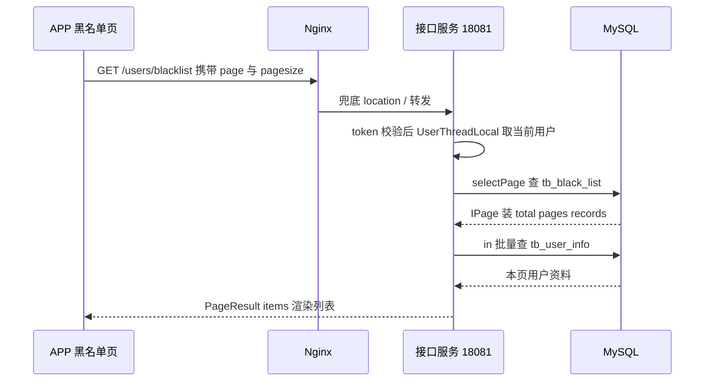

# 黑名单列表接口：两列 id 记录拼装成一份用户资料视图

上一课的黑名单表已经能按人分页查记录了，但库里存的只有两个用户 id，页面上要的是头像、昵称、性别、年龄。列表接口的全部难度就在这个落差里：一页关系记录，要拼成一份份完整的用户资料视图。拼装动作看着机械，空页怎么处理、资料怎么查才不拖慢、字段怎么翻译成契约值域，每一步都有讲究。

## 先给结论

- 契约是 `GET /users/blacklist`，参数 `page` 与 `pagesize`，响应沿用 `PageResult` 结构，items 元素五个字段：id、avatar、nickname、gender、age。
- Service 编排四步：分页查黑名单记录、空页提前返回、收集 `black_user_id` 批量查资料、逐条转 VO 装回 items。
- 批量查资料用 `in` 一次取回全页，逐条循环查库是 N+1 反模式，一页十条就是十条 SQL。
- 字段翻译有两处硬规则：id 填用户 id 而不是资料表主键，移除黑名单的路径参数靠它对上关系表；gender 由枚举名转小写，对齐契约的 man 与 woman。
- 分页元信息 counts 与 pages 从 `IPage` 的 total 与 pages 手动换算，对外契约与框架类型解耦。

## 一、契约与 VO

mock 文档给黑名单列表定义了标准分页响应：顶层是 counts、pagesize、pages、page 与 items 列表，每个 item 是被拉黑用户的资料摘要。响应结构沿用项目里既有的 `PageResult`，元素对象按契约新建：

```java
@Data
@AllArgsConstructor
@NoArgsConstructor
public class BlackListVo {

    private Long id;        //用户 id
    private String avatar;  //头像
    private String nickname;//昵称
    private String gender;  //性别：man / woman
    private Integer age;    //年龄
}
```

五个字段全部来自 `tb_user_info`，没有黑名单自己的东西，VO 却不能省：契约是端上的视图，不是数据库的投影，直接把 `BlackList` 记录序列化出去，端上拿到的是两个 id 和时间戳，什么都渲染不了。VO 是视图与存储之间的翻译层，这个判断从今日佳人到联系人列表一路成立。

Controller 挂进既有的 `UsersController`，GET 请求收两个分页参数，异常统一 500：

```java
@GetMapping("blacklist")
public ResponseEntity<PageResult> queryBlacklist(
        @RequestParam(value = "page", defaultValue = "1") Integer page,
        @RequestParam(value = "pagesize", defaultValue = "10") Integer pagesize) {
    try {
        PageResult pageResult = this.usersService.queryBlacklist(page, pagesize);
        return ResponseEntity.ok(pageResult);
    } catch (Exception e) {
        e.printStackTrace();
    }
    return ResponseEntity.status(HttpStatus.INTERNAL_SERVER_ERROR).build();
}
```

## 二、Service 编排：先取记录，再取资料

`UsersService.queryBlacklist` 的前半段把分页结果翻译成契约的分页骨架。注入 `BlackListService` 后按当前登录人查询，`IPage` 里的 total 与 pages 转成 `PageResult` 的整型字段：

```java
public PageResult queryBlacklist(Integer page, Integer pagesize) {
    User user = UserThreadLocal.get();
    IPage<BlackList> iPage = this.blacklistService.queryPageList(user.getId(), page, pagesize);
    PageResult pageResult = new PageResult();
    pageResult.setPagesize(pagesize);
    pageResult.setPage(page);
    pageResult.setCounts(new Long(iPage.getTotal()).intValue());
    pageResult.setPages(new Long(iPage.getPages()).intValue());
    List<BlackList> records = iPage.getRecords();
    if (CollectionUtils.isEmpty(records)) {
        //空页提前返回，不再触发资料查询
        return pageResult;
    }
    //后半段：收集与拼装
}
```

后半段是核心拼装。先从记录里收集被拉黑的用户 id，再用 `in` 批量查资料：

```java
List<Long> userIds = new ArrayList<>();
for (BlackList record : records) {
    //关系记录里取的是被拉黑的那个人
    userIds.add(record.getBlackUserId());
}
QueryWrapper<UserInfo> queryWrapper = new QueryWrapper<>();
queryWrapper.in("user_id", userIds);
List<UserInfo> userInfoList = this.userInfoService.queryUserInfoList(queryWrapper);

List<BlackListVo> blackListVoList = new ArrayList<>();
for (UserInfo userInfo : userInfoList) {
    BlackListVo blackListVo = new BlackListVo();
    //契约的 id 是用户 id，移除黑名单的路径参数靠它对上 black_user_id
    blackListVo.setId(userInfo.getUserId());
    blackListVo.setNickname(userInfo.getNickName());
    blackListVo.setAvatar(userInfo.getLogo());
    //性别由枚举名转小写，对齐契约的 man 与 woman
    blackListVo.setGender(userInfo.getSex().name().toLowerCase());
    blackListVo.setAge(userInfo.getAge());
    blackListVoList.add(blackListVo);
}
pageResult.setItems(blackListVoList);
return pageResult;
```

整条请求链路画出来，是两次数据库访问加一次内存拼装：



`/users/blacklist` 在 Nginx 里没有专属转发规则，落进兜底的 `location /` 进 18081 接口服务，路由口径与统计接口一致，课程资料的 nginx.conf 里可以对照。

## 三、拼装的三个讲究

**第一，空页提前返回不是可有可无的防御。** 没拉黑过人的用户一进黑名单页，records 是空的，如果照常往下走，收集出的 userIds 是空集合，拿空集合去拼 `in` 条件会生成缺腿的 SQL，轻则报错重则全表扫。提前 return 让空页只花一次分页查询的成本，语义也更干净：没有数据，就没有后续动作。

**第二，in 批量是 N+1 的解药。** 拿到十个 id 后逐条 `selectOne` 查资料，一页请求就是十一条 SQL，页大小开到五十就是五十一条，数据库连接池再多也不够这么花。`in` 把同一张表、同一形态的查询合并成一条，代价只是一个集合参数。批量也有边界，id 数量上万时 SQL 语句过长、执行计划退化，超大集合要分批；列表分页天然把单页规模框在几十条以内，正好落在 `in` 的舒适区。

**第三，遍历顺序决定了列表顺序。** 资料查询的 `in` 不承诺任何顺序，默认按主键返回，而契约期望黑名单按拉黑时间倒序。造数让用户 id 连续且与拉黑顺序巧合一致时演示看不出问题，真实数据下顺序就漂了。更稳的写法以黑名单记录为外层驱动遍历，资料按 userId 装进 Map 一次命中：

```java
//按本课写法补充的工程建议：以黑名单顺序为外层，保住时间倒序语义
Map<Long, UserInfo> userInfoMap = userInfoList.stream()
        .collect(Collectors.toMap(UserInfo::getUserId, u -> u));
for (BlackList record : records) {
    UserInfo userInfo = userInfoMap.get(record.getBlackUserId());
    if (userInfo == null) {
        continue;   //资料缺失的脏数据跳过，别让整页挂掉
    }
    blackListVoList.add(buildVo(userInfo));
}
```

联系人列表那课的保序教训在这里原样复用：有顺序语义的列表，外层循环必须由决定顺序的那个数据源驱动。

## 四、延伸：拉黑动作与互动屏蔽

黑名单表的写入本课没有出现，三行测试数据是手工插入的。mock 文档里同样约定了加入黑名单的接口，交互入口在消息场景的聊天窗口，实现按既有三层套路即可补出：路径参数带目标用户，Service 层落一条 `user_id` 是自己、`black_user_id` 是对方的记录。真正值得提前想的是拉黑之后的屏蔽策略：拉黑的预期是「他看不到我、聊不到我」，这要求推荐取数、消息发送等链路读侧过滤黑名单集合。轻量做法是把每个用户的黑名单 id 集合放进 Redis 的 Set，互动动作发生前 `SISMEMBER` 一次判断，拉黑与移除时同步维护缓存。这部分课程画面未展开，属于延伸讨论，落地时以「写侧唯一入口、读侧一处拦截」为原则。

## 常见误区

- **循环里逐条查资料。** 错例：遍历 records 时每个 id 查一次 `tb_user_info`，一页五十条就是五十一条 SQL，响应时间随页大小线性恶化。正解：收集 id 后 `in` 一次批量取回，拼装在内存完成。
- **VO 的 id 填错语义。** 错例：把资料表主键 id 塞给 VO，测试造数里主键与 user_id 恰好同值侥幸通过，换环境后移除黑名单的路径参数对不上关系表。正解：契约的 id 是用户 id，取 `getUserId()`，语义与 `black_user_id` 严格对齐；课程画面按主键填充，正文按语义修正并注明。
- **性别直塞库里的原值。** 错例：把枚举对象或数值 1、2 直接序列化给端上，契约的 gender 是 man 与 woman 小写字符串。正解：`getSex().name().toLowerCase()` 一步翻译，枚举常量名与契约值域在 day01 就对齐过。
- **空页不做短路。** 错例：records 为空仍继续拼 `in` 条件，空集合生成缺腿 SQL。正解：`CollectionUtils.isEmpty` 判断后提前返回骨架分页对象，items 为 null 或空由前端按「暂无拉黑用户」渲染。

## 面试可能被问到的问题

1. 面试官追问：「N+1 问题怎么发现、怎么解决，in 有没有上限？」
   答：看 SQL 日志或慢查询监控，同一张表形态相同、参数不同的语句连续出现就是 N+1。解法是收集键后合并成 in 批量查询，内存里按键组装。in 的集合过大时 SQL 长度与解析成本上升，执行计划可能从索引定位退化为范围扫描，一般以几百到一千为界分批，分页列表单页几十条远够不着上限。
2. 面试官追问：「关系表和资料表分两次查，为什么不 join？」
   答：单库单表场景 join 完全可以，一次 SQL 少一次往返。不 join 的理由通常有三：拼装逻辑留在 Java 里可单测可复用；表分属不同存储时 join 根本不成立，这个项目里 Mongo 与 MySQL 混合拼装是常态；统一成「先取关系再批量取资料」的套路后，跨不跨库写法一致，迁移成本低。
3. 面试官追问：「列表顺序和资料查询顺序不一致，你怎么保序？」
   答：让决定顺序的数据源驱动外层循环，本课是黑名单的时间倒序，资料放进 Map 按 userId 取用。另一类做法是资料查回来后按关系列表的键序重排。两种本质相同：顺序是业务语义，不能赌数据库返回顺序。
4. 面试官追问：「黑名单越拉越长，接口会慢在哪？」
   答：两个位置。分页 count 随数据量变重，前端无页码条时可以砍掉；深分页 LIMIT 大偏移量扫描变慢，换游标方案按 created 与 id 定位续页。资料批量查询规模被页大小框住，不是瓶颈，真正要做的是给 user_id 保持索引有效。
5. 面试官追问：「对外返回 PageResult 而不是 MyBatis-Plus 的 IPage，为什么多一次转换？」
   答：契约稳定优先。IPage 的字段与泛型绑死框架，升级或换 ORM 时对外结构跟着抖动；PageResult 是自家 VO，字段名、类型、空值约定全由自己定义，端上永远看到同一份契约。转换代码十行，换来的是接口层与存储层解耦。
6. 面试官追问：「拉黑后对方还在推荐列表里出现，属于缺陷吗，怎么根治？」
   答：属于屏蔽策略缺失。根治要把黑名单检查放进所有展示与互动链路的读侧：推荐取数时过滤，消息发送前拦截。高频判断不宜每次查表，用 Redis Set 缓存用户黑名单，写侧拉黑与移除同步维护，读侧一次 SISMEMBER 判断，保证拉黑秒级生效。

## 配套资料

- 学习目标：`materials/code/07/day11 探花交友-我的中心/day11/学习目标.md`，「独立完成黑名单的功能」的列表展现部分即本课验收对象。
- 数据库：`materials/code/07/day11 探花交友-我的中心/day11/代码/mytanhua.sql`，黑名单测试数据与资料表结构出处。
- 路由：`materials/code/07/day11 探花交友-我的中心/day11/代码/nginx.conf`，`/users/blacklist` 落兜底转发的规则可在此对照。
- 说明：day11 资料包不含工程源码，VO、Controller、Service 拼装按课程画面与讲解整理补全，包名统一 `com.study.tanhua` 系；VO 的 id 按契约语义取用户 id，与画面里的资料表主键取法不同，正文已注明；保序写法与屏蔽策略为按本课写法补充的工程建议；mock 文档站点域名以 example.com 占位。
