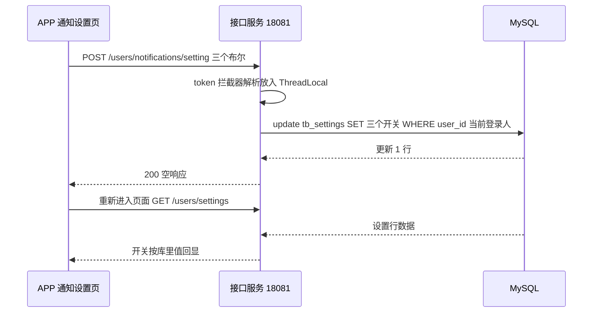

# 通知设置：把三个开关从页面写进 tb_settings

> 🔒 安全提示：文中示例的口令/密钥均为课程教学环境演示口径，生产环境的安全要求见《安全与合规须知》。

通用设置页的查询在 day11 已经打通，通知设置的三个开关能查出来也能回显，但用户拖动开关之后，改动只停留在前端内存里，退出重进就打回原形。缺的就是这一课：保存。mock 文档里对应的是 `POST /users/notifications/setting`，请求体只有三个布尔值，响应没有数据，看似是个小接口，但它把「实体更新 + 条件构造」这条 MyBatis-Plus 的主干链路又走了一遍，而且 Boolean 类型在更新语句里的表现藏着容易踩的细节。

## 先给结论

- 契约是 `POST /users/notifications/setting`，请求体为三个布尔值 `likeNotification`、`pinglunNotification`、`gonggaoNotification`，响应无数据体。
- Controller 用 `Map<String, Boolean>` 接 JSON，Service 层从 `UserThreadLocal` 取当前登录人 id，一路传到 SettingsService。
- 更新动作收敛在 `settingsMapper.update(entity, wrapper)`：实体装要改的列，Wrapper 拼 `user_id` 条件，一个方法同时决定 SET 与 WHERE。
- MyBatis-Plus 的实体更新只拼非 null 字段，`false` 是有效值照常进 SET，所以三个开关全关也能落库为 0。
- 本课只完成开关的保存与回显，真正的「有人喜欢我时是否推送」等业务侧消费，需要拿到开关值再决定发不发通知，留作后续扩展。

## 一、契约与 Map 接参

mock 契约给的三要素：方法 POST、路径 `notifications/setting`、请求体三个布尔。三个开关在页面上是三个独立的开关控件，提交时打成一份 JSON：

```json
{
    "likeNotification": true,
    "pinglunNotification": true,
    "gonggaoNotification": false
}
```

Controller 侧用 `Map<String, Boolean>` 接参，逐个 `get` 出来再下传：

```java
/**
 * 更新通知设置
 */
@PostMapping("notifications/setting")
public ResponseEntity<Void> updateNotification(@RequestBody Map<String, Boolean> param) {
    try {
        Boolean likeNotification = param.get("likeNotification");
        Boolean pinglunNotification = param.get("pinglunNotification");
        Boolean gonggaoNotification = param.get("gonggaoNotification");
        this.userService.updateNotification(likeNotification, pinglunNotification, gonggaoNotification);
        return ResponseEntity.ok(null);
    } catch (Exception e) {
        e.printStackTrace();
    }
    return ResponseEntity.status(HttpStatus.INTERNAL_SERVER_ERROR).build();
}
```

为一个只有三个字段的接口单独建 DTO 收益不大，`Map<String, Boolean>` 接参足够直白，代价是字段的强弱约束从类型系统退到了约定，前端少传一个 key，后端拿到的就是 null。这个取舍在第二节的更新语义里会再次出现。

## 二、Service 三层穿线

UsersService 只做一件事：从线程上下文取出当前登录人，把用户 id 和三个开关一起往下传：

```java
public void updateNotification(Boolean likeNotification,
                               Boolean pinglunNotification,
                               Boolean gonggaoNotification) {
    User user = UserThreadLocal.get();
    this.settingsService.updateNotification(user.getId(),
            likeNotification, pinglunNotification, gonggaoNotification);
}
```

真正的更新在 SettingsService。两个参数各司其职：实体装「改成什么」，QueryWrapper 装「改谁的」：

```java
public void updateNotification(Long userId, Boolean likeNotification,
                               Boolean pinglunNotification, Boolean gonggaoNotification) {
    Settings settings = new Settings();
    settings.setLikeNotification(likeNotification);
    settings.setGonggaoNotification(gonggaoNotification);
    settings.setPinglunNotification(pinglunNotification);
    settings.setUserId(userId);
    settings.setUpdated(new Date());
    QueryWrapper<Settings> queryWrapper = new QueryWrapper<Settings>();
    queryWrapper.eq("user_id", userId);
    this.settingsMapper.update(settings, queryWrapper);
}
```

`update(entity, wrapper)` 生成的 SQL 形如 `UPDATE tb_settings SET like_notification = ?, pinglun_notification = ?, gonggao_notification = ?, user_id = ?, updated = ? WHERE user_id = ?`。实体里非 null 的字段才会出现在 SET 子句里，null 字段被自动排除；Wrapper 里的 `eq` 就是 WHERE 的内容。这里三个开关的值无论 true 还是 false 都不是 null，所以都会进入 SET，全关也能正确写成 0。这也解释了第一节末尾留下的隐患：前端如果漏传某个 key，后端拿到 null，那一列就静默不更新，接口不报错但行为与调用方的预期出现偏差，这类契约必须靠文档与联调守住。

条件里只有 `user_id` 一项，当前登录人从 token 来，客户端伪造不了身份，更新永远落在自己的那一行设置上，与黑名单删除的双条件思路同源：写操作的范围由服务端圈定，不由请求参数决定。

## 三、真机验收与开关的下一步

登录账号 17602026868，验证码按课程环境固定为 123456（云短信通道接 Redis 存储，测试环境下发固定码），进入我的页面打开通用设置，通知设置里三个开关初始全开，对应库里 `tb_settings` 的三列全是 1。把第二个开关关掉，切到数据库客户端刷新，`pinglun_notification` 变成 0；退出设置回到首页再进来，开关保持关闭状态，回显的数据来自刚才那次落库。三个开关全部关掉、再逐个打开，库里三列在 0 与 1 之间随操作同步变化。

整条链路从开关拖动到落库再回显，一次写一次读就完成闭环：



到这里完成的只是「保存开关」本身。开关真正的价值在消费侧：有人喜欢我时，先查 `like_notification` 是不是 1，是才发推送；评论、公告同理。课程把这一步留作自行扩展，因为通知推送链路（站内信、推送通道、消息表）是另一个话题，把「配置存取」与「配置消费」分开做，边界清晰，两边都可以独立演进。

## 常见误区

- **以为实体更新会带上所有字段。** 错例：传一个只装了开关值的实体就期待 `user_id`、`created` 一起更新，结果 null 字段被 SET 排除，行为静默缺失。正解：明确「实体非 null 才更新」的规则，必更新字段确保赋值，或者改用 `UpdateWrapper` 的 `set` 显式指定列。
- **更新时顺手 set 了创建时间。** 错例：更新方法里 `settings.setCreated(new Date())`，每次保存都把 `created` 刷成当前时间，审计信息被破坏。正解：更新只带 `updated`，创建时间交给插入逻辑或自动填充策略管理。
- **更新条件漏写或写错列。** 错例：Wrapper 忘了 `user_id` 的等值条件，WHERE 为空，MySQL 报错还好，若列上没有约束就变成全表更新事故。正解：实体更新必配条件，Code review 时把「update 必见 wrapper」当成检查项。
- **用 String 承接 tinyint 开关。** 错例：实体字段声明成 String，入库时依赖隐式转换，写 `true` 这类字符串值直接报错。正解：`tinyint(1)` 对应 Java 的 Boolean，MySQL 驱动与 MyBatis 会自动完成 0 或 1 与 true 或 false 的映射。

## 面试可能被问到的问题

1. 面试官追问：「MyBatis-Plus 的 update(entity, wrapper) 和 UpdateWrapper 直接 set 有什么区别，怎么选？」
   答：前者用实体承载 SET 内容，只拼非 null 字段，适合「按对象更新大部分列」的场景；后者用 UpdateWrapper 的 `set` 方法显式指定列，能更新 null 值，也适合只改一两列不想构建实体的场景。要清空某列只能选后者，因为实体方式没有手段表达「把这一列写成 null」。
2. 面试官追问：「tinyint 存布尔值，Java 侧用 Boolean，会有什么坑？」
   答：主流映射没问题，`tinyint(1)` 与 Boolean 双向转换由驱动完成。坑在于 `tinyint(4)` 且查询里做了聚合或运算时可能被当作数字读出，以及 JDBC URL 的 `tinyInt1isBit` 参数控制 `tinyint(1)` 是否映射为 Boolean，跨环境迁移时这个参数不一致会导致实体类型对不上。
3. 面试官追问：「这类用户配置数据放 MySQL、Redis 还是 MongoDB，怎么权衡？」
   答：看读写特征与一致性要求。低频写、结构稳定、需要事务保障的配置放 MySQL 最稳，本项目的设置表就是这类；高频读的配置可以加一层 Redis 缓存，写时同步更新；结构多变、字段稀疏的偏好数据才考虑文档库。开关这种三个 tinyint 能表达的数据，上 MongoDB 反而增加一致性维护成本。
4. 面试官追问：「开关保存后，正在运行的推送业务怎么感知变化？」
   答：两种节奏。推送发生时实时查库或查缓存，天然一致，代价是每次多一次读；把开关缓存进 Redis 的，保存时同步写缓存，保持库与缓存同源。要避免的是「保存成功但缓存旧值继续生效」的窗口，写路径统一入口、先写库再覆盖缓存，可以把不一致压到毫秒级。
5. 面试官追问：「更新接口响应里不返回任何数据，端上如何确认保存生效？」
   答：HTTP 200 即表达成功，端上可以乐观更新本地状态。需要更强确认时，服务端返回更新后的完整设置对象，端上直接用返回值覆盖本地，省一次回读；或者在更新后主动调一次查询接口做回显校验，本项目的通用设置页采用的就是重新进入页面时查询回显的方式。

## 配套资料

- 学习目标：`materials/code/07/day11 探花交友-我的中心/day11/学习目标.md`，「独立完成更新通知的功能」即本课验收点。
- 数据库：`materials/code/07/day11 探花交友-我的中心/day11/代码/mytanhua.sql`，`tb_settings` 的三个 tinyint 开关列与默认值为 1 的测试数据出处，验收时观察三列在 0 与 1 之间变化。
- 说明：day11 资料包不含工程源码，Controller、Service 与更新逻辑按课程画面与讲解整理补全，包名统一 `com.study.tanhua` 系；画面原稿在更新时带上了 `created` 赋值，正文按「更新不动创建时间」的正解整理；mock 文档站点域名以 example.com 占位。
