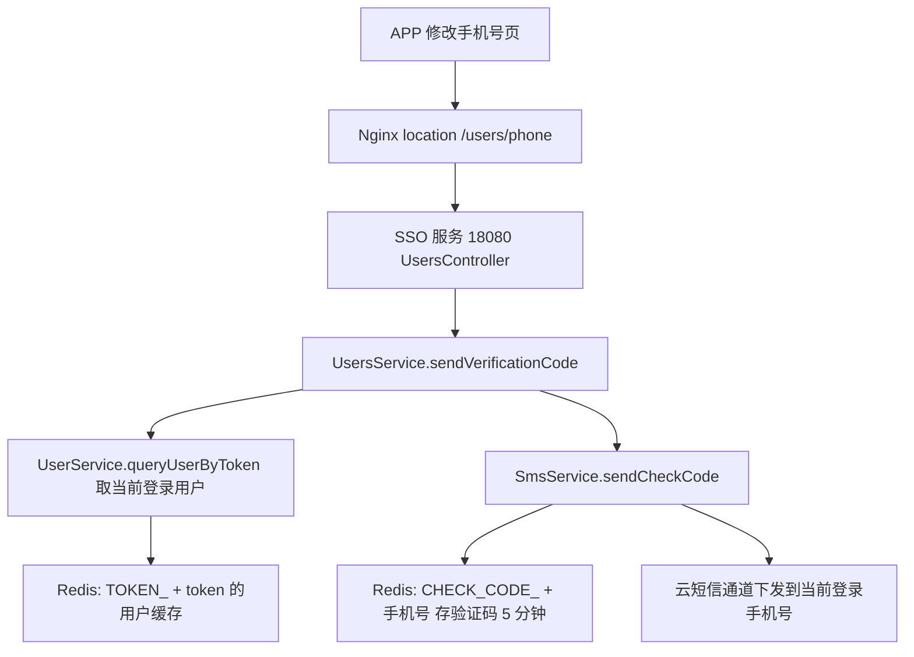

# 更换手机号第一步：从登录态取号，下发短信验证码

> 🔒 安全提示：文中示例的口令/密钥均为课程教学环境演示口径，生产环境的安全要求见《安全与合规须知》。

修改手机号是通用设置里安全等级最高的一个动作：手机号既是登录凭证，又是找回账号的锚点，改错了号，账号就等于送了人。所以它不能像改昵称那样一次请求直接落库，课程把它拆成三步：发送验证码、校验验证码、保存新手机号，三步各自对应一个接口，分三课实现。这一课先把第一步铺好：Nginx 转发规则、SSO 侧的新 Controller 与 Service，以及验证码如何带着登录态发出去。

## 先给结论

- 换号三步对应三个接口，全部落在 SSO 服务 18080，Nginx 用 `location /users/phone` 前缀把请求从 9000 转到 SSO 的 Tomcat。
- 发送验证码接口 `POST /users/phone/sendVerificationCode` 没有请求参数，验证码发给 token 对应的当前登录手机号，用来证明「本人」在操作。
- 链路是 token 查用户、取 `mobile`、复用 SmsService 发码；验证码存 Redis，key 为 `CHECK_CODE_ + 手机号`，有效期 5 分钟。
- 发码结果用 `code` 值区分三种情况：1 是上一次验证码未失效不再下发，2 是短信发送失败，3 是成功，Service 侧只认 3。
- 演示环境云短信下发固定验证码 123456，服务商 AccessKey 打码；换号期间与登录共用同一套发码与存码逻辑。

## 一、路由先行：Nginx 把换号请求交给 SSO

三步换号逻辑放在 SSO 工程而不是接口服务 18081，原因有两个：短信验证码的发送能力早在 day01 登录时就沉淀在 SSO 的 SmsService 里，直接复用；用户的更新动作与登录同源，token 的解析、用户缓存、账号修改天然属于 SSO 的职责范围。

请求先过 Nginx。课程资料包里的 `nginx.conf` 已经备好了这段转发规则：

```nginx
location /users/phone {
    client_max_body_size  300m;
    proxy_connect_timeout 300s;
    proxy_send_timeout 300s;
    proxy_read_timeout 300s;
    proxy_pass   http://127.0.0.1:18080;
}
```

所有以 `/users/phone` 开头的路径都会转给 18080 端口的 SSO 服务，三个换号接口的路径都带这个前缀，一条 location 规则覆盖三步。配置改动后执行 `nginx -s reload` 让其生效，这一步忘做的话，请求还在走旧规则，表现为新接口 404，排查时容易把矛头错指到代码上。

## 二、发码链路的实现

Controller 按惯例薄薄一层：接 token、调 Service、按布尔值翻 200 或 500：

```java
/**
 * 发送短信验证码
 */
@PostMapping("phone/sendVerificationCode")
public ResponseEntity<Void> sendVerificationCode(@RequestHeader("Authorization") String token) {
    try {
        Boolean bool = this.usersService.sendVerificationCode(token);
        if (bool) {
            return ResponseEntity.ok(null);
        }
    } catch (Exception e) {
        e.printStackTrace();
    }
    return ResponseEntity.status(HttpStatus.INTERNAL_SERVER_ERROR).build();
}
```

接口没有请求参数，只有请求头里的 Authorization。这是刻意的：给谁发码，答案在登录态里，客户端只需要表明「我是谁」，不需要也不允许指定号码。UsersService 是 SSO 工程里新建的类（day01 的 UserService 管登录，这里新拆一个 UsersService 管账号资料类操作）：

```java
package com.study.tanhua.sso.service;

@Service
public class UsersService {
    @Autowired
    private SmsService smsService;
    @Autowired
    private UserService userService;

    public Boolean sendVerificationCode(String token) {
        User user = this.userService.queryUserByToken(token);
        if (null == user) {
            return false;
        }
        String mobile = user.getMobile();
        Map<String, Object> result = this.smsService.sendCheckCode(mobile);
        return ((Integer) result.get("code")).intValue() == 3;
    }
}
```

`queryUserByToken` 是 day01 就有的方法：先按 `TOKEN_ + token` 从 Redis 取缓存的用户 JSON，取不到再回源查库。这里对 user 判空返回 false，属于防御式写法，正常登录态下用户必然存在，但 token 失效或被清理时这个分支就是唯一的安全网。取出 `mobile` 后交给 SmsService，返回的 Map 里用 `code` 表达结果，只有 3 算成功，强转取值再比对。

发码与存码的完整逻辑沉淀在 SmsService：

```java
public Map<String, Object> sendCheckCode(String mobile) {
    Map<String, Object> result = new HashMap<>(2);
    try {
        String redisKey = "CHECK_CODE_" + mobile;
        String value = this.redisTemplate.opsForValue().get(redisKey);
        if (StringUtils.isNotBlank(value)) {
            result.put("code", 1);
            result.put("msg", "上一次的验证码还未失效");
            return result;
        }
        // 云短信通道下发，演示环境固定返回 123456，服务商 AccessKey 已打码
        String code = this.sendSms(mobile);
        if (null == code) {
            result.put("code", 2);
            result.put("msg", "短信发送失败");
            return result;
        }
        // 保存验证码到 Redis，5 分钟过期
        this.redisTemplate.opsForValue().set(redisKey, code, 5, TimeUnit.MINUTES);
        result.put("code", 3);
        result.put("msg", "验证码发送成功");
        return result;
    } catch (Exception e) {
        e.printStackTrace();
    }
    return result;
}
```

**key 设计上要认清一点：换号验证码与登录验证码共用同一个 key。** 前缀 `CHECK_CODE_` 拼手机号，两次业务都是「给当前这个手机号发码」，课程里没有按业务再分段。共用带来两个后果：一，用户刚登录完立刻换号，登录时那个验证码可能还在 Redis 里，发码请求会命中「上一次的验证码还未失效」分支返回 1，端上要给出友好提示；二，理论上未消费的登录码可以用来通过换号校验，因为校验逻辑比对的是同一个 key。更严格的工程做法是按业务拆前缀，比如 `CHECK_CODE_LOGIN_` 与 `CHECK_CODE_CHANGE_PHONE_`，各自过期互不干扰，成本只是拼 key 时多一段常量。

## 三、真机验收

登录 17602026868（验证码 123456）进入首页，依次进入我的、通用设置、修改手机号，页面第一步就是获取验证码。在 Service 里打上断点后点击按钮：请求命中 `sendVerificationCode`，token 解出用户对象，取到当前手机号，进入 `sendCheckCode`，先查 Redis 无未失效验证码，再走云短信下发，得到 123456 写入 Redis，key 为 `CHECK_CODE_17602026868`，过期时间 5 分钟，接口返回 200。到数据库客户端或 Redis 客户端里确认这条 key 存在，第一步闭环。

一张图把这一步的调用路径串起来，也为后两步留好位置：



关键路径在 G 节点：查重、发码、存码三件事都在 SmsService 内完成，Controller 与 UsersService 只做穿线。第二步校验与第三步保存会复用这条链路上的同一段 Redis key 与用户缓存，这也是三步必须留在 SSO 的原因。

## 常见误区

- **以为验证码发给新手机号。** 错例：把新号码当参数传给发码接口，给未验证归属权的新号发码，等于替攻击者做号码探测。正解：发码只认 token 对应的当前绑定号，先证明本人，新号码的真实性在第三步绑定时由用户自行承担输入错误的风险。
- **发码接口裸奔没有频控。** 错例：每次点击都调云短信通道，接口被人循环调用就是短信轰炸，账单与通道信誉一起遭殃。正解：课程实现里「上一次验证码未失效不再下发」挡住了密集点击，生产环境还要叠加手机号日限额、IP 限流、图形验证码等手段。
- **result 里忘放 code 就强转取值。** 错例：某个失败分支只 `put("msg", ...)` 没有 `put("code", ...)`，上层 `(Integer) result.get("code")` 直接抛空指针。正解：约定 Map 里 code 为必有字段，或者干脆用枚举、专用结果对象替代 Map。
- **改了 Nginx 不 reload。** 错例：配置文件保存了就以为转发生效，新接口一直 404。正解：每次改动后执行 `nginx -s reload`，并用 `nginx -t` 先做语法检查。

## 面试可能被问到的问题

1. 面试官追问：「换手机号的验证码为什么发给旧手机号而不是新手机号？」
   答：目的是验证当前操作者是账号主人，旧手机号是账号现存的联系方式，归属权已被确认；先向旧号验证身份，再允许绑定新号，攻击者拿到新号 SIM 卡也无法越过这道门。也有产品选择给新号发码确认可用性，但那是「防绑错」，防不了「盗号换绑」，两者目的不同，严谨的做法是两个号都发。
2. 面试官追问：「验证码存 Redis 的 key 怎么设计，过期时间给多久？」
   答：业务前缀加手机号，值存验证码明文或加盐摘要，过期 5 分钟左右。前缀按业务分段可以隔离登录、换绑等场景的码，避免一个业务的未消费码被另一个业务误用。过期时间太短用户体验差，太长给了攻击者枚举窗口，5 分钟是常见折中。
3. 面试官追问：「短信验证码接口怎么防刷？」
   答：分层设防。交互层加图形验证码或滑块挡脚本；业务层对同一手机号限 60 秒一条、每日若干条，命中未过期验证码时直接拒绝重发；基础层用网关限流兜底 IP 维度。另外发送结果不区分「号码不存在」这类细节，避免接口被当成号码探测器。
4. 面试官追问：「发短信是同步调用还是异步，为什么？」
   答：课程实现是同步调用云短信通道后立刻返回，链路简单，缺点是通道抖动会拖慢接口。生产上更常用异步：接口只做校验与写 Redis，投递到 MQ 由消费者调短信通道，失败还能重试；验证码写 Redis 可以在投递前完成，也可以由消费者完成，关键是保证码与 key 的写入原子性。
5. 面试官追问：「token 查用户为什么要先查 Redis 缓存？」
   答：登录后每次请求都可能需要用户信息，回源查库会让 MySQL 承受不必要的读压力。登录时把用户 JSON 按 token 写入 Redis，后续请求直接取缓存，token 本身有过期时间，缓存生命周期与登录态对齐，登出时删 key 即可，一致性压力小，是登录态场景缓存的标准用法。

## 配套资料

- 转发规则：`materials/code/07/day11 探花交友-我的中心/day11/代码/nginx.conf`，`location /users/phone` 转发 18080 的配置出处。
- 学习目标：`materials/code/07/day11 探花交友-我的中心/day11/学习目标.md`，「独立完成更新手机号的功能」的发送验证码环节。
- 说明：day11 资料包不含工程源码，Controller、UsersService 与发码逻辑按课程画面与讲解整理补全，包名统一 `com.study.tanhua` 系，SSO 侧为 `com.study.tanhua.sso`；云短信服务商 AccessKey 按课程画面打码，测试验证码固定 123456；mock 文档站点域名以 example.com 占位。
