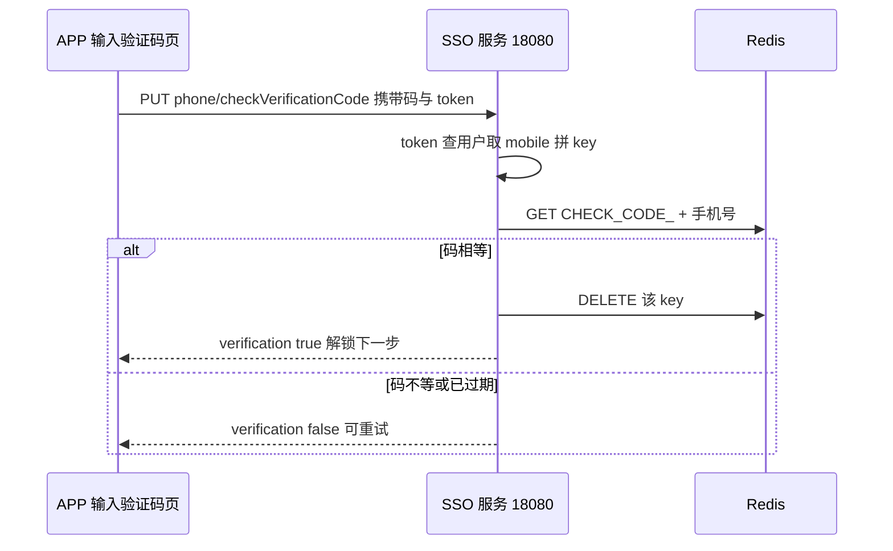

# 更换手机号第二步：验证码比对与一次性消费

> 🔒 安全提示：文中示例的口令/密钥均为课程教学环境演示口径，生产环境的安全要求见《安全与合规须知》。

上一步把验证码发进了当前登录手机号，并存进 Redis。这一步端上把用户输入的码提交上来，服务端与 Redis 里的值比对，通过才放行进入输入新号码的环节。看起来就是一次 `get` 加一次 `equals`，真正决定安全水位的是比对之后的处置：码用完删不删、输错之后留不留、比对用的手机号从哪来，三个细节每一个都对应一类攻击面。

## 先给结论

- 契约为提交用户输入的验证码，路径 `phone/checkVerificationCode`，请求体一个字段 `verificationCode`，响应体是 `{"verification": true 或 false}`。
- 校验不接受前端传手机号：token 查用户、取 `mobile`、拼出与发码时完全一致的 Redis key，key 的来源只信任服务端。
- 比对用 `StringUtils.equals`，两个操作数都不怕 null；相等即通过，同时 `delete` 该 key，验证码一次性消费。
- 比对失败不删 key，用户可以立即重试，直到 5 分钟过期自动失效；重试次数靠生产环境的额外计数限制。
- key 前缀抽成 `SmsService.REDIS_KEY_PREFIX` 公共常量，发码与校验共用一处定义，改前缀不会出现两边不一致。
- 课程实现里两次提交之间没有颁发中间凭证，靠登录 token 串联；更严格的工程做法是校验通过后写入一个短时效的「已验身」标记，第三步只认标记。

## 一、契约与响应设计

mock 契约给这个接口的入参只有一个验证码，出参是一个布尔。响应体的 `verification` 字段要区分两种失败吗？课程实现没有区分：码错、码过期、用户不存在，统统落成 false，端上一句「验证码输入错误」统一提示。把失败原因全部广播给端上反而是反面教材，攻击者可以用差异化响应加速枚举，模糊化处理是验证码类接口的通用姿势。

Controller 层把入参、token 一起交给 Service，再把布尔包成 Map 返回：

```java
/**
 * 校验验证码
 */
@PutMapping("/checkVerificationCode")
public ResponseEntity<Map<String, Object>> checkVerificationCode(@RequestBody Map<String, String> param,
                                                                 @RequestHeader("Authorization") String token) {
    try {
        String code = param.get("verificationCode");
        Boolean bool = this.usersService.checkVerificationCode(code, token);
        Map<String, Object> result = new HashMap<>();
        result.put("verification", bool);
        return ResponseEntity.ok(result);
    } catch (Exception e) {
        e.printStackTrace();
    }
    return ResponseEntity.status(HttpStatus.INTERNAL_SERVER_ERROR).build();
}
```

方法映射用的是 PUT，与发送、保存两步的 POST 不同，mock 文档最终如此约定，实现跟着文档走即可，不必死抠 REST 语义的严格对应。返回值从上一课的 `Void` 换成 `Map<String, Object>`，因为端上要依据这个布尔决定是否解锁下一步，200 状态码表达不了业务层的校验结论。

## 二、比对、删除与重试

Service 层四步走：查用户、拼 key、取值比对、按结果处置：

```java
public Boolean checkVerificationCode(String code, String token) {
    // 查询用户的手机号
    User user = this.userService.queryUserByToken(token);
    if (null == user) {
        return false;
    }
    String redisKey = SmsService.REDIS_KEY_PREFIX + user.getMobile();
    String value = this.redisTemplate.opsForValue().get(redisKey);
    if (StringUtils.equals(value, code)) {
        // 验证码正确，一次性消费
        this.redisTemplate.delete(redisKey);
        return true;
    }
    return false;
}
```

**key 必须由服务端推导，这是校验安全的底线。** 发码时 key 是 `CHECK_CODE_ + 手机号`，校验时拼 key 的手机号依然来自 token 解出的用户，而不是请求参数。假如反过来接受前端传手机号，攻击者就能拿自己手机号收到的码去匹配别人的账号，虽然码值不同难以通过，但接口等于向外部暴露了「某人是否近期收过验证码」这类信息，key 的构造权收归服务端，整类问题直接消失。

**通过即删除，是一次性消费的落地。** 验证码一旦验证成功还留在 Redis 里，截屏、日志、抓包泄露的旧码就能反复使用，一次性消费把它的价值压缩到第一次成功提交为止。删除动作放在 return true 之前，与比对在同一个方法里，正常链路下「比对通过」与「码失效」同时发生。发码侧与校验侧的 key 前缀共用 `SmsService` 里的公共常量，两处字面量拼凑一旦漂移，校验永远取不到值，这类 bug 的表象是「验证码明明发对了却提示错误」，排查时会浪费不少时间，一处定义是便宜的预防。

**失败不删 key，重试窗口留在 5 分钟里。** 用户手滑输错一次就被迫重新发码，体验很差，课程实现选择失败时什么都不做，用户改对了直接通过。代价是枚举风险：六位数字码有一百万种组合，5 分钟内高频提交理论上可以撞库，生产环境必须补一层失败计数，比如同一 key 累计错五次立即作废重发，课程为了聚焦主线没有展开，这一步的缺口要心里有数。



图里两条分支的差异只有一行：DELETE 有没有执行。错误路径不碰 Redis 的写操作，正确路径用删除宣告码的生命周期终结，一次消费对应一次成功。

## 三、真机验收

登录后进入修改手机号页，先点获取验证码，Redis 里写入 `CHECK_CODE_17602026868`，值 123456。在 Service 校验处打断点，故意输入 789 提交：请求命中，token 解出用户，key 拼出，`get` 到的值与入参不相等，走到 return false，端上提示验证码错误，Redis 里这个 key 原样保留。紧接着输入 123456：比对相等，断点里可以看到 `delete` 执行后 key 从 Redis 消失，返回 true，页面放行进入输入新手机号的环节。输错与输对各走一遍，重试与消费两个语义都验证到位。

课堂还顺手修了一处讲义问题：讲义里这个接口的响应封装与课堂实现有出入，以课堂代码为准，配套说明按课堂实现整理。两次提交流程的衔接方式也在这里点一句：校验通过后服务端没有写任何中间态，第三步提交新号码时重新走 token 查用户，身份链路复用登录态。工程上更稳的形态是校验通过时写入一个 10 分钟内有效的 `CHANGE_PHONE_OK_ + userId` 标记，保存接口只认标记，跳过验证码环节直接调保存的请求会被拒绝，两步提交强绑定。

## 常见误区

- **用 == 或 String.equals 比对验证码。** 错例：`value.equals(code)`，Redis 取出的 value 可能为 null（码过期或未发过），直接空指针；用 == 比较两个 String 比的是引用，恒为 false。正解：`StringUtils.equals(value, code)`，null 安全且比较内容。
- **校验通过后不删除验证码。** 错例：比对成功就 return true，码继续留在 Redis，泄露过的码可以反复使用，一次性语义被破坏。正解：成功分支内先 `delete` 再返回，让「用一次」与「失效」绑定。
- **校验失败也删 key。** 错例：无论比对结果一律 delete，用户输错一次就必须重新获取验证码，短信量与等待时间白白翻倍。正解：失败不动 key，用失败计数限制重试次数。
- **key 的手机号来自请求参数。** 错例：接口让前端把手机号一起传上来，服务端按传入值拼 key 校验。正解：手机号永远从 token 解出，客户端只提供验证码值本身。

## 面试可能被问到的问题

1. 面试官追问：「验证码校验通过后为什么要删除，不删会怎样？」
   答：验证码的价值在于一次有效，不删除意味着同一个码在其生命周期内可以重复使用，抓包、日志、截屏泄露的码就成了可重放的凭证，换绑、改密这类高危操作等于被打开了后门。删除之后即使码泄露，也只能消费一次，风险敞口收敛到单次。
2. 面试官追问：「错误验证码应该删除吗？怎么防枚举？」
   答：错误不删除，否则正常用户输错一次就要重发码，体验不可接受。防枚举靠失败计数：Redis 里对同一 key 累计错误次数，达到上限直接作废验证码并要求重新获取，也可以叠加账号维度与 IP 维度的限流。核心思路是把「无限次尝试」变成「有限次尝试加惩罚」。
3. 面试官追问：「先 get 再 delete 校验验证码，并发下有原子性问题吗？」
   答：有。两个请求同时携带同一验证码，都在 delete 之前通过了 get 比对，同一个码被消费两次，check 与 delete 不是原子操作。解决思路是把比对与删除合并成原子动作，比如 Redis 6.2 的 `GETDEL`，或用 Lua 脚本「值相等才删并返回结果」，也可以先删除再用删除结果判断是否通过。
4. 面试官追问：「验证码存 Redis 时，key 与值分别怎么设计？」
   答：key 用业务前缀加手机号，区分登录、换绑等场景避免串用；值一般存验证码本身，配合 5 分钟左右的 TTL，也可以存加盐后的摘要降低 Redis 数据泄露后的直接暴露。扩展字段如错误次数、发送时间可以放在同一个 key 的 Hash 结构里，过期时间整体管理。
5. 面试官追问：「多步操作怎么保证第二步真的校验过验证码，而不是直接调了第三步接口？」
   答：服务端为中间步骤颁发凭证。校验通过后写入一个短时效标记，例如以 userId 为 key 的「换号已验身」标记，有效期几分钟，第三步接口强制校验标记存在才执行，没有标记的直连请求一律拒绝。前端顺序调用只是交互引导，安全边界永远由服务端的标记与校验决定。

## 配套资料

- 学习目标：`materials/code/07/day11 探花交友-我的中心/day11/学习目标.md`，「独立完成更新手机号的功能」的校验验证码环节。
- 说明：day11 资料包不含工程源码，Controller、Service 与校验逻辑按课程画面与讲解整理补全，包名统一 `com.study.tanhua` 系，SSO 侧为 `com.study.tanhua.sso`；校验接口的方法映射按课程画面最终代码整理为 PUT；mock 文档站点域名以 example.com 占位。
