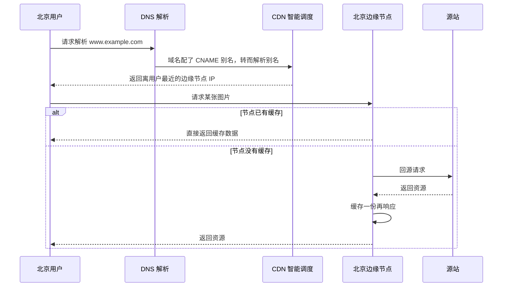

# CDN 内容分发网络：让图片和视频就近到达用户

我的中心页面里，头像存在 OSS，推荐流里的图片与小视频落在 FastDFS，这些资源全部指向同一个源站。用户量一上来，源站带宽先被打满，图片加载转圈是页面里最常见的慢。CDN 就是为这个问题准备的商业方案，day11 在功能全部收尾之后安排了这一课，把原理讲透，日后进企业遇到真实域名与服务器时，接入只是买服务加配置的事。

## 先给结论

- CDN 的全称是内容分发网络，把网站或项目里的静态资源缓存到分布各地的加速节点上，终端用户就近取数据，不必每次都回源站。
- 接入 CDN 后域名解析多了一步 CNAME 别名，智能调度系统按用户位置返回最近边缘节点的 IP，这个 IP 不是源站 IP。
- 边缘节点命中缓存直接响应；未命中就回源站取，取回的路上一边给用户返回、一边在节点缓存一份，这一步叫回源。
- 它加速的对象是静态资源：图片、小视频、静态文件。项目里 OSS 上的图片、FastDFS 里的小视频都可以挂 CDN，但 OSS 本身并不自带加速能力。
- 真正接入需要已备案的域名与服务器，学习项目不具备条件，本课的目标停在「能讲清原理」。

## CDN 是什么，怎么用

CDN 是 Content Delivery Network 的缩写，中文叫内容分发网络。把它想象成一套铺在全国各地的仓库网络：源站是总仓，各地加速节点是分仓，用户下单时从最近的分仓发货，总仓只在分仓缺货时才补货。定义一句话：将网站或项目中的资源缓存到全球或全国的加速节点上，终端用户请求这些资源时无需再找源站服务器，直接从就近的加速节点拿到缓存数据返回。

收益有三层。**第一，分担源站压力。** 大量请求在边缘节点就被终结，真正打到源站的只剩缓存未命中的那一部分。**第二，避免网络拥塞。** 资源从几百公里内的节点过来，跨网跨省的长距离传输少了，骨干网拥堵对体验的影响随之变小。**第三，提升用户体验。** 就近取数意味着更短的传输链路，图片与视频的加载速度是用户能直接感知的。

国内云厂商普遍把 CDN 作为标准产品，阿里云、腾讯云都提供这项服务，应用场景覆盖网页站点加速、下载加速、视频点播、视频直播与移动加速。它是收费服务，按流量或带宽计费，价格在厂商官网的产品页可以查到；接入也有数量门槛，例如某云的准入规则是单个账号最多 50 个加速域名，每个加速域名最多可配 10 个源站 IP。接入流程本身不复杂：厂商已经把整套服务做好，购买后把域名以 CNAME 方式指到调度系统，再配好缓存规则就能投入使用。

## 原理：一次带别名的域名解析

没有 CDN 时，用户访问 `www.example.com`，DNS 直接把域名解析成源站服务器的 IP，请求直达源站。接入 CDN 后，解析流程被插入了两步，整条链路如下：



关键路径在第二次跳转：DNS 解析时发现该域名配置了 CNAME 别名，相当于起了一个别名指向 CDN 侧的调度服务，解析随即转到智能调度系统；调度系统根据用户来源位置，返回离得最近的加速节点的 IP。用户拿到的并不是源站 IP，而是一个边缘节点的地址，之后所有静态资源请求都落在这个节点上。

节点接到请求后做一次判断：这张图片在自己这里已经缓存过，直接返回，源站全程无感；没有缓存，就去源站请求一次，返回时把数据缓存起来再响应给用户，下一个要同一张图的用户命中的就是缓存。北京的用户被调度到北京节点，上海的用户被调度到上海节点，「就近」贯穿了调度与缓存两层，这是 CDN 比直接访问源站快的根本原因。

## 探花项目里能加速什么

对照项目资源盘点一遍。**头像与图片**：完善个人信息时上传的头像存进了 OSS，OSS 负责存储，但没有附带加速；为 OSS 挂上 CDN 是最常见的组合，存储与加速各司其职。**小视频**：day04 起小视频文件落在 FastDFS，同样属于可缓存的静态资源。**静态文件**：页面里的 js、css 与静态图片也都能走 CDN。一句话圈出边界：CDN 缓存的是图片、视频、静态文件这类不常变化的内容，动态接口请求不在其列。

项目当前的部署方式是 Nginx 把请求全部转给后台服务，这是 day11 资料包里的真实配置：

```nginx
location / {
    client_max_body_size 300m;
    proxy_connect_timeout 300s;
    proxy_send_timeout 300s;
    proxy_read_timeout 300s;
    proxy_pass   http://127.0.0.1:18081;
}
```

所有压力都汇聚到 `127.0.0.1:18081` 这一台源站，正是 CDN 要替掉的部分：接入后图片与视频请求在边缘节点终结，源站只需处理动态业务。

对应用代码来说，接入 CDN 往往只是换个资源域名。以返回头像地址为例，把存储域名换成加速域名，做成配置之后代码一行不用动（课程没有真正接入，以下为按本课写法补全的示例）：

```yaml
tanhua:
  media:
    # 资源存于 OSS，展示走 CDN 加速域名；未接入 CDN 时两者保持一致
    image-domain: cdn.example.com
```

## 为什么课程里没有真正接入

厂商对使用 CDN 有准入要求：必须有一个真实的域名，指向一台真实的服务器，并且域名要完成备案，即通过云厂商接入完成监管登记。备案是硬门槛的原因很直接，加速节点遍布全国，未备案域名进不了这套体系。学习项目既没有正式域名也没有正式服务器，条件达不到，所以课程选择把原理讲透，而不是真接一次。

企业里这套流程反而简单：域名与服务器是现成的，走一遍备案，购买服务，配置加速域名与缓存规则，投入的主要是费用而不是工作量。能在交流里把 CNAME、智能调度、边缘节点、回源这条链路讲清楚，CDN 这一课的目的就达到了。

## 常见误区

- **把 CDN 当存储。** 错例：删掉 OSS 上的原图，指望 CDN 继续供图。CDN 只是缓存的副本，节点缓存会按过期规则淘汰并回源，源站才是数据的家。正解：源站保证数据完整，CDN 负责加速分发。
- **OSS 与 CDN 混为一谈。** 错例：图片传了 OSS 就默认已经被加速。OSS 是对象存储，负责存；CDN 是分发网络，负责快，两者是组合关系，不是同一个东西。
- **动态接口也挂到加速域名下。** 错例：把消息列表这类业务接口也指到 CDN 域名，请求被缓存后数据不再新鲜。正解：CDN 只圈静态资源，动态请求仍走源站或网关。
- **以为配置完立即全网生效。** 错例：改完 CNAME 马上开始压测。DNS 记录有 TTL，各地缓存里的旧解析要存活一段时间，全量生效需要等待；热点资源接入后还要做预热。

## 面试可能被问到的问题

1. 面试官追问：「CDN 的核心原理是什么？」
   答：内容分发网络把静态资源缓存到离用户最近的边缘节点。用户请求域名时，DNS 查到 CNAME 别名并把解析转给 CDN 的智能调度，调度按用户位置返回最近节点 IP；节点命中缓存直接响应，未命中则回源站取一次并缓存。收益是分担源站压力、减少网络拥塞、提升访问体验。
2. 面试官追问：「CNAME 在其中起什么作用？」
   答：CNAME 是别名机制。源站域名不直接解析出 IP，而是指向 CDN 提供的调度域名，把解析权交给调度系统，它才能按用户位置返回不同节点的 IP。没有这一步，域名固定解析到源站，就近调度无从谈起。
3. 面试官追问：「边缘节点没命中缓存怎么办，会不会一直回源？」
   答：未命中就回源取一次，取回时在节点缓存，之后的请求就地命中。再配合缓存过期时间与热点资源预热，大流量场景下回源比例能压得很低，这也是 CDN 更适合被大量重复访问的静态资源的原因。
4. 面试官追问：「图片已经放在 OSS 了，为什么还要 CDN？」
   答：OSS 解决存储容量、可靠性与读写接口，访问走的是单地域的存储域名，链路没有就近性；CDN 解决分发速度。组合后写入仍走 OSS，读取走 CDN 边缘节点，存储与加速各管一段。
5. 面试官追问：「接入 CDN 前有哪些前提条件？」
   答：需要一个真实域名、一台真实服务器，并且域名完成备案，这是国内加速节点的准入要求；此外要评估计费模式与流量成本。企业环境里域名与备案通常现成，新增的主要是配置工作和费用。

## 配套资料

- 学习目标：`materials/code/07/day11 探花交友-我的中心/day11/学习目标.md`，末条「理解 cdn 的工作原理」即本课验收点。
- 配置：`materials/code/07/day11 探花交友-我的中心/day11/代码/nginx.conf`，源站 Nginx 全量转发的真实配置，正文引用了其中 `location /` 一段。
- 说明：课程未接入 CDN，`yaml` 示例为按本课写法补全；加速域名与示例站点一律以 example.com 占位；厂商计费与域名准入规则以官网说明为准。
