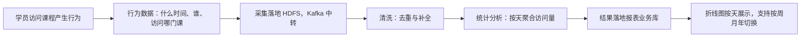

# 智慧学成业务流程：课程访问量从行为数据到报表折线图

报表系统里课程访问量折线图上标着 93471 这样的数字，列表里每一行是一天的访问量。这些数字从哪来、中间经过了哪些加工，就是这一课的业务流程。智慧学成是基于在线教育平台的大数据统计系统，把一条数据从产生到变成图表的完整旅程走一遍，后面几章的清洗、统计、存储才有挂靠的地方。

## 先给结论

- 统计范围是三大业务：课程、机构、用户，统计结果统一落到图表系统（报表）展示。
- 课程访问量的主链路五步：行为数据采集落地、清洗、统计分析、结果存储、报表展示，讲义原文就是按这五步写的。
- 有效访问按会话去重：同一次会话里反复刷新同一门课只算一次，会话内换一门课就再算一次。
- 清洗不只是去重，数据补全同样属于清洗范畴；统计分析负责把洗净的数据按天聚合成指标。
- 最终数字落在报表系统的业务库里，折线图按天展示，支持按周、月、年切换查看。

## 三大业务与报表系统

统计的三大业务是课程、机构、用户，对应上一课的三个主题，所有指标最终都展现到图表系统。课程用报表原型演示了一遍：登录页的账号、密码、验证码任意输入（原型模拟）；登录后是平台看板，顶部卡片摆着今日访问量、新增用户量、今日购买量，配按周、按月、按年的时间筛选；点进课程访问量，是一张按天的折线图加一份数据列表。

三类角色在这条链路里各就各位。学员在平台上浏览与学习，「我的学习」里每一次访问、关注、购买都是行为数据的来源；机构在「教学提供方」发布与维护课程，最关心自己课程的销量与学习人数；管理员与运营站在报表系统前看全局，看板与统计页是他们的工作界面。行为由学员产生、价值归机构与运营消费，统计系统是中间的加工厂。

## 课程访问量的完整链路

以课程访问量为例，讲义把流程写成五步：

```text
1. 日志服务器采集用户行为数据保存到 HDFS 中，NiFi 采集业务数据
2. 根据采集的原始数据进行清洗
3. 根据清洗的结果进行统计分析
4. 统计分析的结果进行数据存储
5. 结果数据提供给业务使用：报表系统展示
```

翻译成数据视角：用户在平台访问课程，产生了「什么时间、谁、访问了哪门课」的行为记录；这批原始数据被采集落地，进入统计系统前先在中转与存储层停一站；清洗环节把重复与缺失处理掉；统计分析把洗净的数据按天聚合出访问量；结果落到业务库，报表系统读业务库画折线图。整条链路如下：



关键路径在中间两步：原始数据不可直接入表，去重与补全决定数字准不准；统计分析决定指标怎么算，按天聚合之后才有「某一天访问量是多少」这个报表要的形态。

## 有效访问怎么数：会话与会话内去重

课程访问量有一个绕不开的细节：一个用户在浏览器里对着同一门课不停地刷新，算一次还是多次？刷新当然都是有效访问，但计数要说道说道。刷新发生在同一次会话里，浏览器没关，会话没变，这种情况下有效访问只算一次；同一次会话里从 Java 的课换到 C++ 的课，虽然还是一次会话，但访问了两门课程，有效次数就是 2。

这就是访问量统计的基本口径：**同一会话内，同一课程只计一次，换课程累计。** 会话是 Web 里反复出现的概念，这里它充当了去重的天然边界。落到工程上，去重发生在清洗环节，会话、用户、课程这几个字段就是判断依据；后续章节做数据仓库分层时，会看到这个口径如何一步步实现。

## 购买量同构，流程可复制

课程购买量的流程与访问量同构：学员先产生购买行为，购买数据被拿过来，做清洗，统计里有数据不完整的情况要做补全，补全同样属于清洗的范畴；清洗完成做统计分析，结果保存到业务库，报表系统再展示。机构销量、用户新增、活跃用户这些指标，都是同一套「行为、清洗、统计、入库、展示」的排列组合，差异只在行为类型与聚合维度上。

业务流程在工程里的样子，课程资料里已经有了实物，是后续章节会反复出现的 spark-submit 任务脚本（按课程资料脚本整理，包名已中性化）：

```bash
#!/usr/bin/env bash
# 课程购买流程的离线统计任务
if [[ $1 != "" ]]; then
    TD_DATE=$1        # 统计日期参数，如 2019-11-12
else
    echo "no params input, default date_info is yesterday"
    exit 1
fi

/opt/spark/bin/spark-submit \
  --master spark://xc-online-spark:7077 \
  --class com.study.xc.analysis.buy.CourseBuyProcessToDWM \
  /opt/run/jars/xc-service-offline-jar-with-dependencies.jar ${TD_DATE}
```

一条 shell 命令把某一天的统计任务提交给 Spark 集群，日期做参数、脚本做入口、jar 做实现，后面数据仓库与课程分析两章会把脚本背后的每一步拆开细讲。原型里那些日期随机的演示数据（1958 年、2014 年之类）只用于撑起折线图的形态，不用纠结数值本身。

## 常见误区

- **把业务流程当成下单流程。** 错例：画流程图画成学员选课、支付、发货。正解：统计系统的业务流程是数据流程，采集、清洗、统计、存储、展示五步，买卖动作只是行为数据的来源之一。
- **有效访问按请求次数计。** 错例：刷新十次算十次访问。正解：同会话同课程只计一次，会话内换课程才累计，去重口径在清洗环节统一执行。
- **以为清洗只有去重。** 错例：数据不完整的记录直接丢弃。正解：补全也属清洗范畴，该补的字段补上再进统计，能保住的明细不该在清洗环节流失。
- **把报表数字当实时值。** 错例：折线图上今天的线要求秒级更新。正解：报表按天展示的是业务库里的统计结果，面向稳定查询；实时性需求由后面的实时分析链路单独承接。

## 面试可能被问到的问题

1. 面试官追问：「讲一下课程访问量这个指标的完整业务流程。」
   答：学员访问课程产生行为数据，采集落地到 HDFS；原始数据先清洗，做会话级去重与字段补全；清洗结果做统计分析，按天聚合出访问量；结果存入报表系统的业务库；报表系统读业务库画折线图，支持按周、月、年切换。
2. 面试官追问：「同一会话里反复刷新同一门课，访问量怎么算？」
   答：算有效访问但只计一次。会话是去重边界，会话内同一课程重复访问合并为一次；换了一门课程则计数加一，因为访问对象变了。口径就是同会话同课程一次、换课程累计。
3. 面试官追问：「清洗环节除了去重还做什么？」
   答：数据补全。原始行为数据可能有字段缺失，比如时间或课程信息不完整，补全也属于清洗范畴。清洗的目标是让进统计的数据既不重复也不残缺，统计环节才能放心聚合。
4. 面试官追问：「统计结果为什么要落到业务库，报表直接查数仓不行吗？」
   答：数仓面向批量分析，模型与数据量都不适合报表系统的高频明细查询；把按天聚合后的最终结果落到 MySQL 业务库，报表查询轻而快，数仓压力也小。这是分析层与服务层解耦的常规做法。
5. 面试官追问：「购买量和访问量的统计流程有什么不同？」
   答：骨架完全同构，都是行为、清洗、统计、入库、展示五步。差异在行为类型与清洗内容：购买要做数据补全这类处理，聚合维度也从访问变成购买；掌握一条链路后，其余指标是同一套模式的复用。

## 配套资料

- 讲义：`materials/docs/08/智慧学成-第1章-项目介绍v1.0.md`，业务流程五步、功能模块与统计说明的出处。
- 讲义：`materials/docs/08/智慧学成-第2章-数据仓库.md`，数据仓库分层与建模，业务流程在后续章节的细化版。
- 代码：`materials/code/08/_散落资料/`，课程购买流程的 spark-submit 脚本等真实任务脚本存放处；文件原始名带站点后缀，属元信息，正文不引用。
- 说明：报表原型页面为演示数据（日期随机生成）；任务脚本按课程资料整理，原工程包名已按 `com.study.xc` 系中性改写；示例站点以 example.com 占位。
