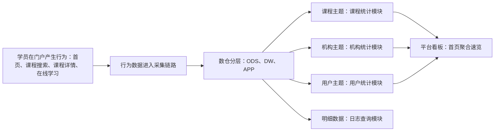

# 功能模块划分：从平台看板到日志查询的六大板块

项目定位与业务流程立住之后，功能怎么切是第三个绕不开的问题。原型系统摆在那里，左边是讲义的模块划分表，右边是能点能看的统计页面，两边对照着走一遍，每个模块里具体放了哪些指标、哪些指标容易放错位置，看完就有数了。这一课没有代码，但它决定了后面数仓建模时每张表为谁服务。

## 先给结论

- 功能分六大模块：平台看板、课程统计、机构统计、用户统计、日志查询、系统管理，模块名与课程、机构、用户三大主题一一对应。
- 平台看板是系统首页的聚合视图：在线听课人数、课程购买量、课程访问量、本周热门课程 TOP5、学习频次分布，外加实时看板与历史数据统计。
- 课程统计具体到「某一天」：课程访问量、课程购买量、在线听课人数、热门学科排名（销量、学生人数、销售额，每项带涨幅）。
- 用户统计里有日活、周活、月活与新增用户；学习频次口径上属于用户统计，前端入口却挂在学科统计下，只是表单摆放位置不同。
- 日志查询是统计明细的兜底查询，课程信息、在线学习日志、课程访问日志聚合在一起查；系统管理管平台自身，不是本阶段重点。

## 六大模块与三大主题的对应关系

模块划分表在讲义 1.4 节，一共六行。这张表要和业务流程课里的三大主题放在一起看：课程统计对应课程主题，机构统计对应机构主题，用户统计对应用户主题，剩下三个模块（看板、日志、系统管理）是围绕主题统计服务的配套能力。找功能的时候顺着主题找就不会迷路，做数仓建模的时候主题库也按这套口径落库。



这张图从左往右读：被统计的在线教育平台提供门户与后台，学员在首页、课程详情、在线学习等页面留下行为；行为数据经过采集进入数仓分层；模块消费的是分层之后的数据，看板再把三个主题的核心指标聚合到首页。模块不是孤立的页面，而是数仓主题的展示出口。

## 平台看板：管理员的首页速览

平台看板是登录后看到的第一个页面，定位是「常用的统计指标方便管理员查看」。页面上从上到下依次是：

- 实时看板：对数据的实时统计，历史数据的统计也归在实时看板这一部分。
- 在线听课人数：当天的在线听课规模。
- 课程购买量、课程访问量：两个核心交易与流量指标。
- 本周热门课程 TOP5：top 指最多，也就是本周最热门的五门课程。
- 学习频次分布：本周学 1 到 5 次的有多少人、10 到 15 次的有多少人，按区间给出学员分布。

看板的本质是聚合视图，它自己不生产新的口径，数字都来自下面三个主题统计模块，只是把最常看的几张图搬到了首页。运营早上打开系统先扫一眼看板，要下钻细节再去对应的统计模块。

## 三大主题统计模块：指标落到某一天

课程统计涵盖课程主题的指标：课程访问量、课程购买量、在线听课人数，统计都具体到某一天有多少；热门学科排名内容比较丰富，里面又包括销量、学生人数、销售额，每一项展示详细值并且带涨幅，排名就是当前最热门学科的顺序；学习频次分布与平台看板里那张图是同一个。

用户统计涵盖用户主题：活跃用户统计给出日活跃用户、周活跃用户、月活跃用户的具体统计值；新增用户统计显示每一天的新增用户数；学习频次统计也在这一组里。这里有个容易记混的细节：**学习频次在统计口径上属于用户统计，前端展示却放在学科统计的菜单下。** 讲师在原型里专门点了这一点，这只是表单存放位置的划分，它本质上还是用户维度的统计。做数仓的时候按口径归主题，做前端的时候按使用习惯摆位置，两边不必强行对齐。

机构统计涵盖机构主题的指标：销量、学生人数、销售额三项，每项下面展示详细值与涨幅。机构是课程的供给方，这三个指标直接回答「哪家机构卖得好、招了多少学员」，与课程统计里的机构销量互相印证。

## 日志查询与系统管理

日志查询提供的是日志数据的查询，日志数据即统计的细节数据，包括课程信息、在线学习日志、课程访问日志等。原型页面把课程名称、视频名称对应的课程查询、学习查询、课程访问查询聚合到了一起，一次查询可以覆盖三类明细。前面的统计模块回答「指标是多少」，日志查询回答「这个指标由哪些明细构成」，做数据核对与问题排查时全靠它。

系统管理是对平台自身的管理功能，包括用户管理、权限管理、订阅管理等。它属于任何一个后台系统都会有的标配能力，与本阶段的大数据主线关系不大，讲到这里课程也明确说了不是重点，认识一下即可。

## 被统计的平台：行为数据的来源

统计的原料全部来自被分析的在线教育平台，它的页面结构在配套的项目介绍文档里有说明：首页左侧是课程分类菜单，点进去进入课程搜索页，支持关键字加一级二级分类、难度等级筛选；课程详情页展示课程名称、课程介绍、课程章节与教育机构信息，收费课程点「马上学习」需要先购买；在线视频页通过右侧章节切换完成学习；教学管理人员则在教学管理平台的课程管理功能里编辑课程信息、上传课程视频。

把两边拼起来看，模块与来源的对应就完整了：门户的浏览与搜索行为喂给课程访问量，购买行为喂给课程购买量与机构销量，学习行为喂给在线听课人数与学习频次，后台的课程发布喂给课程与学科维度。功能模块划得清不清，直接决定后面数仓里每张事实表能不能找到明确的服务对象。

## 模块背后的主题库与任务脚本

模块、主题、数据库名在工程里是一套口径。数据仓库章节按分层与主题建库，建库语句如下：

```sql
-- 按主题建库，库与功能模块的口径一一对应
create database data_agency;    -- 机构主题：机构统计模块
create database data_course;    -- 课程主题：课程统计模块
create database data_dimen;     -- 维度库：各主题共用的维度表
create database data_platform;  -- 平台库：平台看板相关
create database data_subject;   -- 学科库：热门学科排名等
```

机构统计背后的数据落在 `data_agency`，课程统计落在 `data_course`，热门学科排名落在 `data_subject`。任务脚本同样按模块组织，机构统计与课程统计里「热门学科排名」对应的周统计任务，在课程资料里就是一条 spark-submit 脚本（按课程资料脚本整理，包名已中性化）：

```bash
#!/usr/bin/env bash
# 热门学科排名的周统计任务，日期做参数，脚本做入口
if [[ $1 != "" ]]; then
    TD_DATE=$1
else
    echo "[===no params input, default date_info is yesterday===]"
    exit 1
fi

/opt/spark/bin/spark-submit \
  --master spark://xc-online-spark:7077 \
  --class com.study.xc.analysis.subject.sales.SubjectSalesByWeekBiz \
  /opt/run/jars/xc-service-offline-jar-with-dependencies.jar ${TD_DATE}
```

一条命令把某天的统计任务提交给 Spark 集群，算出的就是课程统计与机构统计页面上「热门学科排名」的数字。模块划分表、主题库、任务脚本三层对齐，这套口径会贯穿后面的每一章。

## 常见误区

- **把统计系统的系统管理当成业务平台的后台管理。** 错例：以为系统管理里能维护课程与视频。正解：系统管理只管统计平台自身（用户、权限、订阅）；课程信息、视频上传在在线教育平台的教学管理后台完成，两边是两个系统。
- **按前端菜单归数仓主题。** 错例：看到学习频次挂在学科统计菜单下，就把它建成课程或学科主题的表。正解：口径上学习频次属于用户统计，前端摆放位置只是交互习惯，建模跟口径走。
- **把平台看板当成独立指标源。** 错例：为看板单独设计一套统计任务。正解：看板是聚合视图，指标全部来自三大主题统计，重复开发只会造出口径不一致的两份数字。
- **忽略涨幅这类相对指标。** 错例：只统计销量、学生数的绝对值。正解：热门学科排名里每一项都带涨幅，相对数值反映变化程度，指标设计时绝对值与相对值都要留。

## 面试可能被问到的问题

1. 面试官追问：「统计系统分哪些功能模块，怎么划分的？」
   答：六大模块：平台看板、课程统计、机构统计、用户统计、日志查询、系统管理。划分依据是课程、机构、用户三大主题，三个统计模块与主题一一对应，看板做首页聚合，日志查询兜底明细，系统管理管平台自身。
2. 面试官追问：「平台看板和课程统计里的课程访问量有什么区别？」
   答：口径相同，展示层级不同。看板是首页聚合视图，取各主题最常用的指标做速览；课程统计是主题模块，具体到每天并支持更多指标与涨幅下钻。数据同源，避免两套口径。
3. 面试官追问：「学习频次为什么出现在学科统计菜单下，建模时归哪个主题？」
   答：前端把它放在学科统计下只是表单摆放的划分，它描述的是学员的学习行为，口径上属于用户统计。建模跟口径走，归用户主题，前端位置与数据主题不必强行对齐。
4. 面试官追问：「日志查询存在的价值是什么，直接查统计结果不行吗？」
   答：统计结果只剩聚合后的指标，丢掉了明细。日志查询保留课程信息、在线学习日志、课程访问日志等细节数据并聚合在一个入口，用于核对数字、定位异常和回答「指标由哪些明细构成」。
5. 面试官追问：「热门学科排名要统计哪些东西？」
   答：按学科维度统计销量、学生人数、销售额三项指标，每一项都给出详细值与涨幅，并按热度排序。它同时服务课程统计与机构统计两个模块的数据诉求。

## 配套资料

- 讲义：`materials/docs/08/智慧学成-第1章-项目介绍v1.0.md`，1.4 功能模块六模块表与指标说明的出处。
- 讲义：`materials/docs/08/智慧学成-第2章-数据仓库.md`，分层（ODS、DW、APP）与按主题建库语句的出处。
- 讲义：`materials/docs/08/学成在线项目介绍文档.md`，被分析的在线教育平台首页、课程搜索、课程详情、在线学习与课程管理页面说明。
- 代码：`materials/code/08/_散落资料/`，热门学科排名等模块对应的 spark-submit 任务脚本存放处；目录内原始文件名带站点后缀，属元信息，正文一律不引用。
- 说明：任务脚本按课程资料整理，原工程包名已按 `com.study.xc` 系中性改写；原型页面指标为演示数据；示例站点以 example.com 占位。
