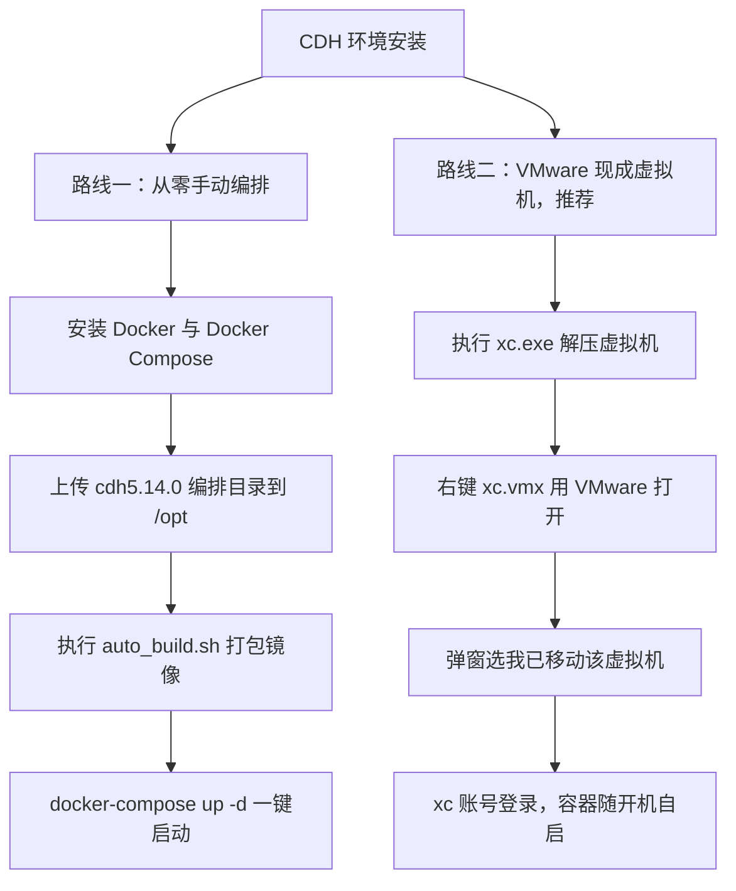

# 把 CDH 环境跑起来：Docker 编排与 VMware 虚拟机两条路

> 🔒 安全提示：文中示例的口令/密钥均为课程教学环境演示口径，生产环境的安全要求见《安全与合规须知》。

组件清单认识完，真正的门槛在安装。这套环境包含十来个组件，逐个裸装对学习机很不友好，课程给了两条路：一条从零手动编排，把 Docker、镜像、容器的每个环节亲手走一遍；另一条直接导入配置好的 VMware 虚拟机，开箱即用。两条路最终都是同一套容器，选哪条决定了你是练一遍原理还是直接开工。

## 先给结论

- 两种安装方式：从零 Docker 编排（适合理解原理）与 VMware 现成虚拟机（课程推荐，开箱即用）。
- 从零路线四步：安装 Docker 与 Docker Compose，上传 `cdh5.14.0` 编排目录到 `/opt`，执行 `auto_build.sh` 自动打包镜像，`docker-compose up -d` 一键启动。
- 打包镜像时要用网络下载第三方依赖，耗时 10 分钟到 1 小时看网况；首次启动要做初始化（HDFS 格式化、Hive 元数据初始化、Hue 初始化），最快 5 分钟，慢的 30 分钟左右，之后启动只要 1 分钟上下。
- VMware 路线：执行 `xc.exe` 解压虚拟机，右键 `xc.vmx` 用 VMware 打开，弹窗选「我已移动该虚拟机」，账号 `xc` 密码 `123456` 登录，容器随开机自启。
- yapi 与 es-head 两个容器没配置开机自启，用 `docker-compose up -d` 单独拉起即可。
- 资源红线：硬盘预留 200G 左右，内存建议 16G；宿主机 hosts 里把 `xc-online` 系列域名指到虚拟机 IP；业务报表系统 API 要手动 `java -jar /opt/xc-web.jar` 启动。

## 两条路线怎么选

从零手动搭建指的是从安装 Docker 开始，一步步配置大数据的各个组件，配置完成之后进行打包，然后编排，最终组成大数据开发环境；VMware 虚拟机方式则是虚拟机里已经配好了所有组件，开箱即用，把虚拟机起起来就能正常使用。课程明确推荐第二种，理由很朴素：简单。但从零路线的文档与脚本资料里都给全了，想搞懂「这套环境是怎么拼出来的」，值得手动走一遍。



两条路的终点相同：一组按编排文件启动的容器。差异在过程，路线一把「镜像怎么打包、容器怎么编排」全部暴露给你，路线二把过程固化在虚拟机里直接给结果。

## 路线一：从零编排，auto_build.sh 做了什么

手动搭建有独立文档，从安装 Docker、安装 Docker Compose，到大数据组件的安装配置都有详细步骤。Ubuntu 上装 Docker 的核心命令（按课程 docker 使用文档摘录）：

```bash
# 新版本安装前先卸载老版本
sudo apt remove docker docker-engine docker.io containerd runc
# 安装依赖
sudo apt install \
    apt-transport-https \
    ca-certificates \
    curl \
    gnupg-agent \
    software-properties-common
# 添加 Docker 官方 GPG 密钥
curl -fsSL https://download.docker.com/linux/ubuntu/gpg | sudo apt-key add -
# 安装社区版
sudo apt install docker-ce docker-ce-cli containerd.io
```

Docker 环境就绪后，把资料中的 `cdh5.14.0` 目录上传到虚拟机的 `/opt` 目录，这个目录是所有组件的配置目录，里面有各组件的安装包、配置文件、Dockerfile 与编排文件。给它添加可执行权限后执行自动配置脚本：

```bash
# 进入编排文件目录
cd /opt/cdh5.14.0
# 为自动配置脚本添加执行权限
chmod +x auto_build.sh
# 运行自动配置脚本
./auto_build.sh
# 打包完成后一键启动所有容器
docker-compose up -d
```

`auto_build.sh` 干的是自动化的粗活：解压 Hive、Spark、Hadoop、Hue、Zeppelin、HBase、Kafka、ZooKeeper、NiFi 九个组件包，把各组件的配置文件（比如 `core-site.xml`、`hive-site.xml`）复制到对应目录，最后用 `docker build` 打出 `xc:base`、`xc:es-head`、`xc:yapi`、`xc-hue:base` 几个镜像，所有大数据容器都以 `xc:base` 为底包，底包里装好 JDK 1.8 与 Scala 2.11.8 并配好环境变量。

两个耗时的坑要提前知道。**打包阶段要联网下载第三方依赖**，es-head、Hue 这些程序带着一串外部库，打包时必须下载齐全，等待时间由网络决定，文档给的范围是 10 分钟到 1 小时。**首次启动要做初始化**，HDFS 要对目录进行格式化，Hive 要初始化元数据，Hue 也要初始化，耗时按机器配置从 5 分钟到 30 分钟左右；初始化只在第一次发生，编排文件用锁文件防止重复执行（按课程编排文件摘录）：

```yaml
xc-online-hadoop:
  # 首次启动自动格式化 NameNode，format.lock 防止二次格式化
  command: bash -c "service ntpd start && service sshd start && \
    [ ! -e /opt/format.lock ] && /opt/hadoop-2.6.0-cdh5.14.0/bin/hdfs namenode -format \
    && touch /opt/format.lock; \
    /opt/hadoop-2.6.0-cdh5.14.0/sbin/start-all.sh && tail -f /dev/null"

xc-online-hive:
  # 首次启动把 Hive 元数据初始化到 MySQL，init.lock 同理
  command: bash -c "service ntpd start && service sshd start && \
    [ ! -e /opt/init.lock ] && \
    /opt/hive-1.1.0-cdh5.14.0/bin/schematool -dbType mysql -initSchema \
    && touch /opt/init.lock; \
    /opt/hive-1.1.0-cdh5.14.0/bin/hive --service hiveserver2"
  depends_on:
    - xc-online-hadoop
    - xc-online-mysql
```

看懂这个模式，很多「容器启动卡住」的疑问就解开了：初始化命令带条件执行、锁文件落盘、之后才进入常驻服务，首次慢是正常的，之后启动 1 分钟左右。

## 端口速查：附录的价值

整套环境占用大量端口，不知道哪个组件用哪个端口时去查文档附录。常用的几条（按课程端口说明摘录）：

```text
3306   mysql
2181   zookeeper 协议端口
9000   hadoop 协议端口
50070  hadoop fs web
8088   hadoop app web
7077   spark submit 协议
8080   spark master web
8888   hue
10000  hive server2 端口
9083   hive metastore 端口
9092   kafka 协议端口
58080  nifi web
9200   es http 接口
18080  zeppelin web 端口
2019   业务报表系统 API
```

## 路线二：VMware 虚拟机与首启弹窗

推荐路线的物料是分卷压缩的虚拟机：执行 `xc.exe` 解压得到虚拟机目录（课程演示为了防覆盖还先改了个名），解压耗时较长。解压完成后右键 `xc.vmx` 文件，选择使用 VMware Workstation 打开，虚拟机出现在界面里，点「开启此虚拟机」。

首次开机有一个必踩的弹窗，询问「此虚拟机可能已被移动或复制」，选「我已移动该虚拟机」。这一步不是随便点的：选「我已移动」，VMware 维持原有标识，虚拟机 IP 会自动配置；选「我已复制」则不会自动配置 IP，用终端连虚拟机时可能连不上。选完等开机完成即可，因为 Docker Compose 已配置 `restart: always`，容器随虚拟机开机自动启动。

登录用账号 `xc`、密码 `123456`（与课程环境一致）。登录后用 `docker ps` 验证容器状态，绝大多数容器已经起来，yapi 与 es-head 这两个不常用的容器没有配置开机自启，需要时单独拉起：

```bash
# 查看运行中的容器
docker ps
# 在编排文件目录单独拉起未自启的容器，已启动的保持原状
docker-compose up -d
```

`docker-compose up -d` 的补拉特性很好用：已启动的容器继续使用，未启动的自动启动，相当于一键兜底。

## 网络打通与最终验证

环境跑起来只是第一步，还要让宿主机与虚拟机互通。查虚拟机 IP 用 `ifconfig -a`，网卡 `eth0` 的 `inet addr` 就是地址（演示环境是 192.168.40.129，以你的为准）；虚拟机控制台里复制不便，有个迂回小技巧，把命令输出重定向到文件再编辑查看：

```bash
# 输出重定向到当前目录的 1 文件，再用编辑器打开查看
ifconfig -a > 1
```

拿到 IP 后在宿主机配置 hosts，把服务域名指向虚拟机，以后访问项目统一用 `xc-online` 加端口（Windows 的 hosts 文件在 `C:\Windows\System32\drivers\etc`，不能直接改，复制到桌面改完再复制回去；IP 按你的服务器地址为准）：

```text
192.168.1.101  xc-online
192.168.1.101  xc-online-hadoop
192.168.1.101  xc-online-spark
192.168.1.101  xc-online-mysql
192.168.1.101  xc-online-yapi
192.168.1.101  xc-online-es
192.168.1.101  xc-online-zk
192.168.1.101  xc-online-kafka
192.168.1.101  xc-online-redis
192.168.1.101  xc-online-hbase
```

最后一步验证：用 SSH 工具连虚拟机 IP（账号 `xc`、密码 `123456`），执行 `docker ps` 确认容器齐全；浏览器抽查 Web 端口，如 `xc-online:50070` 看 HDFS、`xc-online:8080` 看 Spark Master、`xc-online:8888` 看 Hue。还有一个容易漏的服务：业务报表系统 API 需要手动启动，命令为 `java -jar /opt/xc-web.jar`，不启动它报表页面拿不到接口数据。

资源方面守住两条红线：硬盘要预留 200G 左右，统计分析越做越多空间会持续膨胀，空间不足会报各种莫名其妙的错误；内存要给足，演示机给了 16G，全部容器挤在一台虚拟机里，内存不够可以调小，但大数据环境可能因此不正常。

## 补充：生产环境的 Cloudera Manager

本课为省资源把 CDH 组件装进了单机容器，生产环境的常规做法是（按主流做法补充说明，非课程内容）：先用 Cloudera Manager 规划多节点角色分配（NameNode、DataNode、Hive、HBase 各放哪台机器），再通过 parcel 分发把对应版本的二进制包推送到各节点完成安装，之后组件的启动、停止、配置变更都在 CM 的 Web 界面上完成。理解了本课的手动编排，再看 CM 的图形化管理，无非是把这些步骤产品化了。

## 常见误区

- **首启弹窗选了「我已复制」。** 错例：图省事随便选。正解：选「我已移动该虚拟机」，维持原有网络标识让 IP 自动配置；选「复制」后 IP 不自动配置，SSH 连不上要手动折腾网络。
- **以为所有容器都会开机自启。** 错例：开机后直接用 yapi 或 es-head，发现服务不通就以为环境坏了。正解：这两个容器未配置 `restart: always`，执行 `docker-compose up -d` 单独拉起。
- **首次启动卡住就反复重启。** 错例：等了几分钟看不到输出就关机重来。正解：首次要做 HDFS 格式化、Hive 元数据初始化、Hue 初始化，5 到 30 分钟属正常，反复重启反而可能把初始化状态搞乱。
- **宿主机空间与内存不设防。** 错例：在只剩几十 G 空闲的盘上跑。正解：硬盘预留 200G 左右、内存尽量 16G，资源不足的表现是各种莫名错误，很难排查到根因。

## 面试可能被问到的问题

1. 面试官追问：「你的大数据开发环境是怎么搭的？」
   答：基于 Docker 编排的 CDH 5.14.0 组件集：配置文件与 Dockerfile 集中在一个编排目录，auto_build.sh 自动解压组件、分发配置并打包基础镜像，docker-compose up -d 一键启动；也可以直接导入配置好的 VMware 虚拟机开箱即用，课程推荐后者。
2. 面试官追问：「容器怎么做到开机自启和首启初始化？」
   答：自启靠编排里的 restart: always，容器随 Docker 引擎启动；初始化靠锁文件，如 Hadoop 容器首次启动检查 format.lock 不存在才执行 namenode 格式化并落锁，Hive 用 init.lock 保护 schematool 初始化，保证初始化只发生一次。
3. 面试官追问：「VMware 首次启动为什么必须选『我已移动』？」
   答：选移动，VMware 保留虚拟机原有标识，IP 按原配置自动生效；选复制会被识别为新机，IP 不自动配置，宿主机与虚拟机的网络不通，SSH 与 hosts 映射都会失败。
4. 面试官追问：「怎么验证整套环境是健康的？」
   答：三层验证。docker ps 看容器齐全与状态；浏览器抽查各组件 Web 端口，如 50070 看 HDFS、8080 看 Spark Master、8888 看 Hue；再用业务验证，手动 java -jar 启动报表系统 API，看报表页面能否正常取数。
5. 面试官追问：「生产环境部署 CDH 和你这套学习环境差别在哪？」
   答：规模与管理方式。生产用 Cloudera Manager 做多节点规划，通过 parcel 分发版本包到各节点，服务启停、配置变更、监控都在 CM 界面完成；学习环境是单机容器化，用 Docker Compose 承担编排，思路相同、载体不同。

## 配套资料

- 讲义：`materials/docs/08/智慧学成-第1章-环境搭建v1.0.md`，环境安装两种方式、hosts 配置、端口与注意事项的出处。
- 代码：`materials/code/08/_散落资料/`，docker 使用教程、docker-compose 编排文件与 auto_build 脚本存放处，文中 Docker 安装命令、编排字段、端口清单均出自其中；目录内原始文件名带站点后缀，属元信息，正文一律不引用。
- 说明：Cloudera Manager 与 parcel 一节为按主流做法补充的背景说明；示例 IP 按课程演示环境（192.168.1.101 与 192.168.40.129）记录，实际以自己的虚拟机为准；虚拟机账号 `xc`、MySQL root 密码与课程环境一致（123456）。
