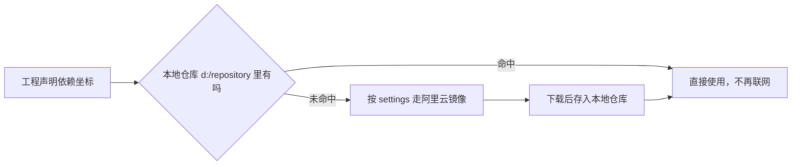

# Maven 环境一次配好：镜像加速、本地仓库与 IDEA 关联

用默认配置的 Maven 拉一个大工程，中央仓库的下载速度足够把人熬走，而课程这种依赖几十个大数据组件的项目更是重灾区。环境搭建这一课把 Maven 一次配顺：装 3.6.2，改 `settings.xml` 两处，再把 IDEA 指到同一个 Maven 上，后面导入基础工程时依赖就能一口气下完。

## 先给结论

- 版本锁定 `apache-maven-3.6.2`，绿色软件解压即用，课程安装到 `D:\devtools` 目录。
- `conf/settings.xml` 只改两处：`<mirrors>` 段加阿里云镜像，`<settings>` 段配 `<localRepository>d:/repository</localRepository>`。
- 课程资料提供打包好的本地仓库 `repository.zip`，解压到 D 盘根目录即可使用，仓库路径不要含中文。
- 镜像加速解决「下载慢」，本地仓库解决「重复下载」，两者叠加使用，不是二选一。
- IDEA 里关联同一套 Maven 安装目录与 settings 文件，IDE 和命令行才共享同一个仓库。

## Maven 装在哪，怎么算装好

Maven 是绿色软件，解压即安装。课程资料的软件目录里提供 `apache-maven-3.6.2-bin` 压缩包，解压到 `D:\devtools` 目录，解压完成安装就算结束，不需要运行什么安装程序。目录结构里要认住两个位置：`bin` 目录放 `mvn` 命令本体，`conf` 目录放全局配置文件 `settings.xml`，本课所有改动都落在 `settings.xml` 一个文件上。

讲义把 Maven 仓库的用法列成三种：一是安装目录 `conf` 内 `settings.xml` 里配置镜像加速；二是从中央仓库直接下载，不配镜像时 Maven 默认走这条路；三是使用本地仓库。课程的组合是镜像加本地仓库，中央仓库直连只作为兜底。装好后可以顺手验证一下：

```bash
# 验证 Maven 可用，输出会带 Maven home 与 Java version 两行（通用验证方式，课程从解压直接开始）
mvn -v
```

输出里 `Maven home` 指向 `D:\devtools\apache-maven-3.6.2`、`Java version` 是 1.8，说明 Maven 已经绑上了正确的 JDK，可以开始改配置。

## 镜像加速：把中央仓库的流量改道国内

中央仓库在国外，直连下载 jar 包速度很慢，这是课程坚持配镜像的原因。镜像的原理是拦截：Maven 默认会向 id 为 `central` 的中央仓库发请求，`<mirrorOf>central</mirrorOf>` 声明「凡是去 central 的请求，都改发给我这个镜像」。配置加在 `settings.xml` 的 `<mirrors>` 段内，文件里自带一段被注释掉的示例，照着示例的位置把下面这段贴进去即可：

```xml
<mirror>
  <id>aliyun maven</id>
  <name>aliyun maven</name>
  <url>http://maven.aliyun.com/nexus/content/groups/public/</url>
  <mirrorOf>central</mirrorOf>
</mirror>
```

`id` 与 `name` 是这个镜像的身份标识，随意但别重复；起作用的是 `url` 与 `mirrorOf` 的组合，前者指路，后者划定接管范围。课件里的镜像地址以当时的阿里云 Nexus 路径为准，如今地址如有更新，按阿里云官方文档替换 `url` 即可，`mirrorOf` 的写法不变。

## 本地仓库：现成的依赖直接用

哪怕有镜像，从零开始也要下载大量文件，课程的解法是把一份已经下好的仓库直接给你。资料里的 `repository.zip` 就是这份本地仓库，覆盖了本项目所需的常用依赖，解压到 D 盘根目录，得到 `d:/repository`。之后 Maven 找依赖时先翻这份本地仓库，绝大多数包直接命中，只有本地确实没有的才去网络上补下载。

启用它的配置在 `settings.xml` 顶部 `<settings>` 标签下，同样有注释示例可以对照位置：

```xml
<localRepository>d:/repository</localRepository>
```

配置路径与解压路径一致就能直接生效。讲义特别标注了一条：本地仓库的目录位置不要使用中文，路径里有中文或空格容易在依赖解析与脚本执行时出问题，D 盘根目录是最省事的选择。加上镜像配置后，一次依赖解析的完整路径如下：



本地仓库是第一优先级，镜像只负责补缺，下载过一次的包永久留存在 `d:/repository`，下次任何工程用到都不再联网。

## IDEA 关联：让 IDE 与命令行用同一套 Maven

IDEA 自带一份捆绑的 Maven，不设置的话 IDE 里跑的是它自己的版本和自己的仓库位置，与刚才配好的环境是两套世界。关联方式在 IDEA 设置里搜 Maven：`Maven home directory` 选 `D:\devtools\apache-maven-3.6.2`；`User settings file` 勾选 Override，指向上一步改过的 `conf/settings.xml`，这样镜像与 `d:/repository` 的本地仓库配置会被 IDEA 原样继承，本地仓库路径一栏会自动识别出来。

IDEA 侧还有编码、JDK、Scala 插件等一批配置，下一课集中处理，这里只保证 Maven 关联正确。

## 常见误区

- **把镜像和本地仓库当成二选一。** 错例：配了本地仓库就删掉镜像配置。正解：本地仓库管命中复用，镜像管未命中的补下载，两者是链路上下游关系，叠加配置。
- **仓库路径含中文或空格。** 错例：把仓库解压到 `D:/常用资料/仓库` 之类的目录。正解：用 `d:/repository` 这类纯英文路径，讲义明确标注不要使用中文。
- **改的不是生效的那份 settings.xml。** 错例：在用户目录 `.m2` 下新建了一份 settings 文件，IDEA 却在用安装目录 `conf` 里的那份。正解：确认 IDEA 的 User settings file 指向哪份，就改哪份；命令行默认读安装目录 `conf/settings.xml`。
- **`mirrorOf` 写成 `*` 一刀切。** 错例：让镜像接管所有仓库请求，私服或其他特殊仓库也被劫持。正解：课程口径只代理 `central`，范围够用且不误伤。

## 面试可能被问到的问题

1. 面试官追问：「Maven 找一个依赖的完整顺序是怎样的？」
   答：先查本地仓库，命中即用；未命中按 settings 配置走镜像或直接请求中央仓库，下载成功后存入本地仓库，下次复用。本地仓库是所有工程共享的缓存层，镜像只是下载通道的改道。
2. 面试官追问：「`mirrorOf` 写 `central` 和写 `*` 有什么区别？」
   答：`central` 只接管对中央仓库的请求，其他仓库如私服、远程仓库不受影响；`*` 接管全部仓库请求。项目里可能同时存在私服与中央仓库依赖时，用精确的 `mirrorOf` 更安全，避免私服流量被镜像吞掉。
3. 面试官追问：「为什么要自己指定本地仓库路径，默认的 `.m2` 不好吗？」
   答：默认仓库在用户目录下，路径可能带中文用户名，且重装系统或换机器时不易迁移。指定到 `d:/repository` 这类纯英文固定路径，一是规避路径解析问题，二是方便整仓拷贝复用，课程直接提供打包好的仓库就是这个思路。
4. 面试官追问：「settings.xml 里还有哪些常用配置？」
   答：除 `localRepository` 与 `mirrors` 外，常用还有 profiles（定义 JDK 版本、仓库列表等构建环境）、servers（私服的账号密码）、proxies（公司内网代理）。日常开发前两类用得最多。
5. 面试官追问：「IDEA 捆绑的 Maven 和自己装的有什么区别，为什么要统一？」
   答：捆绑版是 IDEA 内置的 Maven 运行时，版本与配置都独立于命令行环境。不统一时会出现命令行构建通过、IDE 里却报依赖找不到这类环境不一致问题。把 Maven home 与 settings 文件都指向同一份，IDE 与命令行共享同一仓库与镜像配置，行为才一致。

## 配套资料

- 讲义：`materials/docs/08/智慧学成-第1章-环境搭建v1.0.md`，2.1 Maven 环境一节，镜像与本地仓库配置的出处。
- Maven 发行包：`materials/code/08/apache-maven-3.6.2-bin/`，3.6.2 完整发行目录原件，`conf/settings.xml` 原始文件在内，本课的修改以它为底稿。
- 本地仓库：`materials/code/08/repository/`，课程提供的本地仓库包归档目录，压缩包未随本仓解压，正文配置按课件口径整理。
- 说明：镜像 URL 以课程课件为准，`mvn -v` 验证命令为按主流写法补全的通用示例。
