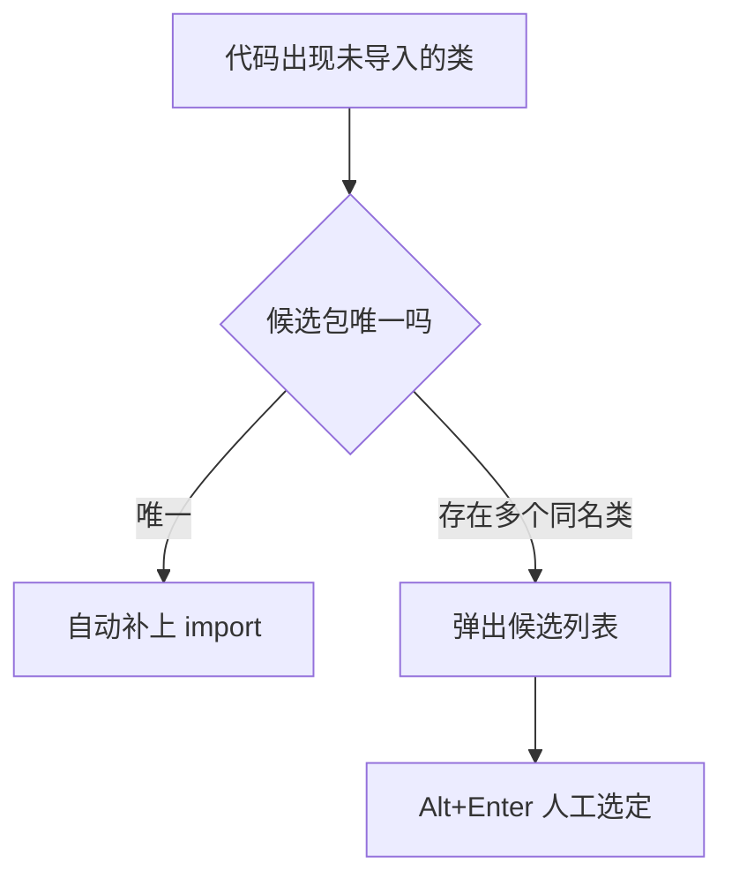

# IDEA 开发环境七项配置：Scala 大数据工程的前置准备

刚装好的 IDEA 直接去导入 Scala 工程多半会碰壁：中文注释变乱码、类名底下飘红、提示 Project JDK is not defined。IDEA 出厂配置面向通用 Java 开发，要跑大数据的 Scala 工程，得先把七个配置项过一遍：Maven 关联、编码、JDK、Scala SDK、快捷键、自动导包、IDE 虚拟内存。本课一次配完，下一课导入工程时才不会被环境问题打断。

## 先给结论

- 七项配置里，Maven 关联、编码、快捷键、自动导包在 Settings 全局完成；JDK 与 Scala SDK 依赖项目存在，放到导入工程那一刻配。
- Maven 配置与上一课衔接：Maven home 指向 `D:\devtools\apache-maven-3.6.2`，本地仓库核对为 `d:/repository`。
- 编码把 File Encodings 里看到的每一项都改成 UTF-8，properties 文件的默认编码从 GBK 改成 UTF-8。
- 自动导包勾选 `Add unambiguous imports on the fly`，Scala 的同款选项一并勾上。
- IDE 虚拟内存是可选项，默认够用就不动；要改的话 8G 内存参考讲义给出的四个参数。

## Settings 里的四个全局项

Maven 关联在设置面板搜 `maven`：Maven home directory 选安装目录 `D:\devtools\apache-maven-3.6.2`，User settings file 指向上课改过的 `conf/settings.xml`，配置正确时 Local repository 一栏会自动带出 `d:/repository`，只要核对它与 `settings.xml` 里写的一致，Maven 这一项就完成了。编码搜 `enc`（全称 encoding），把 File Encodings 页面里所有非 UTF-8 的下拉项全部改成 UTF-8，重点是 Global Encoding、Project Encoding 与 properties 文件的 Default encoding。快捷键搜 `keymap`，默认是 Default for Windows，习惯 Eclipse 的人可以直接切 Eclipse 方案；要自定义就先复制一份再改，避免污染原方案。自动导包搜 `fly`，找到 Auto Import，勾选 `Add unambiguous imports on the fly`，下面的 Scala 自动导包同样勾上，Import on paste 设为 Add。四项的关键字与目标汇总如下：

```text
搜索 maven  → Maven home directory: D:\devtools\apache-maven-3.6.2
              User settings file: 指向 conf/settings.xml
              Local repository:  d:/repository（自动识别）
搜索 enc    → File Encodings: Global / Project / properties 默认值全部 UTF-8
搜索 keymap → Eclipse 或 Default，按个人习惯选择
搜索 fly    → Auto Import: 勾选 Add unambiguous imports on the fly 与 Scala 自动导包
```

编码这项是乱码问题的总开关，工程源码、日志输出、properties 文件三个层面共用这套设置，任何一处留在 GBK 都会以乱码形式还回来。

## 自动导包到底自动到什么程度

勾选的选项直译是「导入无歧义的包」：代码里敲了一个类名，如果全依赖里只有一个叫这个名字的类，IDEA 静默把 import 写好；如果存在多个同名类（比如两个包里都有 `StringUtils`），IDEA 不会替你猜，而是给出候选列表由人决定。决策过程如下：



这条边界解释了讲义里那句补充：IDEA 可以自动优化导入包，但多个同名的类调用不同的包时，必须手动按 Alt+Enter 选择。勾选只是免掉机械劳动，判断权还在人手里。

## JDK 与 Scala SDK：有项目才能配

JDK 与 Scala SDK 都挂在项目结构上，没有打开任何工程时这两项无从配置，课程把它们安排到下一课导入基础工程时一起做。这里先把关系说清：Project JDK 是整个工程的 Java 运行与编译基线，课程用 JDK 1.8；Scala SDK 是 Scala 代码的编译与运行基线，通过 Global Libraries 注册一份 Scala 2.11.8（内部含 scala-library、scala-compiler、scalap 三件套），再挂到工程模块上，Scala 源码才会被识别与编译。前提条件只有一个：IDEA 装了 Scala 插件，Plugins 市场里搜索安装即可，这是处理 `.scala` 文件的入口。

Scala SDK 发行包课程资料里是现成的，版本锁定 2.11.8，与工程 pom 里声明的 `scala.version` 一致，下一课直接指路使用。

## IDE 虚拟内存：可选的第四步半

IDEA 本身也是个 Java 进程，默认堆内存跑大数据工程这种大索引项目时可能吃紧，讲义给出 8G 内存机器的参考配置。修改入口有两处：安装目录 `bin` 下的 `idea64.exe.vmoptions` 文件（64 位系统选它），或者 Help 菜单里的 Custom VM Options，后者会直接帮你打开对应文件：

```text
-Xms1024m
-Xmx4096m
-XX:MaxPermSize=1024m
-XX:ReservedCodeCacheSize=1024m
```

`-Xms` 是初始堆大小，`-Xmx` 是最大堆上限，后两项分别给永久代与代码缓存留空间。课程演示里默认配置够用，教师没有改，这一项按自己机器的内存量力而行即可；顺带一提，`MaxPermSize` 是老版本 JDK 的参数，新的 JDK 会忽略它，属于历史遗存写法，照抄不影响运行。

## 常见误区

- **编码只改 Project 不改 Global。** 错例：新打开一个工程，中文注释又开始乱码。正解：Global Encoding 是所有工程的默认值，Project Encoding 管当前工程，properties 文件另有独立默认项，三处都要 UTF-8。
- **没有项目时硬配 JDK 和 Scala SDK。** 错例：在欢迎页设置里找 Project SDK，找不到或配了不生效。正解：这两项挂靠项目结构，导入工程后在 Project Structure 里配，课程也是这么安排顺序的。
- **以为勾了自动导包就全自动。** 错例：写了 `StringUtils`，IDEA 随手导入了一个不是想要的包，编译报错找半天。正解：多候选时 IDEA 会弹列表，确认候选列表再回车，别无脑选第一个。
- **虚拟内存往死里调大。** 错例：8G 内存的机器把 `-Xmx` 拉到 8G，IDEA 与系统互相挤兑。正解：`-Xmx` 是上限不是越多越好，留足系统与其他进程的份额，讲义的 1024m 起步、4096m 上限是合理量级。

## 面试可能被问到的问题

1. 面试官追问：「Global Encoding 和 Project Encoding 有什么区别，为什么都设 UTF-8？」
   答：Global Encoding 是 IDE 级默认值，作用于所有未单独设置的工程；Project Encoding 只管当前工程。properties 文件还有独立的默认编码。三处统一成 UTF-8 才能保证源码、配置文件读写一致，任何一处不一致都会以乱码或编译错误的形式暴露。
2. 面试官追问：「IDEA 里要让 Scala 代码被识别并编译，需要哪些条件？」
   答：装 Scala 插件提供语言支持，注册一份 Scala SDK（含 scala-library 与 scala-compiler），再把它关联到工程模块，Project JDK 设为 1.8 这类 Java 基线。四者齐备后 `.scala` 源码才有语法解析、跳转与编译能力。
3. 面试官追问：「自动导包的 unambiguous 是什么含义，多候选时怎么处理？」
   答：指候选包唯一时才自动导入；存在多个同名类时不做猜测，弹出候选列表由开发者选择，快捷键 Alt+Enter。这个设计避免了同名类误导入带来的隐蔽编译错误。
4. 面试官追问：「vmoptions 里的 -Xms 和 -Xmx 分别是什么？」
   答：JVM 堆内存参数，-Xms 是初始堆大小，-Xmx 是最大堆上限。给 IDEA 配置时按机器总内存留出余量，比如 8G 机器给 1024m 起步、4096m 上限，避免与系统争抢内存。
5. 面试官追问：「为什么 IDEA 里要绑定自己安装的 Maven，而不是用捆绑的？」
   答：捆绑 Maven 版本与配置独立，IDE 内构建与命令行构建可能出现仓库位置、镜像配置不一致，导致「命令行能跑、IDE 报红」。绑定同一 Maven home 与同一 settings 文件后，两侧共享本地仓库与镜像，行为完全一致。

## 配套资料

- 讲义：`materials/docs/08/智慧学成-第1章-环境搭建v1.0.md`，2.2 IDEA 环境一节，编码、快捷键、自动导包与虚拟内存参数的出处。
- Scala SDK：`materials/code/08/scala-2.11.8/`，Scala 2.11.8 发行包原件，`bin` 目录含 `scala.bat`、`scalac.bat` 等，供 Global Libraries 注册时指向。
- Maven 发行包：`materials/code/08/apache-maven-3.6.2-bin/`，Maven home 指向的目标目录。
- 说明：IDEA 界面操作无课程源码，示例为按本课写法补全；`MaxPermSize` 为课件原文参数，新版 JDK 下会被忽略。
