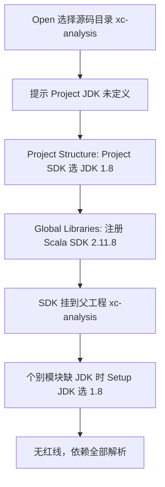

# 导入 Scala 基础工程：五个模块一套坐标，编译通过才算环境就绪

hosts、Maven、IDEA 三件套配齐之后，轮到把课程准备好的 Scala 基础工程导入进来。后续每一章的离线分析、实时分析、即时查询代码都写在这个工程里，导入不成功，后面所有环节都要停摆。导入动作本身只有一次 Open，真正的门槛在 JDK 与 Scala SDK 这对依赖项：必须在正确的时机、配到正确的位置，工程才会从满屏红线变成可以敲代码的状态。

## 先给结论

- Open 导入 `xc-analysis` 工程，先配 Project JDK 1.8，再在 Global Libraries 注册 Scala SDK 2.11.8 并挂到父工程，五个子模块整体继承。
- 工程是聚合工程，`packaging` 为 `pom`，子模块五个：实体、工具类、离线分析、实时分析、即时查询。
- 依赖版本与 CDH 环境对齐：hadoop 2.6.0、hive 1.1.0、hbase 1.2.0、spark 2.3.3、scala 2.11.8、kafka 2.2.0、elasticsearch 6.4.0、mysql 8.0.16。
- `protobuf-java 2.5.0` 是专门为解决版本冲突加进来的依赖，排在所有依赖最前面，hbase 依赖里还显式排除了 guava。
- 导入成功的标志：IDE 里没有红线，Maven 依赖全部解析，工程能编译。

## 导入与双 SDK 配置

IDEA 欢迎页点 Open，选择源码目录（课程演示把工程放在 `D:\code` 下的 `xc-analysis`），等待 preparing workspace 完成。工程打开后第一眼就是顶部横幅报 Project JDK is not defined，同时 Scala 源文件也没有语法识别，因为 JDK 与 Scala SDK 两个都还没配。

两步走。配置 JDK：File 打开 Project Structure，在 Project 里把 SDK 选为新增，弹出菜单选 JDK，指向安装目录（课程环境在 `D:\devtools` 下的 java 目录，版本 1.8），确定后工程基线就有了。配置 Scala SDK：同一个 Project Structure 窗口切到 Global Libraries，点加号选 Scala SDK，Browse 找到 `D:\devtools\scala` 目录内的 `scala-2.11.8`，确认后 IDEA 会问这个库要添加到哪个模块，选父工程 `xc-analysis`，子模块全部继承这一份 SDK，不用逐个模块去挂。挂完如果个别模块还提示 JDK 缺失，在模块的依赖页点 Setup JDK，选 1.8 即可。整个流程串起来如下：



Scala SDK 之所以要走 Global Libraries，是因为它要在多个工程间复用，注册一份全局的 2.11.8，以后新建工程直接引用；这也依赖上一课装好的 Scala 插件，没有插件时这一项在加号菜单里根本不会出现。

## 五个子模块各管什么

工程的模块划分在根 pom 里声明得清清楚楚，父工程坐标之外只有一段 modules 列表加集中依赖。五个子模块的职责如下：

```text
xc-common-entity    实体模块：项目用到的实体类已全部建好，直接取用
xc-common-utils     工具模块：日期、IP、Redis、字符串等工具类，可直接使用
xc-service-offline  离线分析：数据仓库清洗与统计代码都在这个模块（第 2、3 章）
xc-service-rt       实时分析：Spark Streaming 实时统计代码（第 4 章）
xc-service-search   即时查询：HBase 与 Elasticsearch 查询代码（第 5 章）
```

实体模块里的类是 Scala 的 case class，比如平台首页数据的业务实体：

```scala
package com.study.xc.entity

/**
 * 平台首页数据业务实体类
 */
case class PlatformOfflineBiz(
  clazz: String,
  total_count: Int,
  yesterday_count: Int,
  years: String,
  months: String,
  days: String
)
```

字段直接对应报表卡片要展示的数值：总数、昨日数与年月日维度。工具模块的类在后面的代码里高频出现，比如构建 SparkSession 时用到的字符串工具。两个 service 前缀的模块承担真正的分析逻辑，模块名与后续章节一一对应，工程结构本身就是课程地图。

编译链路靠 build 段的两个关键配置支撑：`sourceDirectory` 指向 `src/main/scala`，让 Maven 把 Scala 目录当源码目录；`scala-maven-plugin` 负责在 compile 阶段真正编译 Scala 代码。缺了后者，Maven 只编译 Java 而对 `.scala` 文件视而不见。

## Maven 坐标：版本与 CDH 集群对齐

根 pom 的 properties 是全工程版本的唯一事实来源，数值与前面 CDH 环境的组件版本保持一致（包名已按中性口径改写）：

```xml
<groupId>com.study</groupId>
<artifactId>xc-analysis</artifactId>
<version>1.0-SNAPSHOT</version>
<packaging>pom</packaging>

<properties>
    <java.version>1.8</java.version>
    <scala.version>2.11.8</scala.version>
    <spark.version>2.3.3</spark.version>
    <mysql.version>8.0.16</mysql.version>
    <hadoop.version>2.6.0</hadoop.version>
    <hive.version>1.1.0</hive.version>
    <hbase.version>1.2.0</hbase.version>
    <elastic.version>6.4.0</elastic.version>
    <kafka.version>2.2.0</kafka.version>
</properties>
```

依赖按组件分组铺开：Spark 一组，含 core、sql、streaming、hive、hive-thriftserver、mllib（runtime 范围），外加与 Kafka 对接的 streaming-kafka 与 sql-kafka；Hadoop 只引一个 `hadoop-client`；Hive 五件是 jdbc、hcatalog-streaming、hcatalog-core、exec、cli，数量最多的就是它；HBase 六件覆盖 annotations、client、common、server、shell、thrift；JSON 三件为 fastjson、jettison、json-lib；再往后是 scala-logging 日志、kafka 客户端、jedis 的 Redis 客户端、elasticsearch-spark 连接器、commons-pool2 连接池、ip2region 的 IP 工具库，测试范围挂 scalatest 与 junit。

版本冲突的处理埋在两处，都值得看清。`protobuf-java` 以 2.5.0 固定版本放在依赖列表最顶端，注释写明是解决版本冲突：Hadoop 生态内部对 protobuf 版本敏感，先把 2.5.0 钉死，传递依赖带进来的其他版本就会被统一。hbase-common 那一组则用 exclusions 显式排除 guava，HBase 自带的 guava 版本与集群其他组件冲突，排除后由统一的版本顶上：

```xml
<dependency>
    <groupId>org.apache.hbase</groupId>
    <artifactId>hbase-common</artifactId>
    <version>${hbase.version}</version>
    <exclusions>
        <exclusion>
            <artifactId>guava</artifactId>
            <groupId>com.google.guava</groupId>
        </exclusion>
    </exclusions>
</dependency>
```

这套版本表不能随手升级：本地开发编译通过的版本组合，要能与集群里真实运行的 CDH 组件对话，客户端与服务端版本错位是大数据工程最常见的隐性问题。

## 验证：依赖解析完成、编译通过

导入完成的判定很简单：IDE 里整个工程树没有红线，External Libraries 里能看到全部依赖被解析出来。想更扎实一点就主动跑一次编译，工程把 `defaultGoal` 设成了 install，在工程根目录直接执行 `mvn` 等价于 `mvn install`（`mvn compile` 只编译不安装，验证更快，属通用做法）：

```bash
# 工程根目录执行，验证依赖解析与 Scala 编译链路
mvn compile
```

BUILD SUCCESS 加上控制台里 scala-maven-plugin 的编译输出，说明 JDK、Scala SDK、Maven 仓库三层环境全部就位，下一课就可以在这个工程里写第一个 WordCount。

## 常见误区

- **Scala SDK 挂到单个子模块上。** 错例：添加 SDK 时随手选了某个 service 模块，其余模块的 Scala 文件照样飘红。正解：挂到父工程 `xc-analysis`，子模块统一继承，一份 SDK 全工程生效。
- **看到报版本旧就升级依赖。** 错例：把 hadoop 2.6.0 改成 3.x、spark 2.3.3 改成 3.x，编译过不了或提交到集群直接类不兼容。正解：properties 里的版本与 CDH 集群组件一一对应，客户端跟着服务端走。
- **删掉 protobuf 或 exclusions「清理」依赖。** 错例：认为没被代码直接引用就可以删。正解：protobuf 2.5.0 与排除 guava 都是压版本冲突的，删掉后冲突在运行期才爆发，排查成本远高于留着它们。
- **Scala 文件不被编译就反复重装 IDEA。** 错例：怀疑 IDE 坏了。正解：检查三件事，Scala 插件装没装、Scala SDK 挂没挂对模块、pom 里 scala-maven-plugin 与 `src/main/scala` 源码目录在不在。

## 面试可能被问到的问题

1. 面试官追问：「依赖集中声明在父 pom，子模块和 dependencyManagement 方式有什么区别？」
   答：dependencies 直接写在父 pom 时，子模块无条件继承全部依赖，不用再声明；dependencyManagement 只统一版本号，子模块仍要自己声明坐标才真正引入。前者省事，后者按需取舍，课程工程模块少、依赖统一，直接用继承方式。
2. 面试官追问：「为什么要强制指定 protobuf 2.5.0？」
   答：Hadoop 生态多个组件依赖 protobuf 且版本要求不一，Maven 靠最近优先原则仲裁传递依赖，仲裁结果不一定满足 Hadoop 的要求。在根 pom 显式引入 2.5.0 把版本钉死，所有模块统一用它，避免运行期出现方法不存在这类冲突。
3. 面试官追问：「hbase-common 里排除 guava 是什么操作，什么时候需要？」
   答：exclusions 用来剪掉传递依赖。HBase 带进来的 guava 版本与集群其他组件（如 Spark、Hadoop）依赖的版本冲突，且 guava 在新版本里有大量不兼容改动，显式排除后由统一版本提供，是大数据工程处理 jar 冲突的常规手段。
4. 面试官追问：「scala-maven-plugin 在构建里起什么作用？」
   答：Maven 默认只认 Java 源码目录与编译器，该插件把 `src/main/scala` 纳入源码目录并在 compile、testCompile 阶段调用 Scala 编译器，让 Scala 与 Java 混合工程能被同一条 Maven 命令构建。
5. 面试官追问：「客户端依赖版本为什么必须和集群组件版本对齐？」
   答：Hadoop、Hive、HBase 的客户端与服务端通过 RPC 与序列化协议交互，版本不匹配时会出现协议不兼容、类找不到等运行期错误。工程 properties 与 CDH 组件版本一一对应，就是保证本地编译产物提交到集群后行为一致。

## 配套资料

- 讲义：`materials/docs/08/智慧学成-第1章-环境搭建v1.0.md`，2.3 导入基础工程与 2.3.3 Maven 坐标介绍，导入步骤与依赖清单的出处。
- 工程根 pom：`materials/code/08/_散落资料/`，xc-analysis 根 pom 原件所在目录，模块列表与 properties 数值取自它；目录内文件原始名带站点后缀，属元信息，不进正文。
- Scala SDK：`materials/code/08/scala-2.11.8/`，Scala 2.11.8 发行包原件，Global Libraries 注册时指向的目录。
- 说明：Scala 源码工程未随归档解压，实体类与模块说明按课程画面线整理，包名已按 `com.study.xc` 系中性化改写；`mvn compile` 验证命令为按主流写法补全的通用示例。
