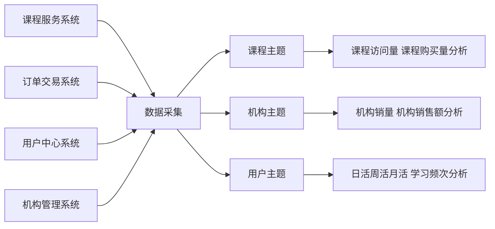

# 数据仓库的四个特点：面向主题、集成、非易失、时变

「数据仓库有四个特点，面向主题、数据集成、非易失、时变」，这句话背下来只要十秒，难的是落到自己项目里：主题到底怎么划、集成靠什么动作完成、非易失是不是永远不许改、时变又变在哪里。这一课把这四个词逐个安到在线教育平台统计的场景上，每个特点都能指到一张具体的表或一个具体的库。

## 先给结论

- 四个特点各管一件事：面向主题管「数据怎么组织」，数据集成管「数据从哪来」，非易失管「存进去之后怎么对待」，时变管「数据随时间怎么变」。
- 主题以分析需求为导向划分，且主题中的数据跨应用系统，这是它与按业务流程划分的业务库最根本的不同。
- 非易失说的是很少更新而不是永不变化；时变补上另一半，变化有三种固定形式：追加新数据、删除过期数据、对历史明细做聚合。
- 落到工程上：主题对应 Hive 里的库，时变对应事实表上的日期分区，四个特点都有可执行的对应物。

## 面向主题：按分析需求组织数据

理解主题，最省力的方式是拿数据库应用系统来对比。业务系统的应用和数据是按业务内容划分的：一个 ERP 套件里，进销存系统管进货、销售、存储的流程，人力资源系统管员工信息与待遇，财务、仓储各管一摊，一个系统对应一段业务流程。数据仓库换了一个划分标准：以数据分析需求为导向，把数据组织成若干主题，比如销售主题、员工主题、产品主题。

主题是一个抽象的概念，可以理解为相关数据的分类或目录，通过销售主题可以做销售相关的分析：年度销量排行、月度订单量统计。要分清的是，销量排行、订单统计这些是具体要分析的指标，而「这些指标和什么相关」的答案才是主题，指标跟着销售走，就归入销售主题。

放到本项目，分析需求围绕课程、机构、用户三大块展开，主题也就相应地切成课程主题、机构主题、用户主题，与统计系统的功能模块一一对应。还有一个关键点：**主题中的数据是跨应用系统的。** 想看年度销量排行，进货销的库里有数据；想看哪个部门的销量最高，还要把部门的数据拿过来；想看员工个人的销售排名，员工的数据也得拿过来。一个主题内部，数据来自多个应用系统，这一点直接引出了第二个特点：



这张图在讲同一个事实的另一个面：四个应用系统各自的数据，经过采集汇入三个按分析需求划出的主题。业务系统按流程切，数仓按分析领域切，同一个「购买」动作在交易系统里是订单流程的一步，在数仓里是课程主题与机构主题都要用的分析素材。

## 数据集成：把分散的数据拉到一起

主题中的数据既然跨应用系统，集成就是必经动作。讲义里的例子是销售分析：销售数据在进销存系统里有，在财务系统里也有，为了做销售分析，必须把两处的销售数据集成到销售主题中，之后从销售主题出发做分析，不必再关心数据原来在哪。

本项目里同样的逻辑每天都在发生。课程购买量这个指标要用到订单数据、课程数据、机构数据，它们原本躺在在线教育平台的业务库里；课程访问量来自前端埋点的访问日志。集成的方式就是采集，把各系统的数据拿过来，落在按主题建好的库里：

```sql
-- 按主题建库，主题是集成的落点
create database data_agency;    -- 机构主题
create database data_course;    -- 课程主题：课程购买量、课程访问量等事实数据集成于此
create database data_dimen;     -- 维度库
create database data_platform;  -- 平台库
create database data_subject;   -- 学科库
```

集成不是把数据堆到一个屋里就完事，各系统对同一个字段的定义、格式可能有出入，采集过来之后还要经过清洗转换，让同一种数据在仓里只有一套口径。口径统一这件事在 ETL 环节展开，这里先记住结论：集成的价值在于让分析从单一出口取数。

## 非易失：存进去是为了查，不是为了改

数据库应用系统根据业务需求做数据处理和存储，数据是活的：订单状态跟着用户的每次支付即时变化，一有操作就更新。数据仓库反过来，它根据数据分析需求做存储，仓里的数据用于查询和分析，为了保证分析结果的准确性和稳定性，数据一般很少更新，甚至不更新。

对比着看更清楚。业务库里的购买记录，用户取消订单、客服改价、退款，状态字段随时在变：

```sql
-- 业务库：状态随业务操作即时更新
UPDATE course_orders SET status = '401003' WHERE order_number = '202611070001';
```

而数仓里的课程购买事实是某一时刻的定格，采集落仓之后供人反复查询统计，不再跟随线上变化。分析师今天算的月度购买量和下周算的必须一致，数字天天变，报表就失去公信力，这是非易失存在的理由。

## 时变：很少更新，但有三种变化

非易失容易被读成「数据永不变化」，时变就是来纠正这个误解的。数据仓库存的是历史数据，历史数据随时间自然增长，讲义里列了三种固定的变化形式。

**一，不断添加新数据。** 今年的销售数据会进入数据仓库，明年同样如此，数据按周期逐步追加进来，仓库越滚越大。

**二，删除过期数据。** 既然存历史，为什么还要删？数据仓库里的数据通常保存五到十年，但也有过期时间。十年前的一次购买行为、一条浏览记录，拿来分析这个用户当下的喜好和购买习惯，显然不合适，留着只占空间，所以会按保留策略有选择地删除。

**三，对历史明细数据进行聚合。** 为了分析方便，较细粒度的明细会按分析需求聚合成粗粒度数据再存一份。要统计年度销售额，不必每次都从销售明细重新加总，按月先聚合好，年度统计只对十二个月的月度结果再算一遍，既复用了历史数据，又省下了重复计算的算力。

落到本项目的表上，时变就是事实表上的日期分区。课程访问量事实表的建表语句里，分区字段直接把年、月、日声明出来，每天的数据整体追加进新分区，历史分区只读不改：

```sql
-- 课程访问量事实表：按年月日三级分区，时变特性落在分区上（讲义真实建表语句）
CREATE EXTERNAL TABLE IF NOT EXISTS data_course.course_visit_fact
(course_visit_fact_id String,
 course_dim_id String,
 time_dim_id String,
 area_dim_id String,
 company_dim_id String,
 client_ip String,
 client_sessionid String,
 client_type String,
 visit_time bigint)
PARTITIONED BY (years String, months String, days String)
ROW FORMAT DELIMITED FIELDS TERMINATED BY '\t'
STORED AS PARQUET
location '/user/hive/external/data_course/course_visit_fact';
```

每天一个新分区追加进来对应「添加新数据」，按保留策略清理老分区对应「删除过期数据」，基于明细分区聚合出月度、年度中间表对应「聚合历史明细」。两个特征合起来的完整口径是：非易失管「没有实时的增删改」，时变管「有周期性的追加与演变」，这个表述与阶段四总结数据仓库基本特征时的口径一致，只是这一次每个特征后面都站着一张真实的表。

## 常见误区

- **把非易失理解成数据永不变化。** 错例：以为入仓之后任何写入都是违规。正解：非易失禁止的是跟随业务操作的实时更新，周期性的追加、过期清理与聚合存储都是时变的正常表现形式。
- **按业务流程划分主题。** 错例：照着在线教育平台的下单流程建「下单主题」「支付主题」「退款主题」。正解：主题按分析需求划分，购买相关的分析归入课程主题，流程只是数据的来源，不是组织的依据。
- **把集成当成简单堆放。** 错例：各系统数据原样灌进同一个库就算集成。正解：集成包含采集与清洗转换，必须让同一业务含义的数据统一格式与口径，否则仓里分析出来的数字互相打架。
- **照抄前端菜单建主题库。** 错例：页面上学习频次挂在学科统计菜单下，就把它建成学科主题的表。正解：主题划分跟统计口径走，学习频次描述学员行为，归用户主题，前端摆放位置只是交互习惯。

## 面试可能被问到的问题

1. 面试官追问：「说说数据仓库的四个特点，结合你做过的项目讲。」
   答：面向主题、数据集成、非易失、时变。以在线教育统计项目为例：按课程、机构、用户分析需求划分主题库；各业务系统数据经采集集成进仓，统一口径；仓内数据供查询分析很少更新；数据按天分区追加、定期清理过期分区、明细聚合出月度年度结果，对应时变。
2. 面试官追问：「面向主题和面向业务的区别到底是什么？主题为什么是跨应用系统的？」
   答：业务系统按流程切分应用，每个系统只管自己那段流程；数仓按分析领域组织数据。一个分析领域的信息天然散在多个系统里，比如销量排行要订单、部门、员工的数据，所以主题里的数据必须跨应用系统汇集。
3. 面试官追问：「非易失和时变是不是矛盾的？」
   答：不矛盾，两者描述的是不同层面的变化。非易失说不做跟随业务的实时更新，保证分析口径稳定；时变说数据随时间有追加、清过期、聚合这三种演变。合起来是：没有毫秒级的改，但有天级月级的变。
4. 面试官追问：「为什么要把历史明细数据聚合成中间结果再存一份？直接用明细算不行吗？」
   答：明细量大，每次统计都从明细加总，算力消耗大且响应慢。按月预聚合后，年度统计只对十二个月的中间结果计算，复用了历史成果，明显缩短查询时间。这是用空间换时间的典型做法，也是分层设计的雏形。
5. 面试官追问：「数据集成靠什么手段完成？具体做什么？」
   答：靠采集加 ETL。把分散在各应用系统的数据抽取出来，清洗掉错误、不完整、重复的脏数据，按数仓要求做格式与内容转换，再装载到对应主题库中，让同一含义的数据在全仓只有一套口径。

## 配套资料

- 讲义：`materials/docs/08/智慧学成-第2章-数据仓库.md`，1.3 数据仓库的特点（面向主题、数据集成、非易失、时变）四小节与 `course_visit_fact` 建表语句的出处。
- 代码：`materials/code/08/_散落资料/`，按主题建库的 `hive.sql` 汇总存放处；目录内原始文件名带站点后缀，属元信息，正文一律不引用。
- 说明：业务库订单更新语句为按本课写法补全的示例；建库语句与课程访问量事实表建表语句为讲义真实内容；示例站点以 example.com 占位。
