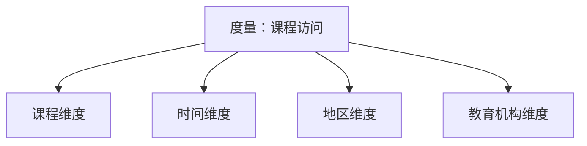

# 维度分析：从课程访问量指标里找出分析的维度

运营提需求的时候不会说「我要时间维度」，只会说「课程访问量按周看看，再按月看看」。把这句业务语言翻译成数仓的语言，就是维度分析要训练的能力：拿到一个指标，反推出可以从哪些角度去看它。这一课先分清指标与维度这对词，再用课程访问量把识别维度、收集关键指标、划分层次级别整套流程走一遍。

## 先给结论

- 指标是衡量事物发展的标准，也叫度量，可以求和求平均，分绝对数值与相对数值；维度是事物的特征，分定性维度与定量维度，指标本身也能转成定量维度。
- 维度分析的顺序不能反：先收集关键指标，也就是运营管理者最关心的指标，再从指标出发识别维度，维度是后续数仓建模的基础。
- 课程访问量作为度量，识别出课程、时间、地区、教育机构四个维度；课程购买量在此基础上多出支付方式与客户两个维度。
- 每个维度至少有一个层次，每个层次至少有一个级别：时间维度一个层次四个级别（年、月、周、天），课程维度四个层次，地区维度一个层次三个级别。

## 指标与维度：一对必须分清的词

指标是衡量事物发展的标准，也叫度量，比如价格、销量，都是具体的值。指标可以求和、求平均值，按反映的内容分成两类：绝对数值反映具体的大小和多少，如价格、销量、分数；相对数值反映一定的程度，如及格率、购买率。

维度是事物的特征，如颜色、区域、时间。同一个指标从不同维度切入，结论会完全不同：按区域维度分析产品销量，看出哪个地区卖得好；按时间维度看每个月的销量，看出趋势。维度也分两类，定性维度是字符类型的特征，比如区域维度下的各个省份；定量维度是数值类型的特征，比如价格区间维度的 0 到 100、100 到 1000 两个区间。指标和维度在定量的地方接上了：把销量切成「0 到 100 单」「100 到 1000 单」的区间去看分布，原来的指标就变成了维度。

## 业务需求：课程访问量如何被分析

在线教育平台的运营方最基础的诉求是课程访问量，它指单位时间内用户访问课程详情页的数量。统计系统的原型页面上，课程访问量以折线图呈现每天的值，并提供按周、按月、按年的筛选。看原型容易产生一个误会，以为周、月、年是三个维度，其实它们都是时间这一个维度内部的筛选范围，只是级别的不同，这一点在分层与分级一节会讲透。

分析从明细开始。课程访问的明细记录每条代表一次访问，包含 IP、访问时间、课程 ID：

| IP | 访问时间 | 课程 ID |
|---|---|---|
| 127.0.0.1 | 2019-10-01 00:00:00 | 10010 |
| 127.0.0.1 | 2019-10-01 01:00:00 | 10011 |
| 127.0.0.1 | 2019-10-01 02:00:00 | 10011 |

按访问时间归到天，就得到运营在页面上看到的数字：

| 时间（天） | 课程访问量 |
|---|---|
| 2019-10-01 | 10000 |
| 2019-10-02 | 9000 |
| 2019-10-03 | 11000 |

从明细到聚合的过程里，访问时间是归类的依据，时间就是课程访问量的维度。日常经验也印证这一点：同一个课程访问量指标，运营方按时间段看整体走势，教育机构只盯着自己那门课程的访问量，指标相同、角度不同、结果不同，这就是维度分析。

## 识别维度与关键指标

识别维度不需要玄学，把度量摆在中间，问「从哪些角度去看它」，角度就一个个冒出来了。以课程访问量为度量，识别出的维度有课程、时间、地区、教育机构，结构如下：



你访问的是哪门课，是课程维度；什么时间访问的，是时间维度；在哪个城市访问的，是地区维度；这门课是哪家教育机构出品的，是教育机构维度。课程购买量与课程访问量略有差别，它多出两个维度：支付方式，看用支付宝支付的多还是微信支付的多；客户，看男生购买的多还是女生购买的多。每个维度下面还能再做更细的划分，就是后面要讲的分级。

维度从哪里定起？从关键指标定起。**关键指标是运营管理者最关心的指标，维度分析开始前要先把它收集齐。** 市场总监提出的产品销量、新增客户，财务经理提出的营业额、利润率，都是关键指标的来源。指标定了，维度识别就有了靶子：拿销量来说，可以识别出哪个课程卖得多、哪个地区卖得多、哪个教育机构卖得多，然后拿着这份清单去找提需求的人确认。市场总监可能会说，最紧急的是地区维度，先看哪个地区的销量最好，这个被确认下来的维度就是关键维度。先有指标、再有维度、再谈分析，顺序反了就会做出一堆没人看的表。

## 分层与分级：维度内部的层级

分析结果通常先看到一个总数，比如全年课程购买量，然后往下钻季度、月。全年、季度、月属于时间维度的一个层次，年、季度、月是这个层次的三个级别。按地区分析时，全国、省、市、县属于地区维度的一个层次，共四个级别。规则是：每个维度至少有一个层次，每个层次至少有一个级别。课程访问量各维度的层次与级别，讲义里定义得很具体：

- 时间维度：一个层次四个级别，年、月、周、天。
- 课程维度：四个层次。课程名称只有一个级别，即每门课程的名称；课程分类有两个级别，大类和小类，大类如编程语言，小类如 Java 里的框架或基础；课程难度有三个级别，简单、一般、难；课程等级有三个级别，初、中、高。
- 地区维度：一个层次三个级别，省、市、县，如果要划分到国家，就扩成四个级别。

这套层次级别不是纸面概念，它直接落进了事实表的字段设计。课程访问量事实表里，四个维度的外键各自成列：

```sql
-- 课程访问量事实表：四个维度的 id 各占一列（讲义真实建表语句，字段有省略）
CREATE EXTERNAL TABLE IF NOT EXISTS data_course.course_visit_fact
(course_visit_fact_id String,
 course_dim_id String,      -- 课程维度
 time_dim_id String,        -- 时间维度
 area_dim_id String,        -- 区域维度，由用户 ip 计算
 company_dim_id String,     -- 教育机构维度
 client_ip String,
 visit_time bigint)
PARTITIONED BY (years String, months String, days String)
ROW FORMAT DELIMITED FIELDS TERMINATED BY '\t'
STORED AS PARQUET
location '/user/hive/external/data_course/course_visit_fact';
```

时间维度的层级直接体现在时间维度表的字段上，年、月、日、小时、周各占一列，按天分析就是按 `day` 分组，按周分析就是按 `week` 分组，原型上的周月年筛选最终都翻译成对这几个字段的分组查询：

```sql
-- 时间维度表：一个层次，级别按年月日小时周铺开（讲义真实建表语句）
CREATE EXTERNAL TABLE IF NOT EXISTS data_dimen.time_dim
(time_dim_id String,
 year String,
 month String,
 day String,
 hour String,
 week String,
 week_name String)
ROW FORMAT DELIMITED FIELDS TERMINATED BY '\t'
STORED AS TEXTFILE
location '/user/hive/external/data_dimen/time_dim';
```

指标定维度、维度定层次、层次定级别，走完这一套，后面建模时事实表要挂哪些维度外键、维度表要备哪些层级字段，就都有了依据。

## 常见误区

- **把周、月、年当成三个维度。** 错例：为周统计、月统计、年统计分别设计三套表。正解：它们都是时间维度一个层次里的三个级别，落库时时间维度表把各级别铺成字段，查询按需分组即可。
- **把明细字段直接当成维度。** 错例：看到访问记录里有 IP，就把 IP 建成维度。正解：IP 是原始字段，它先要转换出地区信息才有分析价值，落进事实表的是 `area_dim_id`，用户维度的关联同样是转换后的结果。
- **先拍维度再定指标。** 错例：一上来就建一堆按地区、按课程、按用户的表，等运营真正要看什么。正解：关键指标来自运营管理者最关心的问题，先收集指标再识别维度，维度清单要和需求方确认。
- **认为维度越多分析越全面。** 错例：把支付方式、客户、课程、地区全部塞进每张事实表。正解：维度跟着指标的业务含义走，课程访问量没有支付方式这个角度，硬加只会让事实表膨胀、口径混乱。

## 面试可能被问到的问题

1. 面试官追问：「指标和维度的区别是什么？」
   答：指标是衡量事物发展的标准，也叫度量，是可计算的具体值，分绝对数值与相对数值；维度是事物的特征，是看指标的角度，分定性维度与定量维度。指标回答多少，维度回答从哪个方面看。
2. 面试官追问：「课程访问量这个指标能识别出哪些维度？怎么识别的？」
   答：课程、时间、地区、教育机构四个维度。方法是围绕度量问分析角度：访问的是哪门课、什么时间访问、在哪个城市访问、课程属于哪家机构，再与业务方确认优先级。课程购买量还会多出支付方式与客户两个维度。
3. 面试官追问：「定性维度和定量维度怎么区分？指标能变成维度吗？」
   答：定性维度是字符类型的特征，如省份名称；定量维度是数值类型的特征，如价格区间、销量区间。指标可以转成维度，转出来的就是定量维度，比如把销量切成区间后按区间分析订单分布。
4. 面试官追问：「什么是维度的分层与分级？举个例子。」
   答：层次是维度内部的分析层级，级别是层次里的具体档位。时间维度一个层次四个级别，年月周天；地区维度一个层次省、市、县三个级别，加国家就是四个；课程维度有名称、分类、难度、等级四个层次，其中分类又分大类小类两级。
5. 面试官追问：「做维度分析前为什么要先收集关键指标？」
   答：关键指标是运营管理者最关心的指标，比如市场总监的销量、财务经理的营业额。维度是为指标服务的，先定指标才能确定从哪些维度切入、哪个维度优先，避免开发出一堆没人用的统计表。

## 配套资料

- 讲义：`materials/docs/08/智慧学成-第2章-数据仓库.md`，2.1 指标与维度、2.2 业务需求、2.3 识别维度、2.4 关键指标、2.5 分层与分级五小节，以及课程访问明细表、按天访问量表、维度层次级别定义的出处。
- 代码：`materials/code/08/_散落资料/`，`course_visit_fact`、`time_dim` 等建表 SQL 汇总存放处；目录内原始文件名带站点后缀，属元信息，正文一律不引用。
- 讲义：`materials/docs/08/学成在线项目介绍文档.md`，被分析的在线教育平台页面结构说明，课程访问行为的数据来源。
- 说明：建表语句为讲义真实内容；原型页面的访问量数字为演示数据；示例站点以 example.com 占位。
