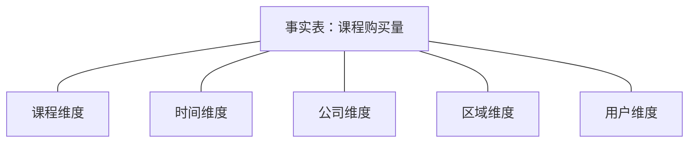
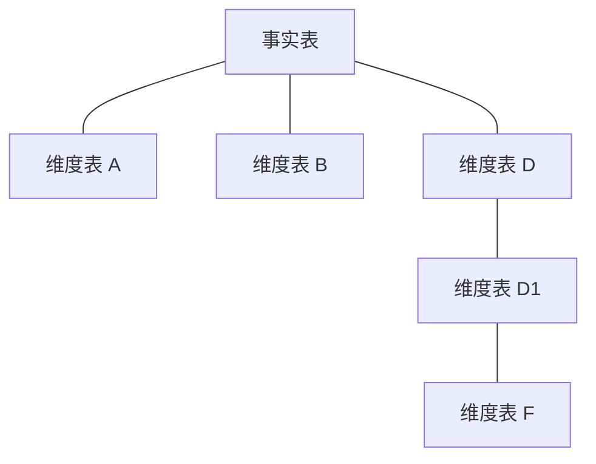
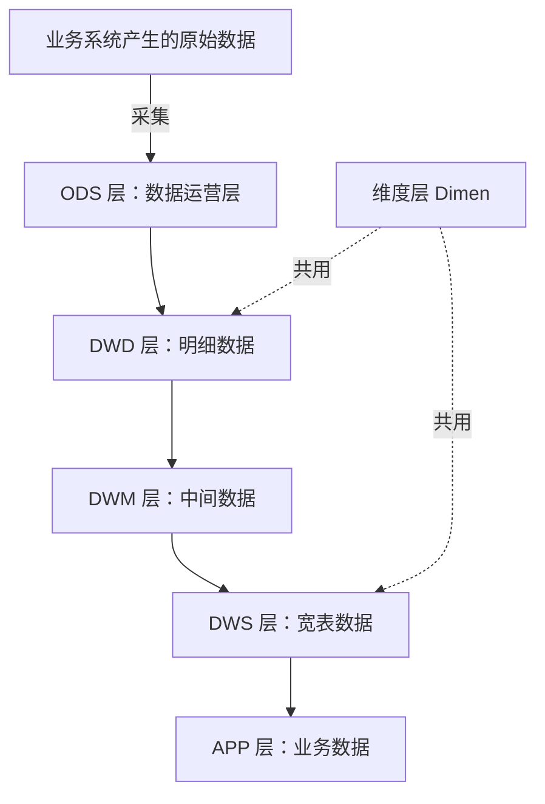

# 数据仓库建模：星型模型、雪花模型与分层设计

维度分析定下了事实表要挂哪些维度，接下来是摆表的问题：事实表和维度表怎么组织成模型，仓里的数据分几层存放，每一层放什么。这一课的信息量在第一章里最大，常见建模方法、数据分层方法、分层的好处三块内容，全部是后面建表与写分析程序的设计依据。

## 先给结论

- 本项目采用星型模型：一个事实表加一组维度表，维度像星星一样围在事实表周围，掌握它即可，雪花模型只需理解。
- 事实表存最细粒度的明细数据，内容分两部分：各维度的 ID 外键，加事实本身的字段如订单价格、订单状态、订单时间。
- 分层分五块：ODS 层存原始数据，DW 层内部再分 DWD 明细、DWM 中间、DWS 宽表，APP 层存业务所需数据，维度层独立存放供各主题共用。
- 分层本质是空间换时间：复杂任务拆成多步，每层只做单一步骤，出错从出问题的层开始恢复。
- 分层的四个价值：易维护、高性能、简单化、存档。

## 星型模型：事实表居中，维度环绕

常见的建模方法有两种：星型模型与雪花模型。星型模型是一种多维的数据关系，由一个事实表和一组维度表组成，每个维度表都有一个维作为主键，这些维的主键组合成事实表的主键。课程购买量这张事实表在项目里就长这样：



事实表的内容由两部分组成。第一部分是维度相关的数据，也就是各维度表的 ID，通过这些 ID 能关联到对应维度表，取到维度内的详细信息；第二部分是课程购买量本身的数据，比如订单的价格、订单的状态、订单的时间。简单讲，事实表就是存储明细数据，是最细粒度的存储。上面这张图里，五个维度像星星一样围在事实表周围，星型模型因此得名。

星型模型强调对维度的预处理，将多个维度结合到一张事实表，最终形成宽表。宽表是新概念，指把业务所需的数据尽可能拼进一张大表，到数据分层方法里再展开。它带来的直接好处是查询时少做维度关联，分析程序拿到的就是拼好的数据。

## 雪花模型：维表再分层的扩展

雪花模型与星型模型相似，同样由事实表和一组维度表组成，但相似并不相同。区别在于：星型模型里所有维度表直接连接事实表；雪花模型中有一个或多个维表没有直接连到事实表上，而是通过其他维表连接到事实表，就像多个雪花连接在一起。



这张图在讲间接关联：想找维度表 F，要沿事实表到维度表 D，再到维度表 D1，最终才到维度表 F，维度信息被拆成了局部的层次区域。雪花模型是对星型模型的扩展，它把原有的维表进一步层次化，好处是维度冗余更少，代价是查一个维度要跨好几张表，关联成本上去了。本项目采用星型模型，雪花模型了解概念、能对比出差异即可。

## 数据分层：ODS、DW、APP 与维度层

分层方法回答「仓里的数据分几层、每层放什么」。项目里一共四层加一个维度层：ODS 层、DW 层、APP 层与维度层，其中 DW 层内部又分三层，整张结构图如下：



**ODS 层是数据运营层，存原始业务操作数据。** 也就是用户产生的行为数据经采集后落下的部分，它与原始业务数据一一匹配，但使用时按需获取：统计只需要课程购买量相关分析，采集时便只采集课程购买量相关的原始数据。

**DW 层是数据仓库层，分 DWD、DWM、DWS 三层。** DWD（Data Warehouse Detail）存明细数据，是最细粒度的事实数据，事实表就落在这一层；DWM（Data Warehouse Middle）存中间数据，多个指标都要用到同一份加工结果时，就把它做成中间表，数据通常来源于 DWD 层；DWS（Data Warehouse Service）存宽表数据，针对某个业务领域把相关数据聚合汇集到一起，是最接近业务的一层，业务层的数据通常取自这里。

**APP 层是业务层，存业务所需的数据。** 它很多时候与宽表画上等号，因为宽表存的正是业务要用的聚合结果；APP 层与 DWS 层很多时候没有明显界限，课程访问量统计出的每天访问量宽表，APP 层可以直接取用。

**维度层 Dimension 存所有维度数据。** 单独拆出来的理由是前面的统计分析都可能用到维度数据，拆开后多个主题库共用一份，不必重复维护。

## 一个例子走通三层：课程购买量

DWD、DWM、DWS 三层的关系，用课程购买量的加工链路走一遍最直观。离线分析里有课程购买量统计，还有热门学科排名，两者都需要用户的购买数据。课程购买量统计通过对购买明细做维度聚合得到结果；热门学科排名同样要购买数据。为了让数据复用，基于事实表先做一次中间层聚合，得到课程购买量需要的中间数据，也得到热门学科排名需要的中间数据，两边再基于这份中间数据做各自的统计分析。

事实表在 DWD 层，字段就是维度外键加事实本身：

```sql
-- 课程购买量事实表：维度 id 外键加订单自身字段（讲义真实建表语句）
CREATE EXTERNAL TABLE IF NOT EXISTS data_course.course_buy_fact
(course_buy_fact_id String,
 course_dim_id String,
 time_dim_id String,
 area_dim_id String,
 company_dim_id String,
 price float,          -- 订单价格
 status String,        -- 订单状态：401001 未付款、401002 已完成、401003 已取消
 user_dim_id String)
PARTITIONED BY (years String, months String, days String)
ROW FORMAT DELIMITED FIELDS TERMINATED BY '\t'
STORED AS PARQUET
location '/user/hive/external/data_course/course_buy_fact';
```

从事实表按课程、机构、分类聚合出销量与销售额，落成 DWM 层的中间表：

```sql
-- DWM 层：课程购买过程数据，课程购买量与热门学科排名共用的中间结果（讲义真实建表语句）
CREATE EXTERNAL TABLE IF NOT EXISTS data_course.course_buy_dwm
(course_dim_id String,
 company_id String,
 course_category_dim_id String,
 sales String,         -- 课程销售额
 salesvolume String)   -- 课程销量
PARTITIONED BY (years String, months String, days String)
ROW FORMAT DELIMITED FIELDS TERMINATED BY '\t'
STORED AS PARQUET
location '/user/hive/external/data_course/course_buy_dwm';
```

课程购买量基于这份中间数据统计出 DWS 层宽表，热门学科排名同样从 DWM 层出发得出自己的业务数据。整条链路在课程资料里就是三段按日期参数执行的 spark-submit 任务，从事实表加工到 DWM，再从 DWM 出业务数据（脚本按课程资料整理，类名已按 `com.study.xc` 系中性化）：

```bash
#!/usr/bin/env bash
# 课程购买量任务链：明细到事实，事实聚合到 DWM，DWM 出业务数据，日期做参数
if [[ $1 != "" ]]; then
    TD_DATE=$1
else
    echo "[===no params input, default date_info is yesterday===]"
    exit 1
fi

/opt/spark/bin/spark-submit \
  --master spark://xc-online-spark:7077 \
  --class com.study.xc.analysis.buy.CourseBuyHiveToFact \
  /opt/run/jars/xc-service-offline-jar-with-dependencies.jar ${TD_DATE}

/opt/spark/bin/spark-submit \
  --master spark://xc-online-spark:7077 \
  --class com.study.xc.analysis.buy.CourseBuyProcessToDWM \
  /opt/run/jars/xc-service-offline-jar-with-dependencies.jar ${TD_DATE}

/opt/spark/bin/spark-submit \
  --master spark://xc-online-spark:7077 \
  --class com.study.xc.analysis.buy.CourseBuyProcessByBiz \
  /opt/run/jars/xc-service-offline-jar-with-dependencies.jar ${TD_DATE}
```

这条链也解释了为什么要分层。分层本身是空间换时间的操作：不同步骤的结果保存到不同层，每层只处理单一步骤，复杂问题被拆简单，也便于维护数据的准确性。出了问题时不必修复所有数据，从出错的步骤开始重跑恢复即可；业务变化时常常只调整底层，上层对调整零感知。讲义把分层的价值归纳为四条：易维护，每层都有明确的作用域，定位与理解表更方便；高性能，海量数据的关联查询与复杂统计在分层之上快速响应；简单化，每层只做单一步骤；存档，记录历史是数仓的特性，所有数据在仓中保存，可以按时间点还原产品状态、用户状态与用户行为，方便回溯历史、比较历史并据此预测未来。

## 常见误区

- **把事实表当汇总表。** 错例：在事实表里只存每天的购买总量。正解：事实表存最细粒度的明细，维度外键加订单价格、状态、时间，汇总数字交给 DWM 与 DWS 层去算。
- **认为雪花模型一定优于星型模型。** 错例：为减少冗余把所有维表拆成层次结构。正解：雪花省下的空间有限，代价是查询要多关联几层维表，分析型场景通常星型加宽表更快，两者按场景选择。
- **把 APP 层与 DWS 层混为一谈。** 错例：以为两者重复建一套。正解：两者确实常画等号，定位却不同，DWS 面向领域聚合出宽表，APP 存具体业务要用的数据；数据同源，取数口径一致，不必重复加工。
- **跳过 DWM 层直接从 DWD 出业务表。** 错例：课程购买量和热门学科排名各自从明细算到头。正解：两个指标共用的聚合逻辑下沉到 DWM 层做一次，下游复用中间结果，重复计算少了，口径也天然统一。

## 面试可能被问到的问题

1. 面试官追问：「星型模型和雪花模型的区别是什么？你们项目为什么选星型？」
   答：星型模型的所有维度表直接连事实表；雪花模型是它的扩展，部分维表通过其他维表间接连接事实表，冗余更少但关联层次更深。项目选星型是因为分析场景重查询效率，维度预处理后形成宽表，统计程序不用层层关联维表。
2. 面试官追问：「事实表和维度表分别存什么？」
   答：事实表存最细粒度的明细数据，由两部分构成，一是各维度的 ID 外键，二是事实本身的数据如订单价格、状态、时间；维度表存维度的描述信息，如课程名、课程分类、机构名，通过外键被事实表引用。
3. 面试官追问：「数仓为什么分层？每一层放什么？」
   答：分层是空间换时间，把复杂任务拆成单一步骤，便于维护准确性、出错按层恢复。ODS 存采集来的原始数据，DWD 存最细粒度明细即事实表，DWM 存多指标共用的中间数据，DWS 存面向业务领域的宽表，APP 存业务层所需数据，维度层独立存放供各主题共用。
4. 面试官追问：「DWM 层存在的意义是什么？去掉它行不行？」
   答：DWM 存多个指标共用的中间聚合结果。项目里课程购买量统计与热门学科排名都需要购买数据，先在 DWM 层按课程、机构、分类聚合出销量与销售额，两边复用。去掉它则每个指标都从明细重算，算力浪费且口径容易不一致。
5. 面试官追问：「什么是宽表？为什么叫宽？」
   答：宽表是把某个业务领域相关的数据统一汇集到一张表里，维度预处理后拼进事实表，列数多、内容全，所以叫宽。业务层直接从宽表取数，少做关联，报表展示与查询结果都取自这一层。
6. 面试官追问：「数据出问题时，分层结构怎么帮你恢复？」
   答：每层只做单一步骤，定位到出错的层之后，从该层开始重跑任务即可，上游无问题的数据不用动。比如 DWM 聚合逻辑有误，修好程序后重跑 DWM 及其下游，ODS 与 DWD 原样保留，恢复成本被限制在出错层以下。

## 配套资料

- 讲义：`materials/docs/08/智慧学成-第2章-数据仓库.md`，3.1 常见的建模方法、3.2 数据分层方法、3.3 数据仓库分层（空间换时间与分层的价值）三节，以及课程购买量事实表与 DWM 中间表建表语句的出处。
- 代码：`materials/code/08/_散落资料/`，课程购买量任务链脚本（source 到 fact、fact 到 DWM、DWM 到业务表）与建表 SQL 汇总存放处；目录内原始文件名带站点后缀，属元信息，正文一律不引用。
- 说明：spark-submit 脚本按课程资料整理，原工程包名已按 `com.study.xc` 系中性改写；建表语句为讲义真实内容；示例站点以 example.com 占位。
