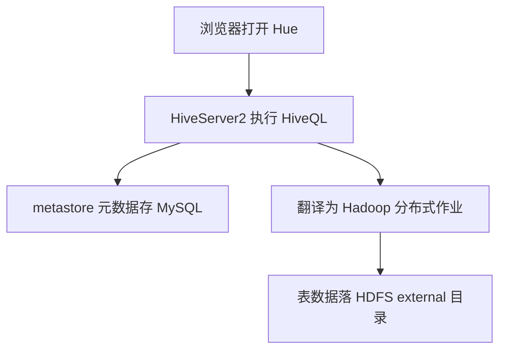
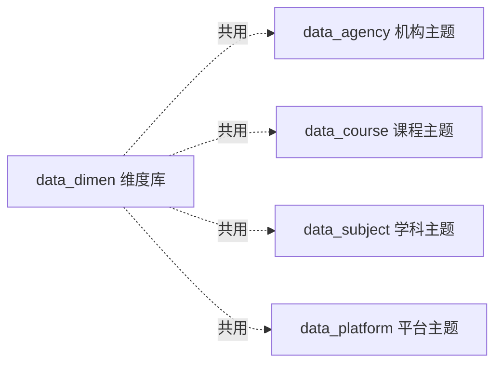

# Hive 创建数据仓库：五个库、三十八张表一次建完

模型与分层在上一课落定，可 Hive 里至今没有任何库和表，仓库还停在纸面上。数据采集、清洗、分析每一环都依赖这张地基，建不起来，后面全部停在起点。这一课把设计变成实物：用一份汇总 SQL 在 Hue 里把整个仓库建出来，顺手处理执行过程中最常见的锁报错，第一章也在这一课收官。

## 先给结论

- Hive 由 Facebook 为解决海量日志分析而开发，后开源给 Apache 软件基金会，是架在 Hadoop 之上的数据仓库软件，用类 SQL 语句读写、管理 Hadoop 上的数据集。
- 建仓动作就是执行一份汇总 SQL：5 条建库语句加 38 条建表语句；库分四个主题库 data_agency、data_course、data_subject、data_platform，外加一个维度库 data_dimen。
- 维度库独立建，因为维度数据被各主题共用；主题库内部按分层放表，表名后缀 `_source`、`_fact`、`_dwm`、`_biz` 对应 ODS、DWD、DWM、APP。
- 全部建外部表，数据挂在 `/user/hive/external/` 下的 HDFS 目录；在 Hue 里全选执行即可，中途的 Database is Locked 是元数据临时锁，删掉已建成功的语句接着跑。
- 验收看两点：库表树里五个库逐个能点开列出全部表；最后一张表 platform_offline_biz 创建成功，整仓即告建成。

## Hive 在这套环境里管什么

Hive 的介绍一句话就够：Facebook 为了解决海量日志数据的分析开发了 Hive，后来贡献给 Apache 软件基金会；它建立在 Hadoop 上，使用类 SQL 语句协助读写、管理存储在 Hadoop 上的数据集。展开说，Hive 把写惯 SQL 的人从 MapReduce 里解放出来：表被映射成 HDFS 目录，一条 HiveQL 查询被翻译成 Hadoop 上的分布式作业执行，海量数据的统计不必手写分布式代码。

课程环境里 Hive 的元数据存在 MySQL，Hue、Hive 命令行、Beeline、Zeppelin 的 `%spark.sql` 都是同一套元数据的客户端，一处建库处处可见。执行入口选 Hue，因为浏览器里就能粘贴大段 SQL，还能逐条回看日志。



这张图讲的是提交链路：SQL 从 Hue 进 HiveServer2，元数据登记到 MySQL，真实数据文件落在 HDFS 的 `/user/hive/external/` 目录下。验收建仓结果时，查元数据看库表，查目录看数据文件，两条线都要通。

## 五个库：四个主题加一个维度库

数仓面向主题组织数据，主题落到 Hive 里就是一个数据库。资料里的建库语句一共五条：

```sql
// 数据库分层创建，主题
create database data_agency;
create database data_course;
create database data_dimen;
create database data_platform;
create database data_subject;
```

四个主题库对应四块分析业务：data_agency 装机构销量相关分析，data_course 装课程访问量、课程购买量等课程主题数据，data_subject 装学科排行，data_platform 装平台整体离线分析。data_dimen 是维度库，单独拉出来的理由在建模一课已经埋下：维度数据被所有主题共用、跨主题使用，放进任何一个主题库都会让其余主题跨库引用，不如独立一份，九张维度表全部落在它里面。

九张维度表按功能划分：时间、课程、课程分类、区域、公司、用户、课程视频、课程学习频率、用户选课。来源分两类，大部分来自在线教育平台的 MySQL 业务库，后续由采集程序灌入；时间维度与区域维度的数据由脚本生成。



图里的虚线是引用关系：每个主题库建事实表时都带各维度的 ID 外键，取数时再关联维度库。这也解释了为什么维度采集必须赶在事实清洗之前，下一章的目标清单里专门有一条。

## 统一建表 SQL：表名后缀就是分层

课程资料提供了统一建表的 SQL 汇总文件，讲义给出的路径是 sql 目录下的 hive.sql，配合同目录 hive.md 的字段解释，五个库 38 张表的建表语句全部在其中。建表不用现场写，把文件内容粘进 Hue 执行即可。

表名后缀直接暴露所属分层：`_source` 是 ODS 层原始数据表，`_fact` 是 DWD 层明细事实表，`_dwm` 是 DWM 层中间表，`_biz` 是 APP 层业务表。存储格式跟着数据量走：维度表小，TEXTFILE 存文本即可；事实表是海量明细，用 PARQUET 列式存储并按年、月、日三级分区；ODS 层的实时源表用 ORC 事务表，为后续的更新删除留出能力。三段真实语句对照着看：

```sql
CREATE EXTERNAL TABLE
IF NOT EXISTS data_dimen.time_dim
(time_dim_id String,
year String,
month String,
day String,
hour String,
week String,
week_name String)
ROW FORMAT DELIMITED FIELDS TERMINATED BY '\t'
STORED AS TEXTFILE
location '/user/hive/external/data_dimen/time_dim';
```

```sql
CREATE EXTERNAL TABLE
IF NOT EXISTS data_course.course_visit_fact
(course_visit_fact_id String,
course_dim_id String,
time_dim_id String,
area_dim_id String,
company_dim_id String,
client_ip String,
client_sessionid String,
client_type String,
visit_time bigint)
PARTITIONED BY (years String,months String,days String)
ROW FORMAT DELIMITED FIELDS TERMINATED BY '\t'
STORED AS PARQUET
location '/user/hive/external/data_course/course_visit_fact';
```

```sql
CREATE EXTERNAL TABLE
IF NOT EXISTS data_course.course_orders_source
(order_number String,
price Float,
status String,
order_time BIGINT,
user_id String,
details String)
clustered by (order_number) into 2 buckets stored as orc TBLPROPERTIES('transactional'='true');
```

三段语句有几个共同点值得圈出来。EXTERNAL 关键字让表只挂元数据，删表不删数据，数据目录与元数据解耦；location 指向 `/user/hive/external/` 下与库名、表名对应的 HDFS 目录；分区字段 years、months、days 不出现在列定义里，写入时由清洗程序按日期落到对应分区目录，查询带分区条件就只扫那几天。

## 在 Hue 里执行与锁处理

操作本身没有难度：把 hive.sql 的内容整段粘进 Hue 的 Hive 编辑器，Ctrl+A 全选，点语句前的小三角或按 Ctrl+Enter 执行。Hue 会逐条执行并在下方打日志，每建成功一个对象就多一条记录；右下角的 Query History 保存执行历史，中断了随时回看执行到哪一条。

真正的坑是 Database is Locked。这是元数据库并发执行产生的临时锁，不是环境损坏。处理办法是看日志确认执行到了哪一条，把已经创建成功的语句从编辑器里删掉，剩下的接着全选执行；运气好也可能整段一次跑完不报任何错。视频里执行到二十多条和三十条左右时两次遇到锁，都是清掉已建部分续跑解决的，最终 38 张表全部建成。

## 建完之后怎么验收

两个动作。一是执行 `show databases`，或直接点左侧库表树的刷新，五个库全部出现，逐个点开能看到库里所有表。二是看最后一张表：hive.sql 的最后一条是 data_platform.platform_offline_biz，平台主题的离线分析表，它排在整份 SQL 的末尾，创建成功就意味着前面全部成功，视频中最后确认的正是这张表。

至此第一章收官：CDH 环境、Maven、IDEA、Scala 基础工程、Zeppelin、Hue 全部就绪，数仓概念、维度分析、建模与分层讲完，五个库三十八张表也落了地。仓库还是空的，第二章开始把数据灌进去。

## 常见误区

- **建完表就以为有数据了。** 错例：建完 course_visit_fact 立刻 select 统计。正解：外部表只登记元数据，location 目录里还没有文件，查询结果是空，数据要等采集与清洗写入。
- **把 Database is Locked 当故障排查半天。** 错例：一看到锁就重启容器、重建环境。正解：元数据并发临时锁，删掉已建成功的语句接着执行即可。
- **为省事去掉 EXTERNAL 关键字。** 错例：用内部表建数仓表，删表验证时数据一起消失。正解：内部表删表连 HDFS 数据一起删，数仓表一律外部表，元数据与数据解耦。
- **维度表照抄事实表的存储格式。** 错例：给九张维度表也上 PARQUET 加年月日分区。正解：维度表数据量小、一次性灌入，TEXTFILE 直接可读，便于脚本生成后上传核对；列存与分区是给大事实表准备的。

## 面试可能被问到的问题

1. 面试官追问：「Hive 是什么？有了 MapReduce 为什么还要用 Hive？」
   答：Hive 是架在 Hadoop 上的数据仓库软件，由 Facebook 开发后开源给 Apache 基金会。它用类 SQL 操作 Hadoop 上的数据，查询被翻译成分布式作业执行，分析师不必手写 MapReduce，开发效率大幅提高，MapReduce 是它的执行引擎之一。
2. 面试官追问：「外部表和内部表的区别？数仓为什么全用外部表？」
   答：内部表删表时元数据与 HDFS 数据一起删除；外部表只删元数据，数据文件保留。数仓数据来之不易且常被多个任务共用，外部表把元数据与数据解耦，误删表后重建再挂回原目录即可恢复。
3. 面试官追问：「维度数据为什么单独建一个库？」
   答：维度被所有主题共用，时间、课程、区域维度在各主题统计中都要关联。独立成库后一份维度服务多个主题，避免重复维护，也避免主题库之间互相引用。
4. 面试官追问：「为什么维度表用 TEXTFILE，事实表用 PARQUET？」
   答：维度表行数少，文本格式直观，脚本生成后直接上传核对；事实表是海量明细，PARQUET 列式存储压缩比高，统计往往只读少数几列，扫描量小，配合年月日分区把查询范围限制到具体日期。
5. 面试官追问：「PARTITIONED BY 和 location 各起什么作用？」
   答：PARTITIONED BY 定义分区字段，数据按年月日落子目录，带分区条件的查询只扫对应目录；location 指定表数据在 HDFS 的挂载目录，配合 EXTERNAL 实现元数据与数据文件分离。

## 配套资料

- 讲义：`materials/docs/08/智慧学成-第2章-数据仓库.md`，第 4 章 Hive 创建数据仓库，4.1 Hive 介绍、4.2 创建数据库、4.3 创建维度表、4.4 创建主题表，九张维度表清单与各表字段解释的出处。
- SQL：`materials/code/08/_散落资料/`，全仓建库建表 SQL 汇总文件所在目录，五个库与三十八张表的建表语句取自它；文件原始名带站点后缀，属元信息，不进正文。
- 说明：Hue 执行与锁处理步骤按视频画面线整理；文中建表语句均为资料真实 SQL。
