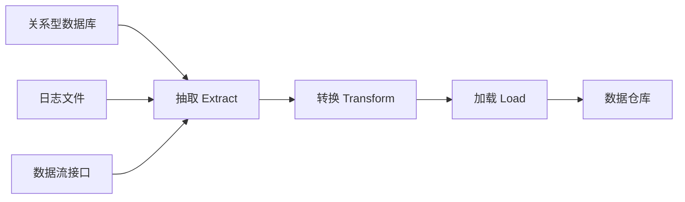
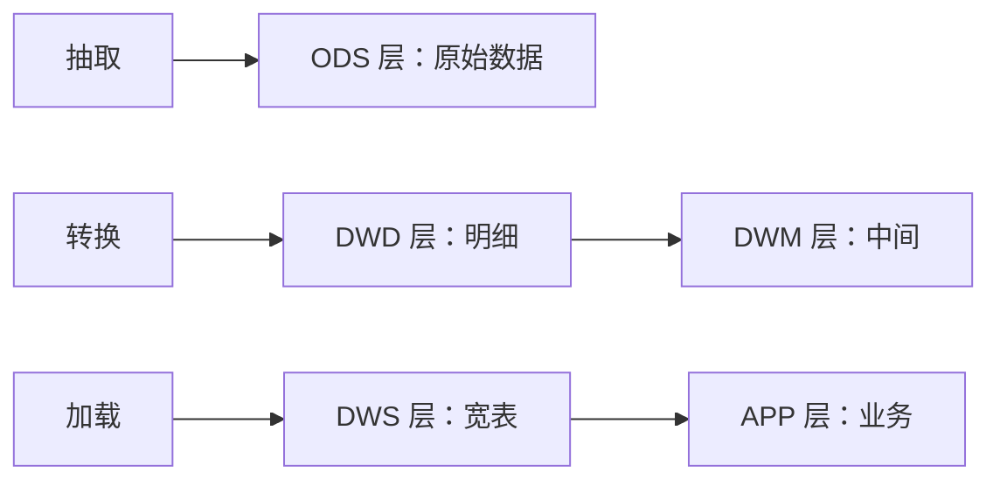

# ETL：从数据源到数据仓库的三道工序

上一课把仓库建成了，表还是空的。业务系统的数据形态五花八门：订单躺在关系型数据库里，用户行为散落在日志文件里，实时消息走数据流。要把这些形态各异的数据统一成仓里能直接分析的表，中间那套加工过程就是 ETL。这一课把抽取、转换、加载三段各自干什么讲透，再把它挂回上一章的分层设计上。

## 先给结论

- ETL 是将数据从源端经过抽取、转换、加载至目的端的过程；因为终点常是数据仓库，它也被称为数据仓库技术。
- 抽取的源头有三类：关系型数据库、日志文件、数据流接口；Kafka 这类流式接口与 TCP、UDP 协议都能直接传输数据。
- 转换干两类活：脏数据清洗，过滤错误、补全缺失、丢弃不合格、重复去重；格式与内容转换，如日期去掉横杠、IP 通过 IP 库转成区域。
- 加载分全量与增量：全量相当于先删后插，增量是直接插入追加，按数据性质选择。
- 对应到分层：抽取落 ODS，转换产出 DWD 明细与 DWM 中间层，加载把宽表送到 DWS 与 APP 层。

## ETL 全景：三段串行

ETL 是将数据从源端经过抽取、转换、加载至目的端的过程。源端多种多样：服务器端产生的数据、数据库中的数据、文件数据；目的端是数据仓库。



三段是串行的流水线：任何一段出问题，仓里落下的数据就不可信，下游统计跟着出错。所以 ETL 不是装完就能忘的管道，每一跳的输出都要有验证手段，后面清洗程序会按分区逐天核对每天的量。

## 抽取：原始数据的获取

**第一类源头是关系型数据库。** 业务数据存在 MySQL、Oracle 这类库中，要做统计分析就得从中抽取相应数据送进数仓，比如对一个 CRM 系统做客户分析，数据要从它的业务库里取。

**第二类源头是日志文件。** 用户行为数据一般以日志形式保存，前端埋点打出的访问记录由专门的采集程序收集，这是访问量统计的原料来源。

**第三类源头是数据流接口。** Kafka 这样的流式数据接口可以直接抽取数据；此外 TCP、UDP 这些网络协议也能直接进行数据传输，属于可以直接抽取的通道。

三类源头对应了本项目的三种数据：维度与订单来自业务库，课程访问行为来自埋点日志，实时指标走消息流。

## 转换：清洗与转换两类活

**脏数据清洗。** 采集来的原始数据通常不能直接使用：错误的数据要过滤掉，不完整的数据要补全，不符合要求的数据要丢弃，重复的数据要去重。去重在访问量统计里是硬需求，同一会话的重复刷新不能算多次访问。

**格式与内容转换。** 格式上，采到的日期是 2019-10-01 这种带横杠的写法，要求转成 20191001，就要做格式转换；内容上，拿到的用户 IP 是 IPv4 数字串，要借助 IP 库把它翻译成对应的区域，按区域做分析时才有维度可用。

两类活在 SQL 里都不抽象，示意如下（语句为按本课写法补全的示例）：

```sql
-- 格式转换：日期 2019-10-01 转 20191001
SELECT regexp_replace(visit_day_str, '-', '') AS visit_day
FROM tmp_visit_raw;

-- 去重：同一会话与同一 IP 的重复刷新只留一条
SELECT *
FROM (
  SELECT t.*,
         ROW_NUMBER() OVER (PARTITION BY client_sessionid, client_ip ORDER BY visit_time) AS rn
  FROM tmp_visit_raw t
) x
WHERE x.rn = 1;
```

IP 转区域的映射在清洗程序里借助 IP 库完成，映射结果写入事实表的区域维度字段，后面的课程访问量需求分析一课会把这个口径展开。

## 加载：全量与增量

**全量加载相当于先删除再插入。** 目标表每次被替换成一份完整快照，适合维度表这类小而完整的数据：公司表、区域表定期重灌一遍，保证与源头一致。

**增量加载是直接插入。** 原来的数据还在，新数据追加进来，适合按天分区的明细事实表：历史一天都不能丢，每天只写当天的分区。

Hive 里两句话法正好对应这两种语义（示例语句，表结构取自讲义真实建表）：

```sql
-- 全量加载：INSERT OVERWRITE 覆盖目标表（示例）
INSERT OVERWRITE TABLE data_dimen.company_dim
SELECT company_id, name, linkname, mobile, email, intro, logo, identitypic,
       worktype, businesspic, status, create_time
FROM tmp_company_staging;

-- 增量加载：INSERT INTO 追加当天分区（示例，分区结构为讲义真实建表）
INSERT INTO TABLE data_course.course_visit_fact PARTITION (years='2019', months='07', days='01')
SELECT course_visit_fact_id, course_dim_id, time_dim_id, area_dim_id, company_dim_id,
       client_ip, client_sessionid, client_type, visit_time
FROM tmp_visit_clean;
```

全量覆盖把目标表连历史一起换掉，增量追加只添新账，选错一种，要么丢历史，要么塞进过期数据。

## ETL 与数仓分层怎么对上

ETL 不是某一步，而是贯穿分层加工的整个过程。抽取的结果先落 ODS 层，保存原始数据的第一次落地；转换产出 DWD 层的明细事实，多指标共用的中间聚合落 DWM 层；加载把面向业务的宽表送到 DWS 层，APP 层业务表直接取用。课程里这套过程表现为一段段带日期参数的 spark-submit 任务与 NiFi 流程，课程购买量统计的任务链已经跑通了这条线：source 到 fact、fact 到 DWM、DWM 到业务表。



图后的对应关系是：抽取只管把原始数据送进 ODS，转换贯穿 DWD 到 DWM 的加工，加载负责把面向业务的结果送到 DWS 与 APP，三段工序与五层数据由此对齐。

## 常见误区

- **把 ETL 当成某个具体工具。** 错例：以为学 ETL 就是学某款软件。正解：ETL 是抽取、转换、加载的过程描述，NiFi、Spark、采集系统都是实现载体，工具可换，过程不变。
- **全量增量不分。** 错例：对按天积累的明细表每次 INSERT OVERWRITE 全表覆盖。正解：明细历史要保留，用增量加载写当天分区；只有维度快照这类可整体重建的数据才用全量覆盖。
- **以为转换只是改格式。** 错例：只做日期格式化就入库。正解：脏数据过滤、补全、去重与 IP 转区域这类内容转换同属转换，漏做会污染统计结果。
- **认为数据源只有数据库。** 错例：只会 JDBC 拉表。正解：日志文件与数据流接口同样是主流源头，本项目访问量数据就来自埋点日志。

## 面试可能被问到的问题

1. 面试官追问：「讲讲你对 ETL 的理解。」
   答：ETL 是数据从源端经抽取、转换、加载到目的端的过程，也称数据仓库技术。抽取解决数据从哪来，转换处理脏数据与格式内容问题，加载按全量或增量把结果落到仓库，三段串行，任何一段不干净都会污染下游统计。
2. 面试官追问：「全量加载和增量加载怎么选？」
   答：看数据性质。可整体重建的小数据如维度表用全量，先删后插保证与源头一致；只增不改的明细用增量，直接插入追加，配合分区按天写。对明细表做全量覆盖会丢历史。
3. 面试官追问：「转换阶段通常处理哪些问题？」
   答：两类。脏数据清洗，错误过滤、缺失补全、重复去重、不合格丢弃；格式与内容转换，如日期 2019-10-01 转 20191001，IPv4 经 IP 库映射成省市区。
4. 面试官追问：「ETL 和数仓分层是什么关系？」
   答：ETL 贯穿分层全程，抽取落 ODS，转换产出 DWD 明细与 DWM 中间层，加载把宽表送到 DWS 与 APP 层；工具可以是 Spark 任务或 NiFi 流程，分层是 ETL 结果的组织方式。
5. 面试官追问：「数据抽取有哪些方式？」
   答：关系型数据库抽取、日志文件采集、数据流接口直接抽取三类，Kafka 这类消息流与 TCP、UDP 协议都能直接传输数据，按源头形态选择。

## 配套资料

- 讲义：`materials/docs/08/智慧学成-第2章-数据仓库.md`，1.1 数据仓库概念、3.2 数据分层方法两节，是 ETL 落点的依据；ETL 概念讲解按视频画面线整理。
- 代码：`materials/code/08/_散落资料/`，清洗统计与任务调度脚本所在目录，课程购买量任务链（source 到 fact、fact 到 DWM、DWM 到业务表）可对照真实任务形态。
- 说明：ETL 概念无独立源码包，文中 SQL 示例按本课表结构与主流写法补全并已注明。
