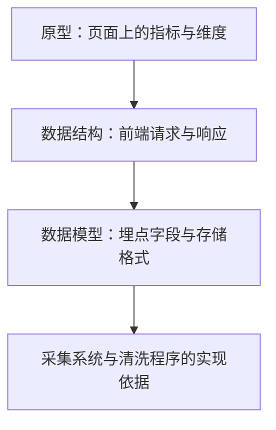

# 课程访问量需求分析：一条折线背后的口径与链路

报表系统里课程访问量是一条按天起伏的折线，看上去只是按天求和。真要动手做，问题一连串冒出来：用户狂刷新算几次访问？爬虫的抓取算不算？数据从哪个页面打出来、落到哪里、前端怎么取？这一课按原型、数据结构、数据模型三步把指标拆到埋点字段，把后面采集系统与清洗程序要用的口径一次定清。

## 先给结论

- 指标只有课程访问量一个，维度只有时间一个，时间又分周、月、年三个级别，每个级别下都以天为单位展示。
- 前端按日期区间查询：请求带 startDate 与 endDate，响应是以天为单位的访问量列表，业务库按天存每天的访问量。
- 采集靠 JS 埋点，共 7 个字段：course_id、time_dim_id、session_id、client_ip、user_id、user_agent、visit_time。
- 判重口径：session_id 与 client_ip 都相同才算一条；统计多课程访问时把 course_id 加入判重；user_agent 用来过滤爬虫等非正常请求。
- 原始数据按天落 HDFS 目录 `/user/hive/external/data_course/course_visit_source/`，一天一个目录，字段以 \t 分隔、\n 换行。

## 需求分析三步走

需求分析拆成原型、数据结构、数据模型三块，分别回答三个问题：页面统计什么、前端怎么取数、数据从哪来怎么存。三步走完，采集系统采什么字段、清洗程序按什么口径加工就全部定死了。



三步是倒推关系：从页面倒推接口，从接口倒推埋点与存储，最后一步的产出就是实现依据。

## 原型：从页面读出指标与维度

课程统计栏目下打开课程访问量页面：上部是折线图，按天展示访问量走势，下部是每天的明细数据；页面上方有周、月、年筛选条件，切换后折线与明细跟着变。

读这张页面的关键是剥掉筛选条件看本质。无论选周、月还是年，筛选的都是时间。课程访问量这个指标背后只有一个维度，即时间维度，它分周、月、年三个级别，每个级别下都以天为单位展示：按周选就展示该周每天的量，按月按年同理。时间维度的层次与级别在维度分析一课已经定义过，这里是它第一次落进真实页面。

## 数据结构：前端请求与响应

打开浏览器开发者工具看接口请求。周级别请求带当前周的第一天与最后一天，月级别带当月第一天与最后一天，年级别带当年第一天与最后一天，参数固定两个：

```text
GET http://example.com/courseVisit?startDate=2019-09-01&endDate=2019-09-15
```

响应是一串以天为单位的数据，每条是日期加当天访问量。原型环境返回的是模拟数据，固定 10 条、日期随机生成，但结构是真实的；真实数据按年查询应返回 365 条，闰年 366 条，按月返回 28 到 31 天不等。

从响应反推存储形态：报表前端拿到的已经是每天的访问量，说明大数据侧清洗、统计之后落到业务库的数据以天为单位，一天一条，前端只负责按区间取数画图。这个结论决定了业务表的字段就是日期加数量。

## 数据模型：埋点采什么、怎么判重

页面数据由埋点产生：用户每刷新一次页面，后台就多一条访问记录。于是出现本课最核心的问题：同一个页面不停刷新，算一次浏览还是多次？按正常理解算一次，但后台每次刷新都有数据产生，判重必须有约束条件。

埋点一共采 7 个字段，每个都有明确用途：

| 字段 | 用途 |
|---|---|
| course_id | 课程标识，切换课程就是新的访问 |
| time_dim_id | 时间维度关联，按访问时间统计 |
| session_id | JS 埋点生成的会话标识 |
| client_ip | 客户端 IP，参与判重 |
| user_id | 判断是否登录，统计登录与未登录人数 |
| user_agent | 浏览器标识，过滤爬虫等非正常请求 |
| visit_time | 访问时间，决定记录归属哪一天 |

**判重为什么用 session_id 加 client_ip 两个条件。** 埋点的 session_id 是 JS 埋点自己生成的，虽然也采用 UUID 方式，仍存在重复的可能，所以判重条件是 session_id 与 client_ip 都相同才算同一条。同一个 IP 配不同 session_id 算多条，因为组合不再是重复数据。

**user_agent 过滤爬虫。** 现在的爬虫很多，最典型的就是搜索引擎的爬虫，它会持续抓取网站页面，这类请求的浏览器标识不是正常用户。按 user_agent 过滤掉非正常访问后再统计，得出的量更接近真实。

**course_id 支撑多课程。** 只访问同一门课时，session_id 加 client_ip 就够判重；用户切换课程后课程 ID 变化，把 course_id 加进判重才能区分不同课程的访问。

## 存储：HDFS 按天目录

采集字段定了，存储格式随之确定：数据存 HDFS 文本文件，按天分目录。

```text
/user/hive/external/data_course/course_visit_source/2019-07-01/
```

每条记录一行，字段以 \t 分隔，行以 \n 换行。数据样例如下，一行代表一次访问（按画面线整理，原始样例一行过长折行展示）：

```text
e60f96225a90645b7d752d163d98d14	2019-07-01-08	f8150a9f3c244053c2093666022705a7	169.63.52.55	79f210da266d44b8011c4a09272d6a44	Mozilla/5.0 (X11; Linux x86_64) AppleWebKit/537.36 (KHTML, like Gecko) Chrome/76.0.3809.87 Safari/537.36	1561943829
```

字段从左到右对应采集字段顺序：课程 ID、访问时间（年-月-日-时）、会话 ID、客户端 IP、用户 ID、浏览器标识、访问时间戳。按天分目录意味着一年 365 个目录，闰年 366 个，目录名就是清洗程序按天读取的依据。

## 全链路串起来

从埋点到折线的完整链路如下：


需求分析定口径，采集与清洗按口径执行，业务表就是前端请求要的形态。业务落地表的字段与响应一一对应，建表语句取自课程资料的建表 SQL 汇总：

```sql
-- 业务层落地表：每天一条访问量（资料真实建表语句）
CREATE EXTERNAL TABLE
IF NOT EXISTS data_course.course_visit_biz
(date_info String,
count INT)
PARTITIONED BY (years String,months String,days String)
ROW FORMAT DELIMITED FIELDS TERMINATED BY '\t'
STORED AS PARQUET
location '/user/hive/external/data_course/course_visit_biz';
```

date_info 存日期，count 存当天访问量，分区字段与 ODS、DWD 各表一致按年月日组织。清洗程序在 DWD 层产出 course_visit_fact 明细，统计任务按天聚合成这张业务表，前端按区间查询即可画图。

## 常见误区

- **把每条埋点记录都当有效访问。** 错例：直接对原始记录做计数。正解：session_id 与 client_ip 都相同的记录判重后计数，否则用户反复刷新就能把量刷上去。
- **只靠 session_id 判重。** 错例：认为 session 唯一就够。正解：埋点 session 由 JS 生成，UUID 也有重复概率，session 加 IP 组合判重才可靠。
- **不滤爬虫。** 错例：统计里包含搜索引擎抓取。正解：按 user_agent 过滤非正常请求，量才接近真实。
- **把存储路径当本地目录。** 错例：在本地磁盘找 course_visit_source。正解：路径是 HDFS 目录，由采集系统写入，一天一个目录。
- **拿模拟数据当真实分布。** 错例：原型固定返回 10 条就怀疑接口分页有问题。正解：原型是模拟数据，真实响应按区间天数返回。

## 面试可能被问到的问题

1. 面试官追问：「课程访问量的统计口径怎么定的？」
   答：session_id 与 client_ip 都相同视为同一条访问，判重后按天计数；多课程场景把 course_id 加入判重；user_agent 过滤爬虫后再统计。口径在需求分析阶段定清，先于代码。
2. 面试官追问：「埋点采了哪些字段？为什么要有 user_agent？」
   答：课程 ID、时间、会话 ID、客户端 IP、用户 ID、浏览器标识、访问时间。user_agent 识别爬虫等非正常请求，过滤后统计更接近真实访问量。
3. 面试官追问：「session_id 本身唯一，为什么还要加 IP 判重？」
   答：埋点的 session 是前端 JS 生成的 UUID，存在重复概率；session 与 IP 组合判重，同 IP 不同 session 仍算多条，能区分同一机器上的不同会话。
4. 面试官追问：「原始数据在 HDFS 怎么组织？」
   答：按天分目录，一天一个目录挂在 course_visit_source 下，字段 \t 分隔、\n 换行；一年 365 或 366 个目录，目录名即日期，清洗程序按天读取。
5. 面试官追问：「从前端折线图反推，业务表长什么样？」
   答：以天为单位，date_info 存日期、count 存当天访问量，对应 data_course.course_visit_biz；前端带 startDate 与 endDate 区间查询，返回区间内每天的量。

## 配套资料

- 讲义：`materials/docs/08/智慧学成-第2章-数据仓库.md`，2.2 业务需求、2.4 关键指标、2.5 分层与分级，以及 4.4.2.2 DWD 层课程访问量事实表结构。
- 代码：`materials/code/08/_散落资料/`，建表 SQL 汇总所在目录，course_visit_biz 建表语句取自它；文件原始名带站点后缀，属元信息，不进正文。
- 说明：埋点字段、判重口径、HDFS 存储格式与数据样例按视频画面线整理；接口请求中的站点域名以 example.com 占位。
