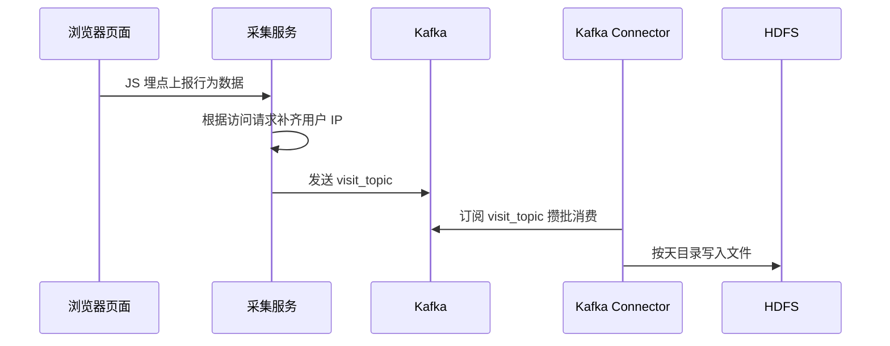

# 访问一次课程页面，验证一条埋点数据走到 HDFS

采集系统的三个组件都起来了：Kafka Connector 配好、采集服务在跑、web 前端也启动了。现在的问题是，整条链路真的通吗？验证方式很直接：用浏览器访问一次课程页面，让埋点产生一条真实的用户行为数据，然后顺着链路去 Kafka 和 HDFS 上找它。找得到，采集系统就算验收通过；找不到，就按数据流向逐层排查。

## 先给结论

- 访问 `http://xc-online:19856/learing-index` 即触发课程访问埋点，页面每刷新一次就多一条记录。
- 数据流向：页面埋点上报，采集服务补 IP 后发 Kafka 的 `visit_topic`，Kafka Connector 落盘 HDFS。
- HDFS 落盘按天分目录：`/user/hive/external/data_course/course_visit_source/日期/`，文件内容是行为明细。
- 一条记录七个字段：课程 id、时间维度、会话 id、客户端 IP、用户 id、浏览器标识、访问时间。
- 验证分两处看：Kafka 用命令行消费者看实时消息，HDFS 用 Hue 文件浏览器看落盘结果。

## 测试入口与埋点埋在哪

前端起来之后，直接访问学习中心页 `http://xc-online:19856/learing-index`，页面一打开埋点就已经生效，用户行为数据随即产生。课程访问量的埋点脚本放在页面源码里，打开页面源码就能看到埋点上报的那一行代码。

按生产环境的常规做法，课程访问量的埋点应该埋在课程详情页：用户点进一门课程，才算一次对这门课程的访问。教学环境里部署的是静态页面，没有后台支撑，课程详情页跳转不起来，所以课程把埋点埋在了首页位置。这对验证链路没有影响，埋点位置只决定统计口径，不影响数据的采集方式与落盘格式。

一次访问产生的数据走这条链路，这张图在讲一条埋点数据从浏览器到 HDFS 的完整旅程：



链路里任何一环断掉，HDFS 上都不会出现新数据，所以验证时两处都要看：Kafka 里有没有实时消息，HDFS 上有没有落盘文件。

## 在 Kafka 与 HDFS 两处验证

**先看 Kafka，确认消息进来了。** 进入 Kafka 容器，用控制台消费者订阅 `visit_topic`：

```bash
# 进入 Kafka 容器后执行，观察埋点消息是否到达
./kafka-console-consumer.sh --bootstrap-server xc-online-kafka:9092 --topic visit_topic
```

浏览器里每刷新一次页面，这个终端就会滚出一条消息。消息能出现，说明前端埋点、采集服务两个环节都正常。

**再看 HDFS，确认落盘结果。** Connector 配置里的 `hdfs.path` 指向 `/user/hive/external/data_course/course_visit_source/`，用 Hue 的文件浏览器按这个路径找过去，目录以天为单位命名，进入当天日期目录，里面是以 uuid 命名的数据文件。点开文件，一条记录大致长这样，字段之间用 `\t` 分隔（数据样例按课程讲义整理）：

```text
c88d0387fa59432d9904498cc7f04b0c	2019-11-04-09	92e66dffc3624d00aa31602d86d18305	91.77.106.137	37e6096d-cbdf-4f17-86d6-ceb91ec673c2	Chrome	1570500691
```

回到浏览器再刷新一次页面，Hue 里重新打开文件，记录数多了一条。多刷几次多几条，说明采集是实时生效的。教学环境里用户就是自己，一天产生不了多少数据；真实生产环境用户量大，这样的埋点每天能产生大量行为数据，正式的数据量级靠这种模拟真实环境的方式积累起来。

## 一条记录的七个字段

落盘的每条记录都按 ODS 层的数据结构设计，七个字段各有用途：

| 字段 | 说明 | 用途 |
|---|---|---|
| `course_id` | 课程 id，uuid | 关联课程，支撑课程热门度等分析 |
| `time_dim_id` | 时间维度，`yyyy-MM-dd-HH` | 由访问时间计算，直接对上时间维度表 |
| `session_id` | 会话 id，uuid | 每打开一个页面产生一个，关闭浏览器消失，用于去重 |
| `client_ip` | 客户端 ipv4 | 去重，也用于地域分析 |
| `user_id` | 用户 id，uuid | 有值说明是登录用户，无值是游客 |
| `user_agent` | 浏览器标识 | 判断访问方式，识别机器人流量 |
| `visit_time` | 访问时间戳 | 计算时间维度，还原用户访问的具体时间 |

这套字段设计是后续分析的底座：按 `session_id` 或 `client_ip` 去重得到真实的访问量，按 `time_dim_id` 汇总出按天、周、月、年的课程访问量曲线，按 `user_id` 区分登录与未登录行为。埋点在浏览器端能拿到什么、采集服务补什么，都是围绕这张字段表倒推出来的。

## 测试不通时的排查顺序

排查沿数据流从下游往上倒查，哪一层先断，问题就藏在哪一层。

**第一，看 HDFS 目录。** 日期目录没出现，先确认 Connector 是否在运行：到 Connect 的日志里看提交的 connector class 是否加载、任务是否 RUNNING。文件目录有了但迟迟不出现新内容，注意 `flush.size` 的攒批语义：配置值是 100，意思是攒够 100 条才触发一次写文件，测试时只刷一两次页面，新记录可能要等下一次攒批才可见，也可能会追加进已有的文件里。

**第二，看 Kafka topic。** 消费不到消息就往上找采集服务：服务日志里有没有收到上报、有没有报错。采集服务本身依赖 Kafka，服务启动时 Kafka 必须已经就绪。

**第三，看前端请求。** 浏览器开发者工具里看埋点请求有没有发出、返回状态是否正常。请求都没发出，问题在页面埋点或前端部署。

**第四，核对路径。** HDFS 的存储路径、日期目录格式都来自 Connector 提交时的 JSON 配置，路径记不清就回文档或 Postman 里看当时提交的配置，不要凭印象猜。

## 常见误区

- **把课程访问量埋点当成必须埋在课程详情页。** 错例：教学环境里等课程详情页产生数据。正解：埋点位置由统计口径决定，教学环境是静态页没有后台，埋在首页同样能产生合法的行为数据，验证的是链路而不是位置。
- **刷新一两次页面就去 HDFS 找新文件。** 错例：发现没有新文件就认定链路断了。正解：Connector 按 `flush.size` 攒批落盘，条数不足时数据在内存缓冲里，先看 Kafka 确认消息到了没有，攒批到量后 HDFS 才见文件。
- **只验证 HDFS 不看 Kafka。** 错例：HDFS 没数据就反复重启 Connector。正解：先确认 topic 里有消息，把问题域切成两半，Kafka 之后是 Connect 的责任，Kafka 之前是采集服务与前端的责任。
- **凭记忆手敲 HDFS 路径。** 错例：路径打错进错目录，误判数据没落盘。正解：落盘路径以提交 Connector 的 JSON 配置为准，`expression` 与 `hdfs.path` 拼出的目录才对得上。

## 面试可能被问到的问题

1. 面试官追问：「你们怎么验证采集系统是可用的？」
   答：环境搭完后做端到端验证，访问埋点页面产生真实行为数据，先在 Kafka 用控制台消费者确认消息到达，再到 HDFS 按天目录下确认文件与记录，刷新一次页面多一条记录，链路各环节即验收通过。
2. 面试官追问：「埋点数据里为什么同时有 session_id、client_ip 和 user_id？」
   答：三者服务不同口径，session_id 标识一次页面会话，用于访问去重；client_ip 辅助去重并支撑地域分析；user_id 区分登录用户与游客。分析访问量时按会话去重，分析用户行为时按用户维度聚合，一个都不能少。
3. 面试官追问：「测试时数据量很小，怎么模拟生产环境的大数据量？」
   答：埋点方式与生产完全一致，数据格式相同，量级差异不影响链路验证；后续做统计分析时可以用 NiFi 的脚本处理器批量生成模拟数据，按同样的格式写入 HDFS，补足数据量。
4. 面试官追问：「HDFS 上为什么按天分目录？」
   答：Connector 的 expression 按日期格式化目录，一天一个目录与数仓 ODS 层按天分区的加载方式对齐，离线任务每天处理前一天的数据时直接按目录取数，也便于按日期回溯与重跑。
5. 面试官追问：「页面刷新了但 HDFS 没有新数据，你怎么排查？」
   答：从下游往上游倒查。先看 Connector 日志确认任务在运行且注意攒批阈值，再看 Kafka topic 里有没有消息，然后看采集服务日志确认收到上报，最后看浏览器网络请求确认埋点发出。哪一层先没有数据，问题就在那一层。

## 配套资料

- 讲义：`materials/docs/04/智慧学成-第2章-ETL.md`，2.3.1 ODS 层数据结构（课程访问量字段表）、3.3 测试采集课程访问量为本课内容出处。
- 讲义：`materials/docs/08/智慧学成-第1章-环境搭建v1.0.md`，Hue 登录与组件使用、容器环境出处。
- 代码：`materials/code/08/_散落资料/`，docker-compose 编排文件（Kafka 容器 9092 端口、Hadoop 容器 50070 端口）。
- 说明：文件内数据样例按课程讲义整理；Kafka 消费命令按讲义整理，topic 以采集系统实际提交的 `visit_topic` 为准；采集系统源码包随课程资料分发，不在代码目录内。
