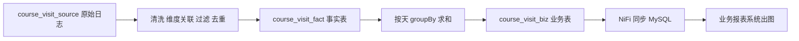
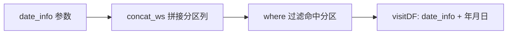
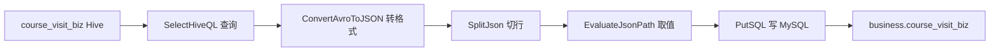
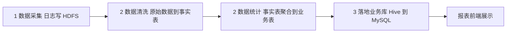
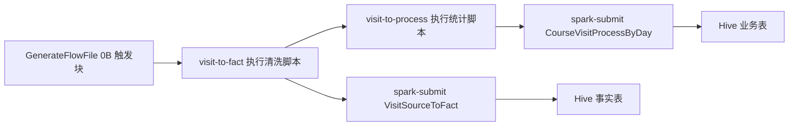
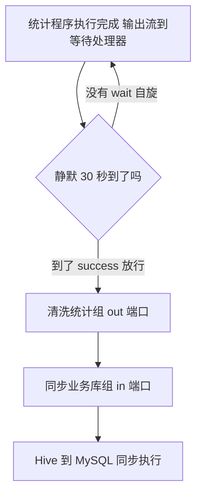

# 课程分析-课程访问量分析全链路：从统计三步、NiFi 同步到集成联动测试

> 🔒 安全提示：文中示例的口令/密钥均为课程教学环境演示口径，生产环境的安全要求见《安全与合规须知》。

## 先给结论

课程分析里的课程访问量分析是一条完整的离线统计链路：从课程访问量事实表出发，以天为单位聚合出每天访问量，写入 APP 层业务表，再由 NiFi 同步到 MySQL 业务库，最后通过集成测试把采集、清洗、统计、同步串成一条自动流水线。全系列八个部分，前四部分聚焦统计程序本身，后四部分聚焦导出与联动测试。
主线只有一条：干净的事实表进来，随天聚合的业务结果出去，同步与调度交给 NiFi。统计口径锚定在天：一行明细即一次访问，groupBy 计数即访问量，周月年只是查询区间差异，不是存储差异。
八个部分依次是：
- 功能概述与统计分析步骤：定下三步走的主线与业务表结构。
- 步骤1 读取事实表：按日期过滤取数，时间字段用 concat_ws 拼接。
- 步骤2 统计求和：groupBy 天粒度计数，输出形状由 APP 层结构倒推。
- 步骤3 结果保存：列序对齐、动态分区、覆盖写入，保证重跑幂等。
- NiFi 同步 MySQL：五个处理器一条线，与清洗链路同一套路。
- 集成测试概述：四段链路与 ETL 的对应关系，环境清点。
- NiFi 调度清洗与统计：spark-submit 交给处理器去点。
- 联动配置与测试：等待处理器与缓存服务串起组间依赖，全链路验证。

## 第1部分：课程访问量统计分析：一次按天聚合，从事实表到业务表

事实表 `course_visit_fact` 里一行是一次访问，明细数据业务方看不懂也没兴趣看，前端要的是一条随时间起伏的趋势线。从明细到曲线只差一次以天为单位的聚合。这一课把统计程序的功能、步骤与 APP 层业务表的结构铺清楚，代码实现紧随其后。与前面清洗程序的思路一样：动手之前，先知道数据从哪来、到哪去、长什么样。

### 功能定位与分析维度

功能一句话：以天为单位，算出每天的课程访问量。为什么偏偏锚定在「天」？回到需求侧：前端原型的查询按周、月、年三档发起，用户选定一个区间，页面返回的是这个区间内逐天的数据点，连成趋势线。维度分析阶段给时间维度定义了一个层次四个级别，年、月、周、天，天是最小级别，也是最细的存储粒度。

数据按天聚合好之后，周、月、年三档查询不需要三套结果，都是同一天粒度数据上的区间过滤。把「算什么」收敛到最小粒度、把「查什么」交给查询参数，是这类统计程序设计的第一原则。

### 统计步骤与数据流

讲义把统计步骤列成三步：读取课程访问量事实表数据；以天为单位求和；将结果保存到课程访问量业务表。放在整条链路里看，它的上下游如下：



上游值得多看一眼。清洗阶段已经做了维度关联、机器人过滤、去重三件事，落到事实表的数据是干净的明细。统计程序拿到手直接聚合，不再重复任何清洗动作。清洗管质量，统计管聚合，职责分开，两边都简单。下游是导出与展示：业务表数据由 NiFi 从 Hive 搬到 MySQL 的业务库，报表前端再从 MySQL 读数画图，这两段在后面的课里展开。

### APP 层业务表结构

业务表的建表语句在数据仓库章节已经执行过，这里回头看结构，它决定了统计程序输出什么：

```sql
CREATE EXTERNAL TABLE IF NOT EXISTS data_course.course_visit_biz
(date_info String,
 count INT)
PARTITIONED BY (years String, months String, days String)
ROW FORMAT DELIMITED FIELDS TERMINATED BY '\t'
STORED AS PARQUET
location '/user/hive/external/data_course/course_visit_biz';
```

`date_info` 是拼好的日期，格式 `yyyy-MM-dd`，前端接口直接用它做返回字段；`count` 是当天访问次数；三个分区列按年月日拆开，供存储裁剪与查询过滤。对应实体与表字段一一对应：

```scala
/**
 * 每天访问量
 *
 * @param date_info 日期，格式：yyyy-MM-dd
 * @param count     访问次数
 * @param years     分区年
 * @param months    分区月
 * @param days      分区日
 */
case class CourseVisitBiz(date_info: String,
                          count: Int,
                          years: String,
                          months: String,
                          days: String)
```

`date_info` 与三个分区列看似冗余，各干各的活：分区列负责 Hive 侧的存储组织与谓词裁剪，`date_info` 负责业务侧的直读直出，导出 MySQL 时不需要再拼字段。

### 统计代码：三步落成十来行

```scala
package com.study.xc.analysis
import com.study.xc.common.EtlEnvironment
import org.apache.spark.sql.SparkSession

/**
 * 课程访问量统计分析程序
 */
object CourseVisitProcessByDay {
  // 获取 spark session
  val spark: SparkSession = EtlEnvironment.getSparkSession(this.getClass.getSimpleName)

  def main(args: Array[String]): Unit = {
    import spark.implicits._
    val date_info = "2019-11-11"
    // 1 读取课程访问量事实表数据
    // 生产环境按 date_info 过滤：
    // select ... where concat_ws('-',years,months,days)='2019-11-11'
    // 方便测试，不过滤日期，统计所有时间
    val visitDF = spark.sql(
      s"select concat_ws('-',years,months,days) as date_info, years, months, days " +
      s"from data_course.course_visit_fact")
    // 2 以天为单位求和
    val visitCount = visitDF.groupBy("date_info", "years", "months", "days").count()
    visitCount.show()
    // 3 保存到数据仓库（业务表中）
    // 配置允许动态分区
    spark.conf.set("hive.exec.dynamic.partition.mode", "nonstrict")
    visitCount
      // 指定列，防止数据混乱
      .selectExpr("date_info", "count", "years", "months", "days")
      // 写入模式：覆盖
      .write.mode("overwrite")
      // 指定数据仓库中的表名（库名.表名）
      .insertInto("data_course.course_visit_biz")
    // 数据仓库中的结果查看
    spark.sql("select * from data_course.course_visit_biz").show()
    // 4 关闭资源
    spark.close()
  }
}
```

三步与代码的对应关系很直白。第一步一条 SQL 把事实表读成三列：`concat_ws('-',years,months,days)` 拼出 `date_info`，分区列原样带出；注释里的 `where` 版本是生产口径，测试时放开日期统计所有时间，两种写法与清洗程序的口径切换习惯一致。第二步 `groupBy` 带上分区列与 `date_info`，`count()` 数行数，一行明细就是一次访问，数出来的就是当天访问量。第三步写入，`selectExpr` 把列按业务表的字段顺序显式排一遍，`insertInto` 是按位置对齐的，列序错一格，数据就整体串位。

本地测试还是 IDEA 直接运行，`show()` 出的结果与 Hive 里查业务表核对一致即通过。
## 第2部分：统计程序第一步：按日期从课程访问量事实表取数

统计程序 `CourseVisitProcessByDay` 的完整实现只有十来行，容易翻车的反而是第一步取数。课程访问量事实表里跟时间沾边的字段有三个：`time_dim_id` 精确到小时，`visit_time` 是毫秒值，`years`、`months`、`days` 是分区列，where 条件选错字段，轻则多扫大量无关数据，重则一条都查不出来。

取数这一步写顺了，后面的聚合与落库才有干净的地基。本课从程序骨架搭起，把取数 SQL 逐段写完：参数化日期、concat_ws 拼分区列、按天过滤。

### 先搭骨架：固定格式与四步注释

离线分析程序有固定套路，新建类时先把不需要动脑的部分写好。SparkSession 由 `EtlEnvironment` 工具类统一装配，应用名取当前类名；main 方法里先落四步注释，再逐条往里填代码。注释就是验收清单，写到哪一步一目了然：

```scala
package com.study.xc.analysis

import com.study.xc.common.EtlEnvironment
import org.apache.spark.sql.SparkSession

/**
 * 课程访问量统计分析程序
 */
object CourseVisitProcessByDay {
  // 获取 spark session
  val spark: SparkSession = EtlEnvironment.getSparkSession(this.getClass.getSimpleName)

  def main(args: Array[String]): Unit = {
    // 1 读取课程访问量事实表数据
    // 2 按天求和
    // 3 保存到数据仓库（业务表中）
    // 4 关闭资源
    spark.close()
  }
}
```

SparkSession 拿到就意味着资源已经打开，与它成对出现的是程序末尾的 `spark.close()`，开什么关什么。清洗程序与统计程序共用这套装配方式，写新指标时直接复制骨架改类名。

### 三个时间字段，选成本最低的

动手写 where 之前，先到 Hue 里把事实表结构看清楚。建表语句在数据仓库章节已经执行过：

```sql
CREATE EXTERNAL TABLE IF NOT EXISTS data_course.course_visit_fact
(course_visit_fact_id String,
 course_dim_id String,
 time_dim_id String,
 area_dim_id String,
 company_dim_id String,
 client_ip String,
 client_sessionid String,
 client_type String,
 visit_time bigint)
PARTITIONED BY (years String, months String, days String)
ROW FORMAT DELIMITED FIELDS TERMINATED BY '\t'
STORED AS PARQUET
location '/user/hive/external/data_course/course_visit_fact';
```

能表达「某一天」的字段有三个，逐个评估使用成本。**time_dim_id 精确到小时。** 它是字符串形式，格式为年月日加一个小时，样例数据里能看到 `2019-11-09-10`，想拿它当日期过滤，得先截取前十位。**visit_time 是毫秒值。** 毫秒精度做等值比较基本对不上，必须先做时间格式化才能用。**分区列原样可用。** `years`、`months`、`days` 拼一个横线就是 `yyyy-MM-dd`，取数不用任何加工。

**加横线的拼接成本最低。** 格式化、截取这些动作全省掉，拼接交给 SQL 函数一次完成；条件表达式只引用分区列，扫描时日期对不上的分区目录自然被排除，时间字段再精确也只是备用选项。

### 取数 SQL：concat_ws 拼日期、按天过滤

```scala
val date_info = "2019-11-11"
// 1 读取课程访问量事实表数据
// 生产环境按日期过滤：
// val visitDF = spark.sql(
//   s"select concat_ws('-',years,months,days) as date_info, years, months, days " +
//   s"from data_course.course_visit_fact " +
//   s"where concat_ws('-',years,months,days)='${date_info}'")
// 方便测试，不过滤日期，统计所有时间
val visitDF = spark.sql(
  s"select concat_ws('-',years,months,days) as date_info, years, months, days " +
  s"from data_course.course_visit_fact")
```

`concat_ws` 是 Spark SQL 内置函数，第一个参数是分隔符，后面列出要连接的字段，年、月、日一次连成 `2019-11-11` 这种格式。别名 `date_info` 不是随手起的，它与 APP 层业务表字段同名，后面聚合、写库直接沿用，不再二次拼接。字符串模板用 s 插值，`${date_info}` 会被替换成变量值，替换结果两边要包单引号，这是 SQL 字面量的要求，漏了引号直接解析报错。

取数链路如下图：日期参数进来，拼接出标准格式，过滤命中分区，读出四列明细。



关键点在拼接与过滤用同一个表达式：读出来的 `date_info` 与 where 里比对的值格式完全一致，不会出现「查的是一种格式、存的是另一种格式」的错位。

### 写死日期与放开过滤的口径切换

离线分析以天为单位，今天分析昨天的数据，日期天然是个变量。测试阶段先写死 `2019-11-11`，集成测试时改成从 args 读取：spark-submit 提交时把日期跟在 jar 包后面，调度脚本用 `$1` 接住转传给 main 方法，日期就变成调度变量，每天自动分析前一天。

另一处口径在 where 上：带条件只算一天，去掉条件统计所有日期。两种写法共用同一条 SQL，切换只动一行；后面的聚合键里本来就有日期，取数范围扩大不影响聚合逻辑。
## 第3部分：聚合求和：数行数得到每天的课程访问量

上一步读出的 `visitDF` 是一行一次访问的明细，前端要的却是一天一个数据点。把明细压成每天一行，靠的是一次 groupBy 加 count。这一步代码只有一行，动手前要先想清楚两件事：聚合键带哪些字段，结果列为什么长那个样子。

两个答案都藏在 APP 层业务表的结构里，从目标表倒推回来设计聚合，比凭感觉写稳得多。

### 输出形状由 APP 层结构倒推

聚合键怎么选，先看目标表长什么样。业务表 `course_visit_biz` 有两个数据列 `date_info` 与 `count`，三个分区列 `years`、`months`、`days`，对应实体在 APP 层数据结构一节已经定义：

```scala
case class CourseVisitBiz(date_info: String,
                          count: Int,
                          years: String,
                          months: String,
                          days: String)
```

写入时这五个字段一个都不能少，聚合输出就必须凑齐它们。groupBy 几个字段，结果就剩这几个字段加一个统计列：分组键选 `date_info` 加三个分区列，count 列自动补上统计值，输出形状与实体严丝合缝，不多一列也不缺一列。

### 聚合代码：一行 groupBy 与一次 show

```scala
// 2 以天为单位求和
val visitCount = visitDF.groupBy("date_info", "years", "months", "days").count()
// 求和结果查看
visitCount.show()
```

`count` 既是聚合动作也是结果列名，聚合完成后 DataFrame 的第五列就叫 `count`，与业务表字段同名，后面写库不用改名。一行明细就是一次访问，按天分完组数行数，数出来的就是当天访问次数。

分组键里带分区列还有一层用处：动态分区写入时，分区列必须在结果里，否则写库那一步拿不到年月日的值。只按 `date_info` 分组虽然统计口径不变，但分区列从此消失，后面寸步难行。

还有一条 SQL 正确性原则藏在背后：聚合之后，出现在结果里的非聚合列必须全部在分组键里。`date_info`、`years`、`months`、`days` 四列都在 groupBy 中，所以原样保留合法；要是把某个维度列也 select 出来却没参与分组，Spark 会直接报错，SQL 语义上那一格的值也无法确定。分组键选哪些列，一半由目标表结构决定，一半由这条原则兜底。

明细到指标的压缩过程如下图：


关键路径在 count：分组键相同的行归成一组，组内行数就是统计值，一次 shuffle 完成聚合，没有任何多余动作。

同样的聚合也能写成一条纯 SQL：

```scala
val visitCount = spark.sql(
  """select concat_ws('-',years,months,days) as date_info,
     |years, months, days, count(1) as count
     |from data_course.course_visit_fact
     |group by years, months, days""".stripMargin)
```

两种写法结果一致，选 DataFrame API 的理由在衔接：聚合结果 visitCount 紧接着要做 selectExpr 与 insertInto，链式写法一路顺下去，不用再包一层 spark.sql；count() 出的列名与业务表字段天然同名，取数用 SQL、聚合用 API 的混搭在本项目里是常态，哪个顺手用哪个。

### 验证：分区存在即数据存在

跑代码之前，先在 Hue 里确认 2019-11-11 有没有数据。事实表按年月日分区，分区列表里能看到这一天的分区目录，数据必然存在。据此推断输出形状：`2019-11-11`、`2019`、`11`、`11`，再加一个具体次数。控制台跑出来与推断一致，这一步就算通过。某一天如果没有分区，结果里自然没有那一行，属于正常现象，不是程序算错了。

`show()` 默认只打印二十行，日期一多看不全。控制台只是抽查，全量核对交给落库之后的查询，那里有 count(1) 兜底。
## 第4部分：统计结果落库：列序对齐、动态分区与覆盖写入

`visitCount` 已经是每天一行，最后一步写进 `data_course.course_visit_biz`。写库这一步的坑不在 SQL，而在写入语义：insertInto 按位置对齐列，列序不排就串位；写分区表要开动态分区开关；模式选错，数据越跑越多。

把这三件事说清楚，再加两处验证动作，统计程序的最后一环就闭环了。

### insertInto 按位置对齐，列序必须显式排

聚合输出 `visitCount` 的列序是 `date_info`、`years`、`months`、`days`、`count`，分组键在前统计列在后；业务表的列序却是 `date_info`、`count`、`years`、`months`、`days`。insertInto 写 Hive 表不看列名，只按位置对齐，直接把 DataFrame 灌进去，count 的值会落进 years 列，整表数据错一格，而且类型都是 String，错位不报错，最隐蔽。

解法是写入前用 selectExpr 按目标表字段顺序显式排一遍：

```scala
// 3 保存到数据仓库（业务表中）
// 配置允许动态分区
spark.conf.set("hive.exec.dynamic.partition.mode", "nonstrict")
visitCount
  // 指定列，防止数据混乱
  .selectExpr("date_info", "count", "years", "months", "days")
  // 写入模式：覆盖
  .write.mode("overwrite")
  // 指定数据仓库中的表名（库名.表名）
  .insertInto("data_course.course_visit_biz")
```

selectExpr 里出现的名字必须与 visitCount 的现有列完全一致，写错一个直接报列不存在；顺序必须与业务表 DDL 一致，错一个位置数据就串一行。

### 动态分区：每个写分区表的程序都要配

`course_visit_biz` 按 `years`、`months`、`days` 三级分区，程序里没有写死任何分区值，年月日全部由数据行携带，这就是动态分区。Hive 默认的 strict 模式要求至少一个分区列静态指定，防的是误操作刷全表分区；全动态的批量落库会被它拒绝，所以保存之前先把模式切到 nonstrict。

清洗程序保存事实表时配过同一个开关。凡是用 insertInto 写分区表的离线程序都要带上这一行，漏了它，任务跑到写入那一步直接抛异常；配置写在保存之前，顺序反了同样白配。

### 覆盖写的语义与重跑幂等

`mode("overwrite")` 与 insertInto 组合的效果是：本次写入涉及哪些分区，哪些分区就被替换。统计口径调整后重算某一天，重跑程序即可，旧结果被新结果覆盖，不会叠加出两倍数据；没写到的分区不受影响，重算范围天然被日期边界圈住。换成 append 就完全是另一回事，每跑一次数据翻一倍，报表曲线直接翻番。

落库链路如下图：


关键路径在 overwrite 与 insertInto 一环：列序在 selectExpr 已经排好，分区开关在保存之前打开，写入才一次通过，任何一个前置条件缺失都会在这一环暴露。

### 验证：变量与业务表各查一次

```scala
// 求和结果查看
visitCount.show()
// 数据仓库中的结果查看
spark.sql("select * from data_course.course_visit_biz").show()
```

两处查看各管一段。`visitCount.show()` 看的是本次聚合对不对，业务表查询看的是落库对不对；变量有值不代表写库成功，表里查得到才算数。控制台默认显示二十行，全量核对切到 Hue 执行 `select count(1) from data_course.course_visit_biz`，这里查到 60 行，与统计结果一致。

60 行的由来值得说一句：测试期把取数 SQL 的日期过滤注释掉，一次统计事实表里的所有日期。分组键里本来就带日期，一天聚出一条结果，六十天的明细聚出六十行，报表系统要的成段数据一次到位。口径差异只在取数那一步，聚合与落库的代码一行不动，这正是统计三步拆开写的回报。
## 第5部分：NiFi 把课程访问量结果同步到 MySQL：五个处理器一条线

统计结果落在 Hive 的 `course_visit_biz` 里，业务报表系统却不读 Hive，它只连 MySQL。中间这段搬运交给 NiFi：查 Hive、转格式、切行、取值、写 MySQL，五个处理器连成一条线，全程零代码。

这条链与数据生产那课的七处理器链是同一套思路的两种用法。配置逐个讲透，模板导入后就能直接跑通。

### MySQL 侧只要两列

```sql
CREATE TABLE `course_visit_biz` (
  `date_info` date NOT NULL COMMENT '天，某一天的访问量',
  `count` int(11) NOT NULL COMMENT '当前访问计数'
) ENGINE=InnoDB DEFAULT CHARSET=utf8
```

`business` 业务库在导入在线教育平台业务数据时一并建好，这张表随库导入。与 Hive 侧的 `course_visit_biz` 相比，它少了三个分区列，只有 `date_info` 与 `count`。原因在用途：MySQL 只做数据展示，前端报表按日期取数画曲线；分区裁剪、存储组织这些 Hive 侧的活，它在 MySQL 里一概不承担，需要什么同步什么即可。

`date_info` 是 date 类型，Hive 侧拼好的 `yyyy-MM-dd` 字符串直接可写，类型上不需要再加工。统计程序取数时坚持把日期拼成标准格式，回报在这里兑现。

### 五处理器各司其职

数据流如下图：查询结果以 Avro 出来，转成 JSON 数组后切行，字段值搬进属性，最后按模板写进 MySQL。



关键路径在格式转换与取值两环：Avro 是 Hive 查询结果的默认输出格式，下游处理器只认 JSON；JSON 数组切开后，字段值从内容搬进属性，PutSQL 的模板才有值可填。

**SelectHiveQL 负责查询。** 它挂着 Hive Database Connection Pooling Service 连接池，查询语句一行：`select * from data_course.course_visit_biz`，输出格式为 Avro。此刻的流文件是整份查询结果，还没有按行拆开。

**ConvertAvroToJSON 负责转格式。** JSON container 配成 array，整份结果变成一个 JSON 数组，一行数据对应数组的一个元素。

**SplitJson 负责切行。** JsonPath 表达式写 `$`，把数组按元素切开，一个元素变成一个流文件，处理粒度从「整份结果」降到「单行记录」。

**EvaluateJsonPath 负责取值。** Destination 配 `flowfile-attribute`，两条表达式各取一个字段：`counts = $.count`、`date_info = $.date_info`，值从流文件内容写进属性。

**PutSQL 负责落库。** 插入语句是一行模板：

```text
INSERT INTO `business`.`course_visit_biz` VALUES ('${date_info}', '${counts}');
```

`${date_info}` 与 `${counts}` 引用的正是上一步写进属性的两个值，Batch Size 配 1000，攒够一批再执行，减少与 MySQL 的往返。字段 count 提取出来时起名 counts，模板里就引用 counts，属性名与模板引用名一字不差，值才能对上。

### 模板导入与两处必配

整条流程在课程资料里有现成的模板 XML，导入即得，不用逐个拖处理器：

```text
1. 浏览器打开 58080 端口进入 NiFi 画布
2. 进入「离线分析」下的「课程访问量」处理器组
3. 上传模板 XML（授课资料第 3 章 nifi 目录下，课程访问量-Hive-To-Mysql）
4. 用添加模板的方式拖入画布，生成处理器组
5. 消除两个黄色感叹号：Hive 连接池服务直接启用
6. MySQL 连接池补连接串、用户名 root、密码 123456
7. 全部处理器启动，观察队列计数，Navicat 刷新业务表核对
```

两个感叹号对应两个连接池。Hive 连接池在维度数据采集时已经配好，启用即可；MySQL 连接池补上连接串与密码，密码 123456。配置齐了点启动，画布上队列开始流动：统计程序产出 60 行数据，这里就处理 60 个流文件，数字对得上说明一条不少。

核对在 Navicat 里完成，刷新 `business` 库的 `course_visit_biz`，60 条记录全部进来，与统计输出一致，从 Hive 到 MySQL 的最后一公里闭环。

### 与清洗链路同一套路

数据生产那课的七处理器链是「查库取 id、转格式、切行、取值、拼模板、跑脚本、落 HDFS」，本课五环把后三步换成一条 PutSQL，骨架完全相同：查询、转 JSON、切分、取值、落地。会配一条，另一条只是换个终点。

这套骨架的价值在后面还会放大：集成测试时，清洗与统计程序也用 ExecuteStreamCommand 交给 NiFi 调度，采集、清洗、统计、导出四段收在同一块画布上联动，一键跑通全链路，每一段失败都有队列留痕。
## 第6部分：集成测试概述：把采集、清洗、统计、落地串成一条 NiFi 流水线

清洗程序在 IDEA 里跑通过，统计程序也单独验证过，同步流程在 NiFi 上也点过启动。可这些都是「单兵作战」：每个环节各自能跑，不等于整条链路一起能跑。集成测试要回答的问题只有一个，把数据采集、数据清洗、数据统计、落地业务库四段用 NiFi 串起来，从头到尾一次跑通，数据从原始日志一路流进 MySQL 业务库。

### 四段链路与 ETL 的对应关系

NiFi 定位是 ETL 工具，这条课程访问量链路正好把三个字母各归各位。数据采集对应抽取，把模拟访问日志写到 HDFS 的原始目录；数据清洗与数据统计对应转换，Spark 程序把原始明细洗成事实表，再聚合成业务表；落地业务库对应加载，把数仓里算好的结果搬进 MySQL 供报表使用。四段的串行关系如下：



关键路径在第二段内部：清洗与统计共用一个 Spark 工程的 jar 包，两个程序按先后顺序执行，统计依赖清洗产出的事实表，这一段跑完才有资格谈同步。图里采集到清洗之间的箭头在测试时会手动控制，原因下一节展开。

### 两段已就绪，一段要补

画布上的三个处理器组，此时状态并不相同。数据采集组已经配好，用的是 NiFi 直接造数的方式：调度脚本批量生成模拟访问日志写入 HDFS。采集本来还有另一种做法，搭一套模拟生产环境的采集系统，让埋点数据从真实入口流进来，但那条路造数太慢，测试阶段选 NiFi 造数。落地业务库组也已配好，Hive 业务表到 MySQL 的搬运流程可以直接启动。

唯一缺席的是中间一段。清洗程序和统计程序此前一直在 IDEA 里以本地模式运行，集成测试要求它们改由 NiFi 调度执行。需要准备的东西讲义和资料里都已给齐：两个程序打成的 jar 包、两个 spark-submit 调度脚本、以及一条现成的 NiFi 流程模板。要做的只是把模板导入画布、把依赖的 jar 与脚本放进 NiFi 容器的约定目录、把处理器参数补齐，随后启动即可。

### 联动范围为什么不含采集

清洗、统计要和落地业务库联动：统计跑完，同步自动跟上，三段按顺序执行成一个整体。采集却站在联动之外，这一点值得想清楚。

**第一，生产语义不同。** 生产环境里数据采集是用户行为自动产生的，访问日志随用户操作源源不断落盘，没有任何人去「启动」它，也就无从联动。**第二，测试造数需要人工控速。** 用 NiFi 造数时，想生成十万条还是二十条、想让它跑多久，都是人为决定，造数完成之后数据才进入下游。**第三，分析口径是离线的。** 课程访问量分析的是昨天的数据，测试时模拟的也是昨天的数据，采集完成与否和清洗何时启动没有强约束，人工衔接完全够用。

于是联动配置收敛为一件具体的事：让「清洗统计」这个处理器组结束的信号，触发「落地业务库」处理器组开始工作。这个信号怎么产生、怎么传递，属于联动配置那一课的内容。

### 开工前的环境清点

集成测试横跨 Hadoop、Hive、Spark、MySQL、NiFi 五个组件，任何一处没就绪，流程都会停在中间某个队列上。启动之前按这份清单过一遍，能省掉大半排障时间：

```text
1. 基础组件在跑：HDFS、YARN、Hive、Spark 集群、MySQL 均已启动
2. NiFi 画布就绪：数据采集组、落地业务库组已导入且配置完整
3. 待导入：数据清洗统计调度模板（流程 xml）、清洗与统计共用 jar 包
4. 脚本就位：两个 spark-submit 调度脚本，放入 NiFi 容器后补可执行权限
5. 数据口径：事实表与业务表的旧数据已确认处理方式（清掉或保留）
6. 模拟数据：采集造数覆盖的日期范围与分析口径一致（昨天或全量）
```

清单里第五条最容易被忽略。此前测试留下的事实表、业务表数据如果不清，新跑的结果会和旧数据混在一起，核对结果时分不清哪部分是本轮产出的。清数据的方式与范围，在后面各步的实际操作里会逐一落实。

组件是否就绪可以各用一条命令快速确认（按课程环境补全的示例，Hadoop 与 Spark 跑在容器里）：

```bash
# 容器一览：Hadoop、Hive、MySQL、NiFi 各容器是否在运行
docker ps
# Spark 集群是否有活着的 Master 与 Worker
jps | grep -E "Master|Worker"
# HDFS 与 Hive 快速探活
hdfs dfs -ls /user/hive/external/data_course
hive -e "show tables in data_course" 2>/dev/null | head
```

探活通过再开流程，中途停摆的概率小得多；哪一条命令卡住，问题就圈在哪一个组件上。
## 第7部分：用 NiFi 调度清洗与统计：spark-submit 交给处理器去点

清洗和统计两个 Spark 程序在 IDEA 里已经反复验证过，但集成测试的画布上它们还是缺席的：采集在 NiFi 上，同步在 NiFi 上，中间这两段却要人开着 IDEA 手动跑。这一课把缺口补上，用 NiFi 的命令执行处理器定时触发两个 spark-submit，让清洗、统计和上下游一样，点一下启动就自动走完。

### 调度流程的结构

三个处理器一条线，谁触发、谁干活、谁接棒清清楚楚：



`GenerateFlowFile` 是整条流的起点，生成一个 0 字节的触发块，文件大小 0B、批次 1，调度周期被拉成一个天文数字，等于手动点一次只跑一轮。触发块沿着连线进入第一个 `ExecuteStreamCommand`，这个处理器的本职就是执行外部命令并把命令输出交给下游。清洗调度执行 `course_visit_fact.sh`，统计调度执行 `course_visit_process.sh`，前者把原始数据清洗进事实表，后者把事实表按天聚合进业务表。

两个命令处理器之间的衔接靠 `ExecuteStreamCommand` 的 `output stream` 关系：清洗脚本执行完，输出流向统计调度，天然的先后顺序不需要任何额外配置。其余两个关系 `original`（原始触发块）与 `nonzero status`（命令非零退出）都设为自动终止，不让无关数据在流里堆积。

### 处理器参数怎么配

两个 `ExecuteStreamCommand` 的配置除了脚本名完全一致，关键项如下：

```text
Command Path        /opt/run/script/course_visit_fact.sh
Command Arguments   ${now():toNumber():minus(86400000):format('yyyy-MM-dd')}
Ignore STDIN        true
Working Directory   /opt/run/script
Argument Delimiter  ;
```

Command Arguments 是一段 NiFi 表达式语言：`now()` 取当前时间，减去一天的毫秒数，再格式化成 `yyyy-MM-dd`，也就是昨天的日期。这个日期作为脚本参数传进去，对应生产口径里「分析昨天」的需求。`Ignore STDIN` 置 true，不把上游触发块的内容喂给脚本；工作目录指向脚本所在位置。统计调度那一枚处理器把 Command Path 换成 `course_visit_process.sh`，其余原样。

模板导入后要做的另一件小事是给画布上的组正名：三个组按执行顺序标上序号，第一组数据采集，第二组数据清洗统计，第三组同步到业务库。名字不影响执行，但集成测试要盯的是顺序，标清楚以后看图不会乱。

### 调度脚本长什么样

脚本在资料里已经备好，清洗与统计各一份，结构相同，只差 `--class` 指向的类。清洗这份如下：

```bash
#!/usr/bin/env bash
if [[ $1 != "" ]];then
    TD_DATE=$1
else
    #TD_DATE=`date -d "-1 day" +%Y-%m-%d`
    echo "[===no params input,default date_info is yesterday($TD_DATE)===]"
    exit 1
fi
SPARK_SUBMIT=/opt/spark/bin/spark-submit
$SPARK_SUBMIT \
  --master spark://spark-host:7077 \
  --class com.study.xc.analysis.visit.VisitSourceToFact \
  /opt/run/jars/service-offline-jar-with-dependencies.jar ${TD_DATE}
if [[ $? == 0 ]];then
    echo "[===spark-submit process success===]"
else
    echo "[===spark-submit process failed===]"
    exit 0
fi
```

脚本逻辑三层：没传日期参数就直接退出，防止空跑；有参数则拼 spark-submit 命令，master 指向课程集群的 Spark 地址（按环境 hosts 里的域名填写），类名用全限定名，jar 是整个离线工程打出的依赖包；结尾用 `$?` 判断提交结果并回显，NiFi 侧能看到脚本的输出。统计脚本只改一处，`--class` 换成 `com.study.xc.analysis.visit.CourseVisitProcessByDay`。测试口径下程序内部不按日期过滤明细，原始目录里多天的数据全部清出、全部统计，报表系统才有一定量的数据可画。

### 打包与部署

调度执行的是集群任务，打包前有两处必改。其一，代码此前没分发包，调度脚本里写的却是带子包的全限定名，所以要在工程里建 `visit` 子包，把清洗与统计两个对象拖进去，两个类打在同一个依赖 jar 里，靠类名区分。其二，公共环境类里的集群模式开关要打开，本地测试时这一行是注释掉的，走本地模式；提交集群必须让它生效置 true。两处改完点 package，等着出 jar。

部署是把四样东西送进 NiFi 容器：先在宿主机上传两个脚本和 jar 包，再用 docker cp 逐个复制进容器，最后在容器里归位：

```bash
# 宿主机：把脚本与 jar 复制进 NiFi 容器（docker cp 按单个文件或目录复制）
docker cp course_visit_fact.sh nifi-container:/opt
docker cp course_visit_process.sh nifi-container:/opt
docker cp service-offline-jar-with-dependencies.jar nifi-container:/opt
# 容器内：归位到约定目录
mv /opt/course_visit_fact.sh /opt/run/script/
mv /opt/course_visit_process.sh /opt/run/script/
mv /opt/service-offline-jar-with-dependencies.jar /opt/run/jars/
# 关键一步：给脚本补可执行权限，在脚本所在目录执行
cd /opt/run/script
chmod +x *.sh
```

可执行权限这一步有现成的坑：上传上来的脚本默认是白色（无执行权限），不加 `chmod +x` 处理器调用必失败；而且权限命令要在脚本所在目录里执行，目录不对，通配符匹配不到任何文件，命令直接报错。加完权限文件名变绿，才算就绪。

### 跑一轮验证

验证前先清场：旧测试留的事实表、业务表数据会造成干扰，直接在 HDFS 上删除两张表对应目录的文件，回 Hue 查询 count 为 0 确认清空。然后启动清洗统计组，观察三个位置：

- NiFi 画布：队列出现计数，说明触发块已经交给下游，第一个处理器在忙。
- Spark Master 页面：先看到 `VisitSourceToFact` 出现在运行列表，本轮 26 秒完成；随后统计任务接棒，23 秒完成。
- Hue 查询：事实表先出数据，统计跑完后业务表也查到结果，按天聚起的访问量一目了然。

三个位置的时间线对得上，清洗与统计的 NiFi 调度就接进了整条流水线，剩下一件事是把这三段和落地业务库联动起来。
## 第8部分：联动配置与测试：统计跑完，同步自动跟上

清洗统计组和落地业务库组各自都能跑，但中间隔着一次人工干预：统计跑完了，得有人记得去点同步的启动。联动的目标就是去掉这一次人工点击，让统计结束的信号自动触发数据仓库到 MySQL 的同步，整条链路一次启动、全程无人值守。这一课把这个信号机制配出来，并从头到尾跑一轮全链路验证。

### 组与组之间为什么要靠端口

单个组内部的处理器可以随便连线，两个组之间却连不上，这不是限制而是设计。处理器组是一个封装单元，内部结构对外不可见，组对外只暴露两类接口：output port 把组内数据送出去，input port 接住外面进来的数据。组内流程怎么改、处理器怎么换，只要端口契约不变，外部连线上什么都不用动。

于是联动的接线图固定为三步：清洗统计组里把最后一个处理器的输出引到组内新增的 output port；同步业务库组开一个 input port；两组之间的连线从 out 端口出发接到 in 端口。但直接连还跑不通，缺一个环节：out 端口只说明「组内最后一段有输出了」，不能说明「整组任务结束了」，中间需要等待处理器做这个判断。

### 等待处理器：属性与原理

等待处理器是课程自研的 NiFi 扩展，源码随资料提供，核心属性定义如下（包名按 `com.study.xc` 系改写）：

```java
/** 当前等待 id，多组都在等待时做唯一标识，防止信号串线 */
public static final PropertyDescriptor WAITING_TIME_ID = new PropertyDescriptor
        .Builder().name("waiting_time_id")
        .displayName("Waiting Time Id")
        .required(true)
        .addValidator(StandardValidators.NON_EMPTY_VALIDATOR)
        .build();

/** 等待时间，单位秒，默认 30：窗口内没有新的放行条件就走下一组 */
public static final PropertyDescriptor WAITING_TIME = new PropertyDescriptor
        .Builder().name("waiting_time")
        .displayName("Waiting Time")
        .required(true)
        .defaultValue("30")
        .addValidator(StandardValidators.NON_EMPTY_VALIDATOR)
        .build();

/** 缓存客户端：向服务端登记与查询等待状态 */
public static final PropertyDescriptor DISTRIBUTED_CACHE_SERVICE = new PropertyDescriptor
        .Builder().name("distributed-cache-service")
        .displayName("Distributed Cache Service")
        .required(true)
        .identifiesControllerService(AtomicDistributedMapCacheClient.class)
        .build();
```

本课实例的取值与连线汇总成一张配置卡：

```text
Waiting Time Id            visit
Waiting Time               30
Distributed Cache Service  DistributedMapCacheClientService
                             Server Hostname  localhost
                             Server Port      4557
关系处理                    wait 连回处理器自身自旋，success 连到组的 out 端口
```

原理不复杂。处理器收到 FlowFile 时把内容直接丢弃，只关心「数据来没来」；首个数据到达时，它用 Waiting Time Id 作键，把本轮等待的起始时间与等待时长登记进缓存服务，之后每秒轮询一次，没到时限就沿 wait 关系连回自身继续扣着等。超过等待窗口仍无新的数据进来，即认定上游任务已经收尾，处理器沿 success 关系放行，同时清掉缓存里的登记。等待窗口的作用是留一个缓冲：统计程序跑完到数据彻底落定之间有零散的收尾输出，静默 30 秒再放行，同步组拿到的信号才可靠。

### 缓存服务端：全局只有一个

等待状态登记在缓存服务里，这套服务分两端。客户端 `DistributedMapCacheClientService` 配在等待处理器所在组里，指向服务端地址；服务端 `DistributedMapCacheServer` 比较特殊，整个 NiFi 实例里配一个就够用，位置放在最外层根组，也就是所有业务流程之外的空白处右键添加，配置保持默认，占用端口 4557，与其他程序冲突时再改。

服务端有个隐藏的坑：它不在任何业务流程里，导出流程模板时不会跟着走，导入整体流程模板后这个服务会丢。表现为等待处理器上挂着黄色感叹号，提示找不到缓存服务。处理方式两条：按上面的步骤在根组手动补建服务端并启用，再把客户端的 Server Hostname 与 Server Port 补成本机加 4557；或者不导模板，照着配置卡一步一步手动搭。启用完成后感叹号消失，等待处理器就绪。

### 全链路测试

联动的执行时序如下：



老规矩，先清场再开跑。业务库 MySQL 里上一轮同步进来的旧数据清掉；Hue 里进文件浏览，把事实表与业务表在 HDFS 上对应目录的旧文件删掉，删除后各查一遍 count 确认为 0：

```sql
-- MySQL 业务库清旧数据（示例）
truncate table business.course_visit_biz;
```

```bash
# HDFS 旧文件删除（界面操作与命令行等价）
hdfs dfs -rm -r /user/hive/external/data_course/course_visit_fact/*
hdfs dfs -rm -r /user/hive/external/data_course/course_visit_biz/*
```

启动顺序是先下游后上游：先把同步业务库组启动起来，它处于等数据状态，没有输入不会误跑；再启动清洗统计组。随后观察整条链路的时间线：清洗任务在 Spark 上运行 26 秒完成，统计任务接棒 23 秒完成；统计输出进入等待处理器，队列里短暂积压，静默 30 秒后放行；同步组拿到数据，60 条统计结果写入 MySQL 业务库。收尾核对三个位置：MySQL 里业务表查到本轮数据，Hue 里事实表与业务表都有值，NiFi 队列归零。三处对上，清洗、统计、同步的联动就正式成立，采集段依旧由人工控制节奏，整个集成测试的拼图只剩展示环节了。
## 常见误区

- **在统计程序里再洗一遍数据。** 错例：聚合前再过滤机器人、再去重。正解：事实表是清洗程序的产物，统计只聚合，重复清洗既慢又会掩盖清洗阶段的问题。
- **找一个数值字段去 sum。** 错例：以为求和要有量值列，在表里翻字段。正解：一行明细即一次访问，`groupBy().count()` 数行数就是访问量，不需要任何数值列。
- **insertInto 不对齐列序。** 错例：把 DataFrame 原样写入，列顺序与业务表字段顺序不一致。正解：`selectExpr("date_info", "count", "years", "months", "days")` 显式排好再写。
- **为周月年各存一套结果。** 错例：建三张表分别存周报、月报、年报。正解：以天为最小粒度存一张业务表，周月年是查询区间的差异，不是存储结构的差异。
- **漏开动态分区。** 错例：直接写分区表，运行期报动态分区异常。正解：`spark.conf.set("hive.exec.dynamic.partition.mode", "nonstrict")` 写在保存之前。
- **拿 time_dim_id 直接等值过滤。** 错例：`where time_dim_id='2019-11-11'`，字段里带小时段，等值永远匹配不上。正解：要么截取前十位，要么改用分区列拼接。
- **用毫秒值过滤。** 错例：把 visit_time 格式化后再比较，多一步加工还容易因精度漏数据。正解：分区列原样可用，成本最低。
- **插值漏写或没包引号。** 错例：`where ...=${date_info}` 没有单引号，SQL 解析报错。正解：s 插值加单引号，写成 `'${date_info}'`。
- **select * 全捞。** 错例：九个字段全部带出来，后续聚合的分组键混杂多余列。正解：只 select 聚合与写入要用的四列。
- **只按 date_info 分组。** 错例：`groupBy("date_info").count()`，结果少了三个分区列，写分区表时拿不到年月日的值。正解：分区列一起参与分组。
- **找一个数值列去 sum。** 错例：在事实表里翻字段想要求和。正解：一行明细即一次访问，count 数行数就是访问量，表里本来就没有量值列。
- **把 show 的二十行当全量。** 错例：控制台只显示二十条就以为数据丢了。正解：show 默认截断二十行，全量用 count 查询核对。
- **分组键与取数别名对不上。** 错例：取数时别名写成 dateInfo，聚合键写 date_info，运行期报列不存在。正解：别名与分组键前后对齐，一字不差。
- **漏配动态分区。** 错例：直接 insertInto 写分区表，strict 模式拒绝全动态分区，任务报错。正解：保存前把 `hive.exec.dynamic.partition.mode` 设为 nonstrict。
- **列序不排直接写。** 错例：visitCount 原样 insertInto，count 值落进 years 列，类型兼容所以不报错。正解：selectExpr 按目标表 DDL 的字段顺序显式重排。
- **用 append 模式攒数据。** 错例：每次运行追加一遍，同一天出现多行统计。正解：overwrite 覆盖写，程序可重复执行。
- **只看变量 show 就收工。** 错例：visitCount 有值就认为成功，实际写入环节早已失败。正解：变量与业务表各查一次，表里有数才算落库。
- **跳过格式转换。** 错例：把 Avro 流文件直接接到 SplitJson 或 PutSQL，下游识别不了二进制内容。正解：ConvertAvroToJSON 必须在切行之前。
- **属性名与模板引用对不上。** 错例：EvaluateJsonPath 取出的属性叫 count，PutSQL 模板里写 `${counts}`，替换值全为空。正解：属性名与 `${}` 引用名一字不差。
- **SplitJson 的 JsonPath 写成字段级。** 错例：写 `$.date_info` 去切数组，切不出单行。正解：对数组切分用 `$`，取字段是 EvaluateJsonPath 的活。
- **只盯成功队列不看失败。** 错例：启动后只看成功关系队列，失败关系堆了几百条也没发现。正解：失败队列与处理器告警一起看，报错先看 bulletin。
- **连接池没启用就开跑。** 错例：Hive 连接池停在 disabled 状态，SelectHiveQL 连不上数据仓库。正解：两个连接池都启用后再启动处理器组。
- **把集成测试理解成再写一遍代码。** 错例：以为要把清洗、统计程序改造成 NiFi 自定义处理器。正解：程序原样打包，NiFi 只负责用命令调度器去触发 spark-submit，代码零改动。
- **四个环节全部强行联动。** 错例：把数据采集也串进自动执行流，让它和清洗统计手拉手。正解：采集在测试环境靠人工控制产量与节奏，联动只覆盖清洗、统计、落地业务库三段。
- **环境没清点就开跑。** 错例：Hive 没起、脚本没加执行权限就直接启动流程，队列里堆着数据不知道卡在哪。正解：按清单逐项确认，流程启动后盯着 NiFi 队列与 Spark 运行页面对照。
- **旧数据不清就开始测。** 错例：事实表里躺着上一轮的结果，跑完直接查表下结论。正解：测试前明确旧数据的去留，保证本轮核对的每一条数据都出自本轮流程。
- **打包时忘了开集群模式。** 错例：拿着本地模式配置的 jar 提交集群，任务行为异常或资源申请不对。正解：打包前把公共环境类里的集群开关置 true，本地调试与集群部署用两套口径。
- **脚本上传后直接调用。** 错例：docker cp 完就启动处理器，报权限拒绝。正解：容器内脚本必须在所在目录 `chmod +x *.sh`，白色变绿色再启动。
- **把两个程序打成两个 jar 分别配路径。** 错例：清洗一个包、统计一个包，脚本里写两份路径。正解：一个依赖 jar，脚本里用 `--class` 的全限定名区分任务，维护一份即可。
- **Command Arguments 直接写死日期。** 错例：参数里填一个固定日期字符串，第二天跑的还是前一天的数。正解：用 NiFi 表达式 `now():toNumber():minus(86400000):format('yyyy-MM-dd')` 动态取昨天。
- **ignored 输出关系全部不处理导致队列积压。** 错例：`original` 关系不自动终止，触发块在队列里越堆越多。正解：用不到的关系一律 auto terminate，只留 `output stream` 交给下游。
- **想给两个处理器组直接拉连线。** 错例：从清洗统计组的处理器直接拖线到同步组的处理器，NiFi 不允许。正解：组内接 output port、对端开 input port，组间只连端口。
- **把缓存服务端配进业务组里。** 错例：跟着等待处理器一起放进清洗统计组，其他流程要用时又配一个。正解：服务端全局唯一，放最外层根组，端口 4557；客户端才配在业务组里。
- **导入模板后不补缓存服务。** 错例：模板导完直接启动，等待处理器挂感叹号无法运行。正解：服务端不在流程内、不随模板导出，手动在根组补建启用。
- **先启动上游再启动下游。** 错例：统计跑完同步组还没就绪，数据压在队列里干等。正解：先起下游组让它处于待命状态，再起上游触发整条链路。
- **把 30 秒当成可有可无的延迟随手改小。** 错例：嫌等得久改成 2 秒，统计收尾输出还没落定就放行，同步拿到不完整信号。正解：静默窗口是任务结束的判断缓冲，按默认值或按数据量评估后调整。

## 面试可能被问到的问题

1. 面试官追问：「清洗和统计为什么拆成两个程序？」
   答：职责不同。清洗负责数据质量，关联维度、过滤、去重，产出干净的事实表；统计负责业务口径，对干净数据做聚合。拆开后各自可独立重跑，统计逻辑调整不用重跑清洗，清洗修正也不用改统计。

2. 面试官追问：「统计粒度为什么定在天，不直接按周或按月聚合？」
   答：天是最细的业务展示粒度，前端的周、月、年查询返回的都是逐天数据点。按天存一份，区间查询交给起止日期参数；按更粗粒度存则丢掉细节，无法回算更细的查询。

3. 面试官追问：「业务表里 date_info 和年月日分区列重复，是否多余？」
   答：不重复，服务对象不同。分区列供 Hive 做存储组织与谓词裁剪，date_info 是拼好的业务字段，导出 MySQL 与前端返回直接可用，省去查询时拼接。冗余一份字符串换来查询与导出的简洁，是常见取舍。

4. 面试官追问：「count 和 sum 在这个指标上怎么选？」
   答：课程访问量的业务含义是访问次数，事实表一行就是一次访问，所以对行数计数，`groupBy().count()` 即可。如果指标是金额、销量这类有量值的口径，才需要 sum 对应数值列。

5. 面试官追问：「某天的统计结果错了，怎么修正？」
   答：先修上游：重新清洗该日数据覆盖事实表对应分区，再重跑统计程序，覆盖写会替换业务表中该日涉及的分区。以天为分区的好处在这里体现，重算范围被分区边界圈住，不会波及其他日期。

6. 面试官追问：「为什么按分区列过滤，而不是按表里的时间字段？」
   答：分区列是 Hive 的存储组织单位，条件落在分区列上扫描范围最小；time_dim_id 带小时段、visit_time 是毫秒值，都要先加工才能比较，成本高且容易出错。

7. 面试官追问：「concat_ws 和 concat 有什么区别？」
   答：concat 按顺序直接连接，concat_ws 第一个参数指定分隔符，后续参数用这个分隔符连接，遇到 null 会跳过，不会产生多余空段，多列拼日期用它更稳。

8. 面试官追问：「日期参数生产上怎么传进来？」
   答：main 方法从 args 读取，spark-submit 提交时把日期跟在 jar 包路径后面，调度脚本用位置参数 `$1` 接住再转传，日期成为调度变量，每天自动分析前一天的数据。

9. 面试官追问：「spark.sql 直接查 Hive 表需要什么前提？」
   答：SparkSession 要开启 Hive 支持，数据仓库地址指向 Hive 的 warehouse 目录，目标表已在 Hive 建好；满足这三点才能读到库、表与分区元数据。

10. 面试官追问：「取数时为什么把分区列一起 select 出来？」
   答：后面写业务表是分区表写入，分区列必须在结果里才能落到对应分区；date_info 与分区列各干各的活，date_info 供业务查询与导出，分区列供存储组织。

11. 面试官追问：「groupBy 多个字段，结果的列是什么？」
   答：所有分组字段原样保留，再加一个统计列。count() 产生的列名就是 count，结果列序是分组键在前、统计列在后，后续按位置写入时要留意这个顺序。

12. 面试官追问：「为什么聚合键要包含分区列？」
   答：一是写入分区表时分区列必须在结果里；二是分区列本来就在日期语义之内，带上它们不改变统计口径，写入时还能按分区命中。

13. 面试官追问：「明细重复会不会把访问量算多？」
   答：清洗阶段已经过滤机器人、关联维度并去重，落到事实表的数据一行代表一次真实访问，统计程序不再清洗，直接计数。

14. 面试官追问：「聚合发生数据倾斜怎么办？」
   答：日期类分组键基数低，每天最多几千到几万行，倾斜概率小；真出现倾斜可以加随机前缀打散再二次聚合，或者调大 shuffle 分区数，先看 key 分布再动手。

15. 面试官追问：「insertInto 和 saveAsTable 有什么区别？」
   答：insertInto 向已存在的表追加或覆盖数据，按位置对齐列，不碰表结构；saveAsTable 按当前 DataFrame 的列名与类型建表或覆盖元数据。写入预建好的分区表用 insertInto，表结构由 DDL 管。

16. 面试官追问：「动态分区的 strict 和 nonstrict 差在哪？」
   答：strict 要求至少一个分区列静态指定，防误操作全表刷分区；nonstrict 允许全部分区由数据行决定。批量按天落库必须用 nonstrict，代价是分区数失去约束，要自己控制分区膨胀。

17. 面试官追问：「overwrite 会不会把其他日期的数据清掉？」
   答：动态分区覆盖只替换本次写入命中的分区，其他分区不受影响；如果分区列被当成静态值处理，覆盖范围会放大，写入前要核对列序与分区配置。

18. 面试官追问：「统计程序怎么做到可重复执行？」
   答：读取靠事实表分区，写入靠 overwrite 替换同名分区，两次执行结果一致。某天数据修正后重跑对应日期即可，结果不叠加，这就是幂等。

19. 面试官追问：「写入后发现数据串位，怎么排查？」
   答：先核对 selectExpr 的列序与目标表 DDL 是否一致，再查每个列名是否真实存在于上游 DataFrame；insertInto 按位置对齐，多列少列都会错位，报不报错取决于类型能否隐式转换。

20. 面试官追问：「为什么 Avro 先转 JSON 再切分，不直接处理 Avro？」
   答：SplitJson 与 EvaluateJsonPath 的表达式引擎面向 JSON 设计，Avro 是二进制容器格式，先转成文本化的 JSON 才能做数组切分与字段取值，链路上每一环只认一种格式。

21. 面试官追问：「PutSQL 里的 ${date_info} 从哪来，取不到会怎样？」
   答：来自 EvaluateJsonPath 写入的流文件属性，Destination 配成 flowfile-attribute 才有；取不到时模板变量替换成空串，date 列的非空约束会拒绝插入，记录进失败关系。

22. 面试官追问：「EvaluateJsonPath 的 Destination 有哪两种？」
   答：flowfile-content 与 flowfile-attribute，前者把结果写回流文件内容，后者写成属性。要把值交给 PutSQL 模板引用，走属性最直接，模板里用 `${属性名}` 取。

23. 面试官追问：「同步失败怎么排查？」
   答：看失败关系队列堆了多少流文件，抽样看属性与内容，再看处理器 bulletin 告警；常见原因是连接池配置缺失、属性名不一致、MySQL 字段约束拒绝。

24. 面试官追问：「为什么导出用 NiFi，Spark 不能直接写 MySQL 吗？」
   答：Spark 能写，但导出环节调度与重试逻辑密集，NiFi 模板化、可视化、失败可重放，改配置不动代码；统计程序专注数仓侧计算，链路职责分开，两边都简单。

25. 面试官追问：「这套同步是全量还是增量？」
   答：模板里是全量查询全量插入，适合小结果集的指标表；要增量就把 SelectHiveQL 的查询加日期分区条件，按天只查新分区，或者改用带状态管理的查询处理器记录水位。

26. 面试官追问：「什么是集成测试，和单元测试在大数据项目里怎么分工？」
   答：单元测试验证单个程序的正确性，比如清洗逻辑、聚合逻辑各自跑通；集成测试把多个环节按真实执行顺序串起来跑，验证环节之间的衔接，包括输入输出格式、调度顺序、依赖组件的可用性。大数据项目里通常是 IDEA 里单程序验证，NiFi 或调度平台上做全链路集成。

27. 面试官追问：「为什么用 NiFi 来调度 Spark 离线任务，而不是写个 shell 加 crontab？」
   答：NiFi 提供可视化的流程编排与监控，任务之间的依赖、队列积压、失败关系在界面上直接可见，也方便把命令执行、数据同步等多类任务挂在同一条流里。crontab 只能定时触发，失败重试、上下游联动都要自己写脚本维护。

28. 面试官追问：「离线分析和实时分析在数据采集上的要求有什么不同？」
   答：离线分析面向已落盘的历史数据，比如每天分析前一天的日志，采集完成的时间点要求宽松；实时分析要求数据产生后尽快进入计算链路，采集与计算天然耦合。这条链路里课程访问量是离线口径，采集和清洗才不需要联动。

29. 面试官追问：「集成测试前为什么要清理旧数据？」
   答：覆盖写只作用于本次写入涉及的分区，旧分区会原样保留，新旧数据混在表里会让核对失去基准。清掉旧数据后，查到的每一条结果都能确定来自本轮流程，出问题也更容易定位到具体环节。

30. 面试官追问：「NiFi 里怎么调度一个已有的 Spark 程序？」
   答：程序打成依赖 jar，写一个 spark-submit 脚本封装提交命令，NiFi 侧用 ExecuteStreamCommand 配置 Command Path 指向脚本、Command Arguments 传日期参数，脚本输出沿 output stream 关系流向下游。程序本身不需要任何改造。

31. 面试官追问：「ExecuteStreamCommand 和 ExecuteProcess 有什么区别？」
   答：ExecuteStreamCommand 可以接收上游 FlowFile，把内容作为标准输入传给外部命令，并把命令输出转成新的 FlowFile 沿 output stream 流出，适合串在流程中间；ExecuteProcess 只负责周期性执行命令，不消费上游 FlowFile。需要触发块串行衔接的场景用前者。

32. 面试官追问：「为什么调度日期参数取昨天而不是当天？」
   答：离线分析处理的是完整落地的前一天数据，当天数据还在持续产生，当天算口径不完整。调度表达式减去一天的毫秒数再格式化，保证任何时间触发，算的都是昨天这一份完整数据。

33. 面试官追问：「清洗和统计为什么能共用一个 jar 包？」
   答：两个程序在同一个 Scala 工程里，共享公共环境类与实体类，分开打包只会重复携带依赖。一个 jar 加 `--class` 全限定名指定入口，脚本差异收敛到一行，发布与回滚都只动一个文件。

34. 面试官追问：「怎么确认调度起来的 Spark 任务真的执行成功了？」
   答：看三层。脚本层 `$?` 判断 spark-submit 退出码并回显；集群层 Spark Master 页面确认应用出现、运行时长合理、状态为完成；数据层到 Hive 查目标表，行数与日期分布符合预期。三层对上才算成功。

35. 面试官追问：「NiFi 里两个处理器组之间怎么传递数据？」
   答：靠端口。上游组把要送出的数据引到 output port，下游组开 input port，组间连线一端接 out 端口一端接 in 端口。处理器组是封装单元，内部处理器对外不可见，端口是组间数据交换的唯一合法通道，也保证组内重构不影响外部接线。

36. 面试官追问：「怎么判断上游处理器组整个任务结束了？」
   答：NiFi 没有内建的「整组完成」事件，用一个等待处理器近似判断：统计输出到达后先扣住，静默一段时间（默认 30 秒）没有新数据进来，就认定上游收尾完成，沿 success 关系放行并触发下游。窗口期是留给收尾输出的缓冲。

37. 面试官追问：「等待处理器为什么需要 DistributedMapCacheService？」
   答：等待状态的起始时间与时长要登记在组外共享的存储里，保证多次触发、多个处理器实例之间读到同一份登记。分布式缓存服务正是干这个的：服务端全局一个，客户端挂给等待处理器，以信号 id 为键读写。

38. 面试官追问：「模板导入后流程缺组件怎么排查？」
   答：先看黄色感叹号。处理器缺属性、控制器服务缺失都会标出来；本课的典型是缓存服务端，它在根组、不属于任何流程模板，导出导入时会丢，手动在根组补建启用，再把客户端地址端口补齐即可。逐个消掉感叹号再启动。

39. 面试官追问：「全链路测试为什么先启动下游？」
   答：下游组先启动只是待命，没有输入不会执行任何动作；如果先启动上游，统计完成时下游还没就绪，数据只能压在队列里。先下游后上游能让信号一到同步立刻执行，链路时间线干净，验证结果时也容易区分各环节产出。

## 配套资料

- 讲义：`materials/docs/08/智慧学成-第3章-课程分析.md`，1.1 课程访问量统计分析（1.1.1 统计步骤、1.1.2 APP 层数据结构、1.1.3 编写代码、1.1.4 测试）为本课代码与结构出处。
- 讲义：`materials/docs/04/智慧学成-第2章-数据仓库.md`，维度分析中时间维度的层次与级别（年、月、周、天）。
- 建表：`materials/code/08/_散落资料/` 下的 hive.sql，含 `data_course.course_visit_biz` 业务表建表语句。
- 调度：`materials/code/04/_散落资料/` 下有统计程序的 spark-submit 调度脚本（文件名含推广后缀，此处略去）。
- 说明：Scala 工程源码未随仓库解包，代码以讲义为准，包名按 `com.study.xc` 系改写。
- 讲义：`materials/docs/08/智慧学成-第3章-课程分析.md`，1.1.3 编写代码与 1.1.4 APP 层代码测试，为本课代码出处。
- 讲义：`materials/docs/04/智慧学成-第2章-ETL.md`，课程访问量事实表的字段介绍与清洗逻辑。
- 建表：`materials/code/08/_散落资料/` 下的 hive.sql，含 `data_course.course_visit_fact` 事实表建表语句。
- 调度：`materials/code/04/_散落资料/` 下有统计程序的 spark-submit 调度脚本（文件名含推广后缀，此处略去），日期传参写法见脚本内容。
- 讲义：`materials/docs/08/智慧学成-第3章-课程分析.md`，1.1.2 APP 层数据结构与 1.1.3 编写代码，聚合代码与实体出处。
- 讲义：`materials/docs/08/智慧学成-第3章-课程分析.md`，1.1.3 编写代码保存段、1.1.4 APP 层代码测试、1.1.5 课程访问量完整代码。
- 讲义：`materials/docs/08/智慧学成-第3章-课程分析.md`，1.2 业务数据从 Hive 到 MySQL（1.2.1 业务表结构、1.2.2 NiFi 调度流程、1.2.3 调度代码、1.2.4 测试）。
- 讲义：`materials/docs/04/Nifi使用文档.md`，常用处理器整理（SelectHiveQL、ConvertAvroToJSON、SplitJson、EvaluateJsonPath、PutSQL）与模板上传操作。
- 资料：`materials/code/04/_散落资料/` 下有课程访问量 Hive-To-Mysql 流程模板 XML，本课处理器配置的真实出处（文件名含推广后缀，此处略去）。
- 说明：MySQL 建表 SQL 以讲义为准，business 库随在线教育平台业务数据导入；MySQL 连接账号按课程环境为 root/123456。
- 讲义：`materials/docs/08/智慧学成-第3章-课程分析.md`，1.3 集成测试（三大调度部分划分、清洗统计调度配置、联动与整体流程）为本课出处。
- 调度脚本：`materials/code/04/_散落资料/` 下有清洗与统计程序的 spark-submit 脚本（文件名含推广后缀，此处略去）。
- 流程模板：`materials/code/08/_散落资料/` 下有课程访问量相关的 NiFi 流程 xml，含数据清洗统计调度与整体流程模板（文件名含推广后缀，此处略去）。
- 说明：清洗与统计程序的业务细节见本章前面的对应课程；包名按 `com.study.xc` 系改写；环境组件检查命令为按课程环境补全的示例。
- 讲义：`materials/docs/08/智慧学成-第3章-课程分析.md`，1.3.2 数据清洗参数配置、1.3.2.2 与 1.3.3.2 调度脚本、1.3.3.3 NiFi 调度代码为本课出处。
- 调度脚本：`materials/code/04/_散落资料/` 下 course_visit_fact 与 course_visit_process 两个 sh（文件名含推广后缀，此处略去）。
- 流程模板：`materials/code/04/_散落资料/` 下课程访问量数据清洗统计程序调度 xml，处理器参数以模板内实际值为准（文件名含推广后缀，此处略去）。
- 说明：脚本中类名按 `com.study.xc` 系改写，master 地址与 jar 名以课程环境实际为准；容器操作命令为按本课演示补全的示例。
- 讲义：`materials/docs/08/智慧学成-第3章-课程分析.md`，1.3.5 课程访问量整体流程（1.3.5.1 联动配置、1.3.5.2 整体流程代码，含缓存服务全局唯一的说明）为本课出处。
- 代码：`materials/code/04/Wait-For-Next-Group/` 下为等待处理器的 NiFi 自定义处理器源码，属性与关系定义以源码为准，包名按 `com.study.xc` 系改写。
- 流程模板：`materials/code/04/_散落资料/` 与 `materials/code/08/_散落资料/` 下有课程访问量整体流程 xml（文件名含推广后缀，此处略去），联动连线与端口结构以模板内实际值为准。
- 说明：清库与删文件的命令为按本课操作补全的示例；MySQL 业务库为 `business`，连接口令按课程环境 root/123456。
