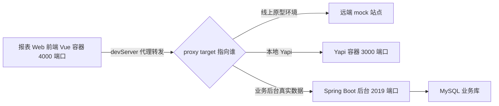

# 报表系统开箱：Web 前端搭建与 Yapi 接口管理平台

> 🔒 安全提示：文中示例的口令/密钥均为课程教学环境演示口径，生产环境的安全要求见《安全与合规须知》。

清洗、统计、同步的联动跑通后，课程访问量的统计结果已经躺在 MySQL 业务库里，链路只剩最后一环：把这些数字变成页面上那条趋势线。眼下有个现实矛盾，前端工程要接接口才能出图，而后端业务接口还没就绪，总不能让前端等着后台。解法是双轨并行，Yapi 平台先出 mock 模拟数据把前端撑起来，后台就绪后改一行代理配置切回真实数据。当前指标只完成了课程访问量一项，展示环节就用它的数据来跑通全流程。

## 先给结论

- 报表 Web 前端是 Vue 工程，跑在 Docker 容器里，宿主机映射 4000 端口；Yapi 是接口管理与 mock 数据平台，容器映射 3000 端口。
- Yapi 容器默认不随编排自启，访问不通先用 `docker-compose up -d` 手动拉起。
- Yapi 使用三步：创建项目、数据管理里导入 JSON 接口文件、在设置页查 MOCK 地址，地址里的项目 id 以自己项目的设置页为准。
- 前端数据源由 `vue.config.js` 的 devServer 代理决定，注释切换即在三套环境之间搬家，改完必须重启前端容器。
- 前后端协作方式：接口契约与模拟数据都挂在 Yapi 上，前端先行开发，后台就绪后切代理 target 即接入真实数据。

## 两个平台各管什么

这套展示层涉及三个角色，各司其职。Web 前端是数据可视化的门面，Vue 开发，负责把接口返回的统计数字画成图表；Yapi 平台是接口管理工具，兼做 mock 数据服务，前端页面在没有真实数据时，靠它模拟接口返回；业务后台是 Spring Boot 写的独立工程，读取业务库 MySQL 里清洗统计出来的真实数据，是前端最终要接的数据源。三者关系如下：



远端原型环境的 mock 站点是公开的演示地址，服务不稳定、数据也可能被清理，所以本地再搭一套 Yapi 作为常备的模拟数据源。切换动作全部收敛在前端的一个代理配置文件里，这正是 mock 先行方案能落地的前提。

## Yapi 平台的搭建与使用

Yapi 源码与编排配置都在资料包里，源码解压到与 Docker 同一台服务器的约定目录，编排文件里补好源码路径的卷映射即可。关键配置节选如下（容器名、镜像与版本以资料包内置的编排文件为准）：

```yaml
services:
  yapi:
    container_name: yapi
    image: yapi:1.10.0
    ports:
      - "3000:3000"
    environment:
      - NODE_ENV=production
      - PORT=3000
      - YAPI_DB_HOST=127.0.0.1
      - YAPI_DB_PORT=3306
      - YAPI_DB_USER=root
      - YAPI_DB_PASS=123456
      - YAPI_DB_NAME=yapi
    volumes:
      - ./yapi:/opt/yapi
      - ./yapi/logs:/opt/yapi/logs
      - ./yapi/config:/opt/yapi/config
```

Yapi 自己的数据存在 MySQL 的 `yapi` 库里，账号口令用本机 MySQL 的 root/123456，与业务库互不相干。这个平台默认没有配置随系统自启，宿主机重启后访问 3000 端口不通，先在编排文件目录执行 `docker-compose up -d` 手动拉起，再谈使用。

登录用平台默认管理员，用户名 `admin@admin.com`，密码 `ymfe.org`（Yapi 开源项目的初始口令）。进来后是空的，按三步把项目搭起来：右上角添加项目，填上项目名创建；进数据管理，数据导入选 JSON，把资料包 code 目录下的接口数据文件上传，弹出的是否同步确认一下，接口列表立刻有货；打开设置页，页面上有这个项目的 MOCK 地址，形如 `http://yapi.example.com:3000/mock/14`，末尾的数字是项目 id，每个项目都不一样，后面配前端代理就靠这个地址。

## Web 前端的启动与数据源切换

前端容器映射宿主机 4000 端口，容器内是 Vue 开发服务，配置文件是工程根目录的 `vue.config.js`。这里直接登录是能进去的，但页面没数据，因为代理默认指向业务后台的真实环境，而后台还没就绪。切到本地 Yapi 的 mock 环境只需改代理配置（请求前缀键名按工程实际为准，这里以 `/api` 示意）：

```js
module.exports = {
  devServer: {
    open: true,
    port: 8080,
    host: "0.0.0.0",
    proxy: {
      "/api": {
        // 原型环境：本地 Yapi 的 mock 地址，项目 id 以设置页显示为准
        // target: "http://yapi.example.com:3000/mock/14",
        // 开发环境：业务后台，数据来自清洗统计落地的业务库
        target: "http://backend.example.com:2019",
        changeOrigin: true,
        pathRewrite: { "^/api": "" }
      }
    }
  }
};
```

三套环境在注释里排着队：线上原型环境、本地 Yapi、业务后台。要谁就把谁的 target 放开，其余注释掉。改完不重启等于白改，dev server 启动时才读这份配置，容器要重启一遍：

```bash
# 修改配置后重启前端容器（容器名按编排文件为准）
docker-compose stop frontend-vue
docker-compose up -d frontend-vue
# 跟一眼日志，确认编译完成再访问
docker logs -f frontend-vue
```

启动没完成时页面访问会失败，别急着下结论，日志里看到编译结束再刷新。登录时用户名、密码、验证码任意填但必须都填，进去之后课程访问量的图表就带着 mock 数据铺开了，趋势线、按周月年切换，原型该有的样子全有。

## 前后端协作方式

这套流程演示的是前后端并行开发的标准打法。接口先行：接口定义以 Yapi 上的接口列表为准，前后端看同一份契约，不会出现字段名对不上的扯皮。模拟数据先行：前端拿着 MOCK 地址开发联调，不等后台工程打包部署。真实数据接管：业务后台读取业务库的统计结果并部署就绪后，前端把代理 target 从 Yapi 切到后台地址，重启容器，页面上的模拟数据换成清洗统计链路产出的真实数据。哪天后台接口有变动，先改 Yapi 上的接口定义，mock 与文档同步更新，前端照新契约调整。

对这条大数据链路来说，报表系统是终点站：数据采集造出原始日志，清洗统计算出每天的访问量，NiFi 同步落进业务库，前端再把业务库的数字画成图。到这里，课程访问量指标从埋点到页面的整条链路全部闭环。

## 常见误区

- **抄别人的 MOCK 地址。** 错例：按示例原样填 `/mock/14`，自己的项目 id 不是这个，前端请求全 404。正解：项目 id 在 Yapi 设置页查看，每个项目唯一，以自己页面上显示的为准。
- **改完代理配置不重启容器。** 错例：配置文件保存了就刷新页面，数据源纹丝不动。正解：dev server 只在启动时读配置，`docker-compose stop` 加 `up -d` 重启，看日志确认编译完成。
- **Yapi 访问不通就认定平台坏了。** 错例：宿主机重启后 3000 端口打不开，开始排查网络。正解：该容器默认不随编排自启，先 `docker-compose up -d` 拉起再访问。
- **导入接口文件后不确认同步。** 错例：上传完 JSON 直接关页面，接口列表是空的。正解：上传后弹出的是否同步提示要点确认，回到接口菜单核对数量。

## 面试可能被问到的问题

1. 面试官追问：「Yapi 这类接口管理平台在前后端协作里解决什么问题？」
   答：把接口契约收敛成单一事实源，接口定义、字段说明、请求响应示例集中维护，变更可追溯；同时平台按接口定义生成 mock 数据，前端在后端实现完成前就能联调页面。并行开发靠它解耦，联调成本显著降低。
2. 面试官追问：「前端怎么在同一份代码里切换 mock 环境和真实环境？」
   答：把环境差异收敛到代理配置。Vue 工程的 devServer proxy 里为请求前缀配 target，不同环境的地址写成注释排在一起，切换时放开一行注释再重启 dev server。代码零改动，回切也容易。
3. 面试官追问：「mock 地址里那段数字是什么，配错了会怎样？」
   答：是 Yapi 里项目的唯一 id，一个平台可以建多个项目，每个项目有自己的 mock 前缀。配错等于请求了一个不存在的项目，接口全 404 或返回空，排查时先核对设置页显示的 MOCK 地址。
4. 面试官追问：「为什么业务后台要独立成一个 Spring Boot 工程，而不并进统计程序？」
   答：职责与生命周期不同。统计程序是离线批处理，按调度周期跑完即退；业务后台是在线服务，常驻进程随时响应前端查询。读的数据倒是同一个业务库，读写分离在工程层面体现，互不影响发布节奏。
5. 面试官追问：「前端页面打开没数据，你的排查思路是什么？」
   答：顺着数据流查。浏览器网络面板看请求是否发出、返回什么；代理配置确认 target 指向的环境是否就绪，mock 环境查 Yapi 的项目与接口，真实环境查后台服务与业务库数据；容器场景还要确认配置修改后重启过、日志里编译完成。层层缩小范围，先定位断在哪一跳。

## 配套资料

- 讲义：`materials/docs/10/智慧学成Web前端及Yapi平台使用说明.md`，Yapi 源码与编排配置、创建项目与导入接口、Web 前端启动与源码配置说明为本课出处。
- 讲义：`materials/docs/04/智慧学成Web业务后台搭建手册.md`，业务后台工程的打包部署与业务库表结构导入。
- 前端源码：`materials/code/08/` 下为报表 Web 前端的 Vue 工程源码，代理配置 `vue.config.js` 在工程根目录（内层目录名含项目原名，此处不展开）。
- Yapi 资料：`materials/code/08/yapi/` 下为 Yapi 源码与接口导入文件，含课程访问量接口的 JSON 数据。
- 说明：容器名、镜像版本与请求前缀键名按工程实际为准，文中以中性名示意；mock 地址域名按示例站点规范以 example.com 占位。
