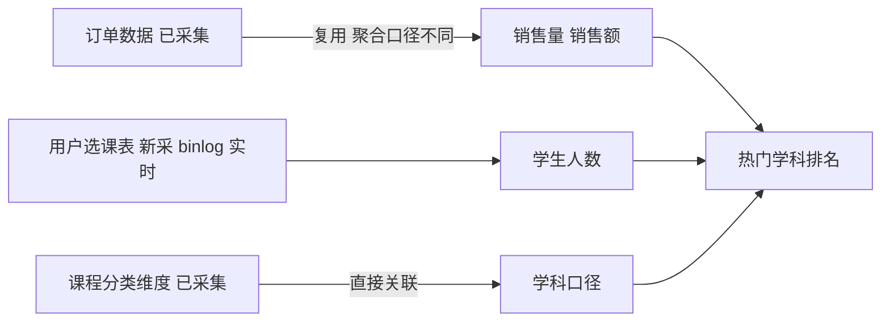
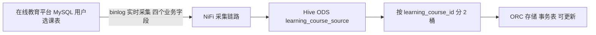

# 热门学科排名采集设计：复用订单数据，只新采用户选课四个字段

> 🔒 安全提示：文中示例的口令/密钥均为课程教学环境演示口径，生产环境的安全要求见《安全与合规须知》。

需求与报表字段都定了，进入数据采集。这次的题眼是「复用与新增」：榜单要的三项数据里，销售量与销售额出自订单数据，课程购买量指标的采集链路现成；学科口径靠课程分类维度关联，维度数据也早就采进数仓。真正要动手新采的只有用户选课表。于是问题收敛成两问：这张表采哪几个字段，采上来存成什么格式。答案依旧从统计需求反推，字段是按需求算出来的，存储是为数据特性选的。

## 先给结论

- 采集布局：销售量与销售额复用课程购买量的订单采集链路，学科数据直接关联课程分类维度，唯一新增采集对象是在线教育平台业务库的用户选课表。
- 用户选课只采四个业务字段：`course_id` 课程 id、`user_id` 用户 id、`choose_time` 选课时间、`status` 选课状态。
- 四个字段各有用途：课程 id 定学科归属，用户 id 数人头，选课时间切时间维度，选课状态过滤无效数据。
- 存储落 Hive ODS 表 `data_course.learning_course_source`，按 `learning_course_id` 分 2 桶、ORC 存储、开启事务，表在数据仓库章节已建好。
- 选课时间在业务库是 datetime，进 ODS 约定转成 BIGINT 时间戳；存储表比采集清单多一列主键 `learning_course_id`，五个列按序落盘。

## 采集布局：两条现成，一条新采

把三项指标数据逐一回溯到源头，采集工作量当场见分晓：



判据只有一条：原始数据是否已经在数仓里。订单数据在课程购买量指标时已经由 binlog 实时采进 `course_orders_source`，销售量与销售额只是换一种聚合口径去消费它，采集侧零改动；课程分类维度数据在维度采集阶段就搬进了数仓，学科名靠关联维度表获取。唯一缺席的是用户选课数据，这张表记录谁选了哪门课，是学生人数指标的原始凭证，也是热门学科排名采集环节唯一的新增对象。采集方式沿用成熟的套路：NiFi 监控业务库 MySQL 的 binlog，过滤用户选课表，数据一有变动实时采集，具体处理器配置在下一课展开。

## 用户选课：四个字段怎么反推

统计需求要的是「每个学科在某个时间范围里有多少学生选课」，把这句话拆开，每个成分对应一个字段。人数要落到人，没有用户 id 就不知道是哪个用户在学习；学科归属要靠课程，课程 id 关联课程分类维度才能定位到学科；按周月年统计需要时间维度，选课时间就是切分依据；统计只算有效选课，选课失败的数据属于垃圾数据，得靠状态字段在清洗时过滤。倒推出来的采集清单就是四个字段：

| 采集字段 | 字段说明 | 数据格式 | 数据样例 |
|---|---|---|---|
| course_id | 课程 id，据此可做更多分析，如课程热门程度等 | uuid | e60f96225a9046d5b7d752d168d98d14 |
| user_id | 用户 id，可分析用户相关的所有数据 | uuid | 311e3af993644504a059fb6be75c7743 |
| choose_time | 选课时间，可根据时间计算时间维度，做和时间相关的数据分析 | 时间戳 | 1510708629 |
| status | 选课状态，根据状态判断用户是否选课 | int | 501001 |

选课状态多说一句：样例值 `501001` 代表选课成功，状态不对的记录会在清洗阶段被过滤掉，只有选课成功的数据才是统计分析的基础数据。选课表里还有选课有效期起止之类的列，对人数统计无用，一概不采。与课程购买量采集时同一原则：**采集不是搬家，是按统计需求取最小字段集**，字段越多，采集与存储负担越大，无关字段的变更还会平白触发数据更新。

测试阶段往用户选课表造数时，一句 insert 就能触发整条采集链（真实测试语句，出自章内讲义）：

```sql
-- 向在线教育平台用户选课表插入一条选课数据
INSERT INTO `xc_learning`.`xc_learning_course`
(`id`, `course_id`, `user_id`, `valid`, `start_time`, `end_time`, `status`)
VALUES ('1',
        '00039fee08a04fe2a1854b64fe08cd9',
        '00050ced7f3a43f49f9eb6ddb2893e7',
        '1',
        '2019-09-13 11:16:10',
        '2019-11-26 11:16:16',
        '501001');
```

对照采集清单还能看到一个映射细节：业务表里没有叫 choose_time 的列，选课时间对应的是 `start_time` 选课开始时间，`id` 主键则映射为 ODS 的 `learning_course_id`。业务库列名与数仓字段名之间的语义对齐，就是在采集映射这一层完成的。

## 存储设计：ODS 事务表与列序落盘

采集上来的数据落到数据仓库 ODS 层，表在数据仓库章节已经随建表脚本建好，此刻拿出来核对（真实建表语句）：

```sql
CREATE EXTERNAL TABLE
IF NOT EXISTS data_course.learning_course_source
(learning_course_id String,
 course_id String,
 user_id String,
 choose_time BIGINT,
 status String)
clustered by (learning_course_id) into 2 buckets stored as orc
TBLPROPERTIES('transactional'='true');
```

这张表与订单 ODS 表 `course_orders_source` 是同一款三件套：桶表、ORC、事务属性。原因也相同，binlog 采集不只是搬新增，用户选课记录同样存在 update 场景，数仓里的行要能跟着业务库改写，Hive 的行级更新必须以分桶加 ORC 加 transactional 为前提，普通文本表写入后不可变，承载不了更新语义。

两个类型细节要留意。主键列 `learning_course_id` 不在采集字段表里，它是存储端补的 uuid 主键，同时充当分桶列；`choose_time` 在业务库是 datetime（样例 `2019-09-13 11:16:10`），采集字段表给的时间戳样例是 `1510708629`，与订单表 `order_time` 的约定一致，datetime 在采集环节转成 BIGINT 时间戳进仓，年月日分区由清洗阶段从时间戳派生。数据按列序自左向右落盘，一行样例长这样：

```text
course_id                          user_id                            choose_time  status
1441f254-9cf8-42b4-82f8-e65f0d81309d  fac474cc-b014-47ba-89b2-98448fef9474  1550304915  501001
```

数据流向汇总如下：



到这里采集设计定稿：采什么，用户选课表四个业务字段加一列生成主键；存成什么样，`data_course.learning_course_source` 五列桶表事务表；怎么触发，NiFi 监控 binlog 实时采集。数仓里有了学生人数的原始数据，热门学科排名的原料就齐了，下一课进入清洗，把四个裸字段关联上维度、洗成可用的事实表。

## 常见误区

- **整表照搬进数仓。** 错例：用户选课表十来列全采，图个省事。正解：按统计需求倒推最小字段集，四个业务字段够用，有效期等列与人数统计无关，采了只会放大存储与更新负担。
- **ODS 建成普通文本外部表。** 错例：沿用访问量事实表的文本表写法建选课表。正解：binlog 采集含 update，必须桶表加 ORC 加 transactional，三件套缺一样，行级更新就落不进去。
- **选课时间直接按 datetime 原样入库。** 错例：以为业务库的 datetime 会原样进 Hive。正解：采集环节统一转 BIGINT 时间戳，清洗阶段再派生年月日，入口统一格式，下游才好处理。
- **忽略选课状态。** 错例：把选课失败的数据也算进学生人数。正解：`status` 是四个采集字段之一，清洗阶段按状态过滤，只保留选课成功的记录作为统计基础。

## 面试可能被问到的问题

1. 面试官追问：「用户选课表为什么只采四个字段？」
   答：从统计需求反推。学生人数要靠用户 id 数人头，学科归属要靠课程 id 关联课程分类维度，周月年时间维度要靠选课时间切分，有效数据要靠选课状态过滤。四个字段各司其职，有效期等列与统计无关，不采能减小采集面，也避免无关变更触发多余的数据更新。
2. 面试官追问：「为什么这张 ODS 表要开事务，普通的访问日志事实表却不用？」
   答：数据更新特性不同。访问日志只会追加，写完不改；用户选课来自业务库，binlog 采集会捕获 update 事件，数仓里的对应行也要能改写。Hive 行级更新的前提是分桶存储加 ORC 格式加 transactional 属性，文本表不可变，承载不了更新。
3. 面试官追问：「选课时间的类型转换为什么放在采集层做？」
   答：采集是业务数据进数仓的唯一入口，入口处统一格式，清洗与统计面对的就是同一套类型约定。datetime 转 BIGINT 时间戳便于比较与计算，年月日与分区字段由清洗阶段从时间戳派生，职责分层清楚，转换只写一遍。
4. 面试官追问：「学科数据为什么不用单独采集？」
   答：学科口径是维度数据，课程分类维度在维度采集阶段已经由 NiFi 采进数仓。清洗用户选课数据时，用 course_id 关联课程分类维度就能拿到课程分类 id 与学科名，分析所需的信息靠关联补齐，不需要为学科再开一条采集链路。
5. 面试官追问：「选课状态字段在整条链路里起什么作用？」
   答：它在采集与清洗两端各挡一道。采集时随行带入，保证状态信息不丢；清洗时按状态过滤，选课失败的记录属于垃圾数据，只有 501001 这类选课成功的记录才进入事实表，学生人数、同比增幅的统计都以过滤后的数据为基础。
6. 面试官追问：「业务表的 start_time 映射成数仓的 choose_time，这种改名映射有必要吗？」
   答：有必要。业务库列名服务交易流程，start_time 与 end_time 是成对的有效期语义；数仓字段服务分析，choose_time 直接表达选课时间。采集映射层完成语义对齐后，下游清洗与统计读到的字段名与业务含义一致，可读性和维护性都更好。

## 配套资料

- 讲义：`materials/docs/08/智慧学成-第3章-课程分析.md`，3.3 数据采集（3.3.1 ODS 层数据结构、3.3.2 数据存储、3.3.3 数据采集实现）为本课出处，用户选课表的插入测试语句出自 3.3.3 小节。
- 讲义：`materials/docs/08/智慧学成-第2章-数据仓库.md`，`learning_course_source` 建表语句与对应实体出自数据仓库章节。
- 流程模板：`materials/code/08/_散落资料/` 下热门学科排名数据采集用户选课 xml（文件名含推广后缀，此处略去），采集字段映射与目标表配置以模板内实际值为准。
- 说明：采集连接口令按课程环境 root/123456；NiFi 处理器配置属下一课内容，此处未展开。
