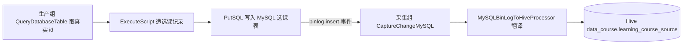

# NiFi 批量造用户选课数据：写入业务库 MySQL 并让 binlog 采集链实时接走

> 🔒 安全提示：文中示例的口令/密钥均为课程教学环境演示口径，生产环境的安全要求见《安全与合规须知》。

手工往选课表插一条数据能验证采集链路通不通，但清洗与统计阶段要的是有规模的样本，几十条撑不起按周按月的聚合，一条条手工插更是不现实。这一课换 NiFi 来造数：让 NiFi 调 Python 脚本批量生成用户选课记录，经 `PutSQL` 写回业务库 MySQL 的选课表；上一课常驻画布的 binlog 监控组就像在真实生产里一样，把新产生的选课记录自动捕进数仓。造数与采集两条流程首尾相接，学生人数的原始数据一次灌到够用的量级。

## 先给结论

- 造数链九个处理器：`QueryDatabaseTable` 取用户与课程 id → `ConvertAvroToJSON` → `SplitJson` 切行 → `EvaluateJsonPath` 取组合串 → `ReplaceText` 规整 → `ExecuteScript` 跑 Python 造选课记录 → `SplitJson` 切单条 → `EvaluateJsonPath` 提字段 → `PutSQL` 入库。
- 取料靠一条 SQL：用户表与课程表做笛卡尔积，拼出「用户 id,课程 id」串，保证造出来的每条选课记录都落在真实存在的 id 组合上。
- 每个组合生成一条选课记录：主键用 uuid 去横杠，状态固定 501001，选课时间随机回退 1 到 60 天，跨度覆盖两个月，后面按周按月的统计才有数据可聚。
- MySQL 连接池只配一次：`QueryDatabaseTable` 读库与 `PutSQL` 写库共用同一个池，启用前先补密码 root/123456，只点启用不填密码是最容易踩的坑。
- 监控组保持运行，生产组启动后数据经 MySQL 被 binlog 采集实时接进数仓；Hive 落地要走 MapReduce，有缓冲时间，队列未消化完不代表测试失败。

## 手工插数的上限在哪

上一课的验证路径是手工 insert 一条选课记录，看它被 binlog 采进数仓。这条路验证连通性足够，验证吞吐量不行：热门学科排名的清洗要按天过滤，统计分析要按周、按月聚合，还要算增幅，样本至少得覆盖一段连续时间。手工插几百条选课记录，每条还得换不同的用户与课程组合，纯体力活且没法复现。

造数有个原则要守住：造出来的数据必须像真的。用户选课是「某用户选了某门课」，用户 id 与课程 id 都必须是库里真实存在的值，否则后面关联维度时一堆查不到的脏数据，测出来的问题全是造数造出来的假问题。所以造数流程的第一段不是造，而是查：从业务库里把真实的用户 id 与课程 id 捞出来做组合，Python 脚本只负责在这些组合上补齐选课状态与选课时间这些「模拟值」。

## 九个处理器的造数链

流程组与采集组并列放在热门学科排名目录下，组名数据生产用户选课-ToMySQL，模板导入后整条链路如下：


链路分两段看。前半段是取料，核心配置在 `QueryDatabaseTable` 的查询语句上：

```text
Table Name        = course_base
SQL Query         = SELECT CONCAT(a.id , ',', b.id ) as uc
                    FROM xc_user.xc_user a, xc_course.course_base b
```

两张表没有 join 条件，做的是笛卡尔积，每个用户配每一门课程，`CONCAT` 把用户 id 与课程 id 拼成一个逗号串。结果集转成 Avro 后被 `ConvertAvroToJSON` 转成 JSON 数组，第一个 `SplitJson` 按 `$` 把数组切成一行一个组合，`EvaluateJsonPath` 把组合串提到流文件内容里，`ReplaceText` 按正则整段重写一遍内容，为脚本喂进干净的输入。

后半段是造数，`ExecuteScript` 的 Script Engine 选 python，实际走 Jython 解释器，模块目录指向环境里的 Python 2.7 包路径。核心脚本如下（出自资料包脚本）：

```python
def datestamp():
    now_info = datetime.datetime.now()
    delta = datetime.timedelta(random.randint(1, 60))
    time_info = now_info - delta
    for_time = time_info.strftime('%Y-%m-%d %H:%M:%S')
    times = int(time.mktime(time.strptime(for_time, '%Y-%m-%d %H:%M:%S')))
    return times

class PyStreamCallback(StreamCallback):
    def process(self, inputStream, outputStream):
        uc = str(IOUtils.toString(inputStream, StandardCharsets.UTF_8)).split(",")
        arr = []
        obj = {}
        obj['learning_course_id'] = str(uuid.uuid4()).replace("-","")
        obj['course_id'] = uc[1]
        obj['user_id'] = uc[0]
        obj['status'] = str(501001)
        obj['choose_time'] = str(datestamp())
        arr.append(obj)
        outputStream.write(bytearray(json.dumps(arr), encoding='utf-8'))
```

脚本拆开看四件事：组合串按逗号切开后 `uc[0]` 是用户 id、`uc[1]` 是课程 id，顺序由取料 SQL 的 CONCAT 顺序决定，这里一旦装反，选课人和课程就互换了；主键 `learning_course_id` 用 uuid 去掉横杠生成，与真实选课记录的主键格式保持一致；状态写死 501001 这个有效选课口径；选课时间用 `datestamp()` 随机回退 1 到 60 天生成秒级时间戳，60 天的随机跨度让数据自然铺满两个月，周与月两级统计都有料。输出是一个 JSON 数组，接着第二个 `SplitJson` 把数组切成单条记录，第二个 `EvaluateJsonPath` 把五个字段提取成流文件属性，交给 `PutSQL` 拼语句。

`PutSQL` 的写入语句只有五个字段，其余列表走默认值：

```sql
INSERT INTO `xc_learning`.`xc_learning_course`(
    `id`, `course_id`, `user_id`, `start_time`, `status`)
VALUES (
    '${learning_course_id}', '${course_id}', '${user_id}',
    FROM_UNIXTIME('${choose_time}'), '${status}');
```

`choose_time` 在脚本里是秒级时间戳，入库前用 `FROM_UNIXTIME` 转成 datetime，与业务表的时间列格式对齐。批量大小 10，关掉 autocommit，攒批提交；写入用全限定表名，读的是 `xc_course` 库的表，写的是 `xc_learning` 库的表，同一个连接池跨库读写并不冲突。

## 连接池一处配置两处使用

处理器组里两个处理器要用 MySQL：`QueryDatabaseTable` 查用户与课程，`PutSQL` 写选课表。两个处理器引用的是同一个 DBCPConnectionPool，JDBC URL 指向 `jdbc:mysql://xc-online-mysql:3306/xc_course`，用户名 root 已配好，所以连接参数只需要配一次，改密码也是一处生效。

配置顺序有个容易犯的错：看到控制器服务面板里 MySQL 连接池处于待启用状态，顺手点启用，忘了密码还空着，服务启动失败还得回头返工。正确姿势是先打开配置页把密码 123456 填上，保存后属性行显示 value set 再点启用。模板能带走大部分配置，密码永远要手工补，这一课的教训在课程演示里真实翻过车。组里另一个 `DistributedMapCacheServer` 服务端属于全局，自动识别不用碰。

## 生产与采集两条线合流

这一课的完整验证是两个处理器组的接力。采集组从上一课起就保持运行，监听选课表的 binlog；生产组启动后，取料、造数、写库自动循环起来：



跑起来的节奏一边快一边慢。生产侧脚本造数极快，队列读数几秒内涨到两千多条；`PutSQL` 攒批写库，业务库选课表肉眼可见地涨。监控侧的捕获处理器逮住每一条 insert 事件实时往 Hive 翻译，但 Hive 的插入要走 MapReduce，消费速度明显落后于生产速度，队列里始终压着未消化的存量。这时不用停生产组再等队列，看两个数字就够了：MySQL 侧 `PutSQL` 的读入输出统计持续增长，说明写入正常；监控侧队列持续流动，说明采集在跟。Hue 里刷 `data_course.learning_course_source`，数据一批批出现。

要收尾时注意停的顺序：生产数据快、落仓慢，直接停整个组会把存量堵在队列里。按处理器粒度控制，先停上游的取料与造数，让 `PutSQL` 与监控链路把队列存量消化完，NiFi 支持这种单处理器启停。测试的判定也不必等到队列清零，讲义里给这条链路标注过缓冲说明：MySQL 到 Hive 的写入实时采集但落地有缓冲，链路各段统计读数都在走，测试就算通过。

## 常见误区

- **服务只启用不填密码。** 错例：控制器服务面板点启用，MySQL 连接池启动失败，来回排查。正解：先补密码 root/123456，属性显示 value set 再启用，连接池被两个处理器共用，一处配置管两处。
- **以为造数脚本直接写数仓。** 错例：在流程里找不到写 Hive 的处理器，怀疑模板缺件。正解：造数终点是 `PutSQL` 写业务库选课表，进数仓靠的是并行运行的 binlog 采集组，两条线在 MySQL 处合流。
- **把 `uc[0]` 与 `uc[1]` 的顺序装反。** 错例：脚本里 `course_id` 取 `uc[0]`，选课人与课程互换，清洗关联维度时大面积查不到。正解：顺序由取料 SQL 的 CONCAT 决定，用户表在前就是 `uc[0]` 是用户 id，改取料顺序时脚本同步改。
- **停组不看存量。** 错例：一次性停掉生产组全部处理器，队列里几千条选课记录堵死。正解：按处理器粒度停，先停上游造数，让 `PutSQL` 与监控链路把存量消化完。

## 面试可能被问到的问题

1. 面试官追问：「造数为什么要用笛卡尔积组合用户与课程，而不是随机生成 id？」
   答：随机生成的 id 在库里不存在，数据落库后与维度表关联不上，清洗阶段会误报大量缺失。笛卡尔积保证每条记录的用户与课程都是真实主键，造出来的数据与生产数据在引用完整性上等价，测试暴露的问题才是链路本身的问题。代价是组合数随两表行数相乘增长，量级要控制。
2. 面试官追问：「两次 SplitJson 与两次 EvaluateJsonPath 各自干什么，能合并吗？」
   答：第一对处理取料结果，把查询结果数组切成行、取出组合串作为脚本输入；第二对处理脚本产物，把 JSON 数组切成单条记录、把字段提为流文件属性供 PutSQL 引用。两组动作对象不同，属性提取依赖数组已切单条，所以不能合并；能精简的是中间的 ReplaceText，输入干净时可以省。
3. 面试官追问：「脚本输出的 choose_time 为什么是时间戳，入库却要用 FROM_UNIXTIME？」
   答：Python 侧用 `time.mktime` 生成的就是秒级时间戳，随机回退天数的计算在时间戳上最直接；业务表的 `start_time` 是 datetime 类型，入库前必须转换。一个字段两种形态，转换点放在 SQL 的 `FROM_UNIXTIME`，保持脚本与表结构各自的表达习惯，边界清晰。
4. 面试官追问：「生产速度远大于消费速度，NiFi 怎么防止内存被打爆？」
   答：靠背压。连接上配置了队列大小与数据量阈值，达到阈值后上游处理器自动暂停调度，生产侧停在那等消费追上来，数据都在队列落盘不占内存。本课的现象就是它的温和版本：造数快、Hive 写入慢，队列持续积压但流程可控。要提速就扩 `PutSQL` 的并发任务数或批量，而不是去掉背压。
5. 面试官追问：「造 60 天随机时间的数据，对后面的验证有什么讲究？」
   答：清洗按天过滤、统计按周按月聚合，数据必须铺满多个完整周期才有东西可验。随机跨度让每个分区都有样本，也自然制造了单日数据量不均匀的形态，顺带能暴露按天调度的边界情况。如果造的数据全落同一天，周环比、月环比这些口径就没有意义，测试等于白做一半。
6. 面试官追问：「这条造数链在真实生产里有什么变体？」
   答：造数是测试设施，生产环境对应的形态是数据回填与仿真压测：同样的链路把随机值换成脱敏后的真实数据样本，用来灌历史数据或压测数仓吞吐。链路结构不变，变的是脚本里的值生成策略，这也是把造数逻辑收在 ExecuteScript 一个处理器里的好处，换场景只动脚本。

## 配套资料

- 讲义：`materials/docs/08/智慧学成-第3章-课程分析.md`，3.3.4 NiFi 生产数据一节（3.3.4.1 NiFi 调用流程、3.3.4.3 生产数据 Python 脚本、3.3.4.4 测试）为本课出处。
- 讲义：`materials/docs/04/Nifi使用文档.md`，NiFi 处理器、连接池服务与脚本执行器的使用说明。
- 资料：`materials/code/08/_散落资料/`，用户选课数据生产的 NiFi 流程模板在这个散落资料目录中（内层文件名带站点后缀，按用途自取，具体文件名不在此列出）。
- 说明：造数脚本与插入语句出自课程资料，账号口令为课程环境实配，MySQL root/123456；脚本运行于 NiFi 自带的 Jython 环境，Python 2.7 语法属正常现象。
