# 热门学科排名统计分析全景：三指标六任务从统计口径到六表入库 MySQL 的完整落地

> 🔒 安全提示：文中示例的口令/密钥均为课程教学环境演示口径，生产环境的安全要求见《安全与合规须知》。

## 先给结论

- 「热门学科排名-统计分析」全系列 19 课合并为一篇总装长文，覆盖三条指标线（销售量、学生人数、销售额）各配周、月两级共六个统计任务的完整落地，最后用 NiFi 把六张业务表从数据仓库同步到 MySQL，是课程分析模块统计层的收官内容。
- 系列主线第一站是统计口径与数据地图：三项指标的输入全部复用前两条链路的存量成果，销售量与销售额出自课程购买量的 DWD/DWM 层，学生人数出自用户选课事实表；唯一的新采集是 NiFi 补采课程分类维度表 `data_dimen.course_category_dim`，途中顺手治好了 NiFi 容器乱码复发的老坑。
- 每条指标线遵循同一套开发节奏：先在 Hue 里把 SQL 写对，再搬回 IDEA 参数化；统计分析走「区间推算→取数→涨幅计算→维度关联→保存入库」七步，与讲义的七步统计分析步骤一一对应。
- 代码组织上把取数与涨幅抽进工具类：`subjectBuyCountSql`（销售量）、`subjectLearnSql`（学生人数）、`subjectBuyAmountSql`（销售额），一个指标一个方法，周月两个周期共用同一方法，只换区间与分区。
- 口径要点贯穿全系列：涨幅是等长窗口对比，周口径对上周、月口径为「当月累计至今对上月同日累计」；基线区间无数据时 `IFNULL(..., 1.0)` 兜底成 100%，是既定约定而非计算错误。
- 结果统一落 `data_subject` 库六张业务表，二级分区为分区年加 `week_of_year` 或 `month_of_year`，动态分区 overwrite 让重跑幂等；「改表名必须同步改分区字段、临时视图名按周期错开」是复制改造路线的固定检查项。
- 验收固定双线：控制台 `show` 核计算结果，Hue 按分区过滤核落库数据；注意 `show()` 默认 20 行截断，全量结论以 Hue 为准。
- 收官一站是 Hive 到 MySQL 的同步：一个 NiFi 处理器组装六条独立支线，每条五处理器链，MySQL 连接池必须补口令再启用；PutSQL 是追加写，重跑前先 truncate 业务表，与 Hive 侧覆盖语义完全不同。

## 第1部分：热门学科排名-统计分析概述&课程分类维度采集

选课事实表里已经有全量的 3958 条明细，热门学科排名的统计分析正式开题。动手写统计代码之前要先把地图画清楚：统计哪几项指标、按什么时间级别、每项指标的数据从哪来。盘点下来三项指标的数据全部来自前两条链路的存量成果，唯一缺的料是课程分类维度表，需要用 NiFi 从业务库补采一次；补采途中那个熟悉的中文乱码问题又冒出来了，重启 NiFi 容器一并解决。

### 统计分析的地图

热门学科排名的统计口径在需求分析阶段已定：单位时间内各学科各项数据的统计，各项包括销售量、学生人数、销售额，每项又带单位时间内的增幅。落到数据模型上，学科这一级对应课程大分类（选课清洗时落到事实表的 `course_category_dim_id`），时间维度上「以周为单位、以月为单位、以年为单位」三种展示级别，本课程代码以周、月两级落地，六个统计任务构成这一章的主体：

| 统计任务 | 数据来源 | 时间级别 |
|---|---|---|
| 销售量统计 | 课程购买量成果聚合 | 周、月 |
| 销售额统计 | 课程购买量成果聚合 | 周、月 |
| 学生人数统计 | 用户选课事实表聚合 | 周、月 |

这张图在讲统计分析的整体数据流，左侧是既有数据资产，右侧是统计产出与展示：

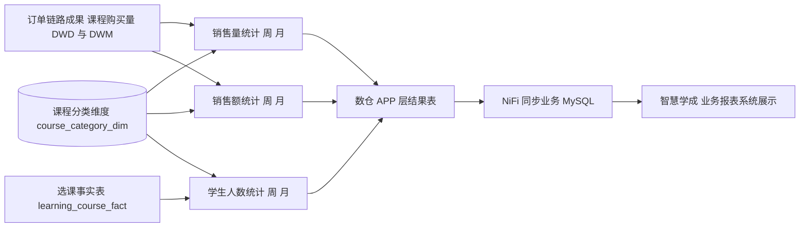

关键路径看三支汇入：三条统计任务线全部指向同一张课程分类维度表，因为它就是「学科」这一级的载体；统计结果先进数仓的 APP 层结果表，再由 NiFi 同步到业务 MySQL，智慧学成的业务报表系统从 MySQL 读数展示。统计本身不产生新数据，只做聚合、关联与搬迁，这个定位决定了后面每一课的代码形态。

### 数据来源盘点：统计为什么不用新采集

**销售量与销售额共用一条来路。** 热门学科排名的数据采集分析一节写得很明确：销售量根据课程购买量聚合计算获取，销售额同样出自课程购买量。课程购买量这条链路早就跑通了全流程，订单数据从业务库采集进 ODS，清洗出事实表，又在 DWM 层按课程维度做了轻度聚合（每门课程的购买量与购买金额，顺带挂上了课程分类维度 id），按天落分区。统计层要做的只是在 DWM 成果上再按时间与学科聚合一层，连清洗都不需要重做。

**学生人数走的是刚铺好的链路。** 学生人数根据学生选课计算获取，数据来自用户选课表，前几课刚把这条链路收尾：NiFi 监控业务库 binlog 实时采集进 ODS，DWD 清洗关联了课程分类、课程、用户、时间四个维度，3958 条明细分日入库。按学科统计学生人数时拿事实表的用户维度做计数（去重）即可。

两条链路的成果在这一章汇合，这正是数仓分层设计兑现收益的时刻：DWD 保明细、DWM 出中间层、APP 层做面向业务的最终聚合，每一层只加工一次，下游全部复用。如果统计层再从业务库拉原始数据自己算一遍，前面所有清洗加工就白做了。

### 课程分类维度：学科名称的唯一来源

三项统计都要按学科分组展示，学科名必须出自维度表。选课事实表里只有 `course_category_dim_id` 这个外键，id 能聚合却不能展示，报表页面上的「Java」「大数据」要靠课程分类维度表的 name 字段解析。这张表的建表语句来自数仓建表脚本：

```sql
CREATE EXTERNAL TABLE
IF NOT EXISTS data_dimen.course_category_dim
(course_category_dim_id String,
name String,
label String,
parentid String,
isshow String,
orderby String,
isleaf String)
ROW FORMAT DELIMITED FIELDS TERMINATED BY '\t'
STORED AS TEXTFILE
location'/user/hive/external/data_dimen/course_category_dim';
```

七列里统计最关心的是前两个：`course_category_dim_id` 是聚合分组键，`name` 是展示名。`parentid` 维护分类层级，课程大分类（一级分类）就是热门学科排名的「学科」级。这张表在维度采集阶段没有采过（当时采的是课程维度、用户维度、区域维度），所以要补。

### NiFi 补采落地

模板由讲义资料提供，上传到 NiFi 的维度处理器组（统计分析的其他处理器组都已建好，维度采集归维度组管）。导入后链路是三个处理器：`QueryDatabaseTable` 从在线教育平台业务库的课程表查询分类数据，`ConvertAvroToJSON` 把查询结果的 Avro 格式转成 JSON，`PutHiveQL` 执行写入落到 Hive 的维度表。配置只两项：

**Hive 连接池。** 之前维度采集已经配好并启用，这次直接启用即可，不用重配。

**MySQL 连接池。** 必须补上数据库口令，课程环境是 root/123456。口令缺失时处理器状态再正常，采集一启动就会报连接失败，这是本次补采最容易漏的一步。

两个连接服务都启用后启动处理器组，数据沿链路走完，Hue 里刷 `data_dimen.course_category_dim` 验证。这次验证又遇到熟悉的场面：分类名的中文全是问号。

### 乱码复发：同一个坑的第二次治疗

症状与课程维度采集时一模一样：MySQL 源表中文正常，Hive 落地表全是问号。成因也相同，NiFi 容器随 Docker 引擎开机自启，启动瞬间多个容器抢资源，编码信息没加载全。修法也是同一个：登录 NiFi 容器重启进程，等编码完整加载后重新采集：

```bash
# 登录 nifi 容器
docker exec -it xc-online-nifi bash
# 重启 nifi：先停再启
$NIFI_HOME/bin/nifi.sh restart
# 观察启动日志，出现端口监听信息即就绪
tail -f $NIFI_HOME/logs/nifi-app.log
```

重启命令返回不等于就绪，日志里出现端口监听才算启动完成，这一步在第一次踩坑时已经强调过。就绪后回到 NiFi 页面重新启动采集，这里有个让人安心的细节：维度模板的写入是覆盖方式，重新采集把目标表旧数据整表覆盖，原先那批问号数据不会残留也不会重复。Hue 里再刷，分类名中文完整显示，课程分类维度补采完成，统计分析的料全部备齐。

## 第2部分：热门学科排名-统计分析-销售量-周-统计分析步骤

六个统计任务里第一个要落地的是销售量按周统计。这一课只拆步骤不写代码，两件事要讲透：统计基于的数据来源是什么、统计的步骤按什么顺序排。这两件事定了，后面的代码就是把步骤翻译成 Spark 任务；结果表的数据结构也在这课给出，它是所有步骤共同服务的终点，先看清终点，过程才有判断标准。

### 为什么站在 DWM 上统计

DWM 层的产出早已就位：事实表按课程维度 id 做了轻度聚合，得到每门课程每天的销售量（`salesvolume`）与销售额（`sales`），并顺带关联出了课程分类维度 id（`course_category_dim_id`）。这几个字段组合起来，恰好覆盖了学科销售量统计的全部前置需求。

统计要回答的问题是「某个学科在某一周卖了多少、比上周涨了多少」。DWM 数据已经把粒度聚合到了课程与天，按周统计时只需再做两步加工：把同一学科（课程大分类）下的课程合并，把一周的日期范围求和。这两步都是轻量聚合，直接对 DWM 表按时间区间过滤再 group by 就能完成，不需要回退到 DWD 事实表重算，更不需要碰业务库的原始订单。

这就是数仓分层的复用逻辑在发力：DWD 保留最细的明细，DWM 把公共口径（按课程聚合的量与额）提前算好，APP 层的每个统计任务都从最近似最终答案的中间层出发，加工链路越短，口径越统一、出错面越小。销售量按月统计、销售额统计、学生人数统计都会沿用同一思路，DWM 的投入被六个统计任务分摊。

### 七个步骤：区间先行，涨幅居中

统计全程围绕两个时间区间展开，流程如下：

这张图在讲销售量周统计的完整步骤链，前四步都在备数据，后三步才算与存：

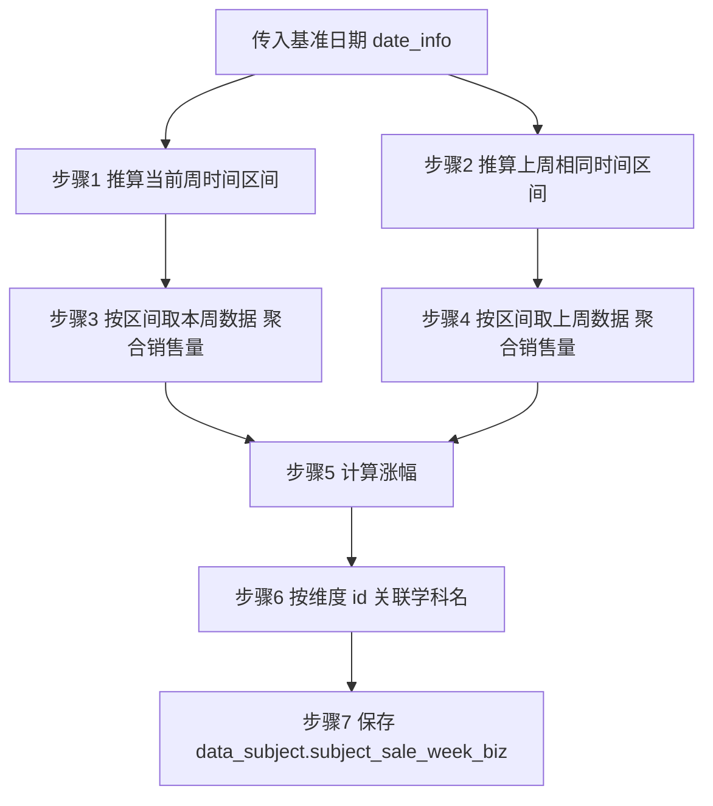

**步骤 1 与步骤 2，先定两个区间。** 输入是一个基准日期，推算出它所在周的时间区间，课程示例口径是周一至周五；上周的相同位置再取一份，上周一对上周五。两个区间必须逐日对齐：本周取到周二就取上周的周一到周二，区间长度与起止位置一致，聚合出来的销售量才有可比性，涨幅的计算才成立。

**步骤 3 与步骤 4，按区间取数聚合。** 对 DWM 表按分区过滤出区间内的行，按课程分类维度 id 分组求和，本周区间聚出本周各学科的销售量，上周区间聚出上周的对照值。一天数据在 DWM 里已经按课程聚合过，这里是第二层聚合，粒度从课程升到学科、范围从天扩到区间。

**步骤 5，计算涨幅。** 本周值与上周值都在手上，增幅按两者对比算出。口径的细节下面单独展开。

**步骤 6 与步骤 7，关联与落地。** 涨幅算完只是拿到了学科 id 加度量值，报表要展示学科名，按课程分类维度 id 关联维度表把 name 拼进来；最后连同分区字段写入结果表，统计完成。这两步做的事都是为最终保存的数据结构服务。

### 涨幅口径：别让命名骗了实现

讲义在指标分析时给的定义是「增幅采用同比方式计算，同比即同期相比」。课程口播在步骤讲解里说的也是同比，但紧接着的实现动作是获取上周对应时间与上周数据。把这两处放在一起读，结论就清楚了：这套统计里涨幅的分子分母是本周与上周，比较对象是时间上紧邻的上一周期，严格的统计学命名应该叫环比；同比的规范定义是与去年同一时期相比。讲义里「同比」取的是「同期相比」的宽泛含义，口播沿用了这个说法。

对读者真正要紧的不是纠正课程用词，而是认准分子分母：本课涨幅按 `(本周销售量 - 上周销售量) / 上周销售量` 计算（通用写法示例，真实实现见讲义后续代码课），结果是小数形式的浮点值，样例数据里的 `0.44` 表示比上周增长 44%。结果表字段名 `sale_percent` 延续了这个小数口径，前端拿到后自行转百分比展示。面试或评审里聊到涨幅，先问清比较对象是谁、除数是谁、值域是小数还是百分数，这三问比术语本身更能防止口径事故。

### 结果结构：六个字段与两级分区

所有步骤都为这张结果表服务，建表语句与对应实体如下：

```sql
CREATE EXTERNAL TABLE
IF NOT EXISTS data_subject.subject_sale_week_biz
(course_category_dim_id String,
course_category_name String,
sale_num INT,
sale_percent FLOAT)
PARTITIONED BY (years String, week_of_year String)
ROW FORMAT DELIMITED FIELDS TERMINATED BY '\t'
STORED AS PARQUET
location'/user/hive/external/data_subject/subject_sale_week_biz';
```

```scala
package com.study.xc.entity

/**
  * 热门学科 - 销量 - 周
  *
  * @param course_category_dim_id 学科 id
  * @param course_category_name   学科名
  * @param sale_num               销售量
  * @param sale_percent           涨幅
  * @param years                  分区年
  * @param week_of_year           分区年中的周
  */
case class SubjectSaleWeekBiz(course_category_dim_id: String,
                              course_category_name: String,
                              sale_num: Int,
                              sale_percent: Float,
                              years: String,
                              week_of_year: String)
```

主列四项，全是周统计的直接产物：学科 id 与学科名来自维度关联，销售量来自本周区间聚合，涨幅来自两期对比。分区两级，`years` 是年份，`week_of_year` 是这一年中的第几周，比如第 40 周、第 50 周。前端的查询参数形如 `datePickerSel=2019-39&type=week`，即指定 2019 年第 39 周；两级分区与查询形态严丝合缝，查询某个周的数据时分区裁剪直接定位到对应目录，扫描量与数据总量无关。

把分区键设计成「年加周」还有一层隐性收益：周这个粒度本身跨年（一年的最后一周与下一年的第一周可能属于同一个 ISO 周），只按周分区不挂年份，不同年份的第 1 周会混在同一个分区里；年份做第一级分区，周归属的边界就唯一了。结果表放在 `data_subject` 库而不是 `data_course`，这也是分层命名语义：这张表按学科主题组织，服务的是热门学科排名这一组指标，与按课程组织的明细库分属不同的主题域。

## 第3部分：热门学科排名-统计分析-销售量-周-代码-获取周区间日期

销售量周统计的步骤已经理清，从这一课起进入代码阶段。统计分析类 `SubjectSalesVolumeByWeekBiz` 在清洗工程里已经建好，`main` 方法里挂好了步骤注释，要填的第一步是拿到两个日期区间：当前周的区间，上周的区间。这步听着像日期加减，动手时会撞上一个反直觉的现象：给工具类传 2019-11-11，返回的却是上周和上上周的区间，指定的日期本身根本没有出现。

### 口径先定：离线分析里的「本周」

周统计的「本周」能直接取日历上的本周吗。离线跑批每天执行一次，处理的是前一天落库的数据。周一凌晨跑批时，昨天是周日，也就是上一个完整周的最后一天；此时若把「本周」理解成日历上的本周，那一周才刚开了几个小时，一天的数据都没攒齐，统计出来没有业务意义。区间的锚点因此要往前挪一天：以分析日的前一天所在的那一周作为「本周」，再往前一周作为「上周」。

这条口径带出一个必懂的特例。分析日是周一，前一天周日落在上一个周里，所谓「本周」实际返回的是上周区间，「上周」实际返回上上周区间；分析日是周二到周日，前一天就在本周之内，返回的就是字面意义的本周与上周。指定日期落在周几，返回结果整体相差一周，而代码里没有任何 if 分支去区分两种情况，差异完全由「取前一天再定位周一」这一个动作自然形成。

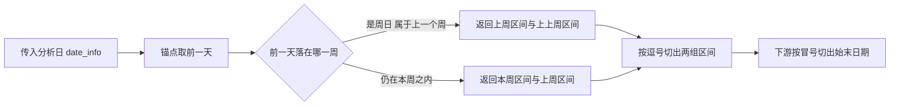

这张图讲的是周区间口径的判定路径。关键分岔在锚点的落点：周日落到上一周、其余日子留在本周，两条路最后都汇到同一份字符串区间上，交给下游统一处理。

### 工具类与调用代码

日期区间不在主类里现算，工程里备好了日期工具类 `DateUtils`，周区间的方法是 `getWeekRelativelyInterval`。主类的第一步这样写：

```scala
package com.study.xc.analysis.subject.salesvolume

import com.study.xc.common.EtlEnvironment
import com.study.xc.utils.DateUtils.getWeekRelativelyInterval
import org.apache.spark.sql.SparkSession

object SubjectSalesVolumeByWeekBiz {
  // 获取 spark session
  val spark: SparkSession = EtlEnvironment.getSparkSession(this.getClass.getSimpleName)

  def main(args: Array[String]): Unit = {
    // 1. 获取当前周日期区间与上周日期区间
    val date_info = "2019-11-11"
    val weeks = getWeekRelativelyInterval(date_info).split(",")
    // 2. 拆出当前周区间与上周区间
    val current = weeks(0)
    val last = weeks(1)
    println(current)
    println(last)
    spark.close()
  }
}
```

**方法只吃一个参数，还回一整个字符串。** 传进分析日，返回「本周区间，上周区间」拼在一起的字符串，两组区间内部各自用冒号连着始末日期。主类里按逗号 `split` 一次，`weeks(0)` 是当前周区间，`weeks(1)` 是上周区间，原计划的两个步骤在一个调用里完成。变量名用 `current` 与 `last` 对应两组区间，测试期先 `println` 出来，保险起见肉眼核对一遍再往下走。

**返回值保持「起始：结束」的整段形态，不急着拆成日期对象。** 始末日期什么时候用什么时候拆，取数按天查、聚合按区间查，都建立在这份字符串上。区间生成与区间消费被这个格式天然解耦，工具类不必关心调用方要拿区间做什么。

### 方法体补全：按周一到周日切周

讲义给出了方法签名、入参与返回口径，工程源码未随资料包归档，方法体按这个口径补全成可运行的示例：

```scala
import java.time.LocalDate
import java.time.format.DateTimeFormatter

/**
  * 获取相对周区间：锚点取指定日期的前一天
  * 返回形如 本周起始:本周结束,上周起始:上周结束 的字符串
  */
def getWeekRelativelyInterval(dateStr: String): String = {
  val fmt = DateTimeFormatter.ofPattern("yyyy-MM-dd")
  val date = LocalDate.parse(dateStr, fmt)
  // 锚点：离线分析处理的是昨天的数据
  val anchor = date.minusDays(1)
  // 锚点所在周的周一，周一到周日为完整一周
  val monday = anchor.minusDays(anchor.getDayOfWeek.getValue - 1)
  val sunday = monday.plusDays(6)
  val lastMonday = monday.minusWeeks(1)
  val lastSunday = lastMonday.plusDays(6)
  s"$monday:$sunday,$lastMonday:$lastSunday"
}
```

核心动作只有两步：把锚点定位到所在周的周一，再平移一周得到上周。`getDayOfWeek.getValue` 周一返回 1、周日返回 7，减 1 就是回退到周一的天数；锚点是周日时减 6，自然落到上一个周的周一，周一特例不需要任何额外判断。用 2019-11-11 验证：锚点是 11-10 的周日，所在周的周一是 11-04，输出 `2019-11-04:2019-11-10,2019-10-28:2019-11-03`，与控制台打印一致；11-11 本身不出现在结果里，恰好说明它是周一，口径走的是上周加上上上周那条路。

### 测试日期与生产参数

测试期把日期写死成变量，改日期只动一处。生产环境这个日期来自 spark-submit 的任务参数，主类里留一行注释占位：

```scala
// 生产环境从任务参数取分析日
// val date_info = args(0)
val date_info = "2019-11-11"
```

测试代码与生产代码的差距被压缩到一个变量上，接入调度时把注释换回来即可。跑批侧传哪天，统计就算哪天的相对周，日期口径在两侧天然对齐，这也是后面所有周统计任务共用的入口约定。

## 第4部分：热门学科排名-统计分析-销售量-周-代码-根据日期获取数据并计算涨幅

区间到手，下一步按区间取数。取数时有两个坑等着：一是 DWM 中间表已经做过轻度聚合，聚合函数选错数值就全错；二是上周没数据的学科，涨幅一除就出 null，不处理会一路污染到实体映射。这一课把取数与涨幅计算一次写齐，SQL 先在 Hue 里验证，再搬进 Spark SQL 换成动态区间。

### 先在 Hue 里把 SQL 写对

老规矩，SQL 先在 Hue 里跑通再进代码，Hue 有提示、出结果快，报错也好排查。周统计读的是课程购买量章节清洗出的 DWM 中间表，整条 SQL 长这样：

```sql
select
a.course_category_dim_id,
a.sale_num,
IFNULL((a.sale_num - b.sale_num) / b.sale_num, 1.0) sale_percent
from
(select course_category_dim_id, sum(salesvolume) sale_num
 from data_course.course_buy_dwm
 where concat_ws('-', years, months, days) between '2019-11-04' and '2019-11-10'
 group by course_category_dim_id) as a
left join
(select course_category_dim_id, sum(salesvolume) sale_num
 from data_course.course_buy_dwm
 where concat_ws('-', years, months, days) between '2019-10-28' and '2019-11-03'
 group by course_category_dim_id) as b
on a.course_category_dim_id = b.course_category_dim_id
```

执行后返回 14 行，14 个学科分类各一行，本周销量与相对涨幅一次算齐。测试期先只写本周版，确认结果正常后只改日期再跑上周版，两周版都对了再拼成带 join 的完整形态，改一处验证一处，错了知道错在哪一步。

### 聚合粒度：为什么是 sum 不是 count

DWM 层做过轻度聚合，每行已经是某个课程在某一天的销量，`salesvolume` 字段就是量值本身。周统计要的是学科维度的周销量，把区间内所有课程的销量加起来，所以聚合函数是 `sum`；顺手写 `count` 的话，数出来的是行数，也就是有销量的课程与日期的组合数，数值完全不是一回事。聚合键用 `course_category_dim_id`，学科分类 id 在 DWM 表里已经带着，不需要再绕道课程表，轻度聚合的收益在这里兑现。

分区过滤也是这条 SQL 的一个关键动作。表按 years、months、days 三个分区列存储，没有现成的日期列，`concat_ws('-', years, months, days)` 把三列拼成 `yyyy-MM-dd` 形态的字符串，正好与区间里的日期同格式，`between` 的等值比较才能成立。分隔符必须是横杠，拼出来与 `'2019-11-04'` 一个模样，差一个字符整条过滤就落空。

### 两周对齐：子查询与 left join

涨幅是相对量，本周要跟上周比。两个子查询结构完全一样，扫同一张表，只有 `between` 的区间不同，`as a` 是本周，`as b` 是上周。join 键选学科分类 id，它是两周数据之间唯一可靠的公共键。方向用 `left join`，以本周为主表：本周有销量的学科，哪怕上周一行数据都没有，也要留在结果里参与排名，这条选择直接引出了后面的除零保护。

**列别名要起全。** `sale_num` 在两个子查询里都有，输出时不指明 `a.sale_num` 就有歧义；涨幅列起别名 `sale_percent`，否则后续环节引用不到这一列。视频里就因为漏了一个逗号连带别名，执行直接报错，排查点就在列清单上。写这种多列 SQL，每加一个输出列就顺手把别名带上，能省掉一轮编译报错。

### 除零保护：IFNULL 把 null 换成 1.0

不管数据从哪天开始，总有一种情况躲不开：上周没有数据。上周缺行的学科，`left join` 右侧全为 null，相减相除一路传染，涨幅落成 null，null 流进后面的实体映射环节就是空指针异常的来源。处理在 SQL 里就地完成：

```sql
IFNULL((a.sale_num - b.sale_num) / b.sale_num, 1.0) sale_percent
```

`IFNULL` 的语义是表达式为 null 时取第二个参数，这里把 null 换成 1.0。业务含义说得通：上周没有销量，本周卖出的每一单都是纯增量，涨幅就是百分之百，1.0 正是 100% 的表达。

验证这个兜底不能拿近期数据，近期每周都有数，兜底分支根本走不到。办法是先在 Hue 里看一眼数仓最早分区落在哪天，把分析日选在最早分区之后没几天、上周区间整体早于最早数据的位置，跑完看涨幅列：清一色 1.0 说明兜底生效，程序健壮性过关。

到这里整条数据流是：

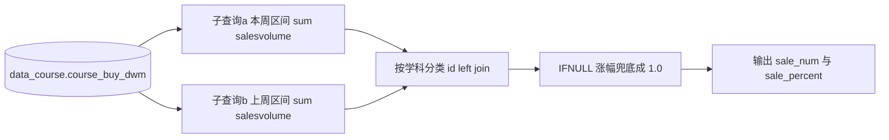

一张 DWM 表被两个子查询各扫一次，聚合到学科分类粒度后在 join 键上对齐，涨幅在 join 结果上现算，null 在同一层被兜住，出手的已经是干净结果。

### 搬进 Spark SQL：区间换成插值

Hue 里验证过的 SQL 搬进主类，写死的日期换成上一课的区间变量。区间字符串当时保留了「起始：结束」的整段形态，这里按冒号切开：

```scala
val weeks = getWeekRelativelyInterval(date_info).split(",")
// 当前周区间，按冒号切出始末日期
val current = weeks(0).split(":")
// 上周区间
val last = weeks(1).split(":")
```

`current(0)` 与 `current(1)` 是本周始末，`last(0)` 与 `last(1)` 是上周始末。SQL 用三引号多行字符串加 `stripMargin`，s 插值把变量送进 `between`：

```scala
spark.sql(
  s"""
     |select
     |a.course_category_dim_id,
     |a.sale_num,
     |IFNULL((a.sale_num - b.sale_num) / b.sale_num, 1.0) sale_percent
     |from
     |(select course_category_dim_id, sum(salesvolume) sale_num
     | from data_course.course_buy_dwm
     | where concat_ws('-', years, months, days) between '${current(0)}' and '${current(1)}'
     | group by course_category_dim_id) as a
     |left join
     |(select course_category_dim_id, sum(salesvolume) sale_num
     | from data_course.course_buy_dwm
     | where concat_ws('-', years, months, days) between '${last(0)}' and '${last(1)}'
     | group by course_category_dim_id) as b
     |on a.course_category_dim_id = b.course_category_dim_id
     |""".stripMargin).show()
```

跑出的结果与 Hue 一致，说明迁移无损。这段取数加涨幅的 SQL 到此成型，它与「周」本身没有绑定关系，吃的只是两个区间，为下一课的维度关联与后续的工具类抽取留好了口子。

## 第5部分：热门学科排名-统计分析-销售量-周-代码-维度关联&保存到数据仓库

涨幅算出来了，14 行结果里只有学科分类 id 和数字，报表要的是学科名，数仓要的是分区。这一课做两件事：把涨幅结果与课程分类维度关联出学科名，再把整批结果按年与年中周写进 APP 层的周统计结果表。中间夹着一个必须拆掉的类型坑：sum 聚出的数值形态和实体声明的类型对不上，`.as[实体]` 会当场翻脸。

### APP 层的数据结构与实体

动手前先把目标表的形状看清楚。周统计结果表建在 `data_subject` 库里，四个业务列加两个分区列：

```sql
CREATE EXTERNAL TABLE
IF NOT EXISTS data_subject.subject_sale_week_biz
(course_category_dim_id String,
 course_category_name String,
 sale_num INT,
 sale_percent FLOAT)
PARTITIONED BY (years String, week_of_year String)
ROW FORMAT DELIMITED FIELDS TERMINATED BY '\t'
STORED AS PARQUET
location '/user/hive/external/data_subject/subject_sale_week_biz';
```

对应的实体六列同名同型，映射时按名字对位：

```scala
package com.study.xc.entity

/**
  * 热门学科排名 销售量 周
  *
  * @param course_category_dim_id 学科 id
  * @param course_category_name   学科名
  * @param sale_num               销售量
  * @param sale_percent           涨幅
  * @param years                  分区年
  * @param week_of_year           分区年中的周
  */
case class SubjectSaleWeekBiz(course_category_dim_id: String,
                              course_category_name: String,
                              sale_num: Int,
                              sale_percent: Float,
                              years: String,
                              week_of_year: String)
```

注意分区列的类型都是 String，这决定了后面生成分区值时要落成字符串字面量，而不是数字。实体声明 `sale_num` 为 Int、`sale_percent` 为 Float，这两个类型声明是后面类型坑的裁判。

### 临时视图承接涨幅结果

上一课的涨幅查询返回一个 DataFrame，主类里接着用 SQL 关联维度，第一步是把它注册成临时视图：

```scala
// 涨幅查询返回的 DataFrame，注册成临时视图
salePercentDF.createOrReplaceTempView("salesvolume_biz_tmp")
```

视图名三段各有含义：`salesvolume` 是指标名，`biz` 标明这是业务统计的中间结果，`tmp` 标明它只是会话内的临时对象，不落库、随 SparkSession 消失。注册成视图的价值在于后面的关联 SQL 可以把涨幅查询当成一张表来引用，字段层级、join 顺序都写得更平，不用把两层查询嵌成一个巨型子查询。视图随用随建，重跑覆盖，不存在状态残留。

### 维度关联与周分区生成

维度关联查的是课程分类维度表，输出列要对着实体逐一对齐：

```scala
// 获取当前周是一年中的第几周，返回年与年中周用横杠连接
val weekOfYear = getWeekNum(current(0)).split("-")
// 关联维度表，得到 APP 层业务数据
val buyDF = spark.sql(
  s"""
     |select
     |a.course_category_dim_id,
     |b.name course_category_name,
     |cast(a.sale_num as int) sale_num,
     |cast(a.sale_percent as float) sale_percent,
     |'${weekOfYear(0)}' years,
     |'${weekOfYear(1)}' week_of_year
     |from salesvolume_biz_tmp a
     |left join data_dimen.course_category_dim b
     |on a.course_category_dim_id = b.course_category_dim_id
     |""".stripMargin)
  .as[SubjectSaleWeekBiz]
```

**输出列逐列对齐实体。** 学科 id 两表都有，取主表 a 的；学科名只有维度表有，`b.name` 起别名 `course_category_name`，正好是 APP 层表与实体的字段名，别名的意义就是在这里把两个世界的叫法接上。join 键仍然是学科分类 id，left join 保住涨幅结果的全部行。

**分区值在主类里算一次，整批共用。** `getWeekNum` 吃当前周第一天的日期，返回年与年中周用横杠连接的字符串，`split("-")` 后 0 号位是年、1 号位是年中周，通过 s 插值以字符串字面量写进 select。取区间第一天代表整周是稳定的：周中任何一天在元旦附近可能算出与整周不同的年中周，而当前周的第一天就是这一周在周年口径下的锚点。同一次跑批里所有行的分区值相同，它们注定落进同一个分区。

**cast 在 SQL 里就地完成。** DWM 表里 `salesvolume` 是字符串列，`sum` 之后 Spark 按浮点计算，show 出来的销量带小数形态；涨幅列同样逃不掉。实体的 `sale_num` 声明为 Int、`sale_percent` 声明为 Float，类型对不上实体映射就报错，所以在 select 里直接 `cast`，cast 完起回原别名，列名不变、类型归位。`.as[SubjectSaleWeekBiz]` 这一步还依赖 `import spark.implicits._`，少了隐式转换导入，编译器在 `as` 处直接标红，把导入补在 `main` 开头报错即消。

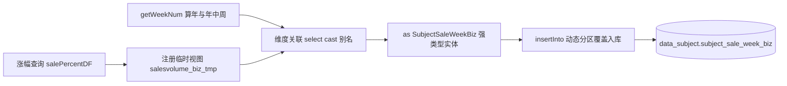

涨幅结果经临时视图进入关联，周分区值旁路注入，六列在 SQL 里一次对齐实体，落库前类型与命名都已归位。

### 写入数据仓库与验证

保存环节是全工程统一的样板，从课程购买量、学习人数的类里原样搬来，改表名与 DataFrame 变量即可：

```scala
// 指定 hive 参数，开启动态分区非严格模式
spark.conf.set("hive.exec.dynamic.partition.mode", "nonstrict")
// 保存到数据仓库
buyDF
  // 小数据量合并成一个文件，分区减少带来的低效可忽略
  .repartition(1)
  .write
  // 相同分区覆盖，重跑幂等
  .mode("overwrite")
  // 指定表名
  .insertInto("data_subject.subject_sale_week_biz")
// 查看结果
spark.sql("select * from data_subject.subject_sale_week_biz").show()
spark.close()
```

**insertInto 按列位置匹配，不是按名字。** 实体里分区列恰好排在最后，前面的业务列依次落进表的前四列，years 与 week_of_year 落到分区字段，列序与表结构严格一致才不会错位。`hive.exec.dynamic.partition.mode` 设成 nonstrict，分区值由数据携带写入；overwrite 覆盖的是本次命中的分区，同一周重跑结果被刷新成最新，不会累积重复行。`repartition(1)` 把结果合并成一个文件再写，讲义注释写得很诚实：分区减少带来低效，数据小时不影响，周统计一天一批、每批十几行，单文件正合适。

运行后看 show 的输出：学科 id、学科名、销量、涨幅、年、年中周六列俱全，学科名挂上了，分区填上了，涨幅结果正式成为 APP 层的一张业务表，报表系统按分区取数展示即可。

## 第6部分：热门学科排名-统计分析-销售量-周-代码-抽取工具类&测试入库

主类里现在堆着完整的取数涨幅 SQL，功能是通的，但月统计一来就得再抄一遍，测试也只能在主类里来回看。这一课做收尾的三件事：把与周期无关的取数涨幅逻辑抽进工具类，把跑批测试跑出两条验证线，最后接上调度脚本让日期从参数里来。销售量周统计整段到这里闭环。

### 复用边界怎么划

抽不抽、抽哪段，判断标准只有一条：换个周期这段逻辑还成立吗。取数加涨幅的 SQL 里没有任何周专属的东西，表名、聚合键、涨幅公式、区间占位符全部由参数喂进来；真正与周有关的只有区间怎么算，而那已经在日期工具类里了。所以抽的是「按区间取数并算涨幅」，不是「按周取数」，月统计只要把月区间算出来传进来，方法原样可用。

维度关联没有跟着抽。各指标的维度字段、实体、分区结构都不同，硬抽出去参数列表会膨胀到没法看，复用的收益抵不过耦合的成本。工具类里已经有学生人数统计的同类方法，销售量的方法照着放进去，命名 `subjectBuyCountSql`，一个指标一个方法，横向对齐。

### 工具类方法落地

```scala
package com.study.xc.utils

import org.apache.spark.sql.SparkSession

object SubjectUtils {

  /**
    * 在线购买量按日期区间统计及涨幅
    *
    * @param spark   spark
    * @param current 当前日期区间
    * @param last    要对比的日期区间
    * @return 涨幅统计 DataFrame
    */
  def subjectBuyCountSql(spark: SparkSession, current: Array[String], last: Array[String]) = {
    spark.sql(
      s"""
         |select
         |a.course_category_dim_id,
         |a.sale_num,
         |IFNULL((a.sale_num - b.sale_num) / b.sale_num, 1.0) sale_percent
         |from
         |(select course_category_dim_id, sum(salesvolume) sale_num
         | from data_course.course_buy_dwm
         | where concat_ws('-', years, months, days) between '${current(0)}' and '${current(1)}'
         | group by course_category_dim_id) as a
         |left join
         |(select course_category_dim_id, sum(salesvolume) sale_num
         | from data_course.course_buy_dwm
         | where concat_ws('-', years, months, days) between '${last(0)}' and '${last(1)}'
         | group by course_category_dim_id) as b
         |on a.course_category_dim_id = b.course_category_dim_id
         |""".stripMargin)
  }
}
```

**返回类型没有写，这不是偷懒。** 方法体最后一个表达式是 `spark.sql(...)`，它返回什么类型方法就是什么类型，DataFrame 原样交还调用方。显式标成 `Unit` 反而把返回值吞掉，主类什么都拿不到；显式标 `DataFrame` 也行，但让编译器推断能少一处类型声明的维护。SQL 体里的日期全部来自参数，表名与聚合键是这段业务逻辑的本体，留在方法里是对的。

主类瘦身后的完整形态：

```scala
package com.study.xc.analysis.subject.salesvolume

import com.study.xc.common.EtlEnvironment
import com.study.xc.entity.SubjectSaleWeekBiz
import com.study.xc.utils.DateUtils.{getWeekNum, getWeekRelativelyInterval}
import com.study.xc.utils.SubjectUtils.subjectBuyCountSql
import org.apache.spark.sql.SparkSession

object SubjectSalesVolumeByWeekBiz {
  // 初始化参数
  val spark: SparkSession = EtlEnvironment.getSparkSession(this.getClass.getSimpleName)

  def main(args: Array[String]): Unit = {
    import spark.implicits._
    //    val date_info = args(0)
    val date_info = "2019-11-11"
    val weeks = getWeekRelativelyInterval(date_info).split(",")
    // 当前周区间，按冒号切出始末日期
    val current = weeks(0).split(":")
    // 获取当前周是一年中的第几周
    val weekOfYear = getWeekNum(current(0)).split("-")
    // 上周区间
    val last = weeks(1).split(":")
    // 计算涨幅得到临时表，然后与维度表关联，得到需要的业务表
    subjectBuyCountSql(spark, current, last)
      .createOrReplaceTempView("salesvolume_biz_tmp")
    // 关联维度表
    val buyDF = spark.sql(
      s"""
         |select
         |a.course_category_dim_id,
         |b.name course_category_name,
         |cast(a.sale_num as int) sale_num,
         |cast(a.sale_percent as float) sale_percent,
         |'${weekOfYear(0)}' years,
         |'${weekOfYear(1)}' week_of_year
         |from salesvolume_biz_tmp a
         |left join data_dimen.course_category_dim b
         |on a.course_category_dim_id = b.course_category_dim_id
         |""".stripMargin)
      .as[SubjectSaleWeekBiz]
    // 指定 hive 参数，保存到表
    spark.conf.set("hive.exec.dynamic.partition.mode", "nonstrict")
    // 保存到数据仓库
    buyDF
      // 输出一个文件，由于分区减少效率低，数据小时不影响
      .repartition(1)
      .write
      // 相同分区覆盖
      .mode("overwrite")
      // 指定表名
      .insertInto("data_subject.subject_sale_week_biz")
    // 查看结果
    spark.sql("select * from data_subject.subject_sale_week_biz").show()
    // 关闭资源
    spark.close()
  }
}
```

抽完之后的结构一眼见底：主类只留流程编排，日期与周数计算、工具调用、维度关联、入库各占一小段，SQL 细节全部沉到工具类。调用工具方法只需一行，参数是 `spark`、当前周区间、上周区间，返回值直接链上 `createOrReplaceTempView`，与抽取前的行为完全一致。

### 跑批测试：两条验证线

测试要看两处，只看一处不算通过。第一处是计算线：IDE 里直接运行，控制台 show 出结果，学科销量与涨幅对得上，说明取数、聚合、涨幅计算都正常。第二处是落库线：切到 Hue 打开数据仓库的 `data_subject.subject_sale_week_biz`，跑批之前分区里没有数据，说明程序还没写完；程序跑完刷新，Hue 里按分区查到了数据，说明写入链路也通了。计算对、落库通，两条线都绿，周统计才算闭环，这也是所有统计任务的固定验收姿势。

结果表的形态还要交代一句。周统计是按日期区间聚合的，区间是参数给定的，表里天然没有「全部历史汇总」的行；如果去掉区间去统计所有数据，周这个维度就消失了，与需求不符。所以展示端传的日期是哪天，拿到的就是哪一周的销量与涨幅，按周翻页浏览由展示端循环传参实现，数据层不做全量大宽表。


整条链路从调度传入的日期出发，区间、涨幅、维度、入库依次推进，两条验证线守在出口。后续学生人数、销售额的周统计与各自的月统计，都沿这条流水线复用同一套工具方法，差异只在各自的维度关联与结果表。

### 接上调度：日期从参数来

生产形态在散落资料的调度脚本里已经备好，脚本吃第一个参数作为分析日：

```bash
#!/usr/bin/env bash
if [[ $1 != "" ]];then
  TD_DATE=$1
else
  echo "[===no params input, expect date like 2019-11-11===]"
  exit 1
fi
SPARK_SUBMIT=/opt/spark/bin/spark-submit

$SPARK_SUBMIT \
  --master spark://spark-master:7077 \
  --class com.study.xc.analysis.subject.salesvolume.SubjectSalesVolumeByWeekBiz \
  /opt/run/jars/xc-service-offline-jar-with-dependencies.jar ${TD_DATE}
```

脚本没有参数时直接报错退出，防止空参误跑；有参数就交给 spark-submit，入口类是本课的主类，日期通过任务参数传进去。主类里把写死的 `date_info` 换回注释里的 `args(0)`，测试与生产的最后一层皮就揭掉了。跑批侧传哪天、统计算哪天的相对周，加上同分区覆盖的幂等写入，按天调度、失败重跑都站稳了。至此热门学科排名销售量周统计整段收口。

## 第7部分：热门学科排名-统计分析-销售量-月-统计分析步骤及代码编写

周统计刚收口，月统计的需求就接上了。看着主类里那套已经跑通的流程，最真实的疑问是：统计分析步骤一模一样、代码重合度极高，是该再抽象一层，还是复制一份改名字？这一课给出的答案是后者，并且把「改哪些地方」压缩成一张五项清单。照着清单替换，月统计的代码就能和周统计一样可信。

### 从周到月，真正变的只有日期

把月统计的七步摆出来和周统计对一遍：取当月区间、取上月同区间、取本月数据、取上月数据、算涨幅、关联维度、保存结果。每一步都能在周统计里找到原样对应，基础数据依然是课程购买量章节清洗好的 DWM 层 `course_buy_dwm`，涨幅依然按同比计算，连 APP 层结果表的列都完全相同。差别只在最后一个分区字段：按周统计时是「年中的周」，按月统计时换成「年中的月」。

日期处理的具体差异值得单独说透。周统计的区间是完整的自然周，而月统计的口径按讲义的定义是：当月区间取「1 号至分析日」，上月区间取「上月 1 号至上月同一天」。以分析日 2019-11-11 为例，当月区间就是 11-01 至 11-11，对比区间是 10-01 至 10-11。这是「月累计至今」的同比：月初每过一天，两条窗口各长一天，任何时刻拿到的涨幅都是等长窗口的公平对比。如果拿整个上月自然月来比月至今，窗口一长一短，涨幅必然失真。

理解了这一点，「月」这个维度里所有与周期无关的代码都原封不动：工具方法 `subjectBuyCountSql` 吃两个日期区间算涨幅，区间从哪来它不关心；真正与周期绑定的区间计算，已经在日期工具类里各有一个现成方法。改造量因此被压到主类这一层。

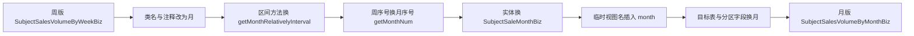

这条链就是全部改造路径：六个箭头五类替换，任何一步都没有触碰计算逻辑本身。

### 复制改名清单：五处替换

**为什么不继续抽象。** 周与月之间真正可复用的共性，上一课已经沉进 `DateUtils` 与 `SubjectUtils` 了；主类层面剩下的差异，是类名、实体、表名这类每个统计任务天然不同的东西。硬要把这些也参数化，得到的会是一个接受十几个泛型参数的骨架类，读代码的人要在两层间接里来回跳。改动点有限、重合度极高时，复制改名反而是维护成本最低的方案，代价只是月统计多一份结构相同的代码，而换来的是每一份都能独立读懂。

五处替换清单如下。
1. 类名与注释：`SubjectSalesVolumeByWeekBiz` 改为 `SubjectSalesVolumeByMonthBiz`，类文档从「每周」改「每月」。
2. 区间方法：`getWeekRelativelyInterval` 换 `getMonthRelativelyInterval`，变量名 `weeks` 同步改成 `months`，避免后面读代码时被残留的周字面误导。
3. 周序号换月序号：`getWeekNum` 换 `getMonthNum`，变量 `weekOfYear` 改 `monthOfYear`。`getMonthNum` 收一个日期，返回「年-月」形式的字符串，按横杠切开后就是分区年与分区月。
4. 实体与临时视图：`SubjectSaleWeekBiz` 换 `SubjectSaleMonthBiz`，临时视图名在原名基础上插入 month。
5. 目标表与分区：`subject_sale_week_biz` 换 `subject_sale_month_biz`，分区字段 `week_of_year` 换 `month_of_year`。

结果表的建表语句与实体在讲义里都有原始出处，`month_of_year` 是与周版唯一的结构差异：

```sql
CREATE EXTERNAL TABLE
IF NOT EXISTS data_subject.subject_sale_month_biz
(course_category_dim_id String,
course_category_name String,
sale_num INT,
sale_percent FLOAT)
PARTITIONED BY (years String, month_of_year String)
ROW FORMAT DELIMITED FIELDS TERMINATED BY '\t'
STORED AS PARQUET
location'/user/hive/external/data_subject/subject_sale_month_biz';
```

```scala
/**
  * 热门学课 - 销量 - 月
  *
  * @param course_category_dim_id 学科 id
  * @param course_category_name   学科名
  * @param sale_num               销售量
  * @param sale_percent           涨幅
  * @param years                  分区年
  * @param month_of_year          分区年中的月
  */
case class SubjectSaleMonthBiz(course_category_dim_id: String,
                               course_category_name: String,
                               sale_num: Int,
                               sale_percent: Float,
                               years: String,
                               month_of_year: String)
```

### 月版主类逐段核对

五处替换全部落地后，主类的完整形态如下。日期仍写死为 2019-11-11 方便测试，接入调度时换回 `args(0)` 即可：

```scala
package com.study.xc.analysis.subject.salesvolume

import com.study.xc.common.EtlEnvironment
import com.study.xc.entity.SubjectSaleMonthBiz
import com.study.xc.utils.DateUtils.{getMonthNum, getMonthRelativelyInterval}
import com.study.xc.utils.SubjectUtils.subjectBuyCountSql
import org.apache.spark.sql.SparkSession

object SubjectSalesVolumeByMonthBiz {
  // 初始化参数
  val spark: SparkSession = EtlEnvironment.getSparkSession(this.getClass.getSimpleName)

  def main(args: Array[String]): Unit = {
    import spark.implicits._
    //    val date_info = args(0)
    val date_info = "2019-11-11"
    val monthRelativelyInterval = getMonthRelativelyInterval(date_info).split(",")
    // 当月区间，按冒号切出始末日期
    val current = monthRelativelyInterval(0).split(":")
    // 获取当前月是一年中的第几月
    val monthOfYear = getMonthNum(current(0)).split("-")
    // 上月区间
    val last = monthRelativelyInterval(1).split(":")
    // 计算涨幅得到临时表，然后与维度表关联，得到需要的业务表
    subjectBuyCountSql(spark, current, last)
      .createOrReplaceTempView("salesvolume_biz_month_tmp")
    // 关联维度表
    val buyDF = spark.sql(
      s"""
         |select
         |a.course_category_dim_id,
         |b.name course_category_name,
         |cast(a.sale_num as int) sale_num,
         |cast(a.sale_percent as float) sale_percent,
         |'${monthOfYear(0)}' years,
         |'${monthOfYear(1)}' month_of_year
         |from salesvolume_biz_month_tmp a
         |left join data_dimen.course_category_dim b
         |on a.course_category_dim_id = b.course_category_dim_id
         |""".stripMargin)
      .as[SubjectSaleMonthBiz]
    // 指定 hive 参数，保存到表
    spark.conf.set("hive.exec.dynamic.partition.mode", "nonstrict")
    // 保存到数据仓库
    buyDF
      // 输出一个文件，由于分区减少效率低，数据小时不影响
      .repartition(1)
      .write
      // 相同分区覆盖
      .mode("overwrite")
      // 指定表名
      .insertInto("data_subject.subject_sale_month_biz")
    // 查看结果
    spark.sql("select * from data_subject.subject_sale_month_biz").show()
    // 关闭资源
    spark.close()
  }
}
```

改完不等于改对。复制改造最大的风险是漏改：某一行还留着周版的变量或表名，程序照样能跑，产出的却是错数据。所以收尾动作是自上而下把整份代码再读一遍，按数据流逐段核对：日期进、区间出，区间进、临时表出，临时表进、维度关联出，最后落到表名与分区字段。目标表名写错，数据会写进一张不存在的表；分区字段没换，`insertInto` 按位置匹配时会把周数塞进月份分区，查询结果整片错乱。表名与分区这两处核对，比任何其他一步都更值得多看一眼。

### 临时视图撞名的坑

临时视图名从 `salesvolume_biz_tmp` 改成 `salesvolume_biz_month_tmp`，看似只是习惯，实际是防呆。`createOrReplaceTempView` 的语义就是同名替换：SparkSession 里已经注册了同名视图，新视图直接顶掉旧的，不报任何错。单个任务独占进程时没事，可一旦调度层把周、月两个统计任务串进同一个进程复用 session，后注册的视图会把先注册的覆盖，先跑的那个任务后续查询读到的就是别人的数据，错误安静得连日志都不留。视图名带上统计周期，是最便宜的隔离手段。

## 第8部分：热门学科排名-统计分析-销售量-月-测试入库

月统计代码写完，直接运行 `main` 就能跑批，但测试阶段最容易产生的误判恰恰在这里：控制台里 10 月、11 月的数据混在一起打印，Hue 里刷新半天没动静，十月的数据涨幅清一色 100%。这些现象如果不知道背后的机制，很容易把正常当成异常。这一课把月统计完整跑两轮，边跑边把三类差异点逐一拆开。

### 第一轮跑批：双线确认十一月

测试入口就是主类的 `main` 方法，点击运行后进入 Spark 计算过程，日志滚动期间需要等待。按已经立好的验收习惯，切到 Hue 把 `data_subject.subject_sale_month_biz` 打开，此时表里没有数据，原因是程序还没跑完，写入尚未发生。等控制台 show 出结果，说明计算与写入都已结束，再回到 Hue 刷新：第一次刷新可能仍然读不到，Hue 读数仓数据存在短暂延迟，再刷新一次，2019-11 分区就出现了，一批学科的销售量与涨幅依次排列。

抽查一条样本核对口径：产品经理销售量 283，涨幅约 0.072，也就是环比增长 7.2%；游戏开发 84 对应涨幅 0.2。涨幅都小于 1 且数值合理，说明取数、聚合、涨幅计算这条链在月维度上同样成立。

```sql
-- Hue 里的核对姿势：按分区过滤，只看目标月份，避免全表顺序干扰
select *
from data_subject.subject_sale_month_biz
where years = '2019' and month_of_year = '11';
```

这句按分区过滤的核对语句是按本课写法补全的示例：`years` 与 `month_of_year` 都是分区列，过滤条件直接裁剪分区，Hue 里只返回目标月的数据，比肉眼在全表里翻行可靠得多。

### 第二轮跑批：补十月，看三个差异点

报表系统展示时只有一个 11 月，数据量偏少，翻页没内容。测试的第二个动作是把分析日从 2019-11-11 改成 2019-10-10，再跑一轮，让 10 月的分区也落进表里：

```scala
def main(args: Array[String]): Unit = {
  import spark.implicits._
  //    val date_info = args(0)
  // 第一轮用 2019-11-11 落了 11 月分区，本轮改为 2019-10-10 补 10 月分区
  val date_info = "2019-10-10"
  val monthRelativelyInterval = getMonthRelativelyInterval(date_info).split(",")
  // 当月区间 10-01 至 10-10，上月区间 09-01 至 09-10
  val current = monthRelativelyInterval(0).split(":")
  // 获取当前月是一年中的第几月
  val monthOfYear = getMonthNum(current(0)).split("-")
  // 上月区间
  val last = monthRelativelyInterval(1).split(":")
  // 计算涨幅得到临时表，然后与维度表关联，得到需要的业务表
  subjectBuyCountSql(spark, current, last)
    .createOrReplaceTempView("salesvolume_biz_month_tmp")
  // 查看结果
  spark.sql("select * from data_subject.subject_sale_month_biz").show()
}
```

这一轮跑批过程中，三个容易误判的差异点依次出现。

**差异一：控制台先打出的是 11 月，不是本月 10 月。** `show` 的语句是 `select * from` 全表，没有按月份过滤，输出顺序就是表的存储顺序：先落库的 11 月记录排前面，新写的 10 月排后面。所以 10 月这轮跑完，控制台开头一段仍是 11 月，往后翻才是 10 月，顺序不等于错误。顺带解释一个细节：`show` 默认只显示 20 行，11 月的记录占了前一大截，10 月只露出尾部几条，看起来像数据不齐，其实全量都在表里。

**差异二：Hue 与控制台的排序方向相反。** Hue 里按分区日期从小到大排，10 月在前 11 月在后；控制台按存储顺序，11 月在前。两边读出的顺序不同，逐条对数值却完全一致。核对数据以值为准，不要被展示顺序带偏。

**差异三：10 月的涨幅全部是 1.0。** 10 月的对比窗口是 9 月 1 日至 9 月 10 日，数仓里 9 月没有数据，上月销量为空，`IFNULL` 兜底把涨幅置为 1.0，即 100% 增幅。这正是工具方法里 `IFNULL(..., 1.0)` 的设计意图：历史窗口无数据时，把「无对比基准」表达成一个明确的满涨幅，而不是空值或报错。这一轮跑批等于顺带验证了兜底逻辑。

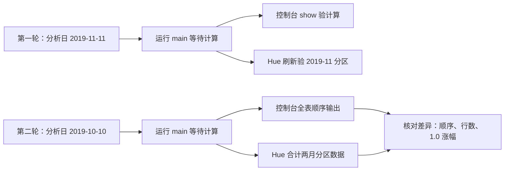

整张图就是两轮跑批的验收路径：第一轮立住双线，第二轮专门暴露差异点，三条差异全部解释得通，月统计的测试才算收口。

### 测试收口后的状态

两轮跑完，结果表里 2019-11 与 2019-10 两个分区各有一批学科数据，控制台计算线与 Hue 落库线互相印证，`IFNULL` 兜底也在真实数据上得到验证。至此热门学科排名里销售量的统计，周和月两个周期全部完成，后续学生人数的周月统计将复用同一套流水线。

## 第9部分：热门学科排名-统计分析-学生人数-周-统计分析步骤

热门学科排名里，销售量的周月统计已经收口，同一张报表还有第二个指标：学生人数，也就是选课人数，同样要出周与月两个周期。指标换了，第一反应往往是流程要推倒重来，实际上统计分析步骤一步没变，变的是数据源、聚合函数、实体与结果表这四处。这一课把周统计的步骤与数据结构定下来，代码留给下一课。

### 指标换了，源数据也换了

**学生人数统计的不是购买，是选课。** 在线教育平台里，用户与学科的关系除了购买还有选课学习，报表要回答的问题是：这一周每个学科有多少学生在学。这个数据的来源是用户选课行为的采集与清洗结果，第 3 章的数据采集与数据清洗两节已经把它洗进了 DWD 层，本课直接取用。

看一眼这张事实表的结构，粒度与用途就清楚了：

```sql
CREATE EXTERNAL TABLE
IF NOT EXISTS data_course.learning_course_fact
(learning_course_dim_id String,
course_category_dim_id String,
course_dim_id String,
user_dim_id String,
time_dim_id String,
status String)
PARTITIONED BY (years String,months String,days String)
ROW FORMAT DELIMITED FIELDS TERMINATED BY '\t'
STORED AS PARQUET
location'/user/hive/external/data_course/learning_course_fact';
```

一行记录对应一次选课行为，挂着课程分类维度、课程维度、用户维度、时间维度的外键，按年月日三级分区。统计学生人数时真正用到的只有三样：`course_category_dim_id` 做聚合键，`user_dim_id` 做计数对象，`years/months/days` 拼出日期做区间过滤。

**为什么销售量走 DWM，学生人数直接用 DWD。** 销售量的基础数据 `course_buy_dwm` 是课程购买量章节预先清洗聚合出的中间层，拿来即算；选课数据没有对应的 DWM 产出，事实表本身的粒度也已经够细，按区间过滤再加聚合就是一步查询的事。数仓分层不是教条，哪一层有现成的、粒度合适的数据就从哪层取，没有就退一层用事实表，代价只是查询扫过的数据多一些。

**count 与 sum 的口径差异要单独说透。** 销售量统计的是卖出去多少份，把每条购买记录的数量加总，用 `sum`；学生人数统计的是有多少条选课行为，把区间内的记录数出来，用 `count`。两者还有一层容易踩的差别：`count(user_dim_id)` 数的是记录条数，同一个用户在同一学科下选了三门课，计 3；换成 `count(distinct user_dim_id)` 才是去重后的 1。本课的口径是选课记录数，业务上称为学生人数，做之前必须与业务确认要的是人次还是人数，这个决定直接写进聚合函数，事后改口径等于重算所有历史分区。

### 七步流程拆解

统计分析步骤与销售量周统计逐条对应：

1. 获取当前周的时间区间，以传入的分析日为基准，例如周 1 至周 5；传 2018 年的日期就按 2018 年的日历算。
2. 获取上周的相同时间区间，例如上周 1 至上周 5。
3. 获取本周的数据，按区间过滤 `learning_course_fact`。
4. 获取上周的数据，同样的过滤换上周区间。
5. 计算增幅，同比方式，本周人数对上周人数。
6. 根据维度 id 关联课程分类维度，补齐学科名称。
7. 保存结果到 APP 层数据仓库。


七步里前四步与销售量周统计的差异只在表名和过滤字段，第五步把 `sum` 换成 `count`，后两步换实体与结果表。流程骨架、日期工具、涨幅公式全部原样复用，这正是上一课把区间与涨幅抽进工具类的回报：换指标时，变动被压缩在数据源与聚合这一小段。

### 结果结构：表与实体

APP 层结果表与销售量周统计同构，指标列改名：

```sql
CREATE EXTERNAL TABLE
IF NOT EXISTS data_subject.subject_user_week_biz
(course_category_dim_id String,
course_category_name String,
user_num Int,
user_percent FLOAT)
PARTITIONED BY (years String, week_of_year String)
ROW FORMAT DELIMITED FIELDS TERMINATED BY '\t'
STORED AS PARQUET
location'/user/hive/external/data_subject/subject_user_week_biz';
```

对应实体在讲义里给出了字段级注释，与销售量的实体只差两个指标列：

```scala
/**
  * 热门学课 - 学生人数(选课) - 周
  *
  * @param course_category_dim_id 课程分类 id
  * @param course_category_name   课程分类名
  * @param user_num               用户数
  * @param user_percent           涨幅
  * @param years                  分区年
  * @param week_of_year           分区年中的周
  */
case class SubjectLearnUserWeekBiz(course_category_dim_id: String,
                                   course_category_name: String,
                                   user_num: Int,
                                   user_percent: Float,
                                   years: String,
                                   week_of_year: String)
```

`user_num` 是当前周该学科的选课记录数，`user_percent` 是对上周的同比涨幅，分区 `week_of_year` 记录一年中的第几周。表结构与实体在入库时按位置对应，两者必须同步改动，这与销售量月统计时表名分区核对是同一类纪律。

## 第10部分：热门学科排名-统计分析-学生人数-周-代码-获取周区间&获取数据&计算涨幅

学生人数周统计的工程骨架建好后，真正要写的关键代码只有一段：取本周与上周的数据并算涨幅。写 Spark SQL 有个现实的开发体验问题，IDEA 里写 SQL 没有任何提示，语法错误要等运行才暴露。这一课的开发路径因此分成两步：先去 Hue 把 SQL 手写跑通，借它的智能提示把语法和口径都验证好，再搬回 IDEA 把写死的日期换成变量。周区间计算是现成代码，直接复用。

### Hue 先行：把单周数据数出来

进 Hue 前先把周区间拿到手。分析日 2019-11-11 传给 `getWeekRelativelyInterval`，返回按逗号分隔的两组区间，每组内用冒号切始末。有个 Scala 小细节值得记住：区间变量是数组，直接打印出来的是对象地址不是内容，转成字符串要过一道 `mkString(",")`。打印确认：本周区间 2019-11-04 至 2019-11-10，上周区间 2019-10-28 至 2019-11-03。

接着在 Hue 里写本周的取数 SQL。基础数据是学生选课事实表 `learning_course_fact`，先整表查出来，再按区间过滤。过滤字段有个明确的坑：表里有 `time_dim_id`，但它是维度键，不是「年-月-日」格式，between 过滤拼不起来；可用的是三个分区字段，用 `concat_ws` 拼成日期再过滤：

```sql
-- 本周：按区间过滤并按学科计数
select course_category_dim_id, count(user_dim_id) user_num
from data_course.learning_course_fact
where concat_ws('-', years, months, days) between '2019-11-04' and '2019-11-10'
group by course_category_dim_id
```

执行过程里撞上本课第一个报错：select 里放了 `course_category_dim_id`，又用了 `count` 聚合，却没有写 `group by`，Hue 当场提示聚合问题。补上 `group by course_category_dim_id` 后跑通，本周区间的原始记录有两百多条，按学科聚合成一批分类 ID 加人数的行。

上周数据不用重新想，同样的 SQL 换区间即可，把 between 的两个日期改成 2019-10-28 和 2019-11-03，本周查询里临时写的日期可以删掉。上周结果同样是一排分类 ID 加人数，例如 1-1 分类 41 条选课记录，1-8 分类 28 条。两份数据在手，涨幅计算的原料齐了。

### 子查询接 left join，涨幅落进别名

把两份单周结果变成一张结果表，套路与销售量统计一致：两个查询分别套上括号变成子查询 a 与 b，外层用 `left join` 关联。关联条件只有课程分类 ID，因为按学科对齐是唯一的对齐口径：

```sql
-- 本周与上周对齐，算同比涨幅
select
a.course_category_dim_id,
a.user_num,
IFNULL(((a.user_num - b.user_num) / b.user_num), 1.0) as user_percent
from
(select course_category_dim_id, count(user_dim_id) user_num
 from data_course.learning_course_fact
 where concat_ws('-', years, months, days) between '2019-11-04' and '2019-11-10'
 group by course_category_dim_id) as a
left join
(select course_category_dim_id, count(user_dim_id) user_num
 from data_course.learning_course_fact
 where concat_ws('-', years, months, days) between '2019-10-28' and '2019-11-03'
 group by course_category_dim_id) as b
on a.course_category_dim_id = b.course_category_dim_id
```

涨幅就是同比公式：本周人数减上周人数，除以上周人数。执行时又暴露一个语法细节，表达式后面给别名 `user_percent` 时补上 `as` 关键字才顺利通过。`IFNULL` 是这段 SQL 的保险丝：left join 下 b 表可能整行无匹配，除出来是空值，用 1.0 兜底表达 100% 增幅，这个设计在销售量统计时已经定下，这里原样沿用。

到这里 Hue 里的 SQL 完全跑通，人数与涨幅都有值，说明语法、口径、兜底三层都没问题，可以搬回开发工具了。

### 搬回 IDEA：三引号里换四个变量

搬运的载体是工具方法。与销售量的 `subjectBuyCountSql` 平行，学生人数在 `SubjectUtils` 里放一个 `subjectLearnSql`，方法体同样只是一句 `spark.sql`，日期全部参数化：

```scala
/**
  * 在线选课根据日期进行统计选课数，及涨幅
  *
  * @param spark   spark
  * @param current 当前日期区间
  * @param last    要对比的日期区间
  * @return 涨幅统计 DataFrame
  */
def subjectLearnSql(spark: SparkSession, current: Array[String], last: Array[String]) = {
  spark.sql(
    s"""
       |select
       |a.course_category_dim_id,
       |a.user_num,
       |IFNULL(((a.user_num - b.user_num) / b.user_num), 1.0) user_percent
       |from
       |(select course_category_dim_id, count(user_dim_id) user_num
       | from data_course.learning_course_fact
       | where concat_ws('-', years, months, days) between '${current(0)}' and '${current(1)}'
       | group by course_category_dim_id) as a
       |left join
       |(select course_category_dim_id, count(user_dim_id) user_num
       | from data_course.learning_course_fact
       | where concat_ws('-', years, months, days) between '${last(0)}' and '${last(1)}'
       | group by course_category_dim_id) as b
       |on a.course_category_dim_id = b.course_category_dim_id
       |""".stripMargin)
}
```

Hue 里写死的四个日期，在这里对应四个插值变量：本周的始末取 `current(0)` 与 `current(1)`，上周的始末取 `last(0)` 与 `last(1)`。Scala 多行字符串用三引号承载，SQL 里的竖线配合 `stripMargin` 保持缩进整洁，s 插值让变量直接嵌进字符串。返回类型照旧交给编译器推断，主类拿到 DataFrame 直接链后续操作。

主类里调用它，与销售量周统计同构：

```scala
package com.study.xc.analysis.subject.stu

import com.study.xc.common.EtlEnvironment
import com.study.xc.utils.DateUtils.{getWeekNum, getWeekRelativelyInterval}
import com.study.xc.utils.SubjectUtils.subjectLearnSql
import org.apache.spark.sql.SparkSession

object SubjectLearnNumByWeekBiz {
  // 初始化参数
  val spark: SparkSession = EtlEnvironment.getSparkSession(this.getClass.getSimpleName)

  def main(args: Array[String]): Unit = {
    import spark.implicits._
    //    val date_info = args(0)
    val date_info = "2019-11-11"
    val wekRelativelyInterval = getWeekRelativelyInterval(date_info).split(",")
    // 当前周区间，按冒号切出始末日期
    val current = wekRelativelyInterval(0).split(":")
    // 获取当前周是一年中的第几周，写入分区时使用
    val weekOfYear = getWeekNum(current(0)).split("-")
    // 上周区间
    val last = wekRelativelyInterval(1).split(":")
    // 计算涨幅得到临时表，维度关联与入库在下一步接上
    subjectLearnSql(spark, current, last)
      .createOrReplaceTempView("learn_biz_tmp")
    // 验证：临时视图里就是带涨幅的人数结果
    spark.sql("select * from learn_biz_tmp").show()
  }
}
```

在 IDEA 里运行，结果与 Hue 里验证的一致，学科人数与涨幅成对输出，说明参数化搬运没有改变行为。`weekOfYear` 这一步先算好备用，维度关联和写表在下一课接上。

### 兜底验证：从最早分区挑日期

SQL 层面的验证过了，`IFNULL` 的兜底分支还需要一次真实触发才能放心。验证思路是找一条「当前周有数据、上一周没数据」的日期：先查原始数据的最早分区，结果在 9 月 14 日附近；选当前周落在 9 月 17 日附近时发现那一周几乎没有选课记录，查询基本无结果；改看 10 月 1 日所在的周，这一周有正常数据，就按它跑。


10 月 1 日这轮跑完，结果里涨幅清一色 1.0，人数不多但都统计到了，与「上一周无数据」的前提完全吻合，兜底逻辑在真实数据上得到确认。到此本课的三段关键代码，周区间复用、取数计数、涨幅计算全部落地并通过验证，维度关联与保存结果交给下一课。

## 第11部分：热门学科排名-统计分析-学生人数-周-代码-维度关联&保存到数据仓库

取数与涨幅的代码已经就绪，控制台能打印出每个课程分类本周的选课人数与涨幅，计算是通的，但离交付还差两步：结果行里只有课程分类 id，展示端需要带分类名称的完整行；算完的数字只停留在控制台，数仓里没有任何落表动作。把这两步补上，热门学科排名里学生人数按周的统计主体就成型了。

整条改造线是：中间结果注册临时视图、关联课程分类维度、类型收敛进实体、动态分区写入结果表。每一步都有自己的坑，逐段拆开看。

### 从打印到临时视图

**临时视图是 Spark SQL 里的轻量交接物。** 它不存数据，只登记一段可按名引用的查询定义，生命周期跟随当前 SparkSession，进程结束即消失，不会在数仓里留下痕迹。中间结果要在主类里被下一段 SQL 反复引用，比起把长子查询复制粘贴一遍，注册视图让 SQL 的可读性与可维护性都上来了。

改动只有一行：原来链在取数涨幅 SQL 后面的 `.show()` 换成 `.createOrReplaceTempView("learn_biz_tmp")`。视图名里的 biz 表明这是业务口径的中间结果，与后面要关联的维度表在命名上就区分开。SQL 本体用三引号字符串加 `stripMargin` 保持缩进，多行 SQL 的可读性靠这个写法兜住。

### 维度关联 SQL：别名即契约

**要补的维度信息只有分类名称一项。** 选课事实表 `data_course.learning_course_fact` 里已经带着 `course_category_dim_id`，清洗阶段就把维度 id 打好了；课程分类的名称在维度库的 `data_dimen.course_category_dim` 里，字段名是 `name`。两表按分类 id 相等关联，维表取出的名称起别名 `course_category_name`，因为结果表与实体里这个字段就叫这个名字。别名在这里不是装饰，它是后续实体映射的对齐依据，别名丢一列，那一列就映射不上。

关联方式用 left join，主体是临时视图里的统计行。维表缺失某个分类时，left join 保住统计行、名称置 null；内 join 会把这一行直接吞掉，统计结果静默变少，这类问题在测试时很难一眼发现。

主类此时的完整形态：

```scala
package com.study.xc.analysis.subject.stu

import com.study.xc.common.EtlEnvironment
import com.study.xc.entity.SubjectLearnUserWeekBiz
import com.study.xc.utils.DateUtils.{getWeekNum, getWeekRelativelyInterval}
import org.apache.spark.sql.SparkSession

object SubjectLearnNumByWeekBiz {
  // 初始化参数
  val spark: SparkSession = EtlEnvironment.getSparkSession(this.getClass.getSimpleName)

  def main(args: Array[String]): Unit = {
    import spark.implicits._
    //    val date_info = args(0)
    val date_info = "2019-11-11"
    val weeks = getWeekRelativelyInterval(date_info).split(",")
    // 当前周区间，按冒号切出始末日期
    val current = weeks(0).split(":")
    // 获取当前周是一年中的第几周
    val weekOfYear = getWeekNum(current(0)).split("-")
    // 上周区间
    val last = weeks(1).split(":")
    // 取数并计算涨幅，结果注册成临时视图，替代原来的 show
    spark.sql(
      s"""
         |select
         |a.course_category_dim_id,
         |a.user_num,
         |IFNULL((a.user_num - b.user_num) / b.user_num, 1.0) user_percent
         |from
         |(select course_category_dim_id, count(user_dim_id) user_num
         | from data_course.learning_course_fact
         | where concat_ws('-', years, months, days) between '${current(0)}' and '${current(1)}'
         | group by course_category_dim_id) as a
         |left join
         |(select course_category_dim_id, count(user_dim_id) user_num
         | from data_course.learning_course_fact
         | where concat_ws('-', years, months, days) between '${last(0)}' and '${last(1)}'
         | group by course_category_dim_id) as b
         |on a.course_category_dim_id = b.course_category_dim_id
         |""".stripMargin)
      .createOrReplaceTempView("learn_biz_tmp")
    // 关联维度表
    val learnDS = spark.sql(
      s"""
         |select
         |a.course_category_dim_id,
         |b.name course_category_name,
         |cast(a.user_num as int) user_num,
         |cast(a.user_percent as float) user_percent,
         |'${weekOfYear(0)}' years,
         |'${weekOfYear(1)}' week_of_year
         |from learn_biz_tmp a
         |left join data_dimen.course_category_dim b
         |on a.course_category_dim_id = b.course_category_dim_id
         |""".stripMargin)
      .as[SubjectLearnUserWeekBiz]
    // 指定 hive 参数，保存到表
    spark.conf.set("hive.exec.dynamic.partition.mode", "nonstrict")
    // 保存到数据仓库
    learnDS
      // 输出一个文件，由于分区减少效率低，数据小时不影响
      .repartition(1)
      .write
      // 相同分区覆盖
      .mode("overwrite")
      // 指定表名
      .insertInto("data_subject.subject_user_week_biz")
    // 查看结果
    spark.sql("select * from data_subject.subject_user_week_biz").show()
    // 关闭资源
    spark.close()
  }
}
```

分区字段的值来自 `weekOfYear` 数组：`getWeekNum` 拿当前周区间的起始日期算出「年-周」编号，按连字符切开后索引 0 是年、索引 1 是周，分别拼成 years 与 week_of_year 两列。这两个值最终落到结果表的分区目录上。

### 类型收敛与实体映射

**count 与除法产出的类型和实体声明对不上，cast 不能省。** `count(user_dim_id)` 返回 bigint，两个整数相除得到 double，而实体里 user_num 声明为 Int、user_percent 声明为 Float。`as[case class]` 依赖 Spark 的 encoder 按列名做映射，列类型与属性类型不兼容时转换直接失败，所以在 SQL 里就地 cast，让 DataFrame 的 schema 与实体严丝合缝。cast 会改写列名，`cast(a.user_num as int)` 产出的列名就是这串表达式本身，别名必须紧跟其后补回来。

实体的定义与业务表字段一一对应：

```scala
/**
  * 热门学科排名 - 学生人数（选课）- 周
  *
  * @param course_category_dim_id 课程分类 id
  * @param course_category_name   课程分类名
  * @param user_num               用户数
  * @param user_percent           涨幅
  * @param years                  分区年
  * @param week_of_year           分区年中的周
  */
case class SubjectLearnUserWeekBiz(course_category_dim_id: String,
                                   course_category_name: String,
                                   user_num: Int,
                                   user_percent: Float,
                                   years: String,
                                   week_of_year: String)
```

### 保存与验证

结果表在数仓建表脚本里的定义：

```sql
CREATE EXTERNAL TABLE IF NOT EXISTS data_subject.subject_user_week_biz
(course_category_dim_id String,
course_category_name String,
user_num Int,
user_percent FLOAT)
PARTITIONED BY (years String, week_of_year String)
ROW FORMAT DELIMITED FIELDS TERMINATED BY '\t'
STORED AS PARQUET
location '/user/hive/external/data_subject/subject_user_week_biz';
```

入库段照销售量周统计的模板改表名：动态分区模式设为 nonstrict，否则 Hive 的严格模式要求至少一个静态分区，全动态写入直接报错；repartition(1) 让十几个分类的结果只输出一个文件，结果集这么小，多分区反而拖慢写入；`mode("overwrite")` 配合 `insertInto` 实现同分区覆盖，历史周分区不受影响。


这张图把一行数据的完整旅程串了起来：从日期参数出发，经取数涨幅、临时视图、维度关联、类型收敛，最终落进周分区。关键路径是临时视图前后的两段 SQL，前一段管数字，后一段管形态，实体映射是两者的交界面。

show 出来的结果与 Hue 里 `subject_user_week_biz` 的分区数据互为印证，统计主体到此成型。工具类抽取与完整的两轮测试放在下一课收口。

## 第12部分：热门学科排名-统计分析-学生人数-周-代码-抽取工具类&测试入库

学生人数周统计的主体代码已经跑通，取数加涨幅的 SQL 还长在主类里。销售量统计时做过一次同样的抽取，当时就说过学生人数与销售额都会各抽一个方法，这一段兑现前一半：把 SQL 沉进工具类，再用两个测试日期把兜底分支与常态分支都验一遍，学生人数周统计整段闭环。

### 抽取的边界与销售量版对照

**这段 SQL 里没有任何周专属的东西。** 表名、聚合键、聚合函数、涨幅公式、区间占位符全部由参数或业务本体决定，真正与周有关的只有区间怎么算，而那已经在日期工具类里。换成月统计时把月区间传进来，方法一字不用改，这就是可抽取的判据：换个周期依然成立的逻辑才值得下沉。

与销售量的 `subjectBuyCountSql` 摆在一起看，差异收敛到三点：数据源从购买宽表换成选课事实表 `data_course.learning_course_fact`；聚合从 `sum(salesvolume)` 换成 `count(user_dim_id)`，人数是计数不是求和；输出指标名从 sale_num 换成 user_num。涨幅公式 `IFNULL((a.user_num - b.user_num) / b.user_num, 1.0)` 与销售量完全同构，left join 骨架、a 与 b 两个别名、区间 between 全部一致。工具类里一个指标一个方法，横向对齐，后面销售额照此办理。

```scala
package com.study.xc.utils

import org.apache.spark.sql.SparkSession

object SubjectUtils {

  // 销售量的 subjectBuyCountSql 已在工具类中，学生人数的方法并排放置

  /**
    * 在线选课按日期区间统计人数，及涨幅
    *
    * @param spark   spark
    * @param current 当前日期区间
    * @param last    要对比的日期区间
    * @return 涨幅统计 DataFrame
    */
  def subjectLearnSql(spark: SparkSession, current: Array[String], last: Array[String]) = {
    spark.sql(
      s"""
         |select
         |a.course_category_dim_id,
         |a.user_num,
         |IFNULL((a.user_num - b.user_num) / b.user_num, 1.0) user_percent
         |from
         |(select course_category_dim_id, count(user_dim_id) user_num
         | from data_course.learning_course_fact
         | where concat_ws('-', years, months, days) between '${current(0)}' and '${current(1)}'
         | group by course_category_dim_id) as a
         |left join
         |(select course_category_dim_id, count(user_dim_id) user_num
         | from data_course.learning_course_fact
         | where concat_ws('-', years, months, days) between '${last(0)}' and '${last(1)}'
         | group by course_category_dim_id) as b
         |on a.course_category_dim_id = b.course_category_dim_id
         |""".stripMargin)
  }
}
```

方法体就是一句 `spark.sql(...)`，返回类型交给编译器推断，查询结果是什么就返回什么，调用方拿到 DataFrame 直接链 `createOrReplaceTempView`，与抽取前的行为完全一致。

### 主类收缩后的形态

```scala
package com.study.xc.analysis.subject.stu

import com.study.xc.common.EtlEnvironment
import com.study.xc.entity.SubjectLearnUserWeekBiz
import com.study.xc.utils.DateUtils.{getWeekNum, getWeekRelativelyInterval}
import com.study.xc.utils.SubjectUtils.subjectLearnSql
import org.apache.spark.sql.SparkSession

object SubjectLearnNumByWeekBiz {
  // 初始化参数
  val spark: SparkSession = EtlEnvironment.getSparkSession(this.getClass.getSimpleName)

  def main(args: Array[String]): Unit = {
    import spark.implicits._
    //    val date_info = args(0)
    val date_info = "2019-11-11"
    val weeks = getWeekRelativelyInterval(date_info).split(",")
    // 当前周区间，按冒号切出始末日期
    val current = weeks(0).split(":")
    // 获取当前周是一年中的第几周
    val weekOfYear = getWeekNum(current(0)).split("-")
    // 上周区间
    val last = weeks(1).split(":")
    // 调用工具方法取数并计算涨幅，注册成临时视图
    subjectLearnSql(spark, current, last)
      .createOrReplaceTempView("learn_biz_tmp")
    // 关联维度表
    val learnDS = spark.sql(
      s"""
         |select
         |a.course_category_dim_id,
         |b.name course_category_name,
         |cast(a.user_num as int) user_num,
         |cast(a.user_percent as float) user_percent,
         |'${weekOfYear(0)}' years,
         |'${weekOfYear(1)}' week_of_year
         |from learn_biz_tmp a
         |left join data_dimen.course_category_dim b
         |on a.course_category_dim_id = b.course_category_dim_id
         |""".stripMargin)
      .as[SubjectLearnUserWeekBiz]
    // 指定 hive 参数，保存到表
    spark.conf.set("hive.exec.dynamic.partition.mode", "nonstrict")
    // 保存到数据仓库
    learnDS
      // 输出一个文件，由于分区减少效率低，数据小时不影响
      .repartition(1)
      .write
      // 相同分区覆盖
      .mode("overwrite")
      // 指定表名
      .insertInto("data_subject.subject_user_week_biz")
    // 查看结果
    spark.sql("select * from data_subject.subject_user_week_biz").show()
    // 关闭资源
    spark.close()
  }
}
```

抽完之后的结构一眼见底：主类只剩流程编排，日期与周数计算、一行工具调用、维度关联、入库各占一小段，取数涨幅的 SQL 细节全部沉到工具类，主类里再也看不到 `learning_course_fact`。

### 两轮测试：兜底分支与常态分支

**测试日期是挑出来的，不是随手填的。** 测试日期决定代码走到哪条分支，两轮各打一条。

第一轮传 2019-10-01。锚点取前一天落在一年中的第 40 周，控制台 show 出的涨幅清一色是 1.0。原因在数据侧：对比区间也就是上一周，在数仓里没有选课记录，b 子查询聚合不出任何行，left join 之后 b.user_num 全为 null，IFNULL 把它们全部兜成 1.0，也就是 100% 增幅。选这个日期就是冲着兜底分支来的，工具类里的 IFNULL 是否好使，这一轮立刻见分晓。

第二轮传 2019-11-11。锚点落在第 45 周，各分类人数上千，涨幅有正有负，数据形态恢复常态。切到 Hue 打开 `data_subject.subject_user_week_biz` 刷新，第 40 周与第 45 周两个分区并排都在，互不覆盖，落库链路与分区隔离同时得到确认。计算对、落库通，两条线都绿，周统计才算验收通过，这也是所有统计任务的固定验收姿势。

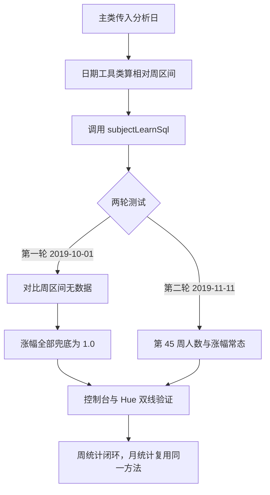

这张图把两轮测试的走向铺开：同一份代码吃进不同日期，分别命中兜底分支与常态分支，出口是控制台与 Hue 两条验证线。

### 涨幅口径的两个细节

**涨幅为 1.0 是合法值，不是异常。** 它表示本区间比对比区间多出一倍，兜底场景与真实翻倍场景产出的都是这个数，语义由业务方解读。同理涨幅可以为负，负增长原样入库，展示端自行格式化。

**人数口径是选课记录数，不是去重人数。** `count(user_dim_id)` 对区间内的选课事实逐行计数，同一用户选了三门课就计三次。课程需求把这一点当作分类热度的「学生人数」口径使用；若业务要严格人数，聚合应换成 `count(distinct user_dim_id)`。这是个口径决策，得在需求阶段对齐，不能写代码时随手定。

## 第13部分：热门学科排名-统计分析-学生人数-月-统计分析步骤&代码编写

学生人数的周统计刚刚闭环，月统计紧随其后。两者的数学结构一模一样：取数、算涨幅、关联维度、分区入库，差的只有区间怎么算、分区字段叫什么、结果表落到哪。工程上最经济的做法不是重写一遍，而是复制周版本做定向改造，再把改造点逐一排查干净。

复制改造省时间，也引入新风险：漏改一处，代码可能不报错却产出错口径的数据。这一段把改造点列全，把排查清单也给全。

### 步骤与差异对照

月统计的步骤与周版本一字不差：获取当月时间区间、获取上月的相同时间区间、获取本月数据、获取上月数据、计算指标、根据维度 id 获取相关数据、保存结果。步骤相同意味着代码结构相同，差异全部集中在参数层。把两个版本的主流程摆成一排看得更清楚：

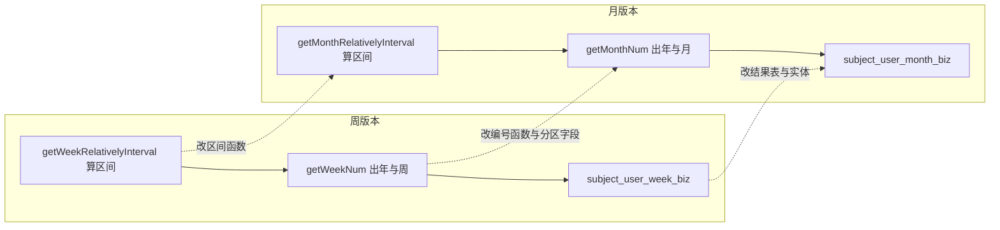

这张图把周版本到月版本的改造点摆成一排：区间函数换成 `getMonthRelativelyInterval`，编号函数换成 `getMonthNum`，分区字段从 week_of_year 换成 month_of_year，目标表换成 `subject_user_month_biz`。连同临时视图名与实体类型一起改完，月统计的主干就成立了。

### 月区间怎么算

**月同比比的是同位区间，不是整月对整月。** 离线批按天调度，传入 2019-11-11 时，当月只走完了 1 号到 10 号，锚点取前一天，当月区间就是 11-01 至 11-10；可比的上月区间取相同的天数字，即 10-01 至 10-10。这样两侧都是「月头上同样长的一段」，涨幅才可比。若拿本月 10 天对上月整月 31 天，涨跌全被天数差异污染。`getMonthRelativelyInterval` 返回逗号分隔的两段、每段冒号连接始末日期，与周版本的数据形态一致，切分代码原样复用。

分区编号由 `getMonthNum` 从当月区间的起始日期算出「年-月」，切开后分别作为 years 与 month_of_year 拼进结果。

### 改造后的完整主类

```scala
package com.study.xc.analysis.subject.stu

import com.study.xc.common.EtlEnvironment
import com.study.xc.entity.SubjectLearnUserMonthBiz
import com.study.xc.utils.DateUtils.{getMonthNum, getMonthRelativelyInterval}
import com.study.xc.utils.SubjectUtils.subjectLearnSql
import org.apache.spark.sql.SparkSession

object SubjectLearnNumByMonthBiz {
  // 初始化参数
  val spark: SparkSession = EtlEnvironment.getSparkSession(this.getClass.getSimpleName)

  def main(args: Array[String]): Unit = {
    import spark.implicits._
    //    val date_info = args(0)
    val date_info = "2019-11-11"
    // 当月区间与上月区间
    val months = getMonthRelativelyInterval(date_info).split(",")
    // 当前月区间，按冒号切出始末日期
    val current = months(0).split(":")
    // 获取当月是一年中的第几月
    val monthOfYear = getMonthNum(current(0)).split("-")
    // 上月区间
    val last = months(1).split(":")
    // 调用工具方法取数并计算涨幅，视图名带上月，防止与周统计互相覆盖
    subjectLearnSql(spark, current, last)
      .createOrReplaceTempView("learn_biz_month_tmp")
    // 关联维度表
    val learnDS = spark.sql(
      s"""
         |select
         |a.course_category_dim_id,
         |b.name course_category_name,
         |cast(a.user_num as int) user_num,
         |cast(a.user_percent as float) user_percent,
         |'${monthOfYear(0)}' years,
         |'${monthOfYear(1)}' month_of_year
         |from learn_biz_month_tmp a
         |left join data_dimen.course_category_dim b
         |on a.course_category_dim_id = b.course_category_dim_id
         |""".stripMargin)
      .as[SubjectLearnUserMonthBiz]
    // 指定 hive 参数，保存到表
    spark.conf.set("hive.exec.dynamic.partition.mode", "nonstrict")
    // 保存到数据仓库
    learnDS
      // 输出一个文件，由于分区减少效率低，数据小时不影响
      .repartition(1)
      .write
      // 相同分区覆盖
      .mode("overwrite")
      // 指定表名
      .insertInto("data_subject.subject_user_month_biz")
    // 查看结果
    spark.sql("select * from data_subject.subject_user_month_biz").show()
    // 关闭资源
    spark.close()
  }
}
```

对照周版本读这段代码：变量从 weeks 换成 months，weekOfYear 换成 monthOfYear，视图名、实体、表名、分区列全部就位。实体 `SubjectLearnUserMonthBiz` 与周版本只差最后一个字段，week_of_year 换成 month_of_year，其余属性原样。

临时视图特意改名而不是沿用 `learn_biz_tmp`，防的是同进程内先后注册同名视图时后者把前者顶掉，多个统计任务合并调度或串行复用 SparkSession 时这个问题就会现形；名字带上周期，日志与排查时也能一眼分清口径。

### 改造后的排查清单

**重构快捷键只管代码标识符，字符串要按清单手动搜。** IDE 的 Shift+F6 重命名覆盖变量与类名，SQL 字符串字面量里的视图名、分区列名、表名一个都碰不到。逐项过一遍：实体 import 与 `as[...]` 的类型参数、临时视图名（注册处与 SQL 的 from 处共两处）、分区字段 years 与 month_of_year、`insertInto` 的表名、验证查询的表名，以及注释里残留的「周」字。注释也要同步改，注释与代码不一致比没有注释更误导。

排查的目标不是让代码能编译，而是让口径成立：编译器只认类型与名字的合法性，认不出「月表里混进周字段」这种语义错位，这类问题只有人工过清单和运行测试能兜住。

## 第14部分：热门学科排名-统计分析-学生人数-月-测试入库

改造完的月统计代码读起来挑不出毛病，真跑起来才知道排查还有漏网之鱼。这一轮测试先报了个错，错因不在 SQL 也不在参数，而在一个没换掉的实体类；修完复跑，控制台与 Hue 的数字一一对应，学生人数这条线的周统计与月统计双双闭环，热门学科排名的统计分析也走到了阶段性收口。

### 第一跑：区间核对与报错定位

**区间核对是测试的第一道关。** 程序里 date_info 传 2019-11-11，控制台先打印区间切分结果：当月 11-01 至 11-10，上月 10-01 至 10-10。离线分析只统计已走完的天，锚点取前一天，两个区间长度相同、位置对称，同比口径成立，这一关过了才轮到看数字。

第二关直接报错，错误信息指向 week_of_year：SQL 已经产出 month_of_year 列，而代码里的实体还是周版本的 `SubjectLearnUserWeekBiz`，`as[...]` 构建 Dataset 时按列名找属性，week_of_year 这列不存在，映射失败。根因是复制改造时 IDE 重命名只改到了变量，实体引用这一处漏网。修正很直接，import 与类型参数一起换：

```scala
// 漏网点一：顶部 import 仍是周版本实体，换成月版本
import com.study.xc.entity.SubjectLearnUserMonthBiz

// 漏网点二：as 的类型参数随之替换，SQL 本体不用动
val learnDS = spark.sql(
  s"""
     |select
     |a.course_category_dim_id,
     |b.name course_category_name,
     |cast(a.user_num as int) user_num,
     |cast(a.user_percent as float) user_percent,
     |'${monthOfYear(0)}' years,
     |'${monthOfYear(1)}' month_of_year
     |from learn_biz_month_tmp a
     |left join data_dimen.course_category_dim b
     |on a.course_category_dim_id = b.course_category_dim_id
     |""".stripMargin)
  .as[SubjectLearnUserMonthBiz]
```

这个坑的价值在于验证了一句老话：排查清单再细，最后一道防线永远是运行。编译器拦不住列名级的语义错位，import 的实体本身合法，SQL 字符串本身合法，错的是两者的对应关系，这种问题只有把代码真正跑起来才会现形。

### 复跑与双线验证

修正后再次运行，等待跑批完成，控制台 show 出各分类的人数与涨幅，有正增长也有负增长。切到 Hue 打开 `data_subject.subject_user_month_biz` 刷新，2019 年 11 月分区出现，课程分类名称、人数、涨幅与控制台逐行一致。中间有几次刷新看不到数据，是 Hue 读元数据与数据文件存在延迟，稍等再刷即可，不是程序问题。

结果里有一行涨幅恰好是 0，含义是本月与上月同区间的选课人数完全持平，两侧计数相等，除法得 0。0 与 1.0 一样都是合法值，不要当成计算错误去排查。

验证用的查询就一句：

```scala
// 查看结果：月分区数据
spark.sql("select * from data_subject.subject_user_month_biz").show()
// 关闭资源
spark.close()
```

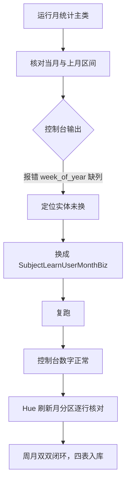

这张图是本轮测试的完整回路：报错信息把排查方向直接指到实体，修正复跑后两条验证线依次走绿。报错不是坏事，它是排查清单失效位置最诚实的反馈。

### 月分区的滚动更新

**月表的写入形态与周表不同，覆盖的是「月内至今」。** 动态分区 overwrite 只覆盖本次命中的 2019-11 分区，10 月及更早的分区纹丝不动。调度按天跑，11 月里每跑一天，锚点前移一天，当月区间延长一天，同一个 11 月分区带着最新口径被重写一次，展示端任何时候读到的都是当月最新的同位区间对比。结果集只有十几个分类，重写代价可以忽略。

生产形态交给调度脚本，日期从参数传入：

```bash
#!/usr/bin/env bash
if [[ $1 != "" ]];then
  TD_DATE=$1
else
  echo "[===no params input, expect date like 2019-11-11===]"
  exit 1
fi
SPARK_SUBMIT=/opt/spark/bin/spark-submit

$SPARK_SUBMIT \
  --master spark://spark-master:7077 \
  --class com.study.xc.analysis.subject.stu.SubjectLearnNumByMonthBiz \
  /opt/run/jars/xc-service-offline-jar-with-dependencies.jar ${TD_DATE}
```

脚本无参直接退出并提示，防止空参误跑；入口类是月统计主类，按天传分析日即可，主类里把写死的测试日期换回 `args(0)`，测试与生产就接上了。

### 学科排名统计分析的收官要点

到这里把成果摊开看：data_subject 库里销售量的周表月表、学生人数的周表月表，四张业务表全部有了数据。四段统计代码共用同一副骨架，差异只在数据源、聚合函数与维度字段；讲义在章末提供了热门学科排名的完整代码对照，四张表的建表语句同源于数仓建表脚本。散落资料里还备着两条 NiFi 模板：一条调度清洗与统计分析任务，一条把 Hive 业务表同步进 MySQL，报表系统从 MySQL 读数出图。学习目标里「编写热门学科排名的分析程序」与「将分析结果同步到 MySQL」两条要求，在统计层与同步层各就各位。

同一套模板还有销售额一条线要走，区间、涨幅、维度关联、分区入库的形态已经全部定型，剩下的只是换表换字段，属于复用而不是重新发明。把四张表的口径与验收姿势带走，后面每个统计都是照方抓药。

## 第15部分：热门学科排名-统计分析-销售额-周-统计分析步骤&代码编写

销售量的周统计刚收口，销售额的需求就跟上了。两个指标一字之差，第一反应容易是另起炉灶再写一套；把两边的口径摆开对比，会发现它们同源同步骤，真正要动的只有聚合字段与一批名字。基于已经跑通的销售量周版做定向改造，改动点收敛、行为可预期，比重写更快也更稳。

### 销售额与销售量差在哪

**一句话：销售量数件数，销售额数钱。** 课程购买量章节清洗出的 DWM 表 `course_buy_dwm` 里同时带着两个度量：`salesvolume` 由 `count(course_dim_id)` 聚合而来，是课程每天卖出的件数；`sales` 由 `sum(price)` 聚合而来，是课程每天的订单金额。热门学科排名的统计层在这张表上做二次聚合，按课程分类与时间区间求和，要件数就累加 `salesvolume`，要金额就累加 `sales`，两者共享同一份明细。

**同源决定了改造量。** 数据源相同，维度键相同，都是 `course_category_dim_id`，涨幅公式也相同，唯一的实质差异是聚合字段从 `salesvolume` 换成 `sales`。销售量周版里所有与「按区间聚合再算同比」有关的代码，销售额一行都不用改；要做的只是把金额这一路接进来，并把各处名字换成销售额语义。

涨幅公式本身值得再看一眼：`IFNULL((a.sale_amount - b.sale_amount) / b.sale_amount, 1.0)`。它等价于一个三目判断，基线有值就算差值比基线的比值，基线为空就兜底 1.0，也就是涨幅 100%。兜底值为什么取 1.0 而不是 0，测试那一课会看到实际效果。

### 七步不变，改在参数层

讲义 3.5.3.1.1 给出销售额周的统计分析步骤：获取当前周时间区间、获取上周相同时间区间、获取本周数据、获取上周数据、计算增幅、根据维度 id 获取相关数据、保存结果。与销售量周的七步逐条对照，每一步都能原样对上，改的只是第 3、4 步取数的数据从件数换成金额。


这条链就是全部改造路径：日期区间计算、维度关联、入库写法都不在链上，因为它们不需要动。聚合字段是唯一碰计算语义的一处，其余全是命名替换。

### 工具方法与主类落地

取数涨幅沿用抽取工具类的模式，`SubjectUtils` 里为销售额新增 `subjectBuyAmountSql`，方法体同样只有一句 `spark.sql`：

```scala
package com.study.xc.utils

import org.apache.spark.sql.SparkSession

object SubjectUtils {

  /**
    * 销售额按日期区间统计及涨幅
    *
    * @param spark   spark
    * @param current 当前日期区间
    * @param last    要对比的日期区间
    * @return 涨幅统计 DataFrame
    */
  def subjectBuyAmountSql(spark: SparkSession, current: Array[String], last: Array[String]) = {
    spark.sql(
      s"""
         |select
         |a.course_category_dim_id,
         |a.sale_amount,
         |IFNULL((a.sale_amount - b.sale_amount) / b.sale_amount, 1.0) amount_percent
         |from
         |(select course_category_dim_id, sum(sales) sale_amount
         | from data_course.course_buy_dwm
         | where concat_ws('-', years, months, days) between '${current(0)}' and '${current(1)}'
         | group by course_category_dim_id) as a
         |left join
         |(select course_category_dim_id, sum(sales) sale_amount
         | from data_course.course_buy_dwm
         | where concat_ws('-', years, months, days) between '${last(0)}' and '${last(1)}'
         | group by course_category_dim_id) as b
         |on a.course_category_dim_id = b.course_category_dim_id
         |""".stripMargin)
  }
}
```

与 `subjectBuyCountSql` 逐行对照，结构完全同构，差异只有两处：聚合字段 `sum(salesvolume)` 换成 `sum(sales)`，输出别名 sale_num 与 sale_percent 换成 sale_amount 与 amount_percent。日期区间全部由参数喂入，这一段与周期无关，周统计与月统计共用同一个方法。

主类在销售量周版 `SubjectSalesVolumeByWeekBiz` 的骨架上替换命名与工具调用，得到 `SubjectSalesByWeekBiz`：

```scala
package com.study.xc.analysis.subject.sales

import com.study.xc.common.EtlEnvironment
import com.study.xc.entity.SubjectAmountWeekBiz
import com.study.xc.utils.DateUtils.{getWeekNum, getWeekRelativelyInterval}
import com.study.xc.utils.SubjectUtils.subjectBuyAmountSql
import org.apache.spark.sql.SparkSession

object SubjectSalesByWeekBiz {
  // 初始化参数
  val spark: SparkSession = EtlEnvironment.getSparkSession(this.getClass.getSimpleName)

  def main(args: Array[String]): Unit = {
    import spark.implicits._
    //    val date_info = args(0)
    val date_info = "2019-09-16"
    val weeks = getWeekRelativelyInterval(date_info).split(",")
    // 当前周区间，按冒号切出始末日期
    val current = weeks(0).split(":")
    // 获取当前周是一年中的第几周
    val weekOfYear = getWeekNum(current(0)).split("-")
    // 上周区间
    val last = weeks(1).split(":")
    // 计算涨幅得到临时表，然后与维度表关联，得到需要的业务表
    subjectBuyAmountSql(spark, current, last)
      .createOrReplaceTempView("buy_amount_biz_tmp")
    // 关联维度表
    val buyDF = spark.sql(
      s"""
         |select
         |a.course_category_dim_id,
         |b.name course_category_name,
         |cast(a.sale_amount as int) sale_amount,
         |cast(a.amount_percent as float) amount_percent,
         |'${weekOfYear(0)}' years,
         |'${weekOfYear(1)}' week_of_year
         |from buy_amount_biz_tmp a
         |left join data_dimen.course_category_dim b
         |on a.course_category_dim_id = b.course_category_dim_id
         |""".stripMargin)
      .as[SubjectAmountWeekBiz]
    // 指定 hive 参数，保存到表
    spark.conf.set("hive.exec.dynamic.partition.mode", "nonstrict")
    // 保存到数据仓库
    buyDF
      // 输出一个文件，由于分区减少效率低，数据小时不影响
      .repartition(1)
      .write
      // 相同分区覆盖
      .mode("overwrite")
      // 指定表名
      .insertInto("data_subject.subject_amount_week_biz")
    // 查看结果
    spark.sql("select * from data_subject.subject_amount_week_biz").show()
    // 关闭资源
    spark.close()
  }
}
```

最终封装的实体与结果表如下，两个度量都是 Float 类型：

```scala
/**
  * 热门学课 - 销售额 - 周
  *
  * @param course_category_dim_id 学科 id
  * @param course_category_name   学科名
  * @param sale_amount            销售额
  * @param amount_percent         涨幅
  * @param years                  分区年
  * @param week_of_year           分区年中的周
  */
case class SubjectAmountWeekBiz(course_category_dim_id: String,
                                course_category_name: String,
                                sale_amount: Float,
                                amount_percent: Float,
                                years: String,
                                week_of_year: String)
```

```sql
CREATE EXTERNAL TABLE
IF NOT EXISTS data_subject.subject_amount_week_biz
(course_category_dim_id String,
course_category_name String,
sale_amount Float,
amount_percent Float)
PARTITIONED BY (years String, week_of_year String)
ROW FORMAT DELIMITED FIELDS TERMINATED BY '\t'
STORED AS PARQUET
location'/user/hive/external/data_subject/subject_amount_week_biz';
```

金额在 select 里被 `cast(a.sale_amount as int)` 取整，这是课程代码的既有口径，入库后的销售额按元为最小单位。报表若要分位精度，调整这一处 cast 即可，表结构本身就是 Float。

### 改完回读：自上而下再核一遍

**复制改造收尾的固定动作是回读。** 从主类第一行往下走一遍数据流：日期进、区间出，这段没动过，可以快；区间进、临时视图出，核对工具方法已换成 `subjectBuyAmountSql`、视图名已换成 `buy_amount_biz_tmp`；临时表进、维度关联出，核对 select 里两个度量别名已换成 sale_amount 与 amount_percent、实体类型参数已换成 `SubjectAmountWeekBiz`；最后落到表名，写入与查看两处都已指向 `subject_amount_week_biz`。变量名这类改动编译器不拦，注释里残留的旧语义也不报错，只有回读能把它们翻出来。

## 第16部分：热门学科排名-统计分析-销售额-周-测试入库

代码改完只代表静态正确，跑起来才知道口径在真实数据上长什么样。销售额周统计的第一轮测试撞上两个现象：Hue 里刷了半天没有数据，等程序跑完，第 39 周的涨幅又清一色是 100%。这两个现象都不是 bug，读懂它们比改代码更有价值。

### 跑批与空表的两层等待

测试直接在 IDE 里运行 `SubjectSalesByWeekBiz` 主类。程序启动要先打包编译，再初始化 SparkSession、连接 Hive 元数据服务，这一段日志刷得热闹但还没到计算；与此同时切到 Hue 打开 `data_subject.subject_amount_week_biz` 刷新，表里自然空空如也。此时刷不出数据有两层原因叠加：程序还没执行完，写库动作没发生；就算写完了，Hue 读元数据与数据文件也有几秒延迟。

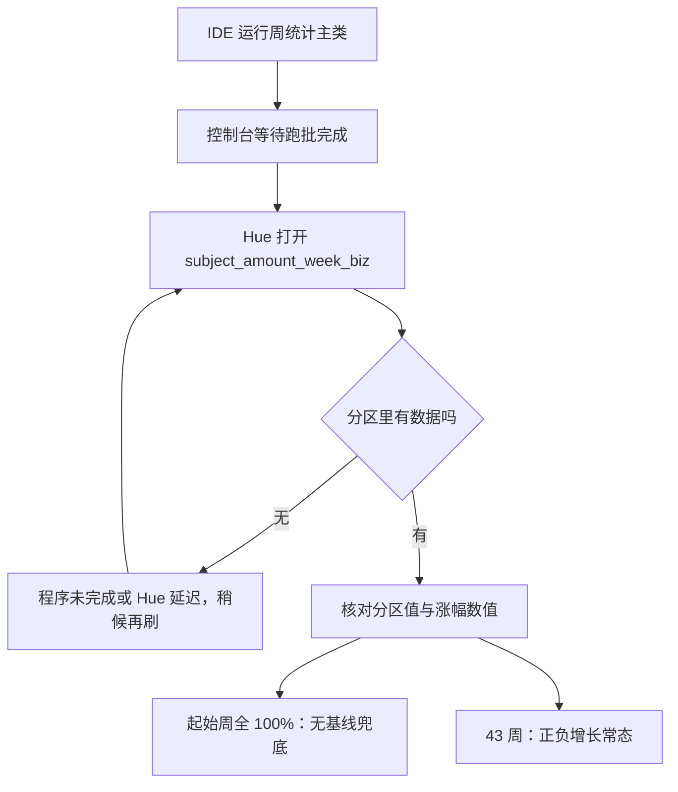

这张图是测试的完整回路：空表先回到等待，而不是回到代码。以控制台跑完为前提，Hue 稍候再刷，数据就会出现；拿空表当程序失败去反复重启任务，只会越搅越乱。

### 起始周的 100% 从哪来

程序跑完，控制台 show 出各分类的销售额与涨幅，第一轮测试日期取 9 月中旬，结果落在 2019 年第 39 周，涨幅一列全是 1.0。原因在数据侧：在线教育平台的购买数据从 9 月才开始积累，第 39 周的上周区间里一行明细都没有，工具方法里对比侧的子查询对每个分类都返回空，LEFT JOIN 之后 b.sale_amount 全是 null，`(a - null) / null` 还是 null，`IFNULL` 按口径兜底成 1.0。涨幅 100% 的真实含义是「这一周没有可对比的基线」，不是每个分类都恰好翻倍。

换 2019-10-25 再跑一轮，结果落在第 43 周。这一周的上周已经落在 10 月中旬，仓库里有真实数据，涨幅立刻变成正负都有：有的分类环比上涨，有的回落，这才是不带兜底痕迹的正常统计结果。两轮测试放在一起，正好把 `IFNULL` 的两条分支都踩了一遍。

```scala
// 查看结果：按分区读周销售额
spark.sql("select * from data_subject.subject_amount_week_biz").show()
// 关闭资源
spark.close()
```

展示端解读这类结果时要留意：第 39 周的 100% 不能当业绩播报，它是兜底口径；第 43 周起的正负值才有环比意义。口径懂了，数字才敢用。

### 日志里的分区裁剪

控制台日志里有一段值得停下来看：`FileSourceStrategy` 打印的裁剪记录显示，扫描条件被下推成了目录级过滤，实际读取只落在两个日期区间的日分区上。过滤条件写的是 `concat_ws('-', years, months, days) between ...`，外面套了函数，通常会被当成「对列做了运算、索引与裁剪失效」的反例；但这里的表达式只引用 years、months、days 三个分区列，Spark 能把它整棵下推成目录名比较，无关月份的分区整目录跳过。

这个细节的工程含义是：`concat_ws` 包分区列不必然废掉裁剪，废掉裁剪的是表达式里混入非分区列。写分区过滤时保持表达式只碰分区列，函数套着也能裁；一旦像 `concat_ws('-', years, dt)` 这样混进普通列，就只能全扫。DWM 表按天分区、数据按天落目录，裁剪生效与否直接决定每次跑批扫多少文件。

### 接上调度脚本

测试通过后，生产形态交给散落资料里备好的调度脚本，日期从参数传入：

```bash
#!/usr/bin/env bash
if [[ $1 != "" ]];then
  TD_DATE=$1
else
  echo "[===no params input, expect date like 2019-10-25===]"
  exit 1
fi
SPARK_SUBMIT=/opt/spark/bin/spark-submit

$SPARK_SUBMIT \
  --master spark://spark-master:7077 \
  --class com.study.xc.analysis.subject.sales.SubjectSalesByWeekBiz \
  /opt/run/jars/xc-service-offline-jar-with-dependencies.jar ${TD_DATE}
```

脚本无参直接退出并提示，防止空参误跑；入口类是销售额周统计主类，按天传分析日。主类里把写死的测试日期换回 `args(0)`，测试与生产就接上了。写入走同分区覆盖，调度哪天失败就重跑哪天，重跑只覆盖命中的周分区，幂等性在写入模式里已经备好。

## 第17部分：热门学科排名-统计分析-销售额-月-统计分析步骤&代码编写

销售额的周版刚测完，月版照例提上日程。数据与周统计一模一样，统计步骤一模一样，能改的只剩周期这一层参数。做法沿用在销售量与学生人数两条线上验证过的路线：复制周版主类做定向改造，把改造点列成清单，逐处替换、逐处核对。

### 周月同构，改在周期层

月统计的七步与周版一字不差：获取当前月时间区间、获取上月相同区间、获取本月数据、获取上月数据、计算增幅、根据维度 id 获取相关数据、保存结果。基础数据仍是 `data_course.course_buy_dwm`，聚合字段仍是 `sales`，涨幅公式仍是 `IFNULL` 兜底 1.0。变化的只有日期这一层：区间从自然周换成「月内至今」的同位区间，分区从年中的周换成年中的月。

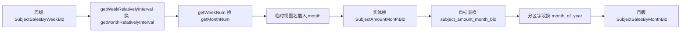

这条链是全部改造路径：六个箭头六类替换，没有任何一步触碰计算逻辑。月区间的语义值得单独交代，讲义 3.5.3.2.1 的定义是当月区间取「1 号至分析日」，上月取「1 号至上月同日」。以分析日 18 号为例，两条窗口都是 18 天长，月初每过一天两条窗口各长一天，任何时刻拿到的涨幅都是等长窗口的公平对比；如果拿本月头 18 天对上月整月，涨幅会被天数差直接污染。

### 月版主类完整形态

六处替换全部落地后，月版主类如下。日期仍写死方便测试，接入调度时换回 `args(0)`：

```scala
package com.study.xc.analysis.subject.sales

import com.study.xc.common.EtlEnvironment
import com.study.xc.entity.SubjectAmountMonthBiz
import com.study.xc.utils.DateUtils.{getMonthNum, getMonthRelativelyInterval}
import com.study.xc.utils.SubjectUtils.subjectBuyAmountSql
import org.apache.spark.sql.SparkSession

object SubjectSalesByMonthBiz {
  // 初始化参数
  val spark: SparkSession = EtlEnvironment.getSparkSession(this.getClass.getSimpleName)

  def main(args: Array[String]): Unit = {
    import spark.implicits._
    //    val date_info = args(0)
    val date_info = "2019-11-11"
    val monthRelativelyInterval = getMonthRelativelyInterval(date_info).split(",")
    // 当月区间，按冒号切出始末日期
    val current = monthRelativelyInterval(0).split(":")
    // 获取当前月是一年中的第几月
    val monthOfYear = getMonthNum(current(0)).split("-")
    // 上月区间
    val last = monthRelativelyInterval(1).split(":")
    // 计算涨幅得到临时表，然后与维度表关联，得到需要的业务表
    subjectBuyAmountSql(spark, current, last)
      .createOrReplaceTempView("buy_amount_biz_month_tmp")
    // 关联维度表
    val buyDF = spark.sql(
      s"""
         |select
         |a.course_category_dim_id,
         |b.name course_category_name,
         |cast(a.sale_amount as int) sale_amount,
         |cast(a.amount_percent as float) amount_percent,
         |'${monthOfYear(0)}' years,
         |'${monthOfYear(1)}' month_of_year
         |from buy_amount_biz_month_tmp a
         |left join data_dimen.course_category_dim b
         |on a.course_category_dim_id = b.course_category_dim_id
         |""".stripMargin)
      .as[SubjectAmountMonthBiz]
    // 指定 hive 参数，保存到表
    spark.conf.set("hive.exec.dynamic.partition.mode", "nonstrict")
    // 保存到数据仓库
    buyDF
      // 输出一个文件，由于分区减少效率低，数据小时不影响
      .repartition(1)
      .write
      // 相同分区覆盖
      .mode("overwrite")
      // 指定表名
      .insertInto("data_subject.subject_amount_month_biz")
    // 查看结果
    spark.sql("select * from data_subject.subject_amount_month_biz").show()
    // 关闭资源
    spark.close()
  }
}
```

月版实体与结果表如下，注意金额列在建表语句里是 Int：

```scala
/**
  * 热门学课 - 销售额 - 月
  *
  * @param course_category_dim_id 学科 id
  * @param course_category_name   学科名
  * @param sale_amount            销售额
  * @param amount_percent         涨幅
  * @param years                  分区年
  * @param month_of_year          分区年中的月
  */
case class SubjectAmountMonthBiz(course_category_dim_id: String,
                                 course_category_name: String,
                                 sale_amount: Float,
                                 amount_percent: Float,
                                 years: String,
                                 month_of_year: String)
```

```sql
CREATE EXTERNAL TABLE
IF NOT EXISTS data_subject.subject_amount_month_biz
(course_category_dim_id String,
course_category_name String,
sale_amount Int,
amount_percent Float)
PARTITIONED BY (years String, month_of_year String)
ROW FORMAT DELIMITED FIELDS TERMINATED BY '\t'
STORED AS PARQUET
location'/user/hive/external/data_subject/subject_amount_month_biz';
```

实体里 sale_amount 仍声明为 Float，select 侧 `cast(a.sale_amount as int)` 把金额取整后写入 Int 列，`insertInto` 按列位置匹配并做类型收窄，整条链是自洽的。这与周表建 Float、取整写入的形态一脉相承，金额按元为最小单位是课程代码的统一口径。

### 变量名与注释也计入改造

**能跑不等于改对，见名知意才算改完。** 复制周版后，`weeks`、`weekOfYear` 这类变量即使不改名程序也照常工作，因为编译器只认类型不认语义。但留着周字面量，下个月读代码的人要在每处 `weeks(0)` 前默念一遍「这是月区间」，成本转嫁给了未来。所以替换清单里专门有一项是变量名：`weeks` 改 `monthRelativelyInterval`，`weekOfYear` 改 `monthOfYear`，行注释里的「周」全部改「月」，类文档从「每周」改「每月」。

收尾的核对姿势与此前两轮改造一致：自上而下按数据流重读，日期进、区间出，区间进、临时表出，临时表进、维度关联出，最后核对表名与分区字段。分区字段这一处要格外较真，`insertInto` 按位置匹配列，select 里若还输出 week_of_year，周数会被塞进 month_of_year 分区，不报任何错，查询结果整片错乱。表名与分区在同一张清单里核对，改表必查分区。

## 第18部分：热门学科排名-统计分析-销售额-月-测试入库

月版代码跑起来，测试现象比周版更戏剧化：10 月对 9 月的同比动辄百分之几百，翻几页数据又看到负增长。涨幅一会儿上天一会儿入地，究竟是代码错了还是数据本来如此？这一轮测试把这个问题讲透，顺便给热门学科排名的三条指标线做一次总盘点。

### 两轮测试：先 10 月再 11 月

第一轮把分析日传成 10 月下旬，当月区间是 10 月 1 号至分析日，对比区间是 9 月的同位区间。程序跑完，控制台 show 出各分类的销售额与涨幅，数值大得扎眼：500%、600%、800%。这组数字是真实计算的结果，不是兜底，也不是 bug：在线教育平台的购买数据 9 月才开始积累，月度基数很薄，10 月的数据量比 9 月同期多出数倍，除法算出来自然是几倍的涨幅。基数薄的时候，高涨幅恰恰说明业务在起量。

第二轮把分析日换到 11 月下旬再跑，看 11 月对 10 月的同比。此时 10 月与 11 月的数据体量已经对等，涨幅应当回归常态。跑完后去 Hue 打开 `data_subject.subject_amount_month_biz`，样本数据里先看到的仍是 10 月分区的行，涨幅 500% 上下，那是上一轮跑批留下的分区；往下翻过 20 多条，11 月分区的行才出现，涨幅有正有负，其中大数据分类约负 20%，云计算也在常态区间波动。两轮放在一起读：同一张表里，10 月分区记录的是「10 月对 9 月」，11 月分区记录的是「11 月对 10 月」，跨分区的涨幅变化讲的是基数对齐的过程。

```scala
// 查看结果：月分区数据
spark.sql("select * from data_subject.subject_amount_month_biz").show()
// 关闭资源
spark.close()
```

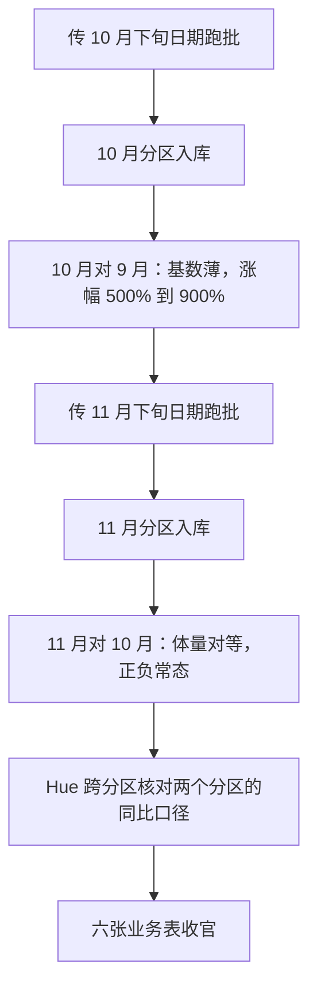

这张图把两轮测试串成一条口径演进线：涨幅从夸张回到常态，不是代码变了，而是基线在两个月份之间对齐了。读同比数据先问基线厚薄，再谈涨跌结论。

### show 的 20 行与全量核对

控制台 `show()` 不带参数时默认只打印 20 行，这条默认值在分类数超过 20 时会制造错觉：屏幕上恰好全是 10 月分区的行，11 月的行被截在屏幕外，看起来像「11 月没写进去」。翻页有两种做法，`show(100)` 直接放大行数，或者到 Hue 的表浏览器里看全量样本。测试用的是后者，顺便把分区结构也核了一遍。

Hue 里的核对顺序是先分区后数值：确认 years 加 month_of_year 的分区都出现了，11 月分区里各分类行数与控制台一致，再抽查几行的 sale_amount 与 amount_percent。中间偶尔刷新看不到最新数据，是 Hue 读元数据与数据文件的延迟，稍等再刷即可，与程序无关。

### 三条指标线收官

到这里把热门学科排名统计分析的成果摊开盘点。三个指标、两个周期、六张业务表，全部落在 data_subject 库：

| 指标 | 统计语义 | 工具方法 | 周表 | 月表 |
|---|---|---|---|---|
| 销售量 | 订单件数 `sum(salesvolume)` | `subjectBuyCountSql` | `subject_sale_week_biz` | `subject_sale_month_biz` |
| 学生人数 | 选课人次计数 | `subjectLearnSql` | `subject_user_week_biz` | `subject_user_month_biz` |
| 销售额 | 订单金额 `sum(sales)` | `subjectBuyAmountSql` | `subject_amount_week_biz` | `subject_amount_month_biz` |

六段统计代码共用同一副骨架：日期工具类算同位区间，工具类里一指标一方法算取数与涨幅，主类做维度关联与动态分区入库；差异只在聚合字段、维度字段与目标表。销售额月统计的生产形态由散落资料里的调度脚本接管：

```bash
#!/usr/bin/env bash
if [[ $1 != "" ]];then
  TD_DATE=$1
else
  echo "[===no params input, expect date like 2019-11-25===]"
  exit 1
fi
SPARK_SUBMIT=/opt/spark/bin/spark-submit

$SPARK_SUBMIT \
  --master spark://spark-master:7077 \
  --class com.study.xc.analysis.subject.sales.SubjectSalesByMonthBiz \
  /opt/run/jars/xc-service-offline-jar-with-dependencies.jar ${TD_DATE}
```

脚本无参直接退出并提示，防止空参误跑；主类里把写死的测试日期换回 `args(0)`，测试与生产接上。再往后一环，NiFi 模板把 Hive 业务表同步进 MySQL，报表系统从 MySQL 读数出图，章学习目标里「编写热门学科排名的分析程序」与「将分析结果同步到 MySQL」两条要求分别落在统计层与同步层。热门学科排名从采集、清洗到统计分析的整条链路，至此全部闭环。

## 第19部分：热门学科排名-统计分析-使用NiFi将业务数据从数据仓库同步到MySQL

销售量、学生人数、销售额三套指标的周月统计结果已经全部落在数仓的 `data_subject` 库里，但业务报表系统的后台只连 MySQL，数仓里的数据它一概看不见。热门学科排名这条线要走出数仓，还差最后一段搬运：把 Hive 里六张业务表同步进 MySQL 业务库。这段活不写代码，靠 NiFi 模板完成，一个处理器组里装六条支线，导入、配置、启动、核对，一气呵成。

### 六张业务表与它们的形态

同步的目标表在建在线教育平台业务库时已经随库导入，六张表按指标与时间粒度命名，以销售量周表为例：

```sql
-- 在导入在线教育平台业务数据时，business 数据库已导入
CREATE TABLE `subject_sale_week_biz` (
  `course_category_dim_id` varchar(255) NOT NULL,
  `course_category_name` varchar(255) DEFAULT NULL,
  `sale_num` int(11) NOT NULL,
  `sale_percent` float(11,4) DEFAULT NULL,
  `date_info` varchar(255) DEFAULT NULL
) ENGINE=InnoDB DEFAULT CHARSET=utf8;
```

其余五张同构：学生人数表把 `sale_num`、`sale_percent` 换成 `user_num`、`user_percent`，销售额表换成 `sale_amount`、`amount_percent`，月表只是表名里 `week` 换 `month`。与 Hive 侧业务表相比，MySQL 侧少了 `years`、`week_of_year`、`month_of_year` 三个分区列，合并成一个 `date_info` 字符串列，比如 `2019-45` 表示 2019 年第 45 周、`2019-11` 表示 11 月。展示层只按这个字符串取数画图，分区裁剪那套机制在 MySQL 里没有存在的必要，需要什么同步什么即可。

这个拼接在查询语句里完成，同步链路的第一环就把 Hive 的分区列捏成了展示层的 `date_info`，两边的形态差异在源头对齐。

### 一条支线五个处理器

每条支线的处理器链与课程访问量、课程购买量的同步完全同款，只是查询与目标表换成了学科排名的内容：

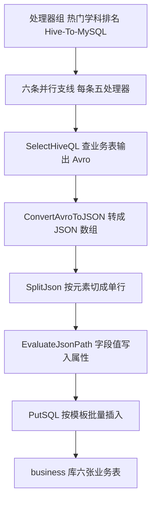

关键路径在查询与取值两环。SelectHiveQL 挂 Hive 连接池，查询把分区列拼进 `date_info`：

```sql
select course_category_dim_id ,course_category_name ,user_num ,user_percent,
concat_ws('-',years,week_of_year) date_info
from data_subject.subject_user_week_biz
```

输出格式保持 Avro，整份查询结果是一个流文件。ConvertAvroToJSON 把它转成 JSON 数组，SplitJson 用 `$` 表达式按元素切开，一行记录一个流文件。EvaluateJsonPath 配 `flowfile-attribute`，五个字段各配一条表达式：`$.course_category_dim_id`、`$.course_category_name`、`$.user_num`、`$.user_percent`、`$.date_info`，值从流文件内容搬进属性。PutSQL 拿属性填模板：

```sql
INSERT INTO `business`.`subject_user_week_biz`
VALUES ('${course_category_dim_id}', '${course_category_name}', '${user_num}', '${user_percent}', '${date_info}');
```

`${}` 里引用的属性名必须与上一步提取的属性名一字不差，Batch Size 配 1000，攒一批执行，十几个分类的结果集一次往返就写完。六条支线的差异只在这两句话：查询里的表名与字段、插入语句里的目标表，其余配置逐字相同。

### 十二个感叹号的批量处理

模板上传添加后，处理器组上挂着 12 个感叹号，数量看着吓人，拆开就是 6 组各 2 个连接池。配置动作可以流水线化：

```text
1. 上传学科排名的 Hive-To-MySQL 模板，用添加模板方式拖入画布
2. 进入处理器组，六条支线各自独立，逐条处理
3. 每条支线：Hive 连接池直接启用
4. 每条支线：MySQL 连接池补密码 123456，再启用
5. 六条全部消警后，启动整个处理器组
```

MySQL 连接池的核心配置是连接串、驱动与账号口令：

```text
Database Connection URL      jdbc:mysql://xc-online-mysql:3306/business
Database Driver Class Name   com.mysql.cj.jdbc.Driver
Database Driver Location(s)  /opt/mysql-connector-java-8.0.16.jar
Database User                root
Password                     123456
```

Hive 连接池在前面的采集环节已经配好连接信息，这里只剩启用一个动作。最容易出事的是密码：连接池不填密码也能启用，启动处理器时才会连接失败，处理器告警与失败队列一起冒出来。六个池逐个过一遍，复制粘贴密码，比跑起来再回头排查省时间。

### 入库验证与追加写的坑

启动整组后，画布上六条支线的队列同时开始流动，每条支线的流量上限就是 Hive 侧业务表当前的行数，十几个分类几十行数据，几秒内走完。切到 Navicat 打开 `business` 库，六张表逐个刷新：周表里新周次的行进来了，月表里新月份的行也进来了，与数仓侧统计输出的行数一致，同步就算闭环。

有一处与数仓侧截然不同的语义要吃透。数仓侧统计程序写 Hive 用动态分区 overwrite，同一段数据重跑只会覆盖命中的分区，幂等安全；这里 PutSQL 是纯 INSERT，没有任何去重与覆盖，同一段数据重跑一次，表里的行数就翻一倍。模板里存着前几轮测试的旧数据，与本次新增的行混在同一张表里，正是这个追加语义留下的痕迹。所以联动测试或生产调度重跑前，先把 `business` 六张表清空是固定动作，下一课的联动测试就从这个清空开始。

## 常见误区

- **以为三项指标要重新采集业务数据。** 错例：统计前从业务库把订单表、选课表再拉一遍进数仓。正解：统计的全部输入已在 DWD 与 DWM 层就位，统计层只做聚合关联；再采一遍既浪费又可能引入口径不一致。
- **连接池没逐个确认就启动整组。** 错例：只启用 Hive 侧连接池、MySQL 连接池漏配口令就点启动，处理器全部绿了照样在运行时连接失败，PutSQL 全部进失败队列；或只配一半支线就急着启动，剩下几条连接池未启用，整组启动后一半支线挂告警。正解：controller service 逐个确认状态，六个 MySQL 池逐个填 `root` 加密码 123456 再启用，口令属于连接配置的一部分，不是可选项；12 个感叹号全部消除后再启动，一条支线都别落下。
- **乱码只重启不重新采集。** 错例：重启完 NiFi 直接看表，问号还在，以为没修好。正解：重启只让进程编码恢复正常，表里的旧数据要靠重新采集覆盖掉。
- **维度采集一律追求增量。** 错例：担心重复采集浪费，想给分类维度配增量机制。正解：课程分类数据量小、阶段内稳定，覆盖式全量采集既简单又幂等；增量采集适合的是持续增长的流水数据，维度表用覆盖更省心。
- **按术语字面理解涨幅。** 错例：看到「同比」就去找去年同周的数据，实现层面找错比较对象。正解：口径以分子分母为准，本课实现是本周与上周对比（环比口径），术语叫什么以团队约定为准，落地必须与实现一致。
- **把日期或表名写死在 SQL 或工具类里。** 错例：SQL 里直接过滤 `2019-07-01` 到 `2019-07-05`，每周上线都要改代码；从 Hue 搬 SQL 或抽取工具方法时残留 `'2019-11-04'` 这类调试日期，月统计一调就产出错区间的数据。正解：区间由基准日期推算，搬运时同步换成 `${current(0)}` 等四个插值变量，任务按天调度时传哪天就统计哪天所在的周；工具方法只认参数，测试期写死日期这件事只留在主类的 `date_info` 变量一处，生产形态与调度脚本的日期传参对齐。
- **两期区间不对齐。** 错例：本周取周一到周五，上周取整周七天，聚合基数不同，涨幅数字失真。正解：步骤 2 的「相同时间区间」是硬约束，起止位置与天数必须与本周一致。
- **涨幅分母为零不设防。** 错例：上周某学科销售量为 0，除法得到 NaN 或无穷大，入库后报表渲染异常。正解：分母为 0 时按业务约定落默认值（如 0 或空），并在统计代码里显式处理这一分支。
- **week_of_year 口径混用。** 错例：推算周数时一处用 ISO 8601 标准（周一起始、首周含首个周四），另一处用默认 Calendar 口径，跨年边界上分区值对不上。正解：全链路统一一种周数标准，跨年周归属规则先定后写。
- **按日历周直接取「本周」。** 错例：周一跑批取当天所在周，一周里只攒了周一凌晨几个小时的数据，结果没有意义。正解：锚点取分析日的前一天，参与统计的一定是走完的完整周。
- **给周一特例单独写分支。** 错例：判断指定日期是否周一，分别返回不同组合，分支一多必有遗漏。正解：只实现「取前一天再定位周一」一个动作，特例由锚点自然覆盖。
- **把逗号与冒号混成一个分隔符处理。** 错例：一次 `split` 既想分周又想分始末，数组必然错位。正解：逗号分两组区间，冒号分始末日期，两层各自切开，各管各的。
- **返回值当日期对象用。** 错例：拿到返回值直接传给需要 `LocalDate` 的方法，编译报错。正解：字符串是这里的格式契约，需要日期对象时在消费侧自行解析。
- **拿 `count` 顶替 `sum`。** 错例：看到统计销量就写 `count(salesvolume)`，数出来的是行数不是量值。正解：DWM 行粒度是课程加天，量值聚合用 `sum(salesvolume)`，聚合键才是 `count` 该出现的地方。
- **分区拼接分隔符写错。** 错例：`concat_ws` 的分隔符写成空串或斜杠，拼出的日期串与 `between` 边界对不上，结果整表为空。正解：分隔符用横杠，拼出的形态必须与区间字符串逐字符一致。
- **该用 left join 的地方用了 inner join。** 错例：两周对齐时用 `inner join` 或把上周当主表，上周没数据的新学科整行丢失，排名凭空少人；维度关联时内 join 把维表缺分类的统计行静默吞掉，人数变少却无报错。正解：一律以统计行为主体做 `left join`，两周对齐以本周为主表，维表缺失补 null，行数不缩水。
- **输出列不起别名。** 错例：涨幅表达式裸奔不命名，或 `cast(a.sale_num as int)` 裸写，列名变成整段表达式，下游按名字找不到列，实体映射也对不上。正解：每个输出列显式起别名，cast 完紧跟原字段名的别名，名字与类型同时归位，并与 APP 层字段名保持一致。
- **把 insertInto 当按名字写入。** 错例：随意调整 DataFrame 列序，列与表结构错位，数据落错列且不报错。正解：DataFrame 列序必须与表结构一致，分区列排在最后，写入前对照实体检查一遍。
- **忘掉隐式转换导入。** 错例：`.as[SubjectSaleWeekBiz]` 处编译标红，怀疑实体定义有问题。正解：`main` 开头补 `import spark.implicits._`，DataFrame 转 DataSet 的 Encoder 在隐式参数里。
- **把 `repartition(1)` 当万能配置。** 错例：数据量大的指标也合并成单文件写入，写入耗时暴涨。正解：单文件适合本课这种小批量结果，大表按分区数据量决定并行度。
- **方法返回类型标成 Unit。** 错例：抽取时习惯性写 `: Unit`，主类拿不到 DataFrame，链式调用编译报错。正解：方法体末尾的表达式就是返回值，返回类型交给编译器推断，或者显式标 `DataFrame`。
- **只看控制台不看落库。** 错例：show 出正确结果就宣布完成，分区表里实际没写进去或写错分区，展示端查不到。正解：控制台核数值、Hue 核分区，两条线都验、都绿才算闭环，落库以分区数据为准。
- **调度脚本无参时继续执行。** 错例：不传参数脚本拿空值当日期往下跑，写出一个空分区。正解：参数判空后直接退出并给出提示，空参比错参更危险。
- **以为月同比对比的是整个上月。** 错例：拿 11-01 至 11-11 的销量或本月 1 至 18 号的销售额直接除上月全月，涨幅被天数差异淹没，得出必然偏低的假涨幅。正解：本课口径是月累计至今的同位等长区间，上月 1 号至上月同一天，两侧天数相同、口径对称，窗口等长才有可比性。
- **改了表名忘了改分区字段。** 错例：目标表换成 `subject_sale_month_biz` 或 `subject_amount_month_biz`，select 里仍输出 `week_of_year`，`insertInto` 按列位置匹配不报错，周数被写进月份分区。正解：表名与分区字段在同一处清单里绑定核对，列的顺序、类型、分区结构必须与建表语句一致，改表必查分区。
- **临时视图沿用周程序或别的指标的名字。** 错例：两份代码都注册 `salesvolume_biz_tmp` 或 `buy_amount_biz_tmp`，周月两个统计同进程先后执行或复用同一 SparkSession 时同名互相顶掉，后跑的任务读到错口径。正解：视图名编入统计周期与指标（插入 month，销售额用 `buy_amount_biz_tmp`），让每个统计周期的临时数据各有其名，注册与引用两处同步改。
- **复制改造后替换不彻底就跑批。** 错例：全局替换完看都不看就运行，某个 `weekOfYear` 残留导致分区值错误；变量重命名了，字符串里还写着旧视图名或 week_of_year，运行期或落库时才暴露；`weeks`、`weekOfYear` 原样留在月版代码里；涨幅字段沿用 `sale_percent` 旧名，读代码的人要猜它存的是不是销售额涨幅。正解：自上而下按数据流重读一遍，字符串内容全局手动搜一遍，注册处与引用处都核，确认每一处变量都指向新语义；变量与注释一并替换，命名跟语义走，sale_num 对 sale_amount、sale_percent 对 amount_percent 成对替换。
- **把控制台的输出顺序当成写入顺序问题。** 错例：看到先打印 11 月后打印 10 月，怀疑分区写错。正解：`show` 是无过滤的全表顺序输出，后写的排在后面，用分区过滤查询核对才准确。
- **拿 show 的默认 20 行当全量结论。** 错例：屏幕里没有 10 月或 11 月的行、只看到几条，就断定写入不完整或月分区没写入。正解：`show` 默认 20 行截断，放大行数或到 Hue 全量核对后再下结论。
- **把 1.0 的涨幅当成计算错误。** 错例：10 月全是 100% 增幅，或看到整列 1.0、起始周 100%，就怀疑涨幅公式坏了，去翻 SQL 与数据排查。正解：基线为空（上周或上月窗口无数据）时 `IFNULL` 兜底为 1.0，无基线按 100% 处理是设计行为与既定口径，先检查对比区间是否有数据再下结论，兜底逻辑正常时 1.0 是预期输出。
- **把 Hue 里暂时没数据当成写入失败。** 错例：程序刚跑完甚至还在跑就去刷 Hue，刷新一次没看到就认定入库失败，回炉查代码、反复重启或重跑任务。正解：以控制台跑完为前提，Hue 读数仓有短暂延迟，确认程序日志跑完且无异常后延迟几秒多刷新一次再看分区；重跑虽幂等但没必要。
- **把学生人数默认理解成去重人数。** 错例：直接拿 `count(user_dim_id)` 的结果当「有多少个学生」，一个用户选多门课被计多次，按去重人数理解的数据实际是选课人次，与需求对不上。正解：口径在需求阶段与业务确认，要人次用 `count`，要人数用 `count(distinct user_dim_id)`，聚合函数按口径选。
- **以为换了指标就要重搭流程。** 错例：为人数统计另起一套完全不同的代码结构。正解：七步流程、日期工具、涨幅公式全部复用，只换数据源、聚合函数、实体与结果表四处。
- **直接改销售量工具方法的表名就跑。** 错例：在 `subjectBuyCountSql` 里把 `course_buy_dwm` 换成事实表，`sum(salesvolume)` 原样保留，产出的是销量当人数的错表。正解：人数统计用独立的 `subjectLearnSql`，聚合函数换成 `count(user_dim_id)`。
- **拿 `time_dim_id` 做日期过滤。** 错例：看到事实表里有时间维度键就去 between，它不是「年-月-日」格式，区间过滤拼不出来，查询无结果。正解：与销售量统计保持同一手法，用 `concat_ws('-', years, months, days)` 拼分区日期再做区间过滤。
- **聚合列与非聚合列混用不写 `group by`。** 错例：select 里同时放分类 ID 和 `count`，执行报聚合错误。正解：非聚合列必须出现在 `group by` 里，按分类 ID 分组后每组的 `count` 才有意义。
- **兜底分支没实测就上线。** 错例：`IFNULL` 写完看一眼代码就过，只跑数据充足的常态日期，兜底分支从未被验证，线上新分类涨幅异常才发现。正解：空区间轮与常态轮各跑一轮，从最早分区反推一个「上一周无数据」的分析日实跑，见到 1.0 才算验证了兜底。
- **忘设 nonstrict。** 错例：全动态分区写入在 Hive 严格模式下直接失败。正解：写入前执行 `spark.conf.set("hive.exec.dynamic.partition.mode", "nonstrict")`。
- **把临时视图当持久表用。** 错例：另起一个进程想复用 `learn_biz_tmp`，视图早随原进程销毁了。正解：临时视图只在本进程内有效，跨任务共享要么落表要么由调度串联。
- **报错只看栈顶。** 错例：看到 AnalysisException 就去翻 SQL 语法，越查越偏。正解：错误里的列名直接指明哪张实体没换，先核对列名与实体的对应关系。
- **把涨幅 0 当计算错误。** 错例：0 涨幅行被当成 bug 反复排查代码。正解：核对两侧区间的计数是否相等，相等则 0 是正确结果。
- **担心覆盖历史月份。** 错例：以为 overwrite 会清空整张月表，不敢按天重跑。正解：动态分区 overwrite 只覆盖命中的分区，历史月份安全，重跑幂等。
- **以为销售额要另建一张明细表。** 错例：觉得金额和件数是两个业务，去数仓找一张独立的「销售额表」。正解：两个度量同在 `course_buy_dwm`，统计层换聚合字段即可，无需新明细。
- **以为函数包住分区列必然全表扫描。** 错例：看到 `concat_ws` 套在分区列外就断定裁剪失效。正解：表达式只引用分区列时照样能做目录裁剪，混入非分区列才会全扫。
- **把高涨幅当异常数据。** 错例：看到 900% 就怀疑 SQL 写错，反复核对代码。正解：先看基线，9 月基数薄是业务事实，涨幅是真实计算；基线对齐后数字自然回归。
- **跨分区直接比数值不看口径。** 错例：把 10 月分区的 900% 与 11 月分区的负 20% 放一起说「业务崩了」。正解：每个分区的同比基线不同，10 月对 9 月、11 月对 10 月，先对齐口径再比较。
- **把 overwrite 经验套到同步链路。** 错例：以为重跑同步会覆盖 MySQL 旧数据，放心反复测试。正解：PutSQL 是追加写，重跑前 truncate 业务表，否则行数翻倍新旧混淆。
- **属性名与模板引用对不上。** 错例：EvaluateJsonPath 提取的属性叫 `sale_num`，PutSQL 模板里写成 `${saleNum}`，插入全变空串。正解：属性名与 `${}` 引用名逐字核对。

## 面试可能被问到的问题

1. 面试官追问：「事实表里已经有课程分类 id 了，为什么统计前还要单独采分类维度表？」
   答：事实表按窄表原则只存维度外键，id 可以聚合分组但解析不出展示名。学科名称、层级关系这些属性维护在维度表里，统计结果要给报表展示就必须关联维度表取 name。清洗时存 id 让事实表稳定且不随改名重跑，名称解析延迟到使用点，这是维度建模的标准分工。
2. 面试官追问：「同样是 MySQL 到 Hive 的采集，维度采集和选课数据采集的处理器链为什么不同？」
   答：维度表小而稳定，用查询式的 `QueryDatabaseTable` 全量拉取、覆盖写入即可，简单幂等；选课是持续增长的流水数据，实时性有要求，用 `CaptureChangeMySQL` 监控 binlog 做实时采集。选型看两点：数据量与变更频率、时效要求，不是处理器谁的更高级。
3. 面试官追问：「NiFi 的 controller service 是什么，为什么口令配在连接池上？」
   答：controller service 是处理器共享的后端服务，数据库连接池、Hive 连接、分布式缓存都属于此类。把连接信息收敛到服务层，多个处理器引用同一份配置，改口令只改一处；处理器本身保持无状态。这也是为什么采集报连接错误时要先查服务的状态与配置，而不是处理器本身。
4. 面试官追问：「六个统计任务（三指标乘两级时间）会不会造成大量重复代码？」
   答：会，如果不做抽象。三项统计的数据结构高度同构：维度 id、名称、度量值、涨幅、分区字段，差异只在来源表与聚合粒度。成熟做法是把公共步骤抽工具方法（获取时间区间、涨幅计算、维度关联、入库），每个任务只保留参数差异，本课程的代码也按这个方向逐步抽取工具类。
5. 面试官追问：「统计结果为什么先落 Hive 再同步到 MySQL，报表系统直接读 Hive 不行吗？」
   答：报表系统是典型的 OLTP 点查场景，按条件查几行几列、要求毫秒级响应，Hive 的 MapReduce 批处理模式扛不住这种访问形态；MySQL 生态与报表后台天然匹配。Hive 承担大范围统计分析，结果表体量小，同步到 MySQL 后供点查，这是离线数仓与服务库分工的标准架构。
6. 面试官追问：「NiFi 采集中文乱码，你确认过哪些环节才定位到进程编码？」
   答：按链路分段排除：源 MySQL 里中文正常，排除数据源头；Hive 表结构与字符集没动过且其他表正常，排除存储端；坏点夹在中间的采集进程。再结合乱码在容器重启后规律性复现，指向 NiFi 进程启动阶段编码信息未加载全，重启后恢复验证了判断。
7. 面试官追问：「统计为什么不直接在 DWD 事实表上聚合，周统计为什么要读 DWM 表？」
   答：DWM 把多个统计任务都要用的公共口径提前算好，本课按课程聚合的量与额被六个统计任务复用；DWD 是明细事实，粒度最细，每次统计都要重算一遍课程级聚合，而 DWM 已经按课程轻度聚合过，周统计只需在其上做一次按学科的 sum，加工链路短、扫描量和计算量都小，口径也统一在一处维护。直接在 DWD 上算不是不行，但同样的聚合逻辑要在多个任务里重复实现，口径漂移与重复计算的成本随任务数放大；分层的作用就是让每层统计站在合适的粒度上，而不是每次都从最细的明细或原始层出发。
8. 面试官追问：「同比和环比的准确区别是什么？」
   答：环比是与时间上相邻的上一周期比较，本周对上周、本月对上月；同比是与去年同一时期比较，本周对去年同周、本月对去年同月，目的是消除季节性。两者的分子分母结构相同，只是基期不同。本课程的涨幅按上周对比实现，属于环比口径，讲义称同比取的是「同期相比」的宽泛含义。
9. 面试官追问：「由一个日期推算它所在周的区间，要注意什么？」
   答：三个点：一周的起点定义（周一起始还是周日起始）、周数的跨年归属（年末年初的周属于哪一年）、区间是否要截止到基准日。推算要用统一的日期工具方法，避免手工算 7 天偏移漏掉闰年与跨年；本课实现把推算封装在工具类里，区间以日期串对的形式返回本周与上周两段。
10. 面试官追问：「结果表用年份加周数做二级分区，比按天分区好在哪？」
   答：分区粒度与查询粒度一致。页面按周查询，按周分区让每次查询只扫一个分区，按天分区则要扫七个目录再聚合，元数据操作也翻倍。分区过细还会造成小文件堆积，一年 52 个周分区远比 365 个天分区友好，写入侧合并文件的策略也更好安排。
11. 面试官追问：「涨幅计算有哪些边界情况要处理？」
   答：上周值为 0 时除法无意义，要按业务约定落默认值；上周数据缺失（任务漏跑）时对比会失真，先校验基期数据存在再计算；涨幅为负是正常业务信号，展示层要支持负增长样式，不能在计算层被截断成 0。三条都应在统计代码里显式分支，而不是依赖浮点运算的默认行为。
12. 面试官追问：「这张结果表为什么建在 data_subject 库，和 data_course 库怎么分工？」
   答：按主题域分层。data_course 沉淀课程相关明细与中间层，粒度到课程与天；data_subject 面向学科主题的最终统计结果，粒度到学科与周，服务热门学科排名的展示与同步。主题域分开后，各库的表结构演进、生命周期管理互不干扰，同步到业务 MySQL 时也按库组织，边界清晰。
13. 面试官追问：「为什么周统计的锚点取分析日的前一天？」
   答：离线跑批处理的是前一天落库的数据。以前一天为锚点，保证参与统计的一定是走完的完整周；直接用分析日所在的日历周，周一跑批时那一周刚开头，数据一天没攒齐，统计结果没有业务意义。
14. 面试官追问：「分析日是周一和周二，返回的区间有什么差别？」
   答：差一整周。周一时前一天是周日，落在上一个周，返回上周区间加上上上周区间；周二及之后，前一天仍在本周内，返回本周区间加上上周区间。代码没有为周一写特殊分支，差别是「取前一天再定位周一」自然产生的。
15. 面试官追问：「方法为什么返回一个拼接字符串，而不是元组或日期对象？」
   答：字符串是两层格式契约，逗号分周、冒号分始末，一次 split 就能按需取用，工具类不必关心下游按天还是按周消费。返回强类型对象会把格式固化在工具类里，改格式就要改所有调用方。
16. 面试官追问：「这个设计怎么支持月统计？」
   答：口径不变，锚点仍取前一天，把「定位周一」换成「定位月初」，返回当前月区间与上个月区间。区间的生成与消费靠字符串格式解耦，换周期只换生成逻辑，下游消费代码不用动。
17. 面试官追问：「服务器时区与数据时区不一致会发生什么？」
   答：锚点会漂移。前一天按服务器时钟算，数据落库按业务时区打分区，两边不一致时整周区间可能错位一天，表现为结果比预期多或少一天。处理办法是统一时区，或在解析日期时显式指定时区。
18. 面试官追问：「为什么以本周为主表做 left join，而不是 inner join？」
   答：排名场景要求本周有数据的学科全部出现在结果里。inner join 会把上周没有数据的学科或首周记录整行丢掉，新学科永远进不了榜单，报表上直接少行，而且这个丢失是隐性的，比一个 100% 涨幅难发现得多；left join 保住本周行，上周缺数据的情况交给涨幅的 `IFNULL` 兜底逻辑处理。
19. 面试官追问：「除零保护除了 IFNULL 还有什么写法，和 coalesce 差别在哪？」
   答：`coalesce(表达式, 1.0)` 效果相同，它按参数顺序取第一个非 null 值，可以设置多级兜底；`case when` 能区分缺数据与除零等多种情况分别给值。IFNULL 语义最直白，两参场景用它最省事。
20. 面试官追问：「分区过滤为什么把三列 concat 起来比，不逐列 between？」
   答：years、months、days 是三个独立分区列，逐列比较要分别构造年、月、日的边界，跨月的区间写起来极易出错。拼成日期串后与区间同格式，一个 between 表达完整语义，可读性和正确性都占优。
21. 面试官追问：「涨幅 1.0 到了展示端怎么处理？」
   答：展示端把它乘 100 换算成百分比，1.0 显示为 100%。存储层保留小数比值有利于计算与排序，格式化是展示层的职责，两层不要互相越界。
22. 面试官追问：「两个子查询扫同一张表两遍，有优化空间吗？」
   答：有。可以一次扫描，用 case when 给行打上本周或上周的标记，再按学科分类加标记分组聚合，把两周销量透视为两列，最后在同一行上算涨幅。数据量大时能省一半扫描，代价是 SQL 更绕；本课数据量小，两个子查询的写法更清晰。
23. 面试官追问：「为什么要注册临时视图，不直接把涨幅 SQL 嵌进关联 SQL？」
   答：临时视图把两层查询解耦，涨幅结果先定型，维度关联在视图上平铺书写，列来源一目了然。嵌套子查询也能实现，但两层括号叠起来后改一处要通读全段，排查成本高；视图还便于单独验证涨幅这一层。
24. 面试官追问：「分区为什么选年加年中周两列，不放一个完整日期？」
   答：报表按周取数，查询条件就是某年某周，两列分区正好一一对应，裁剪时命中一个分区。完整日期会让一周的数据散在七个分区里，按周查询要扫七个分区，还引入按天重复存储的问题。
25. 面试官追问：「insertInto 与 saveAsTable 差别在哪？」
   答：insertInto 写入已存在的表，按列位置对齐，配合动态分区做分区级追加或覆盖，适合数仓场景；saveAsTable 会管理表元数据甚至重建表，列按名字对齐，适合探索与原型。结果表结构固定、按分区重跑的场景用 insertInto 更可控。
26. 面试官追问：「cast 为什么在 SQL 里做，不在实体层处理？」
   答：`.as[实体]` 的类型检查发生在映射时刻，上游列型不符直接失败，没有给实体层留修正机会。在 SQL 里 cast 让进入映射前的数据已经符合实体契约，别名保证名字同时归位，实体只做映射不做修补。
27. 面试官追问：「动态分区的 strict 与 nonstrict 差别是什么？」
   答：strict 模式要求至少提供一个静态分区列，防止误写一条 SQL 把全表所有分区都动一遍、生成海量分区把元数据压垮；nonstrict 允许全动态，分区值全部由数据携带。本课每次只写一个年周组合且值在代码里算好，nonstrict 配合 overwrite 足够安全，是跑批的标准做法。
28. 面试官追问：「同分区重跑为什么不会产生重复数据，跑批任务的幂等性怎么保证？」
   答：写入模式是 overwrite 加动态分区，覆盖语义下本次写入了哪个分区，哪个分区就被整体替换，旧数据随之清空，重跑 N 次与跑一次结果一致。配合两点更稳：每次跑批只写代码里算出的那一个分区，不触碰历史分区；涨幅计算是纯函数式的 SQL，同样输入产出同样结果。这是跑批任务幂等性的来源，也是失败重试的底气。
29. 面试官追问：「判断一段代码该不该抽工具类，你的标准是什么？」
   答：看它与业务周期的耦合度。输入输出全部参数化之后换个周期依然成立的逻辑值得下沉，像取数加涨幅这种逻辑换周换月都成立，就值得抽；维度关联这种每个指标字段都不同的逻辑，抽出去只会制造参数怪物，留在主类。抽的是共性，留的是差异。
30. 面试官追问：「Scala 方法不写返回类型，会不会有风险？」
   答：公开 API 建议显式声明，便于阅读与二进制兼容；工程内部工具方法交给类型推断问题不大，因为方法体的表达式类型变化会立刻反映到所有调用点的编译错误上。此处的风险点是千万别标成 Unit，返回值会被静默吞掉。
31. 面试官追问：「调度传参与统计口径怎么对齐？」
   答：脚本把第一个参数原样传给主类，主类拿它当分析日算相对周区间，锚点取分析日前一天。两侧唯一要对齐的约定就是参数含义是分析日本身，调度在周一传周一，统计的就是刚走完的那一周，任何一侧擅自加减天数都会错位一周。
32. 面试官追问：「周统计结果表没有全量汇总行，业务要全量怎么办？」
   答：展示端按周循环传参逐周取数再拼装，或者另建一条按更大区间聚合的任务。数据层不做全量大宽表是有意的：区间聚合让每个分区的数据语义单一，全量行混进去反而破坏分区裁剪，两件事分开做各自简单。
33. 面试官追问：「周统计和月统计、三条指标线代码重合度这么高，为什么不抽成一个泛型类或共用主类？」
   答：可复用的共性已经沉在日期工具类与各指标的工具方法（如 `subjectBuyAmountSql`）里了，主类剩下的差异是类名、实体、表名、分区字段这些每个任务天然不同的标识信息，再抽象一层只是把这些差异挪进参数列表，得到一个难读的骨架类。复制改名让每份代码各自独立可读，维护成本反而更低；判断标准始终是换场景还成立的抽走，每个场景独有的留下。
34. 面试官追问：「你们的月同比口径是什么，为什么不用整个上月？」
   答：口径是月累计至今对上月同日累计，比如 11-01 至 11-11 对 10-01 至 10-11。离线批在月中就要给出当月走势，可比对象只能是上月的同样一段；月初跑批时本月数据只有几天，拿整个上月比会得到一个必然偏低的假涨幅，等长同位窗口才能在月内任何一天都给出有意义的趋势。整月对比要等月末最后一天才有意义，那是另一种口径，两者别混。
35. 面试官追问：「createOrReplaceTempView 的 replace 有什么风险？」
   答：同名视图会被静默替换，不报错。多个统计任务复用同一个 SparkSession 时，撞名的临时视图会互相覆盖，先跑的任务后续读到的数据是错的。工程上的做法是把统计周期编进视图名，让每个任务各用各的临时视图。
36. 面试官追问：「insertInto 写动态分区按什么匹配列？」
   答：按位置而不是按名字。DataFrame 的普通列与分区列的顺序必须和目标表定义一致，列名不同不影响写入。这也是改表名时必须同步改分区字段的原因：周数写进月份分区不会报错，只会产出错乱的数据。
37. 面试官追问：「复制改造代码（周改月、销售量改销售额）怎么保证没有漏改？」
   答：按数据流自上而下重读：日期参数、区间计算、序号方法、临时视图、维度关联、实体映射、聚合字段与工具方法、目标表与分区，逐段核对每一处标识符的语义；再配合替换清单逐项打勾，变量名与注释编译器不拦，回读是唯一防线。测试时核对结果分区值是否为预期周期，再以结果数值二次确认，漏改会在这个环节暴露。
38. 面试官追问：「一个离线统计任务跑完，你的验收动作有哪些？」
   答：两条线。计算线在控制台看 `show` 结果，抽查若干学科的销量与涨幅是否对得上口径；落库线到 Hue 里按分区过滤查询，确认数据真的写进了目标表的正确分区。只有控制台正确、分区落库，任务才算闭环，因为展示端读的是表不是控制台。
39. 面试官追问：「DataFrame.show 显示的行数和表里实际行数不一致，可能是什么原因？」
   答：`show` 不传参数时默认只显示 20 行，超出部分静默截断，这是最常见的原因。其次它输出的是当前 DataFrame 的内容，如果是全表查询，顺序是存储顺序，不代表分区或写入顺序。要看全量与准确行数，用 count 加分区过滤查询。
40. 面试官追问：「历史窗口没有数据时，涨幅应该怎么处理？」
   答：三种选择，置为 1.0 表示满涨幅、置为空值、直接不产出该行。本课选 1.0，语义是「没有对比基准但本窗口有增长」，报表上表现为 100%，同时用 `IFNULL` 保证 SQL 不会因除零或空值产生脏数据。关键是口径要事先与业务约定，写进文档。
41. 面试官追问：「Hue 里一时查不到刚写完的分区，你怎么排查？」
   答：先看任务日志确认写入动作确实完成且无异常；再确认查询的分区值与代码写入的分区值一致；然后考虑元数据与存储的同步延迟，Hue 读数仓有短暂滞后，刷新重查。仍没有再查 HDFS 上分区目录是否生成，逐层缩小范围，不要一上来就怀疑代码。
42. 面试官追问：「测试时把日期写死在代码里，上线前怎么处理？」
   答：写死日期只服务于本地测试，接入调度时把它换回 `args(0)`，由 spark-submit 的任务参数传入分析日。两边唯一的约定是参数含义，测试期写死的值与调度传入的值必须是同一种语义，否则测试与生产行为会错位。
43. 面试官追问：「学生人数和销售量两个统计，在数仓使用上最大的差别是什么？」
   答：取数层级与聚合函数。销售量从预先聚合的 DWM 层 `course_buy_dwm` 取数用 `sum`；学生人数从 DWD 层事实表 `learning_course_fact` 取数用 `count`。层级差异源于上游有没有现成的中间层，函数差异源于指标语义是累加量还是行为计数。
44. 面试官追问：「count(user_dim_id) 和 count(distinct user_dim_id)，报表该怎么选？」
   答：取决于业务要人次还是人数。统计学科热度、选课规模，人次口径更直观，同一用户选多门课被计多次也符合预期；统计覆盖用户数、转化分析，必须用 count(distinct user_dim_id) 严格去重。去重在数据量大时有额外开销，Hash 聚合换 Sort 聚合，数据倾斜时还要处理热点用户，所以口径要在需求阶段写清楚，统计、存储、展示三层保持同一个口径，确定要前置而不是事后改。
45. 面试官追问：「为什么销售量有 DWM 层可用，学生人数却直接查事实表？」
   答：DWM 层是按需求建设的，购买量场景上游已经产出按天聚合的中间层，直接复用省一次扫描；选课行为没有对应的 DWM 产出，事实表粒度也够细，区间过滤加聚合一步到位。分层是手段不是目的，取数优先选有现成数据且粒度匹配的那一层。
46. 面试官追问：「两个指标的同比涨幅公式完全一样，为什么？」
   答：涨幅是比率层面的计算，只关心两个同口径数值，`(本周 - 上周) / 上周` 与被统计的是什么指标无关。把涨幅从取数逻辑里拆出来抽成公共部分，正是它能跨指标复用的原因；指标差异被隔离在各自的子查询里。
47. 面试官追问：「这个统计的锚点日期怎么定，传错年份会怎样？」
   答：以传入的分析日为基准算相对周区间，传 2018 年的日期就按 2018 年的周历算，区间落在 2018 年，查询 2019 年的分区自然查不到数据，产出空结果。锚点语义必须在调度与代码之间对齐，测试期写死的日期也要与真实数据的时间范围匹配。
48. 面试官追问：「为什么先在 Hue 里写 SQL 再搬回 IDEA，直接在代码里写不行吗？」
   答：IDEA 的 Scala 字符串里写 SQL 没有语法提示，错误要到 Spark 提交运行才暴露，一轮验证的代价很高。Hue 对 HiveQL 有智能提示，`group by` 缺失、别名缺 `as` 这类问题当场报出，迭代速度快一个量级。SQL 在 Hue 里跑通后，搬运只是参数化，风险已经收敛。
49. 面试官追问：「count 聚合和 sum 聚合在写法上要注意什么？」
   答：count 的计数对象选好键，这里数 `user_dim_id` 数的是选课记录数；select 里的非聚合列必须全部进 `group by`，否则执行期报错。另外聚合结果要起别名，下游子查询引用时才有明确的名字可指。
50. 面试官追问：「IFNULL 兜底成 1.0 的语义你怎么向业务解释？」
   答：解释成「无对比基准的首期，按满增幅表达」。业务侧要知道 1.0 不是算出来的增长，而是没有历史数据时的约定值，是否接受这个口径要在报表设计阶段定下来。也可以选择置空或不出行，代价是前端要做空值处理，各方案要与展示端约定一致。
51. 面试官追问：「怎么验证一个带边界分支的统计 SQL 是对的？」
   答：找边界数据实测。先查数据的最小分区确定时间下界，再挑一个满足分支条件的分析日，比如当前周有数据而上一周没有，跑完后核对输出是否走的是预期分支，本课的验证就是全部涨幅等于 1.0。正常路径与边界路径各验一遍，分支覆盖才算完成。
52. 面试官追问：「临时视图和 cache 是一回事吗？」
   答：不是。createOrReplaceTempView 只登记查询定义，不缓存数据，后续每次引用都重新执行底层计算；cache 才会把数据物化起来。这里的中间结果只被下游引用一次，注册视图足够；若一段中间结果被多个下游反复消费，才考虑 cache 或 persist。
53. 面试官追问：「为什么这里用 left join 而不是内 join？」
   答：统计行的完整性优先。维表可能缺分类或 id 对不上，内 join 会把对不上的统计行悄悄丢掉，结果变少却没有任何报错；left join 保住全部统计行，缺名称时展示端按 null 处理，问题至少可见。
54. 面试官追问：「as[case class] 的映射规则是什么？」
   答：按列名映射，要求 DataFrame 的列名与实体属性名一致、类型可转换。所以 SQL 里每个表达式都要起别名，类型差异用 cast 提前收敛。列名对不上时会得到 null 值字段或直接编码失败，取决于具体差异。
55. 面试官追问：「repartition(1) 会不会有隐患？」
   答：有，数据量大时单分区会成为写入瓶颈。这里结果只有十几个分类共十几行，一个文件最快；数据量上来后应按分区键重分布，让每个分区内的文件数与大小落在合理区间。
56. 面试官追问：「IFNULL 兜底为什么设成 1.0，不用 0 或 null？」
   答：对比区间没有任何记录时涨幅无从计算，兜底 0 会把「没有基线」表达成「暴跌 100%」，语义更错；返回 null 则下游除法与排序都要额外处理空值。业务上把「新出现的热度」表达为 100% 增幅最直观，1.0 表示「新起点视作持平起步」，对比区间计数为 0 时除法产出 null 也走同一个兜底，空数据与翻倍两种场景在展示端语义统一，下游无需特判；代价是展示层要能解释这一行的含义，口径文档里写清楚即可。
57. 面试官追问：「Spark SQL 里整数除零会抛异常吗？」
   答：课程所用 Spark 2.x 里不会，除零返回 null，这与很多数据库的行为不同，空数据兜底正是利用了这一点，null 进 IFNULL 换成 1.0。升到 Spark 3 并开启 ANSI 模式后除零改为报错，升级时这类兜底要重新审视。
58. 面试官追问：「两轮测试的日期怎么设计？」
   答：一轮打边界，一轮打常态。空对比区间验证兜底分支，数据充足区间验证聚合与涨幅的真实形态，两轮的分区还能在结果表里共存，顺带验证分区隔离。比只跑一个「看起来正常」的日期可靠得多。
59. 面试官追问：「复制改造代码的风险怎么控制？」
   答：三道防线。改造时按清单逐点过，覆盖 IDE 重构管不到的字符串；编译器拦住类型与名称的硬错误；运行测试兜住口径级错误，区间、分区、表名逐项核对。清单防漏、编译防错、测试防口径偏。
60. 面试官追问：「周月两个任务能合并成一个程序吗？」
   答：结构上可以，把周期抽象成参数，区间函数与分区字段随之切换。但保持两个独立主类更务实：调度上周期本来就不同，独立任务失败重跑互不影响，代码重复的代价远小于过度抽象的维护成本。
61. 面试官追问：「周表和月表为什么分两张表？」
   答：分区结构不同，一个是 week_of_year 一个是 month_of_year，混在一张表里分区语义会打架；查询模式也不同，周报表按周翻页、月报表按月汇总。分表让各自分区裁剪干净，展示端 SQL 简单，宽表合用省的那点建表成本抵不过口径混乱。
62. 面试官追问：「改完的代码为什么还要整篇通读一遍？」
   答：复制改造的漏改点往往不在变量层而在语义层，比如注释、表名、视图名这些编译器完全不管的内容。整篇通读是把语义一致性当验收项，成本几分钟，拦住的却是错口径数据入库这种最难追溯的问题。
63. 面试官追问：「as[case class] 的列缺失会在编译期报错吗？」
   答：不会。实体类型本身合法，编译能过；编码发生在构建 Dataset 的分析阶段，缺列在运行期抛 AnalysisException。这类错误只能靠运行测试兜底，静态检查与代码评审都拦不住列名与属性的对应错位。
64. 面试官追问：「月表每天重写同一个分区，数据量大了怎么办？」
   答：当月同位区间只是分类级聚合结果，行数极少，重写代价可忽略；若指标细化到分类下的课程或地区，行数上升，可以改成分区内增量合并，或者按天做更细粒度的分区、展示层再聚合。原则是保持一个分区一个语义，重写粒度跟着数据量走。
65. 面试官追问：「这次漏改实体的问题，怎么从流程上避免？」
   答：复制改造后的整篇通读要覆盖编译器盲区，实体 import、as 的类型参数、SQL 字符串里的视图名与分区列、注释；再配一条运行验收的固定姿势，区间、控制台、落库三处逐项核对。漏改无法杜绝，流程能让它必然暴露。
66. 面试官追问：「从 Hive 业务表到报表展示，中间还有哪些环节？」
   答：调度侧按天 spark-submit 跑统计分析，结果先落 Hive 业务表；NiFi 把业务表同步进 MySQL；报表系统读 MySQL 的接口出图。统计层只负责把口径算对落稳，同步与展示各自解耦，链路上任何一段都能独立重跑。
67. 面试官追问：「从统计分析到报表展示，整条链路上哪一段最容易出错，口径上还要注意什么？」
   答：口径的传递环节。统计层算的口径（尤其「学生人数」实际是选课人次）、存储层的字段与分区、同步后的表结构、展示端的解释文案，必须指向同一个定义；任何一段解释偏了，数字还是那个数字，含义已经变了，报表文案写成独立访客数就是口径事故。对策是口径文档与代码同库维护，改口径多处同改，验收时按数据流逐段核对。
68. 面试官追问：「销售额和销售量为什么要放在同一张 DWM 表？」
   答：两者来自同一批订单明细，粒度与维度完全一致，只是度量不同，一个 count 一个 sum。放同一张表一次清洗产出两个度量，统计层按需取用，避免明细重复存储与两次清洗带来的口径漂移。
69. 面试官追问：「DWM 层已经聚合过一次，统计层再 sum 一遍，口径会乱吗？」
   答：不会，两层聚合方向一致。DWM 聚合到课程乘以天的粒度，`sales` 是该粒度上的金额之和；统计层按分类与区间再求和，等价于把同一分类下每天每课程的金额累加，语义上就是区间内订单金额总和，加法对加法不存在口径冲突。
70. 面试官追问：「工具类里一个指标一个方法，会不会太散？」
   答：方法签名统一为 spark、当前区间、对比区间，调用方式一致，散而不乱。好处是各指标 SQL 独立演进互不干扰，SQL 本体是每个指标的核心资产，压到一个方法里用分支区分反而难读。
71. 面试官追问：「IFNULL 兜底 1.0 的口径有什么业务风险？」
   答：新分类或新数据起点之后的第一个统计周期会显示 100% 涨幅，展示层若直接输出「同比增长 100%」会误导读者。合理的做法是报表侧识别基线为空的场景，标注「无对比基线」，而不是当作真实涨幅。
72. 面试官追问：「测试时怎么确认统计的是正确的那一周？」
   答：三处对齐。传参的分析日决定区间，主类里 `getWeekNum` 算出的年与周决定分区值，落库后 Hue 里先看分区再比数值。分区值错了数字再对也不算通过，因为展示端是按分区取数的。
73. 面试官追问：「concat_ws 包住分区列，分区裁剪为什么还能生效？」
   答：分区裁剪的前提是过滤表达式只引用分区列，与有没有函数无关。Spark 会把这样的谓词翻译成对分区目录值的比较，逐目录判断是否命中；一旦表达式混入非分区列，谓词无法在目录层面求值，就只能展开扫描。
74. 面试官追问：「这轮测试两条验证线为什么缺一不可？」
   答：控制台 show 验证的是计算逻辑，取数、聚合、涨幅公式对不对；Hue 验证的是存储链路，分区值、落库位置、写入模式对不对。只验前者可能数据写错地方，只验后者可能数值本身算错，两条线各守一段。
75. 面试官追问：「起始周之后每周都重跑吗，历史周会不会被覆盖？」
   答：按天调度时每天只算传入分析日所在的那个周区间，动态分区覆盖只命中当前周分区，历史周分区不触碰。要刷新某个历史周，把分析日传成那周内的日期即可，覆盖语义保证了重跑幂等。
76. 面试官追问：「月同比窗口『1 号至分析日』的设计，月底最后一天会发生什么？」
   答：月底最后一天当月区间走满整月，对比区间也是上月整月，同比退化为完整自然月的对比，这正是口径的自洽处：月中是「月内至今对上月同日」，月底自动变成「整月对整月」，不需要额外逻辑。
77. 面试官追问：「getMonthNum 返回什么，为什么要切一刀？」
   答：返回「年-月」形式的字符串，按横杠切开后前半是分区年 years，后半是分区月 month_of_year。一次调用供两个分区列使用，与周版的 `getWeekNum` 形态完全一致。
78. 面试官追问：「insertInto 的类型收窄有什么隐患？」
   答：金额 select 侧 cast 成 int、表列是 Int，小数部分在入库前就被截断。这是课程刻意为之的口径，金额按元取整；若业务要分位精度，需要同步改 select 的 cast 与建表列类型，只改一侧会出现 schema 不一致。
79. 面试官追问：「月版上线后，同一分区的数据每天会被重写吗？」
   答：会。动态分区覆盖只命中当前月分区，11 月里每跑一天，锚点前移一天，当月区间延长一天，同一个 11 月分区带着最新口径被重写一次。结果集只有十几个分类，重写代价可忽略，展示端任何时候读到的都是当月最新的同位区间对比。
80. 面试官追问：「同一张表里不同分区的涨幅基线不同，怎么避免报表误读？」
   答：把口径写进元数据与展示层。每个分区的同比基线由分区值唯一决定，报表出图时按分区标注「对哪个月同比」，基线为薄基数的月份可加「新业务起量期」提示，让读者先看口径再看数字。
81. 面试官追问：「show 默认 20 行这种小事，在真实项目里会造成什么事故？」
   答：典型的是验收不完整。测试者以屏幕可见的行下结论，截断行里的异常值或缺失分区被放过，问题流到展示端才暴露。规范做法是验收时显式指定行数或走全量查询，把「看到的」与「存在的」区分开。
82. 面试官追问：「六张业务表都用动态分区覆盖，重跑一次会不会把别的指标冲掉？」
   答：不会。覆盖的粒度是「本任务的本周期分区」，销售额月任务只重写命中的年月分区，与销售量、学生人数的表互不相干，同表的历史分区也不触碰。任务之间靠表隔离，任务自身靠分区覆盖实现幂等。
83. 面试官追问：「销售额取整入库，报表要展示小数怎么办？」
   答：改的是源头而不是展示端硬凑。select 侧的 cast 与建表列类型一起调整成保留分位，历史分区按新口径重刷；报表侧不做二次加工，避免同一指标在数仓与报表两个精度并存。
84. 面试官追问：「六条支线为什么要各自带一套连接池，不共用两个？」
   答：连接池服务的作用域可以挂在处理器组级别，每条支线独立一套，故障域就隔离了：一条支线的连接配置出错或连接池被打满，不影响另外五条。代价是配置项翻倍，模板机制恰好把这六套配置固化下来，导入即得，代价可以接受。
85. 面试官追问：「MySQL 侧为什么不保留分区列？」
   答：分区是数仓侧的组织手段，服务批处理扫描时的裁剪；MySQL 这张表只服务报表展示，按 `date_info` 等值取数，行数只有分类级聚合的量级。去掉三个分区列换成拼好的 `date_info`，表结构与查询都更简单，同步时少搬字段。
86. 面试官追问：「同步是全量还是增量，大表怎么办？」
   答：模板里 SelectHiveQL 是全量查询、PutSQL 全量追加，适合分类级聚合这种行数极少的指标表。大结果集场景要把查询加分区过滤条件，按天或按周只查新分区，配合先清空目标区间的行，或者改用带水位管理的查询处理器做增量同步。
87. 面试官追问：「PutSQL 失败的流文件去哪了，怎么处理？」
   答：进 failure 关系对应的队列，NiFi 不会丢弃。排查时抽样看属性与内容，常见原因是连接池配置、属性名不一致、目标表约束拒绝；修复后把队列里的流文件重新放回上游重放即可，链路本身不需要改。
88. 面试官追问：「重跑导致数据翻倍，除了清表还有什么办法？」
   答：给业务表建唯一键，PutSQL 失败时靠数据库拒绝重复行；或把插入语句改成先删后插的模板；或在查询侧只取最新区间。本课表没有唯一约束，靠流程约定重跑前清表，约束越少的表越要靠操作纪律补。

## 配套资料

- 讲义：`materials/docs/08/智慧学成-第3章-课程分析.md`，3.5 统计分析（课程分类维度采集的模板导入与配置说明）与 3.1.2 指标与维度分析（三项指标、周月年三级与增幅口径）为本课内容出处。
- 资料：`materials/code/08/_散落资料/`，课程分类维度采集的 NiFi 模板（`QueryDatabaseTable` 到 `PutHiveQL` 的真实链路）与数仓建表脚本（含 `data_dimen.course_category_dim` 的真实 DDL）在这个散落资料目录中（内层文件名带站点后缀，按用途自取，具体文件名不在此列出）。
- 讲义：`materials/docs/04/Nifi使用文档.md`，处理器与连接池配置的通用说明。
- 说明：NiFi 乱码的容器编码成因与重启修法沿用课程维度采集章节的结论，DWM 层复用机制按讲义分层设计整理。
- 讲义：`materials/docs/08/智慧学成-第3章-课程分析.md`，3.5.1.1.1 统计分析步骤（七步流程原始出处）与 3.5.1.1.2 APP 层数据结构（结果表 DDL 与 `SubjectSaleWeekBiz` 实体）为本课内容出处。
- 资料：`materials/code/08/_散落资料/`，数仓建表脚本（含 `data_subject.subject_sale_week_biz` 的真实 DDL）与销售量周统计的 spark-submit 调度脚本（入口类 `SubjectSalesVolumeByWeekBiz`，按日期传参）在这个散落资料目录中（内层文件名带站点后缀，按用途自取，具体文件名不在此列出）。
- 说明：涨幅计算公式为按本课写法补全的通用写法（真实实现见讲义 3.5.1.1.3 及后续代码课），周区间推算的工具方法实现属下一课内容，包名按课程工程 `com.study.xc` 系改写。
- 讲义：`materials/docs/08/智慧学成-第3章-课程分析.md`，3.5.1.1 周统计的统计分析步骤与主流程代码为本课代码的原始出处。
- 讲义：`materials/docs/08/智慧学成-第2章-数据仓库.md`，数仓分层与分区表设计，周统计要读的 DWM 中间表在这里建表。
- 说明：Scala 工程源码未随资料包归档，`DateUtils` 方法体为按讲义口径补全的示例，包名按课程工程 `com.study.xc` 系改写。
- 讲义：`materials/docs/08/智慧学成-第3章-课程分析.md`，3.5.1.1.3 统计分析代码为涨幅 SQL 的原始出处。
- 讲义：`materials/docs/08/智慧学成-第2章-数据仓库.md`，DWM 层数据一节给出 `course_buy_dwm` 的建表语句与轻度聚合口径。
- 说明：Scala 工程源码未随资料包归档，代码以讲义为准整理，包名按课程工程 `com.study.xc` 系改写。
- 讲义：`materials/docs/08/智慧学成-第3章-课程分析.md`，3.5.1.1.2 APP 层数据结构与 3.5.1.1.3 统计分析代码为本课 DDL、实体与关联入库代码的原始出处。
- 讲义：`materials/docs/08/智慧学成-第2章-数据仓库.md`，课程分类维度 `data_dimen.course_category_dim` 的建表语句与字段说明在这里。
- 讲义：`materials/docs/08/智慧学成-第3章-课程分析.md`，3.5.1.1.3.1 工具类一节给出 `subjectBuyCountSql` 方法与保存代码的原始出处。
- 资料：`materials/code/08/_散落资料/`，销售量周统计的 spark-submit 调度脚本与数仓建表脚本在这个散落资料目录中（内层文件名带站点后缀，按用途自取，具体文件名不在此列出）。
- 说明：Scala 工程源码未随资料包归档，代码以讲义为准整理，包名与工具类按课程工程 `com.study.xc` 系改写。
- 讲义：`materials/docs/08/智慧学成-第3章-课程分析.md`，3.5.1.2 月一节给出统计分析步骤、`subject_sale_month_biz` 建表语句、`SubjectSaleMonthBiz` 实体与 `SubjectSalesVolumeByMonthBiz` 主类的原始出处。
- 资料：`materials/code/08/_散落资料/`，数仓建表 SQL 与销售量月统计的 spark-submit 调度脚本在这个散落资料目录中（内层文件名带站点后缀，按用途自取，具体文件名不在此列出）。
- 讲义：`materials/docs/08/智慧学成-第3章-课程分析.md`，3.5.1.2.3 测试一节给出月统计运行结果的原始出处。
- 说明：Scala 工程源码未随资料包归档，代码以讲义为准整理，包名与工具类按课程工程 `com.study.xc` 系改写；按分区过滤的核对查询为按本课写法补全的示例。
- 讲义：`materials/docs/08/智慧学成-第3章-课程分析.md`，3.5.2 学生人数与 3.5.2.1 周两节给出统计分析步骤、`subject_user_week_biz` 建表语句与 `SubjectLearnUserWeekBiz` 实体的原始出处。
- 资料：`materials/code/08/_散落资料/`，数仓建表 SQL、用户选课的数据采集与数据清洗调度配置、学生人数周统计的 spark-submit 调度脚本在这个散落资料目录中（内层文件名带站点后缀，按用途自取，具体文件名不在此列出）。
- 讲义：`materials/docs/08/智慧学成-第3章-课程分析.md`，3.5.2.1.3 统计分析代码与 3.5.2.1.3.1 工具类两节给出 `SubjectLearnNumByWeekBiz` 主类与 `subjectLearnSql` 方法的原始出处。
- 资料：`materials/code/08/_散落资料/`，数仓建表 SQL 与学生人数周统计的 spark-submit 调度脚本在这个散落资料目录中（内层文件名带站点后缀，按用途自取，具体文件名不在此列出）。
- 说明：Scala 工程源码未随资料包归档，代码以讲义为准整理，包名与工具类按课程工程 `com.study.xc` 系改写；Hue 手写验证用的日期硬编码 SQL 为按本课开发过程还原的示例。
- 讲义：`materials/docs/08/智慧学成-第3章-课程分析.md`，3.5.2.1 学生人数周一节给出 APP 层数据结构、实体与主类代码的原始出处。
- 资料：`materials/code/08/_散落资料/`，数仓建表脚本在散落资料目录中，`subject_user_week_biz` 的建表语句以它为准（内层文件名带站点后缀，按用途自取，具体文件名不在此列出）。
- 讲义：`materials/docs/08/智慧学成-第3章-课程分析.md`，3.5.2.1.3.1 工具类一节给出 subjectLearnSql 方法与主类调用代码的原始出处。
- 资料：`materials/code/08/_散落资料/`，学生人数周统计的 spark-submit 调度脚本在散落资料目录中，生产形态下日期从任务参数传入（内层文件名带站点后缀，按用途自取，具体文件名不在此列出）。
- 讲义：`materials/docs/08/智慧学成-第3章-课程分析.md`，3.5.2.2 学生人数月一节给出统计分析步骤、APP 层数据结构与月版主类代码的原始出处。
- 资料：`materials/code/08/_散落资料/`，学生人数月统计的 spark-submit 调度脚本与数仓建表脚本在散落资料目录中（内层文件名带站点后缀，按用途自取，具体文件名不在此列出）。
- 讲义：`materials/docs/08/智慧学成-第3章-课程分析.md`，3.5.2.2 学生人数月一节与章末热门学科排名完整代码给出月版实体、主类与建表语句的原始出处。
- 资料：`materials/code/08/_散落资料/`，学生人数月统计的 spark-submit 调度脚本与热门学科排名的 NiFi 模板（清洗统计分析调度、Hive 同步 MySQL）在散落资料目录中（内层文件名带站点后缀，按用途自取，具体文件名不在此列出）。
- 讲义：`materials/docs/08/智慧学成-第3章-课程分析.md`，3.5.3 销售额一周一节给出统计分析步骤、`subject_amount_week_biz` 建表语句、`SubjectAmountWeekBiz` 实体、`SubjectSalesByWeekBiz` 主类与 `subjectBuyAmountSql` 工具方法的原始出处。
- 资料：`materials/code/08/_散落资料/`，数仓建表 SQL 与销售额周统计的 spark-submit 调度脚本在这个散落资料目录中（内层文件名带站点后缀，按用途自取，具体文件名不在此列出）。
- 讲义：`materials/docs/08/智慧学成-第3章-课程分析.md`，3.5.3.1.3 测试一节给出销售额周统计的运行验收口径与结果形态。
- 资料：`materials/code/08/_散落资料/`，销售额周统计的 spark-submit 调度脚本（本课脚本出处）与数仓建表 SQL 在这个散落资料目录中（内层文件名带站点后缀，按用途自取，具体文件名不在此列出）。
- 讲义：`materials/docs/08/智慧学成-第3章-课程分析.md`，3.5.3.2 月一节给出统计分析步骤、`subject_amount_month_biz` 建表语句、`SubjectAmountMonthBiz` 实体与 `SubjectSalesByMonthBiz` 主类的原始出处。
- 资料：`materials/code/08/_散落资料/`，数仓建表 SQL 与销售额月统计的 spark-submit 调度脚本在这个散落资料目录中（内层文件名带站点后缀，按用途自取，具体文件名不在此列出）。
- 讲义：`materials/docs/08/智慧学成-第3章-课程分析.md`，3.5.3.2 月一节的测试口径与章末热门学科排名完整代码给出月版主类、六张业务表建表语句的原始出处。
- 资料：`materials/code/08/_散落资料/`，销售额月统计的 spark-submit 调度脚本（本课脚本出处）、热门学科排名的 NiFi 模板（数据清洗统计分析调度、Hive 同步 MySQL）与数仓建表 SQL 在这个散落资料目录中（内层文件名带站点后缀，按用途自取，具体文件名不在此列出）。
- 讲义：`materials/docs/08/智慧学成-第3章-课程分析.md`，3.6 业务数据 Hive 到 MySQL 一节（3.6.1 至 3.6.6 各指标的业务表结构与 NiFi 调度流程）为建表语句与流程说明的原始出处。
- 资料：`materials/code/08/_散落资料/`，热门学科排名的 Hive-To-MySQL 流程模板 XML 在散落资料目录中（内层文件名带站点后缀，按用途自取，具体文件名不在此列出），本课处理器配置以其真实内容为准。
- 讲义：`materials/docs/04/Nifi使用文档.md`，常用处理器整理与模板上传操作。
- 说明：JDBC 地址按课程环境 `xc-online-mysql:3306`，连接账号 root/123456；包名与主类命名按课程工程 `com.study.xc` 系口径。
