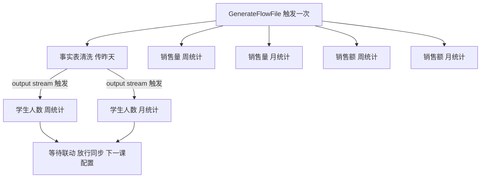
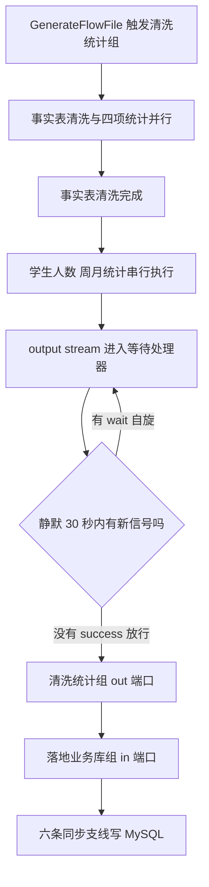

# 热门学科排名集成测试：NiFi 调度、全链路联动与报表系统展示

> 🔒 安全提示：文中示例的口令/密钥均为课程教学环境演示口径，生产环境的安全要求见《安全与合规须知》。

## 先给结论

- 三篇内容把热门学科排名从代码推进到上线：配置 NiFi 调度数据清洗分析任务、联动配置与测试、报表系统 Web 展示。
- 七个调度脚本对应七个 Spark 任务，脚本与 fat jar 进 NiFi 容器的固定目录，打包前必须确认 `useingCluster=true`，local 包提交后集群页面看不到任务。
- 编排零配置导入：GenerateFlowFile 触发一次，四个统计任务并行，两个学生人数任务等事实表清洗完再串行接棒，日期参数由 NiFi 表达式现算。
- 联动接线固定为端口对端口：清洗统计组的 out 连落地业务库组的 in；等待处理器挂在收尾最晚的两个任务上，等住它们就等于等住整组。
- DistributedMapCacheServer 全局只有一个、不随模板导出，导入整体流程后要手动补建。
- 测试前先清场：truncate 六张业务表、删 HDFS 旧目录，启动顺序先下游后上游，核对看 MySQL 数据、NiFi 队列、处理器告警三处。
- 报表前端跑在 4000 端口，三个标签两种粒度，页面数据来自学科统计接口按日期与粒度聚合六张业务表。
- 当期没数据的指标展示 -1 是展示端兜底约定，不是计算错误；数据核对一律以 MySQL 业务表为准。
- 至此课程分析收官：编写分析程序、同步 MySQL、Web 展示三层目标逐条落地。

## 第1部分：Spark 清洗统计交给 NiFi 调度：七个脚本、一个包、一轮实测

热门学科排名的集成测试到了收尾阶段：数据采集、数据同步两段早已上了 NiFi 画布，调度清单里还剩数据清洗与统计分析这一段空白。它不是一条处理器链，而是一组 spark-submit 任务，NiFi 用外部命令处理器把七个 shell 脚本当命令来调。这一课把包和脚本送进容器、把调度模板跑起来，并用一轮清场实测证明这套调度真的可用。

### 部署：一个包与七个脚本进容器

打包有一个前置开关。清洗统计工程读取配置文件决定运行模式，配置项只有一行：

```properties
# true-集群模式，false-local模式，不配置默认为false
useingCluster=true
```

确认置为 true 再执行 package。这个开关决定 Spark 任务的提交方式：集群模式把任务真正提交到 Spark Standalone 集群，Master 页面上能看到 Running 与 Completed 的应用；local 模式在提交节点本地跑完，调度看起来成功了，集群上一片空白，排查时容易南辕北辙。产物是 `xc-service-offline-jar-with-dependencies.jar`，上传到宿主机临时目录后用 docker cp 直接覆盖容器里的旧包，旧包内容本来就是同一份工程打出来的，覆盖即可，不必先删后传。

七个脚本与 jar 是分离的，脚本只负责拼 spark-submit 命令。上传路径是一条流水线：WinSCP 把脚本目录传到宿主机 `/opt/tmp`，docker cp 复制进 NiFi 容器，容器内归位并授权：

```bash
# 宿主机：把脚本目录复制进 NiFi 容器的 /opt 下（容器名按环境实际为准）
docker cp /opt/tmp/script xc-online-nifi:/opt/
# 进容器归位
docker exec -it xc-online-nifi bash
mv /opt/tmp/*.sh /opt/run/script/
chmod +x /opt/run/script/*.sh
```

容器里原本就有一个 `/opt/tmp` 目录存日志，脚本暂时落在这里不影响什么，`mv` 完归位。授权那一步看文件颜色：`chmod` 之前新上传的脚本在终端里是白色，加上可执行权限后变绿色，颜色就是权限的可视化。脚本内容以学生人数月统计为例：

```bash
#!/usr/bin/env bash
if [[ $1 != "" ]];then
  TD_DATE=$1
else
  echo "[===no params input, expect date like 2019-11-11===]"
  exit 1
fi
SPARK_SUBMIT=/opt/spark/bin/spark-submit

$SPARK_SUBMIT \
  --master spark://xc-online-spark:7077 \
  --class com.study.xc.analysis.subject.learn.UserLearnSourceToFact \
  /opt/run/jars/xc-service-offline-jar-with-dependencies.jar ${TD_DATE}

if [[ $? == 0 ]];then
  echo "[===spark-submit process success===]"
else
  echo "[===spark-submit process failed===]"
  exit 0
fi
```

无参直接退出并提示，防止空参误跑。七个脚本骨架完全相同，差异只在 `--class` 指向的主类：事实表清洗是 `UserLearnSourceToFact`，六项统计分别指向销售量、学生人数、销售额的周月主类。尾部这个 `exit 0` 是个伏笔，失败分支也以成功码退出，后面测试时再说它的后果。

### 编排：一个触发器拉起七个外部命令

调度模板导入画布后不需要任何配置，因为命令路径、参数、工作目录全部固化在处理器里。七个任务全是 ExecuteStreamCommand，以销售额周统计为例，配置卡如下：

```text
Command Path         /opt/run/script/subject_sales_by_week_biz.sh
Command Arguments    ${now():format('yyyy-MM-dd')}
Working Directory    /opt/run/script
Ignore STDIN         true
```

日期不写死，由 NiFi 表达式现算。事实表清洗那一支的参数多了两步换算：

```text
${now():toNumber():minus(86400000):format('yyyy-MM-dd')}
```

当前时间转毫秒减去一天的量再格式化，传给脚本的就是昨天。离线分析只统计已走完的时间段，事实表清洗按天吃数，锚点取前一天；六项统计在事实表之上做同位区间对比，传当天即可。触发结构如下：



四个统计任务与事实表清洗并行起跑，因为它们读的是数仓里已有的其他层数据，互不依赖；学生人数统计读的是清洗刚产出的事实表，必须串行在清洗之后，连线用的正是 ExecuteStreamCommand 的 output stream 关系，命令一结束就把流文件送给下游，下游任务随即被拉起。一套画布同时表达了并行与串行两种依赖，这是把调度编排放进 NiFi 而不是 cron 的核心理由。

### 测试：清场、启动、两处核对

测试要回答的问题是「调度跑完真的有数据」，所以先把旧数据清掉。Hue 文件浏览器里删两处：`/user/hive/external/data_subject/` 下六张 biz 表的目录文件，以及用户选课事实表所在目录，原始数据目录不动，只清清洗产出：

```bash
# HDFS 旧文件删除（界面操作与命令行等价）
hdfs dfs -rm -r /user/hive/external/data_subject/subject_sale_week_biz/*
hdfs dfs -rm -r /user/hive/external/data_subject/subject_user_week_biz/*
hdfs dfs -rm -r /user/hive/external/data_course/learning_course_fact/*
```

清完启动处理器组，切到 Spark Master 页面观察：同时运行的任务有五个，事实表清洗加四项并行统计，应用名与主类一一对应，比如 `SubjectSalesByMonthBiz`、`SubjectLearnNumByWeekBiz`。任务完成即退出，Completed 列表逐个增加；清洗结束后，两个学生人数统计接棒上线。整个过程不需要人工干预，画布队列与 Spark 页面的任务数量互相印证。

跑完切回 Hue 逐目录核对：`data_subject` 下六个 biz 目录重新出现数据文件，周目录里有新周次分区，月目录里有新月份分区；事实表目录里也有了几个月的清洗产出。每个目录都有新数据，调度可用的结论才成立，这一段配置与实测到此收官，剩下的联动配置交给下一课。

## 第2部分：联动配置与测试：清洗统计一收尾，六张表自动落库

清洗统计调度与同步落库调度各自都验证过可用，但两段之间还隔着一次人工干预：统计跑完了，得有人记得去点同步的启动。联动就是去掉这一次点击，让清洗统计结束的信号自动触发 Hive 到 MySQL 的六条同步支线。这是课程里第三次配联动，机制与前两轮一致，变化在等待点的选择上，这一课把接线配出来，再跑一轮全链路实测。

### 编排改造：给串行链装上收尾信号

组内结构在配置调度时已经定型：GenerateFlowFile 触发后，销售量周月、销售额周月四个统计任务与事实表清洗并行起跑，学生人数周月两个统计串行在清洗之后。联动的任务就是在这条链的末尾装一个收尾信号。

等待处理器是课程自研的 NiFi 扩展，模板里名为 `WaitForNextGroupProcessor`（包名按 `com.study.xc` 系口径），接线三步：学生人数两个统计任务的 output stream 连到等待处理器；它的 wait 关系连回处理器自身，没到放行条件就自旋等待；success 关系连到组内新建的 out 端口。配置卡如下：

```text
Waiting Time Id            subject
Waiting Time               30
Distributed Cache Service  DistributedMapCacheClientService
                             Server Hostname  localhost
                             Server Port      4557
关系                        wait 连回自身自旋，success 连到组 out 端口
```

Waiting Time Id 必须全局唯一。等待状态以这个 id 为键登记在缓存服务里，两条流程共用一个 id，各自登记的等待信息就会互相覆盖，出现信号串线。课程访问量那一轮取的键名对应课程访问量，这一轮取 `subject` 对应学科排名，一眼可辨。

缓存服务分两端：客户端配在清洗统计组里指向服务端地址；服务端 DistributedMapCacheServer 整个 NiFi 实例只建一个，放在最外层根组。服务端不属于任何业务流程，导出流程模板时不会跟着走，导入整体流程模板后它会丢，表现为等待处理器挂黄色感叹号，手动在根组补建并启用、客户端地址端口补齐即可。

组间接线是联动的最后一跳。落地业务库组内六条支线原本靠手动启动，现在组里开一个 in 端口把触发信号分发进去；清洗统计组的 out 端口连到这个 in 端口。全链路时序如下：



关键路径在等待处理器那一环：它收到流文件时把内容丢弃，只关心信号到没到；超过 30 秒没有新信号进来，就认定上游收尾完成，放行并触发下游。

### 为什么等的是两个串行任务

一个组里有七个任务，等谁？等最先结束的没有意义，等全部七个又做不到，NiFi 没有内建的「整组完成」事件。这里的选择是等两个学生人数统计：它们排在串行链末端，前面压着事实表清洗，四个并行任务跑完了它们往往还在跑，收尾最晚。等住最晚的两个，其余任务必然已经结束，整组近似完成。

30 秒静默窗口是给收尾留的缓冲。统计程序跑完到数仓落盘、元数据刷新之间有零散的收尾动作，信号刚到就放行，同步支线可能读到不完整的分区。扣住 30 秒没有新信号再放行，代价是每次联动固定多等半分钟，换来的判断可靠性值这个价。测试时观察队列能直观看到这套机制：两个信号先后进队列，静默期内纹丝不动，30 秒一到队列清空，同步支线的队列开始流动。

### 全链路测试：清空业务表再开跑

测试前把 `business` 库六张业务表清空，验证时看到的每一条都是本次联动真实写进来的：

```sql
truncate table business.subject_sale_week_biz;
truncate table business.subject_sale_month_biz;
truncate table business.subject_user_week_biz;
truncate table business.subject_user_month_biz;
truncate table business.subject_amount_week_biz;
truncate table business.subject_amount_month_biz;
```

现场敲这些语句还有个小插曲：`truncate` 手滑少敲了一个字母 e，数据库当场报语法错误，改过来再执行，六条全部跑完，逐表 count 验证为 0。清场的意义就在这里，不清空的话新旧数据混在一起，联动到底有没有触发根本说不清。

启动顺序先下游后上游。先把落地业务库组启动，它拿到触发信号之前不会执行任何动作，处于待命状态；再启动清洗统计组。时间线逐段展开：事实表清洗先跑，四个并行统计陆续完成，学生人数两个统计接棒；两个 output stream 信号进入等待处理器，静默 30 秒后放行，out 端口出线，同步组六条支线的队列同时开始流动，Navicat 里六张表逐个刷新出数据。收尾核对三处：MySQL 六表有数据、NiFi 队列归零、全程无失败告警。三处对上，采集、清洗、统计、同步四段就串成了一条无人值守的链路，热门学科排名的集成测试全部完成。

## 第3部分：报表页面上线：热门学科排名走完最后一公里，课程分析收官

联动跑通后，六张业务表的统计结果已经躺在 MySQL 业务库里，链路只剩最后一环：登录报表系统，看这些数字变成页面上的柱状图与排名表格。这一课做两件事，一是把热门学科排名页面与业务库逐项核对，二是把第三章课程分析从头到尾复盘一遍，从需求分析走到 Web 展示，整条离线分析链路正式收口。

### 登录与页面：三个标签两种粒度

报表前端的访问方式与课程访问量那轮一致：浏览器进 4000 端口，登录页随便填用户名密码，验证码按图形输入任意字符，但三个框都不能空。登录后点开热门学科排名，页面上方是销售量、学生人数、销售额三个标签，下方柱状图画当前标签的指标，表格一次列出全部七列：学科名称、三个指标各自的数值与增幅，分页浏览。

页面的数据源是业务后台的学科统计接口，前端工程的接口清单里注册得很清楚：

```js
// 接口清单节选（前端工程随资料包提供，工程目录名含项目原名，此处不列路径）
const config = {
  login: "/xuecheng/common/login",
  // 学科统计：热门学科排名页三个标签共用
  subjectStat: "/xuecheng/courseSubject/statistics",
  // 学科排名与热门课程 TOP-N
  courseSubjectRank: "/xuecheng/courseSubject/subjectRank",
  courseUser: "/xuecheng/course/courseUser"
};
```

切换标签或切换周月粒度都会触发重新请求，参数带上日期与粒度，业务后台读 `business` 库对应的业务表聚合后返回，前端把学科名放进横轴、当前指标放进柱状图，数字与增幅填进表格。接口契约在 Yapi 平台上有完整定义，学科分类下正是学科统计与学科排名两条 GET 接口。

### 数据核对：以业务表为准

页面数字是否可信，核对的对象永远是业务库。周粒度下三个指标的数据分布并不齐整：切到第 45 周，学生人数有正常数据，销售量与销售额两列显示 -1，增幅 0；往前切到第 43 周，销售额有数据；再切到第 39 周，销售量正常。月粒度下，11 月有学生人数与销售额，销售量要切到 10 月才有。这与清洗统计时各指标的测试日期一一对应，哪段指标在哪个区间跑过，页面上就哪个区间有数。

对照 SQL 就一句，以第 45 周学生人数为例：

```sql
select course_category_name, user_num, user_percent, date_info
from business.subject_user_week_biz
where date_info = '2019-45';
```

查询结果的行数与顺序、人数与涨幅，与页面表格逐行一致，这条指标线从数仓到屏幕的旅程就算验收完毕。反向也成立：业务表里该周该月没有行的指标，接口聚合时没有数据可取，页面就落进 -1 的兜底展示。

### -1 是约定不是事故

第一次看这个页面的人多半会被 -1 吓到，怀疑统计或同步出了错。它的来源很朴素：六张业务表都是分区写入，某个指标只在测试或调度覆盖过的周月分区里有行，没覆盖的区间表里就没有记录。接口聚合时拿不到数，用 -1 兜底，增幅给 0，柱状图照画。所以 -1 的准确读法是「当期无数据」，与 0 的语义不同，0 是「当期有数据且数值为零」，出现在涨幅上时表示同位区间持平。

这个约定对读报表的人有要求：看数之前先确认所选区间有没有调度覆盖，-1 区间不要参与环比解读。更严谨的做法是接口返回空并让前端显示「暂无数据」，把无数据与负值在视觉上分开，代价是前端要多一层占位处理。课程用 -1 换了实现简洁，两种取舍在面试里都值得说清楚。

### 第三章收官复盘

热门学科排名页面出图，意味着第三章课程分析的全链路走到了终点。回头把整条链摊开看：


五段各司其职。数据采集段生产用户选课数据并用 binlog 实时采集进数仓；清洗段把原始数据加工成 DWD 层事实表；统计分析段是三指标六程序，销售量、销售额、学生人数各分周月，同位区间对比加涨幅计算；调度与同步段由 NiFi 统一编排，七个外部命令任务加六条五处理器支线，联动信号把两段焊死；展示段业务后台读业务库出接口，前端画图。

章首学习目标在这里逐条对账：编写热门学科排名的分析程序，落在统计层六个主类上；将分析结果同步到 MySQL，落在同步支线与联动编排上。留下的资产清点一遍：数仓 `data_subject` 六张业务表、MySQL `business` 六张同名业务表、七个 spark-submit 调度脚本、五份 NiFi 流程模板（数据生产、数据采集、清洗统计调度、同步落库、整体流程）。同一套骨架接下来还会复用，换表换字段就是下一个统计主题，骨架本身不再变。

## 常见误区

- **local 模式打包。** 错例：没看配置就 package，提交后 Spark Master 页面找不到应用，以为集群挂了。正解：打包前核对 `useingCluster=true`，包一旦打出去，模式就凝固在里面。
- **脚本上传后不授权。** 错例：脚本落进 `/opt/run/script` 直接跑，ExecuteStreamCommand 报权限拒绝。正解：`chmod +x`，终端里白色变绿色再启动。
- **不清场就测试。** 错例：旧分区文件还在，跑完分不清哪些是新产出，验证流于形式。正解：先删 biz 目录与事实表目录旧文件，跑完逐目录确认都有新数据。
- **把脚本失败当成功。** 错例：脚本失败分支 `exit 0`，NiFi 队列安静如常，实际上什么都没算出来。正解：以 Spark 页面应用记录与 Hue 数据文件为准，脚本 stdout 日志一起看。
- **以 Spark 页面无任务判失败。** 错例：刷新时任务已跑完退出，Running 列表是空的，误判成没调度起来。正解：看 Completed 应用列表与任务名，时间线对上即可。
- **信号 id 多条流程共用。** 错例：图省事沿用上一条流程的 Waiting Time Id，两条链的等待登记互相覆盖，联动时序错乱。正解：每条流程一个唯一 id，用业务语义命名，一眼可辨。
- **等待点选在并行任务上。** 错例：把等待处理器挂在最先完成的统计任务输出上，放行时学生人数统计还在跑，同步读到不完整数据。正解：等串行链末端收尾最晚的任务。
- **导入模板后不补缓存服务端。** 错例：模板导入直接启动，等待处理器挂感叹号无法运行。正解：服务端在根组、不随模板导出，手动补建启用，客户端地址端口补齐。
- **不清业务表就测联动。** 错例：表里留着上一轮数据，联动跑完分不清哪些是新写入的。正解：truncate 六表并逐表 count 为 0，再启动链路。
- **组间直接拖连线。** 错例：从清洗统计组的处理器直接拉线到同步组的处理器，NiFi 不允许。正解：组内接 out 端口、对端开 in 端口，组间只连端口。
- **把 -1 当数据事故。** 错例：看到指标列全是 -1 就去翻统计代码找 bug。正解：先查业务表该区间有没有行，没有行就是无数据的兜底展示。
- **页面无数据先怀疑同步。** 错例：切到一个区间没数就重启联动链路。正解：核对顺序从后往前，先查 MySQL、再查接口返回、最后查前端代理，哪一环断了一目了然。
- **登录框留空。** 错例：验证码偷懒不填直接点登录，被挡在门外以为服务没起。正解：三个框都填，验证码任意字符即可。
- **只信页面不信库。** 错例：页面有数就算验收通过，业务库里到底是什么没看过。正解：页面与业务表逐行对照才算闭环，页面只是业务的视图。

## 面试可能被问到的问题

1. 面试官追问：「ExecuteStreamCommand 和 ExecuteProcess 有什么区别？」
   答：ExecuteStreamCommand 消费上游流文件、以流文件驱动执行，命令参数可以引用流文件属性与表达式，结束后沿 output stream 把结果传给下游，天然适合编排进数据流；ExecuteProcess 是无上游的定时执行命令，产出一个流文件。调度一批有依赖关系的任务，用前者。

2. 面试官追问：「为什么学生人数统计要串行，其他四个可以并行？」
   答：数据依赖决定编排。学生人数统计的输入是清洗刚产出的事实表，清洗没完成统计就是空算；销售量与销售额统计读的是已经存在的维度与其他层数据，与事实表清洗互不依赖。并行省时间，串行保正确，两者画在同一块画布上由连线表达。

3. 面试官追问：「脚本里失败分支 exit 0 是好是坏？」
   答：坏习惯。它让 ExecuteStreamCommand 的 nonzero status 关系永远收不到信号，调度层失去失败感知，只能靠日志与下游数据人工兜底。更稳妥的写法是失败分支返回非零，让调度层把失败流文件留痕，配合告警与重试。

4. 面试官追问：「覆盖部署 fat jar 会不会影响正在运行的任务？」
   答：不会。spark-submit 提交时才加载 jar，进程一旦起来，类已经加载进内存；覆盖磁盘上的文件只影响下一次提交。要避免的是提交与覆盖同时发生，窗口期极短，生产上按调度周期错开即可。

5. 面试官追问：「为什么用 NiFi 调度 Spark 任务而不是 crontab？」
   答：画布上依赖关系可视化，并行串行一目了然；每次执行有队列留痕，失败可重放；日期参数用表达式现算，改调度节奏改的是处理器配置不是脚本。crontab 只能按时间表触发，表达不了任务间依赖，失败也要自己搭通知机制。采集、清洗、统计、同步四段都收在 NiFi 里，还能做跨段联动。

6. 面试官追问：「NiFi 没有整组完成事件，怎么近似判断一组任务结束了？」
   答：找组内收尾最晚的任务，把它的输出流接给等待处理器，静默一段时间（默认 30 秒）没有新信号就认定整组收尾。这是工程上的近似判断，不是精确 ACK；窗口期按收尾动作的耗时评估，宁可多等也不能提前放行。

7. 面试官追问：「等待处理器为什么要依赖分布式缓存服务？」
   答：等待的起始时间与时长要以信号 id 为键登记，多个处理器实例、多次触发之间必须读到同一份登记，这个状态不能放在处理器本地。DistributedMapCacheServer 全局一个做存储端，客户端挂在等待处理器上读写，键用唯一的信号 id。

8. 面试官追问：「联动之后某一段失败了，怎么定位？」
   答：每段之间有队列，失败会积压在对应关系的队列里而不是消失。看哪个队列堆积、哪个处理器挂 bulletin 告警，就能定位到段；NiFi 支持把队列里的流文件重放，修复配置后从失败点续跑，不用整条链重来。

9. 面试官追问：「这条链路里 Spark 任务与 NiFi 同步是两种进程，联动的信号可靠吗？」
   答：信号承载的是「命令执行结束」这个事实，不是「计算结果正确」。spark-submit 退出码为 0 只代表提交成功，业务上的失败要靠脚本内检查、日志与数据核对兜底。信号机制解决时序问题，数据质量问题靠各自的验收环节，两层分开设计。

10. 面试官追问：「如果并行任务比串行链收尾还晚，联动会出什么问题？」
   答：等待处理器放行时并行任务可能还没写完，同步读到旧分区数据。处理方式是把等待点改挂到真正的收尾末端，或者调整编排让长任务进串行链；判断依据始终是「谁最后写完数仓」，而不是任务在画布上的位置。

11. 面试官追问：「用 -1 表示无数据好不好？」
   答：优点是实现简单，数值列不用引入 null 语义，前端少一层空值处理；缺点是读数人必须懂约定，-1 混在正常负值里会误读，指标含义里也没法区分「无数据」与「数据为零」。更严谨的方案是接口返回空标记、前端显式占位，取舍看使用方的理解成本。

12. 面试官追问：「报表页面为什么查 MySQL 而不直接查 Hive？」
   答：报表是高频低延迟的点查，MySQL 的索引与连接模型适合；Hive 面向批处理扫描，一次查询的启动开销远超页面容忍度。数仓负责算，业务库负责查，中间靠同步衔接，两边的引擎各干各的活。

13. 面试官追问：「从需求到出图，一个新指标要动多少环节？」
   答：五处。需求分析定口径与维度，数仓建 APP 层表，统计程序算数落分区，NiFi 加同步支线与调度编排，业务后台与前端补接口和展示。这套骨架里只有统计程序是真正的编码工作，其余是配置与复用。

14. 面试官追问：「页面上数字与数仓数字不一致，以谁为准？」
   答：以业务库为准，它是展示链路唯一的可信来源；数仓里的中间层是过程产物，随时会被重算覆盖。排查不一致时从业务库往数仓倒查，核对同步是否漏跑、统计区间是否一致，最后才怀疑展示层聚合逻辑。

15. 面试官追问：「这个项目里离线分析链路的可维护性体现在哪？」
   答：三处。统计程序共用一副骨架，新增指标是换表换字段的复用；调度与同步全部配置化在 NiFi 画布上，改节奏不动代码；链路每段之间有队列留痕，失败可定位可重放。代码量收敛在统计层，运维成本摊薄在配置层。

## 配套资料

- 讲义：`materials/docs/08/智慧学成-第3章-课程分析.md`，3.7.2 数据清洗分析调度（3.7.2.1 调度流程、3.7.2.2 调度脚本共 7 个的清单与路径、3.7.2.3 测试）为本课出处。
- 资料：`materials/code/08/_散落资料/`，7 个调度脚本（`user_learn_source_to_fact` 与销售量、学生人数、销售额的周月脚本）与数据清洗统计分析调度模板 XML 在散落资料目录中（内层文件名带站点后缀，按用途自取，具体文件名不在此列出）。
- 说明：Scala 工程源码未随资料包归档，主类名以脚本内容为准，包名按课程工程 `com.study.xc` 系改写；容器内路径以 `/opt/run/script`、`/opt/run/jars` 为准，容器名与 Spark Master 地址按课程环境实际填写。
- 讲义：`materials/docs/08/智慧学成-第3章-课程分析.md`，3.7.4 热门学科排名整体流程（3.7.4.1 联动配置、3.7.4.2 整体流程）为本课出处。
- 资料：`materials/code/08/_散落资料/`，热门学科排名整体流程模板 XML 在散落资料目录中（内层文件名带站点后缀，按用途自取，具体文件名不在此列出），等待处理器接线与属性取值以其真实内容为准。
- 代码：`materials/code/04/Wait-For-Next-Group/`，等待处理器自定义源码，属性与关系定义以源码为准，包名按 `com.study.xc` 系改写。
- 说明：truncate 与 HDFS 清场命令为按本课操作补全的示例；MySQL 业务库为 `business`，连接口令按课程环境 root/123456。
- 讲义：`materials/docs/08/智慧学成-第3章-课程分析.md`，3.7.5 智慧学成 Web 展示一节为页面展示与数据说明的出处。
- 手册：`materials/docs/04/智慧学成Web业务后台搭建手册.md`，业务后台打包部署、2019 端口与前端代理指向的说明。
- 资料：`materials/code/08/yapi/`，接口定义文件含学科分类下的学科统计与学科排名接口契约。
- 资料：`materials/code/08/` 下含报表前端 Vue 工程与业务后台工程（目录名含项目原名，此处不列内层路径），热门学科排名页面组件与接口清单在工程源码内，字段与标签名以源码为准。
- 说明：页面数据为课程环境实测记录，-1 兜底为展示端表现的归纳口径；示例站点一律以 example.com 占位。
