# 实时分析开篇：给平台看板的三块数字装上秒级引擎

第三章收官时，热门学科排名的六张业务表已经能在报表系统出图，但那套链路是按天跑批的，当天发生的业务要等第二天调度才进报表。而平台看板顶部的今日访问量、新增用户量、今日购买量要求页面数字秒级变化，批处理骨架原样搬过来行不通。第四章实时分析就从这里切入：先立学习目标，再做需求与技术方案，然后逐个指标把采集、统计、展示走通。这一篇把八条学习目标铺开，顺带把离线与实时两条统计线的结构差异讲透，后面的实现才有清晰的参照系。

## 先给结论

- 八条学习目标分两组：一到四条是认知铺垫，覆盖看板需求、应用场景、技术方案与开发环境；五到八条是动手主线，围绕指标需求、数据采集、编写 Spark 实时分析程序、报表系统实时展示展开。
- 本章只做三个指标：今日访问量、新增用户量、今日购买量，维度全部收敛在时间维度里的「当天」。
- 开发环境在容器编排阶段已经就绪，Kafka、Redis、Spark 以容器常驻运行，本章直接使用，不再重新搭建。
- 每个指标走同一套三步：NiFi 实时采集进 Kafka、Spark Streaming 每 5 秒统计一次、结果写入 Redis 供报表系统读取。
- 与第三章最本质的差异在运行形态：离线分析是调度触发的批处理作业，跑完即退；实时分析是启动后常驻不退的流处理程序。

## 八条学习目标分两组读

**前四条解决「是什么、为什么」。** 第一条，能够分析实时看板的需求。实时看板在业务报表系统里是一个独立页面，要弄清这个页面上有哪些业务、每块业务的数据从哪来。第二条，理解实时分析的应用场景，比如实时统计网站的访问量、实时统计页面的 UV 与 PV，知道哪些业务适合实时分析。第三条，理解本项目实时分析的技术方案，技术方案说的是数据怎么采集、采集完成之后怎么处理、最终结果怎么保存这三段。第四条，能够搭建 Spark Streaming 加 Kafka 的开发环境，这套环境在容器编排阶段已经编排好，直接使用即可，要弄明白的是实时分析这个场景里用了哪些大数据组件。

**后四条是动手主线，围着三个指标转。** 第五条，理解今日访问量、新增用户量、今日购买量各指标的需求，实时分析章节主要就针对这三个指标做实时统计分析，理解了需求才能知道后面要采集什么数据。第六、七、八条对应每个指标都要走的三步：采集实时分析需要的数据，根据采集到的数据编写 Spark 的实时分析程序，把分析结果保存到业务报表系统上做实时展示。三个指标各自完整走一遍，章末再做整体集成测试，三个指标的处理组可以同时启动，互不依赖先后顺序。

## 离线与实时：同一业务的两条统计线

把第三章和第四章的结构摊开对照，差异不在「用什么组件」，而在「数据以什么形态流动」。

**输入侧，数据的到达方式不同。** 离线分析里，课程访问量、课程购买量、用户选课这些数据由 NiFi 采集进 HDFS，再加工进 Hive 数仓，数据是成批落盘的文件；实时分析里，同样的业务数据不再等待落盘，NiFi 把课程访问日志直接推给 Kafka，用户表与订单表的变更通过监听 binlog 抓出来推给 Kafka，数据是一条一条持续到达的消息。

**计算侧，触发方式与时间粒度不同。** 离线统计是 Spark SQL 批作业，由 NiFi 外部命令任务按天调度，作业读取数仓分层表算完就退出；实时统计是 Spark Streaming 作业，启动后常驻运行，每 5 秒从 Kafka 拉一小批数据做聚合，不停轮转。

**输出侧，结果的去向与消费方式不同。** 离线结果先落 Hive 业务表，再由 NiFi 同步进 MySQL，报表系统从 MySQL 点查出图；实时结果直接写 Redis，报表系统读 Redis，统计值每 5 秒刷新一次，页面跟着达到准实时的效果。

```mermaid
flowchart TB
    subgraph OFF["第三章 离线分析：按天批处理"]
        A1["业务库与日志数据"] --> B1["NiFi 采集进 HDFS"]
        B1 --> C1["Hive 数仓分层加工"]
        C1 --> D1["NiFi 调度 Spark 统计"]
        D1 --> E1["Hive 业务表"]
        E1 --> F1["NiFi 同步 MySQL"]
        F1 --> G1["报表系统出图"]
    end
    subgraph RT["第四章 实时分析：秒级流处理"]
        A2["日志与 binlog 持续到达"] --> B2["NiFi 实时采集"]
        B2 --> C2["Kafka 消息队列"]
        C2 --> D2["Spark Streaming 每 5 秒一批"]
        D2 --> E2["Redis 统计结果"]
        E2 --> G2["报表系统实时展示"]
    end
```



上图把两条线并排画出来：左边每一环之间隔着「天」，右边每一环之间隔着「秒」。值得注意的是右边的环数明显更少，没有数仓分层，也没有同步落库，因为三个指标都是当天范围内的单一计数值，用不上维度建模那套重装备，一条消息进来累加一次就够。

**两条线并非替代关系，而是分工关系。** 平台看板上课程访问量、课程购买量的趋势图依旧由第三章的离线链路供数，历史指标的聚合查询走 Hive 与 MySQL；只有今日访问量、新增用户量、今日购买量这三个要求秒级变化的指标走实时链路。复用的资产也不少：NiFi 既是离线的调度器又是实时的采集通道，Spark 是两条线共同的计算引擎，报表系统更是同一个。学实时分析不是推翻第三章，而是在同一套基础设施上补一条更快的数据通路。

## 学习路径：一个指标走通，剩下两个照搬

整章的行进顺序与第三章同构：先做平台看板的需求分析与实时分析应用场景，明确看板要展示什么、哪些业务适合实时；再定实时分析技术方案，把采集、消息、计算、存储四段选型定下来；然后是指标与维度分析、数据存储分析，把三个指标的口径与 Redis 存储格式设计好；接下来进入正餐，今日访问量、新增用户量、今日购买量三个指标各走采集、统计、展示三步；最后集成测试联跑整条链路，并在报表系统上看实时效果。

开发期验证消息是否持续到达 Kafka，用模拟消费者命令最直接：

```bash
# 在 Kafka 容器的 bin 目录执行，模拟消费者查看指定 topic 的消息
./kafka-console-consumer.sh --bootstrap-server xc-online-kafka:9092 --topic visit_topic
```

环境本身用一条编排文件描述，实时分析要用的三个大数据组件都在里面常驻：

```yaml
# 容器编排文件节选：实时分析直接复用的三个容器
xc-online-kafka:
    image: xc:base
    container_name: xc-online-kafka
    hostname: xc-online-kafka
    ports:
      - '9092:9092'   # Kafka 对外服务端口
xc-online-spark:
    image: xc:base
    container_name: xc-online-spark
    hostname: xc-online-spark
    ports:
      - '7077:7077'   # Spark 集群提交端口
xc-online-redis:
    container_name: xc-online-redis
    hostname: xc-online-redis
    image: redis:5.0.5
    ports:
      - '6379:6379'
```

有一个容易忽略的运行细节：实时分析程序一旦启动就不会自动停止，开发测试时结束它要么进容器用 `jps` 找到 SparkSubmit 进程再 `kill`，要么用调度侧专设的结束处理器，结束后调度面板报错属于正常提示。这些坑在集成测试一节都有对应处理，路径走到那里再展开。

## 常见误区

- **以为要重新搭一套实时环境。** 错例：看到学习目标里有「搭建 Spark Streaming 加 Kafka 开发环境」，就动手装 Kafka、配 Redis。正解：容器编排阶段已经把 Kafka、Redis、Spark 编排成常驻容器，本章只需确认容器在跑，然后把精力放在组件连接上。
- **把实时分析当成推翻离线重做。** 错例：觉得有了实时链路就可以拆掉第三章那套数仓。正解：两条线分工不同，趋势图与历史聚合依旧依赖离线链路，实时只接管三个当天指标，互为补充。
- **以为三个指标是三套技术。** 错例：给每个指标单独设计一套采集与计算方案。正解：三个指标共用同一副骨架，差异只在采集的数据源与统计口径，一个指标走通后其余两个是复用。
- **把 Spark Streaming 当成无延迟的真流式。** 错例：预期消息一到达页面数字立刻变化。正解：Spark Streaming 按 5 秒切批，统计结果以批为单位更新，页面约 5 秒刷新一次，这是微批模型的固有节奏。

## 面试可能被问到的问题

1. 面试官追问：「离线分析和实时分析在同一项目里怎么共存？」
   答：按指标时效要求分工。趋势图、历史聚合这类容忍 T+1 的指标走离线链路，数仓分层加工后同步业务库；当天实时变化的指标走实时链路，采集进 Kafka 后由 Spark Streaming 计算、结果放 Redis。两套链路共用采集工具与计算引擎，报表系统同时消费两边的结果。
2. 面试官追问：「为什么这个项目选 Spark Streaming 而不是 Flink？」
   答：三个指标允许秒级延迟，微批模型够用；更关键的是离线分析已经用 Spark，实时分析沿用同一技术栈，团队的代码、依赖、运维经验都能复用，工程成本最低。如果是实时性要求极高的场景，才值得引入 Flink 这类真流式引擎。
3. 面试官追问：「实时分析程序和批处理作业在运维上有什么区别？」
   答：批作业由调度触发，跑完退出，状态好管理；实时程序常驻运行，启动一次就不再退出，需要考虑进程监控、失败重启与升级时的平滑停启。结束实时程序要显式 kill 进程或走专用处理器，调度面板随之报错是预期行为，要有心理预期。
4. 面试官追问：「实时链路里 Kafka 的作用是什么，能不能直接让 Spark 读日志文件？」
   答：Kafka 做消息中转，起到削峰、解耦和持久缓冲的作用。直接读文件意味着采集端要自己处理背压与断点，文件滚动、乱序、重复都会暴露给计算端；进 Kafka 后，采集端只管推消息，计算端按 offset 消费，两边互不拖累，重算也有据可依。
5. 面试官追问：「微批 5 秒是怎么定下来的，能更短吗？」
   答：批次时长是延迟与开销的折中。批次越短延迟越低，但任务调度与状态检查点的固定开销占比越高，批次太长实时性又退化成准离线。5 秒对三个当天计数类指标完全够用，展示端刷新节奏与之对齐，实践中从需求容忍度出发反推批次时长即可。

## 配套资料

- 讲义：`materials/docs/08/智慧学成-第4章-实时分析.md`，章首学习目标与 1.1 节平台看板需求分析为八条目标与整章路径的出处。
- 资料：`materials/code/08/_散落资料/`，容器编排文件（含 Kafka、Spark、Redis 容器定义）、三个指标的 spark-submit 启动脚本与各指标 NiFi 模板都在此目录（内层文件名带站点后缀，按用途自取，具体文件名不在此列出）。
- 说明：实时分析 Scala 工程源码未随资料包归档，涉及实现细节的代码以讲义为准整理，包名统一按课程工程 `com.study.xc` 系改写；示例站点一律以 example.com 占位。
