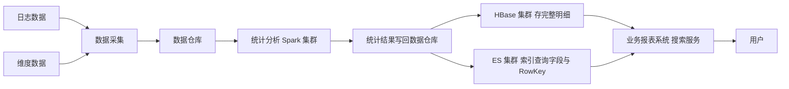

# 即时查询的需求分析与技术方案：明细查询为什么要 HBase 加 Elasticsearch 两跳

离线分析交出去的是趋势报表，实时分析交出去的是看板数字，两者都是统计值。运营和客服的工作台上还压着另一类诉求：把某个学员某天学了哪门课、看了哪个视频、花了多久，一条条翻出来。条件随口就来，今天按学生查，明天按课程加时间段组合查，结果还得秒级返回。这种明细级检索在数据仓库里跑不动，在业务库里也扛不住，智慧学成项目为它单独规划了一条链路，叫即时查询。接下来把原型拆成数据需求，再摊开完整技术方案，后面动手写代码时，图纸都在这里。

## 先给结论

- 原型页是「在线学习详情」：展示列五项，筛选条件同样取自这五个字段，时间条件既能锁定某一天，也能框住一个起止区间。
- 五个展示字段没有一个能从埋点直接拿到：三个名称靠维度表关联得出，学习时间由埋点上报，学习时长要按上报节奏算出来。
- 技术方案四步走：采集入数据仓库，Spark 统计分析后写回数据仓库，统计结果存 HBase 并把查询字段与 RowKey 索引进 Elasticsearch，业务查询按先查 ES 再查 HBase 的两跳完成。
- Elasticsearch 只索引业务要查的字段与 RowKey，完整明细始终在 HBase，两个库各干各的。
- 查询入口就是业务报表系统已有的后端搜索服务，数据落库即可联调，不需要新写服务。

## 原型拆需求：在线学习详情页要什么

原型从平台的「日志查询」菜单进入，落地页就是在线学习详情。页面上下两段：顶上一排筛选条件，学生昵称、课程名称、视频名称、时间选择；底下一张明细表，五列，学生昵称、课程名称、视频名称、学习时间、学习时长。时间条件有独立控件，既能精确到某一天，也能框一个起止区间，原型里演示的区间是 2019-12-02 到 2020-01-05，条件一变表格即时刷新。

把页面翻到数据视角，五个字段分成两类。名称类三个：学生昵称、课程名称、视频名称，它们都不在埋点原始数据里，埋点只有 id，名称全部住在维度表里。时间类两个：学习时间与学习时长，来自用户的学习行为数据，学习时间是上报上来的播放时间点，学习时长则要从行为数据里算出来。还有一个容易漏掉的观察：筛选条件本身就是展示字段的子集，「能查什么」和「能展示什么」是同一份字段清单，索引设计只要覆盖这五个字段加日期，页面的全部交互就有数据撑着。

页面还有一条展示规则：同一个学员同一天学了多门课，明细就是多行，一行一门课。这条规则反过来约束了统计粒度，明细行不能按人聚合，只能按「人加课程加视频」的组合粒度展开，否则多门课的学习记录会被合并掉。

## 需求落到数据上：两路采集加一步计算

**第一路是行为数据。** 前端埋点采集的是 id 与时间：用户 id、视频 id、学习时间点。视频 id 一个字段身兼三职，通过课程视频维度级联出课程 id，再挂出课程名称，所以课程 id 连埋都不用埋。学习时长最特殊，埋点从来不上报一条「学了多久」，页面开着、视频在播，埋点按一分钟一次的节奏自动发送，一次心跳代表一分钟的学习，最终时长按心跳算出来。

**第二路是维度数据。** 用户维度与课程维度在数仓建设中已经采集过，本链路要补的是课程视频维度。三张维度表备齐，id 到名称的映射才走得通。

**一步计算发生在采集之后。** 原始埋点直接展示并不友好：没有名称、没有时长、时间还是时间戳。统计环节必须做三件事，关联维度把 id 换成名称，按心跳算出学习时长，把时间戳格式化成日期。加工完的明细才配叫可查的数据。

## 技术方案：从埋点到两跳查询的完整链路

讲义把整条链路画成一张流程图，数据从左到右流过四个环节：



上图的关键在右半段：统计结果不是直接给页面，而是分叉成两份，完整明细进 HBase，查询字段与 RowKey 进 Elasticsearch。落到操作层面是四步：

1. 采集相关数据与相关维度，存进数据仓库；
2. 用 Spark 做统计分析，关联维度、计算学习时长，结果写回数据仓库；
3. 把统计结果保存到 HBase，同时用 Elasticsearch 建索引，索引里只有查询字段与 RowKey；
4. 业务使用时，先在 Elasticsearch 里按条件查出 RowKey，再按 RowKey 到 HBase 里取完整数据。

**Elasticsearch 为什么只索引一部分。** HBase 的读路径贴着 RowKey，RowKey 之外的任何组合条件都意味着全表扫描，页面这种条件随意的查询交给它，秒级响应无从谈起；Elasticsearch 的倒排索引恰好相反，任意字段的组合条件都能先在索引里收敛出命中集合，但让它在磁盘上扛全量明细又贵又重。方案取两者长处：Elasticsearch 相当于只印目录的检索册，HBase 相当于正文，两跳都是点查，数据量再大也能压在秒级。搜索服务实际发出的检索体就是一段 JSON，讲义演示代码里的写法如下：

```json
{"query": {"match": {"name": "王五"}}}
```

真实明细索引的字段比 demo 多，按学生昵称加时间区间组合查询时，检索体会换成 bool 加 range 的结构（示例按 ES 6.x 语法补全，字段名以明细索引设计为准）：

```json
{
  "query": {
    "bool": {
      "must": [{"match": {"user_name": "张三"}}],
      "filter": [{"range": {"date_info": {"gte": "2019-12-02", "lte": "2020-01-05"}}}]
    }
  }
}
```

命中结果里只取 id 字段，拿到的就是 HBase 的 RowKey；第二跳按这批 RowKey 批量点查明细，拼装后返回页面。**搜索服务不用新写。** 查 ES 拿 RowKey、回 HBase 拼明细的逻辑已经封装在业务报表系统的后端接口里，属于项目搭建阶段就备好的资产，统计侧只要保证两份数据按时落库，页面联调即就绪。

## 常见误区

- **把明细查询直接压到数据仓库上。** 错例：条件拼进 SQL 去 Hive 里查，指望秒级返回。正解：数仓面向批处理的全量扫描，随机条件的明细查询走 HBase 加 Elasticsearch 两跳，数仓只负责产出统计结果。
- **以为名称字段要前端埋点上报。** 错例：让前端把课程名称、视频名称也埋进日志。正解：埋点只上报 id，名称靠维度表关联，视频 id 还能级联出课程 id，埋点越薄越容易改。
- **以为学习时长有现成字段。** 错例：在埋点里找不到「学习时长」字段就认为数据缺了。正解：时长由心跳式一分钟一次的上报算出来，任何一条原始记录里都没有它的终值。
- **以为 Elasticsearch 存了全量明细。** 错例：ES 查不到的字段就断言数据丢了。正解：ES 只索引查询字段与 RowKey，完整明细在 HBase，两跳缺一不可。

## 面试可能被问到的问题

1. 面试官追问：「即时查询为什么单独成一条链路，复用离线或实时的链路不行吗？」
   答：离线产出按天重算的聚合结果，实时产出当天计数值，都是统计值形态，回答不了「具体某条是什么」。明细查询条件灵活、返回明细行，必须为它单配列存与索引，链路形态由产出形态决定。
2. 面试官追问：「为什么不让页面直接查 HBase？」
   答：HBase 只有 RowKey 点查与前缀扫描快，RowKey 之外的组合条件等于全表扫描。页面查询条件任意组合，必须先经 Elasticsearch 收敛出 RowKey，HBase 只做第二跳的点查，两跳配合才保得住秒级响应。
3. 面试官追问：「ES 和 HBase 的数据一致性怎么保证？」
   答：两份数据来自同一个统计批次，由同一个 Spark 任务写入，正常情况同时就绪。极端情况下无论先写哪个库都存在短暂窗口，一边查得到另一边取不到；明细查询对分钟级窗口不敏感，按天批算的场景通常不为此引入分布式事务。
4. 面试官追问：「新增一个查询条件，这套方案要动哪些地方？」
   答：索引结构必须覆盖所有查询条件，新字段要进 ES 索引并处理历史数据；HBase 存的是完整明细，一般不用动；页面与搜索服务按新字段透传。索引字段就是检索能力的边界，动手前要把查询模式盘清楚。
5. 面试官追问：「为什么用业务报表系统的后端做搜索服务，前端直连 ES 不行吗？」
   答：前端直连要把 ES 地址与查询语法暴露给浏览器，权限与审计都没法做。后端封装后可以校验条件、控制返回字段、把两跳查询的细节收在服务端，以后换底层存储也不必动页面。

## 配套资料

- 讲义：`materials/docs/08/智慧学成-第5章-即时查询.md`，1.1 原型与 1.2 技术方案为本节出处，1.2.1 代码演示含保存与查询的最小练习代码。
- 资料：`materials/code/08/_散落资料/`，即时查询整体流程与数据清洗统计两类 NiFi 调度模板在该目录（内层文件名带站点后缀，属元信息，按用途自取）。
- 说明：两段 JSON 为按 ES 6.x 语法与讲义演示格式补全的示例，字段名以明细索引设计为准；容器与主机名沿用课程环境命名。
