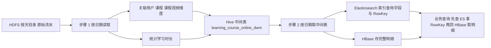
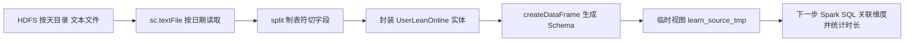
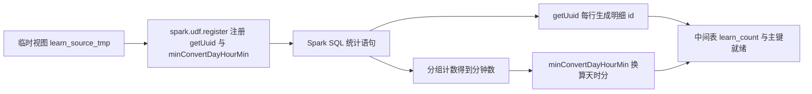
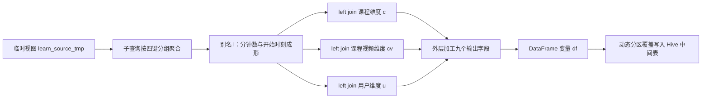
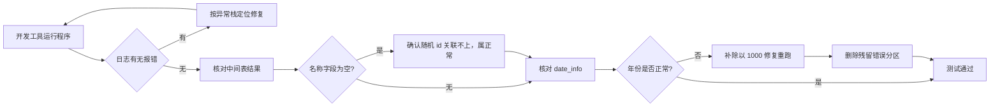
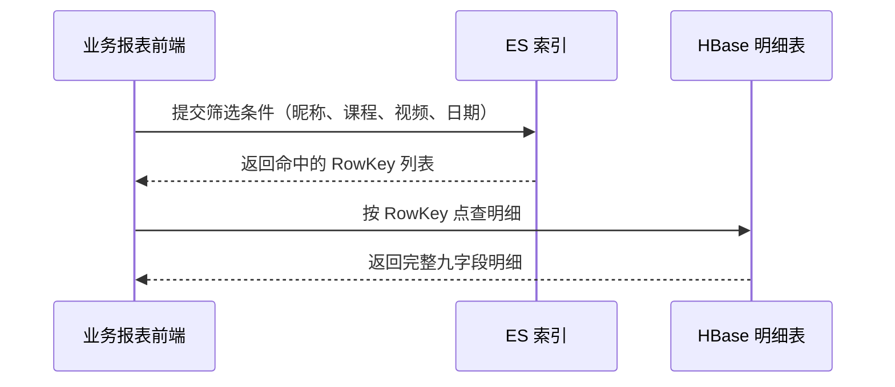
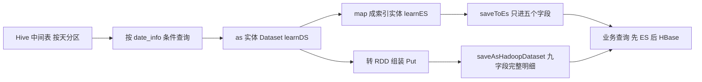
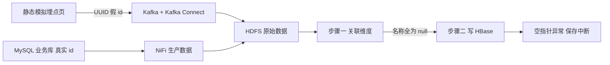
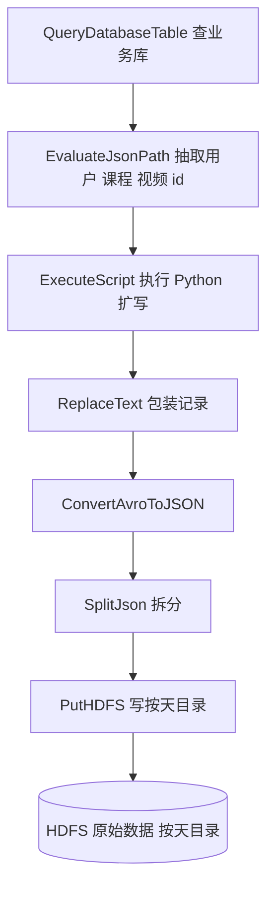

# 即时查询统计分析全解：中间表两步走，把学习明细送进 ES 与 HBase

> 🔒 安全提示：文中示例的口令/密钥均为课程教学环境演示口径，生产环境的安全要求见《安全与合规须知》。

## 先给结论

- 学习中心的即时查询统计分析走两步：步骤 1 关联维度并统计学习时长，产出中间表保存进 Hive；步骤 2 从中间表按日期取数，查询字段索引进 Elasticsearch，完整明细落进 HBase。
- 时长口径是全系列的基石：埋点一分钟一条，同一次会话同一视频的记录条数就是学习分钟数，count(1) 即得；前台要「天、小时、分」的展示格式，Spark SQL 没有现成函数，靠 UDF 换算。
- 中间表是分水岭：九个字段落在 Hive `data_course.learning_course_online_dwm`，属数仓 DWM 层；它不是终点，真正的落地在 HBase 与 ES。
- 步骤 1 的代码四段推进：按日期读原始数据封装实体、注册 uuid 与时长换算两个 UDF、一条 SQL 同时完成分组计数与三表 left join、动态分区覆盖写进中间表。
- 步骤 1 测试修出一个真 bug：from_unixtime 按秒解释入参而 learn_time 是毫秒值，年份跑到五位数，补上除以 1000 即修复；覆盖写清不掉的残留分区要到 HUE 里手动删除。
- 步骤 2 复用技术方案阶段 HBase 与 ES 的保存写法：ES 只索引 RowKey 与五个查询字段，九字段全量明细进 HBase；两边对 null 的态度不同，HBase 直接空指针，ES 自动跳过。
- 运维与数据两条底线：容器 Up 不等于服务健康，HBase 强依赖 ZooKeeper，恢复按先依赖后服务的顺序；模拟页上报的假 id 关联不上维度，用 NiFi 从业务库取真实 id 造数后，全链路才算真正跑通。
- 换数据源伴随两处代码适配：学习时间从毫秒值变秒级时间戳，from_unixtime 里的除以 1000 要去掉；生产脚本把数据打散在 30 天里，步骤二去掉日期过滤、处理中间表全量数据。

## 第1部分：即时查询统计分析总览：中间表如何把一分钟一条的埋点变成可查的学习明细

采集落地的用户学习原始数据是一份流水：一分钟一条，只有 id 没有名称，更没有一个叫「学习时长」的字段。拿这样的数据去支撑明细查询，页面五个字段一个都对不上。统计分析要做的就是这轮加工，而且它分两步走，中间还隔着一层 Hive 中间表。把两步的边界、时长统计的口径、中间表每个字段的来路想清楚，后面几节的代码只是把这些决定翻译成 Scala 与 SQL。

### 两步拆解：中间表是分水岭

把整条统计链路画出来，中间表的位置一目了然：



**步骤 1 是从流水到明细的清洗。** 原始数据本身比较规范，字段齐全，但名称缺失、时长未算，这层把用户维度、课程维度、课程视频维度关联进来，把学习时间算出来，产出九个字段的中间表。注意它保存的去向是数据仓库的 Hive 表，而不是 HBase，这一层产物被称作中间表，属于 DWM 层的清洗。

**步骤 2 是从明细到可检索形态的落地。** 从中间表按日期取数，拆成两份写出：Elasticsearch 只索引查询字段与 RowKey，承担条件检索；HBase 存九个字段的完整明细，承担点查。两步职责分开，中间表就成了可以独立重跑、独立校验的缓冲层。

### 步骤 1 的四小步与时长口径

统计逻辑依次是：根据日期从 HDFS 获取原始数据；关联相关维度表；统计学习时长；保存到数据仓库中。前三步在一条 Spark SQL 里完成，第四步是 DataFrame 的覆盖写入。这里面唯一需要新建立的认知是时长口径，维度关联在离线分析章节已经做过很多遍。

口径的推导回到埋点的上报机制。用户学习埋点一分钟发送一次，同一会话里看同一个视频，`user_id`、`course_id`、`course_video_id` 都不变，唯一变化的是 `learn_time` 随时间递增。于是一分钟一条的记录天然就是分钟计时器：按 `user_id`、`course_id`、`course_video_id`、`user_session_id` 四个字段分组，组内记录条数就是学习分钟数。分组键里 `user_session_id` 不能省，它区分同一个人同一天两次打开同一视频的学习，少了它两次学习会被合并累加。

```sql
-- 时长统计的核心子查询：分组计数即分钟数，节选自步骤 1 统计 SQL
select
    user_id,
    course_id,
    course_video_id,
    min(learn_time) learn_time,      -- 首次上报时间即开始学习时间
    count(1) learn_count_tmp         -- 记录条数即学习分钟数
from learn_source_tmp
group by user_id, course_id, course_video_id, user_session_id
```

组内取 `min(learn_time)` 而不是 max 也有讲究：第一次上报的时刻就是用户开始学习的时刻，中间表里存的 `learn_time` 语义是学习时间，页面展示的正是它。

### 中间表：九个字段与三个来路

中间表结构是九个字段，按来路分三类：原始数据直接带过来的、维度关联补出来的、计算生成的。讲义里的对应关系整理如下：

| 中间表字段 | 源数据字段 | 字段说明 |
|---|---|---|
| learning_course_online_id | uuid 生成 | 用户学习明细 id，后续作 HBase RowKey |
| course_id | 原始自带 course_id | 课程维度 id |
| course_name | 通过 course_id 关联 | 课程名称，来自课程维度 |
| video_name | 通过 course_video_id 关联 | 视频名称，来自课程视频维度 |
| user_id | 原始自带 user_id | 用户维度 id |
| user_name | 通过 user_id 关联 | 用户名，来自用户维度 |
| learn_time | learn_time 取分组最小值 | 学习时间，时间戳 |
| learn_count | 通过分组计数计算 | 学习时长，分钟数换算的展示文案 |
| date_info | 通过 learn_time 格式化 | yyyy-MM-dd 格式日期 |

三个计算字段值得单独展开。`learning_course_online_id` 由 uuid 生成，每行一个唯一值，它将来就是 HBase 的 RowKey；不在采集时生成而在统计时生成，是因为只有到这一步才知道哪一行是「一条明细」。`learn_count` 是分组计数得到的分钟数，落表前经 UDF 换算成「x 天 x 小时 x 分」的展示文案，用户直接能读。`date_info` 用 `from_unixtime(learn_time/1000, 'yyyy-MM-dd')` 从时间戳格式化而来，学习时间是机器可读的时间戳，人看既不直观也没法当分区条件用，格式化成日期后，页面筛选与步骤 2 的按日取数都直接用它。

按讲义的写入方式（动态分区覆盖写），中间表的 Hive 建表示例如下，属按表结构补全的示例：

```sql
-- 建表示例，按讲义中间表结构与动态分区写入方式补全
create external table if not exists data_course.learning_course_online_dwm (
    learning_course_online_id string comment '用户学习明细 id，uuid 生成',
    course_id                  string comment '课程维度 id',
    course_name                string comment '课程名称',
    video_name                 string comment '视频名称',
    user_id                    string comment '用户维度 id',
    user_name                  string comment '用户名',
    learn_time                 bigint  comment '学习时间，时间戳',
    learn_count                string  comment '学习时长，x 天 x 小时 x 分'
)
partitioned by (date_info string comment 'yyyy-MM-dd 日期')
stored as textfile;
```

### 中间表为什么单独存一层

把清洗结果先落 Hive 再由步骤 2 落 HBase 与 ES，多一层看似绕路，实际解决了三件事。其一，步骤 2 的输入契约稳定：不管上游采集重跑多少次、口径怎么微调，只要中间表按日期就位，步骤 2 随时可重跑。其二，校验有抓手：九个字段的中间表可以先用 SQL 抽查，名称关联是否命中、时长是否合理，都在这一层验完，带病数据进不了 HBase。其三，职责可扩展：哪天要新增一条以中间表为源的统计或导出，直接挂上去即可，不必碰 HBase 与 ES 的写入链路。

## 第2部分：步骤 1 代码实现：按日期读取原始数据，把一行行文本封装成实体

统计逻辑定了四步，代码从哪里下手？工程里固定代码早已备好：公共环境类 `EtlEnvironment` 一行拿到 SparkSession 与 SparkContext，写入数仓的样板代码也已就位，只是因为最终要保存的变量还没声明，先把写入段注释着，等第三步统计出时长再放开。剩下的活按顺序写：按日期把 HDFS 上的原始流水读进来，按分隔符切字段，封装成实体，注册成临时视图，把接力棒交给 Spark SQL。

### 骨架与环境：固定代码先就位

进入开发工具，工程与依赖已经建好，步骤 1 的对象 `InstantQueryStep1ToHive` 里先写三样东西：初始化 SparkSession 的字段、main 方法开头获取 SparkContext、按统计逻辑留下的步骤注释。由于第二步关联维度与第三步统计时长都打算用 Spark SQL 完成，此刻先把读取代码写完，保存段的注释等变量出来再放开，这也是这类统计程序通用的推进节奏：读、算、存三段，写完一段验证一段。

### 按日期读文件：路径即契约

读取的路径没有任何新东西，就是采集阶段 connector 写盘的目录再拼一层日期。到 HUE 的 File Browser 里核对一遍 `learning_course_online_source` 目录，选中具体日期文件夹，完整路径就出来了。代码写成变量拼接：

```scala
package com.study.xc.analysis.search

import com.study.xc.analysis.common.EtlEnvironment
import com.study.xc.entity.UserLeanOnline
import org.apache.spark.sql.SparkSession

object InstantQueryStep1ToHive {
  // 初始化 SparkSession，本步骤不写 ES，第二个参数传 null
  val spark: SparkSession = EtlEnvironment.getSparkSession(this.getClass.getSimpleName, null)

  def main(args: Array[String]): Unit = {
    // 获取 SparkContext
    val sc = spark.sparkContext

    // 1. 根据日期从 HDFS 获取原始数据
    // 生产环境由调度脚本传参：val date_info = args(0)
    val date_info = "2019-12-11"
    val learnSource = sc.textFile(
      s"/user/hive/external/data_course/learning_course_online_source/${date_info}")

    // 2. 关联维度、3. 统计时长：注册临时视图后用 Spark SQL 完成
    // 4. 保存到数据仓库：变量就绪后放开写入代码
  }
}
```

测试期把日期写死无可厚非，但硬编码不能带进生产：日期应该由外部传进来。后续的调度脚本就是这么做的，spark-submit 命令行末尾带一个日期参数，程序里改成 `args(0)` 即可，同一段代码就能在任意日期上重跑：

```bash
SPARK_SUBMIT=/opt/spark/bin/spark-submit
$SPARK_SUBMIT \
  --master spark://xc-online-spark:7077 \
  --class com.study.xc.analysis.search.InstantQueryStep1ToHive \
  /opt/run/jars/xc-service-search-jar-with-dependencies.jar ${TD_DATE}
```

路径按天生成的规则在采集侧定下，代码侧按天拼接来消费，两侧共用同一份目录契约，谁也不用迁就谁。

### 从文本行到实体：顺序就是一切

原始数据在 ODS 层的存储格式是文本：字段间制表符分隔，行间换行分隔。一行七个字段，顺序固定为用户 id、课程 id、视频 id、用户 ip、会话 id、浏览器标识、学习时间。`split("\t")` 之后得到字符串数组，接下来把数组封装成实体，为的是后面关联维度、计算时长时每个字段有名字，而不是满屏 `arr(3)`。

```scala
// 实体字段顺序与 ODS 文本列顺序一致，learn_time 为时间戳用 Long
case class UserLeanOnline(user_id: String,
                          course_id: String,
                          course_video_id: String,
                          user_ip: String,
                          user_session_id: String,
                          user_agent: String,
                          learn_time: Long)

val learnSourceRDD = learnSource.map(_.split("\t")).map(arr => {
  UserLeanOnline(arr(0), arr(1), arr(2), arr(3), arr(4), arr(5), arr(6).toLong)
})
```

封装时从索引 0 开始逐个对位，数组的排列与讲义里 ODS 字段顺序一模一样，所以可以放心按 0 到 6 依次取。唯一要动手脚的是最后一列：切出来的是字符串，而实体里 `learn_time` 声明为 Long，用 `toLong` 转换。这一步不能省，时间戳一旦留在 String 里，后面按时间格式化日期、按时间比较大小全要出问题。

### 临时视图：把 RDD 交给 Spark SQL

封装好的 RDD 还不能直接写 SQL，Spark SQL 吃的是 DataFrame。`spark.createDataFrame(learnSourceRDD)` 借助 case class 的字段名与类型生成 Schema，再调 `createOrReplaceTempView` 注册成会话级临时视图：



视图名是 `learn_source_tmp`，`createOrReplace` 的语义是已存在则覆盖，调试期间改一版代码重跑一次，视图跟着刷新，不会撞上「视图已存在」的报错。到这一步，原始数据已经变成有名字、有类型的结构化数据，步骤 2 与步骤 3 的关联和统计全部交给一条 SQL。

## 第3部分：步骤 1 代码实现：注册 UDF，让 Spark SQL 会生成 uuid、会换算学习时长

原始数据已经躺在临时视图 `learn_source_tmp` 里，接下来关联维度、统计时长都计划用一条 Spark SQL 解决。动笔之前有两个活先要想清楚：每行明细需要一个 uuid 当主键，分钟数要换算成「x 天 x 小时 x 分」的展示文案，这两件事 Spark SQL 的内置函数都干不了。UDF 正是为这种场景准备的机制：把外部函数注册进 Spark SQL 的函数表，SQL 里就能像内置函数一样调用。这一节注册两个 UDF，为下一步的统计 SQL 备好弹药。

### 动笔前把时长口径再过一遍

两个步骤合并成一条 SQL 好理解：`group by` 计数本身就完成时长统计，`join` 三张维度表补名称，一条语句写完反而清晰。为什么时长要先想清楚？因为维度关联是熟路，离线分析章节做过大量同类操作，时长统计却是这门课第一次做，口径错了后面全错。

回到 ODS 层的数据形态。用户学习埋点一分钟采集一次，上报后经采集系统进 Kafka，再持久化到 HDFS。同一会话看同一个视频，用户 id、课程 id、视频 id 这些字段每次都相同，因为视频开始看了这些值就不会变；唯一不停变化的是学习时间，它随时间推移一直增大。于是分组计数就是分钟数：count 出来的结果是一个具体的分钟值，代表这个用户在这个视频上学了多少分钟。

前台展示不会直接甩一个 50、90 给用户，而是转换成天、小时、分钟的格式。Spark SQL 里没有现成的这种转换函数，但它留了口子：UDF 允许把外部函数注册进来，注册之后 Spark SQL 调用起来与内置函数无异。

### 两个 UDF 的注册代码

对照中间表结构看要补的两个缺口：`learn_count` 需要「分钟数转天时分」的函数；`learning_course_online_id` 需要「生成 uuid」的函数。这两个实现课程工具类里都已经有了，字符串工具类里有 uuid 方法，日期工具类里有时长格式化方法，UDF 只是把它们挂进 SQL。

```scala
package com.study.xc.analysis.search

import com.study.xc.utils.DateUtils.minConvertDayHourMin
import com.study.xc.utils.StrUtils.getUuId

// 注册 UDF：uuid 生成，无参函数，给每行明细生成唯一 id
spark.udf.register("getUuid", () => {
  getUuId()
})
// 注册 UDF：分钟数转天时分，入参为 Long 类型的分钟数
spark.udf.register("minConvertDayHourMin", (time: Long) => {
  minConvertDayHourMin(time)
})
```

两个注册长得差不多，参数签名却是关键差异。`getUuid` 是无参 UDF，闭包里直接调工具类方法；`minConvertDayHourMin` 声明了入参 `time: Long`，类型用大写 L 标注的 Long，SQL 传进来的值会按这个类型匹配。注册时第一个参数是在 SQL 里使用的函数名，之后写统计 SQL 时就用这个名字调用。

工具类的实现课程源码已备好，按讲义语义补全的示例如下，帮助理解函数的输入输出：

```scala
// 字符串工具类的 uuid 方法，示例实现，课程工具类已有同名方法
object StrUtils {
  def getUuId(): String = {
    java.util.UUID.randomUUID().toString.replace("-", "")
  }
}

// 日期工具类的时长格式化方法，示例实现，课程工具类已有同名方法
object DateUtils {
  // 学习了 50 分钟返回「0 天 0 小时 50 分」，60 分钟返回「0 天 1 小时 0 分」
  def minConvertDayHourMin(time: Long): String = {
    val day = time / (24 * 60)
    val hour = time % (24 * 60) / 60
    val min = time % 60
    s"${day}天${hour}小时${min}分"
  }
}
```

### 注册之后怎么用

UDF 注册完，下一步的统计 SQL 里就可以直接点名调用。节选与 UDF 相关的三个位置，完整 SQL 在关联维度的课程里展开：

```sql
select
    getUuid() learning_course_online_id,                 -- 无参 UDF 也要带括号
    minConvertDayHourMin(learn_count_tmp) learn_count,   -- 分钟数换成展示文案
    from_unixtime(l.learn_time/1000, 'yyyy-MM-dd') date_info
from (
    -- 分组计数子查询，见时长口径一节
) l
```

`getUuid()` 在 select 列表里对每行执行一次，每行明细拿到一个互不相同的 id；`minConvertDayHourMin(learn_count_tmp)` 把分组计数的结果就地换算，落进中间表的 `learn_count` 已经是可读文案。调用链在一张图里收拢：



### 调试注意点

UDF 的坑几乎都集中在「名字、时机、类型」三件事上。

**名字要对上。** 注册名与 SQL 调用名一致，大小写书写保持同一风格最稳妥。无参 UDF 调用必须带括号，漏掉括号后 SQL 会把 `getUuid` 当成一个不存在的列名，报 column not found，这是新手最高频的错。

**时机要在前。** `spark.udf.register` 是往当前 SparkSession 的函数表里登记，登记发生在 SQL 解析之前才有效。把注册写在 `spark.sql` 之后，运行直接报函数未定义。

**类型要匹配。** UDF 声明入参是 Long，SQL 里传 String 就会在运行期报类型错误；反过来，分组计数 `count(1)` 的结果是 Long，与 `minConvertDayHourMin` 的签名正好吻合。写 UDF 时把入参类型当成 SQL 与 Scala 两侧的契约来对待。

**实现要能序列化。** 闭包里引用 Scala `object` 的方法（工具类风格）没有序列化负担；若引用了某个实例对象的成员，该对象必须可序列化，否则集群模式提交时才炸，本地测不出来。

## 第4部分：步骤 1 代码实现：一条 SQL 同时完成维度关联与学习时长统计

UDF 注册进 Spark SQL 的函数表之后，统计语句的原料已经备齐：临时视图 `learn_source_tmp` 里躺着按日期读入的原始流水，`getUuid` 与 `minConvertDayHourMin` 两个函数随时可以点名调用。统计分析步骤 1 的四小步里，剩下的是把第 2 步关联维度与第 3 步统计时长写进一条 Spark SQL，再接上第 4 步保存数仓的收尾代码。这条 SQL 是即时查询统计分析的核心，值得逐段拆开看。

### 先聚合后关联：SQL 为什么拆成子查询

**先收敛行数，再做关联。** 原始流水一分钟一条，参与 join 之前先把同一会话的记录收敛成一行明细，外层 join 面对的就是明细行数而不是流水行数，关联成本随之下降。更关键的原因是依赖方向：外层要输出的 `learn_time` 与分钟数都是聚合的结果，只有从子查询里才拿得到，关联必须排在聚合之后。

子查询起别名 `l`，外层所有字段引用都从 `l` 出发，另外两张表只补名称。这个结构在读代码时也好认：看到 `from ( ... ) l` 就知道里面是聚合口径，外面是字段加工。

### 聚合子查询：分组键与两个聚合函数

分组计数是时长口径的落地，把上一章定下的规则翻译成 SQL：

```sql
-- 轻度聚合：分组计数折算学习分钟数
select
    user_id,
    course_id,
    course_video_id,
    min(learn_time) learn_time,      -- 组内最早的上报时间即开始学习时刻
    count(1) learn_count_tmp         -- 组内记录条数即学习分钟数，tmp 表示尚未换算
from learn_source_tmp
group by user_id, course_id, course_video_id, user_session_id
```

**分组键里课程 id 可选但保留。** 视频 id 是唯一的，一个视频归属一个课程，分组时带上不带课程 id 结果一样；但外层关联课程维度要用课程 id，分组的输出里就得有它，所以四个键一起写上，省得回头补。

**输出只留分组键与两个聚合值。** 用户 ip、浏览器标识在本指标里用不到，会话 id 在分组时已经消费完，都不再往外传，输出字段严格对着中间表的需求来。

**两个聚合函数各有语义。** 同一会话一分钟一条上报，组内是一串递增的时间戳，最早的那条就是用户开始学习的时刻，中间表的 `learn_time` 存的正是它。条数就是分钟数：看了 50 条，就是学了 50 分钟。这个值先命名为 `learn_count_tmp`，因为它还是裸的分钟数，不是页面要的「x 天 x 小时 x 分」，换算留到外层。

### left join 三张维度表：字段从哪张表来

关联之前先到 HUE 上核对三张维度表的主键字段名：课程维度表 `data_dimen.course_dim` 的主键是 `course_dim_id`，课程视频维度表的主键是 `course_video_dim_id`，用户维度表的主键是 `user_dim_id`，分别对上子查询里的课程 id、视频 id、用户 id：

```sql
select
    getUuid() learning_course_online_id,                 -- 无参 UDF 也要带括号
    l.course_id,
    c.name course_name,                                  -- 课程维度的 name 重命名为 course_name
    cv.video_name video_name,                            -- 维度表本就叫 video_name，别名可省
    l.user_id,
    u.name user_name,
    l.learn_time,
    minConvertDayHourMin(learn_count_tmp) learn_count,   -- 分钟数换算成展示文案
    from_unixtime(l.learn_time/1000, 'yyyy-MM-dd') date_info
from (
    -- 轻度聚合子查询，见上一节
) l
left join data_dimen.course_dim c on c.course_dim_id = l.course_id
left join data_dimen.course_video_dim cv on cv.course_video_dim_id = l.course_video_id
left join data_dimen.user_dim u on u.user_dim_id = l.user_id
```

**用 left join 而不是 inner join。** 明细是主，名称是补充：哪行关联不上维度，名称留空也要把明细留在中间表，否则统计口径与原始数据的行数对不上。测试环境里埋点 id 多为随机生成，关联不上的情况会成批出现，left join 保证了这些行不丢。

**名称字段两头叫法不同时用别名对齐。** 课程维度表里名称就叫 `name`，中间表里叫 `course_name`，输出处用别名改过来；课程视频维度表的名称本来就叫 `video_name`，两边同名，别名写不写都行。

**用户名取哪个字段要先查业务库。** 用户维度表里同时有 `user_name` 与 `name` 两个字段，光看字段名分不出语义。到在线教育平台的业务库把用户表翻出来核对：`user_name` 是登录名，`name` 才是要展示的用户名，页面要的是后者，所以输出 `u.name`。字段语义拿不准时去源头库确认，比在代码里猜可靠得多。

**三个加工字段各就各位。** `getUuid()` 对每行执行一次，生成互不相同的明细 id；`minConvertDayHourMin` 消费子查询里的分钟数，就地换成可读文案；`from_unixtime` 接收秒级时间戳与目标格式两个参数，`learn_time` 是毫秒值，先除以 1000 再格式化，落表的 `date_info` 才是正常的 `yyyy-MM-dd` 日期。

### 接上保存段，步骤 1 收尾

`spark.sql` 的返回类型是 DataFrame，用变量 `df` 接收。查询结果有了，开头注释着的保存段现在放开：

```scala
// 4. 保存到数据仓库：统计结果接在 df 上
spark.conf.set("hive.exec.dynamic.partition.mode", "nonstrict")
// 中间表名
val tableName = "data_course.learning_course_online_dwm"
df
  .repartition(1)               // 测试数据量小，合并成单文件再落表
  .write.mode("overwrite")      // 同一天重跑直接覆盖旧结果
  .insertInto(tableName)        // 按列位置写入中间表
spark.sql(s"select * from ${tableName}").show()
// 关闭资源
spark.close()
```

`date_info` 这一列完全由数据生成，没有静态分区值，动态分区模式要设成 `nonstrict` 才放行。`repartition(1)` 是针对测试期小数据量的处理，避免一个分区一个小文件地灌进 Hive；数据量上来之后这个并行度要按量调整。`insertInto` 按列位置匹配目标表，select 列表的字段顺序必须与建表语句一字不差，列名不参与匹配。

至此步骤 1 的代码全部写完：按日期读原始数据、关联维度、统计时长、保存数仓，四小步在同一个对象里首尾相接。整条加工链路收在一张图里：



图里从 `l` 分出的三条 join 是字段补齐的关键路径：三条都命中，九个字段齐整；任一条没命中，对应名称列留空，明细行依然往下走。

## 第5部分：步骤 1 测试：跑通统计 SQL，修掉一个日期 bug，清掉残留分区

统计分析步骤 1 的代码是这门课到目前为止最长的一段 Spark SQL，聚合、三表关联、UDF 调用全在里面，写完不跑一遍谁也不敢说它对。测试在开发工具里直接运行程序，验证两层东西：程序不报错，说明 SQL 语法与代码逻辑成立；结果正确，功能才算完整。这一轮测试正好踩中三个典型现象：名称字段大面积为空、日期格式化出五位数年份、覆盖写清不掉错误分区，每一个都值得单独拆开讲。

### 测试在验证什么：逻辑与结果两层

程序抛异常、任务失败，这类问题在日志里一眼可见；真正容易糊弄过去的是「跑完了但结果是错的」。所以测试分两层看：日志层确认读取、聚合、关联、写入四段都执行完，没有异常栈；结果层对中间表做抽查，行数与明细对得上、字段值符合口径，功能才算闭环。

抽查从分区维度入手最直接，先把表里所有日期分区与行数拉出来：

```sql
-- 核对分区与行数：哪些日期进了表、各多少条
select date_info, count(1) cnt
from data_course.learning_course_online_dwm
group by date_info
```

这一条 SQL 能同时暴露两类问题：分区日期值是否正常（年份是不是五位数），以及数据落在哪些天。

### 第一次运行：空名称与跨天数据都属正常

程序运行完，`show` 出来的结果里最先注意到的是名称列大面积空白：课程名称、视频名称、用户名都是空。回到 HUE 看中间表，这几列同样是空。这不需要改代码：埋点页面是静态页面，上报的用户 id、课程 id、视频 id 都是随机生成的 uuid，维度表里根本没有这些主键，left join 关联不上，名称留空、明细保留，正是设计的行为。等后续换成生产数据方式灌数，id 来自真实业务库，这几个字段自然有值。

时间分布上，数据落在 12 号与 13 号两天。生成数据的时间戳是在一个区间里随机取的，并没有按目标日期做过滤，所以跨两天是预期内的现象，不算统计错误；按天取数的逻辑在步骤 2 里靠 `date_info` 条件过滤，各天的数据各走各的分区。

### 一个真 bug：年份跑到五位数

结果里 `date_info` 一列出现了 51914 这样的年份，当下系统时间是 2019 年 12 月，这个值明显不对。问题出在日期格式化那一行：`from_unixtime` 期望的入参是秒级时间戳，而 `learn_time` 采集上来就是毫秒值，直接传进去等于把毫秒当秒，换算出来的年份膨胀了一千倍：

```sql
-- 修复前：毫秒当秒用，年份变成五位数
from_unixtime(l.learn_time, 'yyyy-MM-dd') date_info

-- 修复后：先除以 1000 转成秒，再格式化
from_unixtime(l.learn_time/1000, 'yyyy-MM-dd') date_info
```

改完重跑。写入模式是 `overwrite`，同一批分区的新结果会盖掉旧结果，这是重跑的基础保障。

### 覆盖写清不掉的残留分区

重跑之后新问题来了：新产生的分区日期是正确的，上一轮写错日期的那些分区并没有被覆盖掉。动态分区覆盖写的语义是只替换本次写入涉及的分区值，51914 年的分区在这次运行里根本没有被产出，自然原样留在表里。上一节那条分组核对 SQL 此时正合适，跑一遍就能看到正确分区与错误分区并存。

处理方式是把错误分区手动删掉，HUE 里对着表分区删除即可，等价的 SQL 是：

```sql
-- 删除错误日期的分区，分区值按实际残留情况替换
alter table data_course.learning_course_online_dwm
drop if exists partition (date_info = '51914-12-11');
```

分区删除完成后，数据仓库里剩下的就都是正常数据，步骤 1 的中间表交付达标：代码编写完成，测试通过。整轮测试的路径收在一张图里：



图里两条判定的顺序有讲究：先确认空名称是数据现象，再处理日期 bug，否则会把正常现象误判成代码问题，排查方向直接跑偏。

## 第6部分：统计分析步骤 2：把中间表拆成 ES 索引与 HBase 明细，跑通检索闭环

中间表 `learning_course_online_dwm` 在 Hive 里就位之后，数据还只是躺在数仓里。即时查询的终点不在这里：业务页面要让学生昵称、课程名称、视频名称、日期这些条件在海量明细里秒级筛出结果，还要把筛中的那一行完整明细点开展示。统计与查询在时效上的矛盾就卡在这：统计分析按天批量跑，查询却要求即时响应，所以查询链路必须与统计链路解耦，把统计成品搬进两种为查询而生的存储。统计分析步骤 2 做的就是这轮搬运，按日期取中间表，拆成两份写出：查询字段连同 RowKey 索引进 Elasticsearch，完整明细存进 HBase。这节课按保存逻辑、代码实现、测试验证的顺序走完整条链路，两个写出各自踩到的坑也一并交代。

### 保存逻辑：一份明细拆两份写出

**两份数据各管一件事。** ES 这份只放查询字段与 RowKey，任务是条件检索：页面提交筛选条件，ES 从索引里筛出命中的 RowKey 列表。HBase 这份放九个字段的完整明细，任务是点查：拿着 RowKey 去 HBase 取整行数据，供页面展示。一份管「找得到」，一份管「看得全」，两个存储的分工从这一刻就定下来了。

**查询字段从页面倒推。** 在线听课详情页面能填的筛选条件就四个：学生昵称、课程名称、视频名称、时间选择，时间选择对应中间表的 `date_info`，日期既是页面上的筛选框，也是中间表的分区依据。加上回查凭证 RowKey，索引实体就是五个字段。索引里多一个字段，写入与存储的成本就多一分，页面用不到的字段没必要进 ES。

**为什么按日期取数。** 中间表按天分区，统计分析步骤 1 每天产出一天的数据，步骤 2 就按 `date_info` 条件把对应分区取出来。一天一批，批批独立，某一天的数据要重算就单独重跑那一天，落进 ES 与 HBase 的结果跟着覆盖，整条链路的颗粒度与分区对齐。上下游之间也靠这个日期咬合：步骤 1 把当天的分区写进中间表，步骤 2 才有数可取，谁没跑完看分区一眼便知；补历史数据时把日期拨回去，两个步骤按同样的日期各跑一遍，链路不用改任何代码。

**页面五字段到中间表九字段的对应提前想清楚。** 原型上要展示的是学生昵称、课程名称、视频名称、学习时间、学习时长五个字段，筛选条件在此基础上多一个时间选择。对照中间表的九个字段，昵称取自 `user_name`、两个名称分别取自 `course_name` 与 `video_name`，学习时间是 `learn_time`、学习时长是 `learn_count`，筛选再加 `date_info`。这一轮对照做完，ES 要哪五个字段、HBase 为什么九个都要，答案已经全部浮出，写代码只是把结论落下来。

**为什么不把完整明细全塞进 ES。** 明细字段会随业务扩展越变越宽，全量进 ES 意味着存储与索引维护成本跟着涨；而 HBase 按行键点查是常数级的，天生适合「拿 id 取整行」。检索与点查分开，每种存储只承担自己擅长的形态，这是即时查询技术方案的核心取舍。统计侧把两边各写到位之后，业务查询与两个存储的协作关系画出来是这样的：



时序里两次请求各司其职：ES 那次把候选集从海量收敛到个位数，HBase 那次按行键一次命中。中间表是这条链路的分水岭，步骤 1 从原始流水进中间表，步骤 2 从中间表出、进 ES 与 HBase，数据在步骤 2 内部的流转也值得先看一眼：



流程图里 `learnDS` 是两条写出支路的公共上游，一份读入养两个出口；两个出口的字段清单不同，这正是保存逻辑的落点。

### 取数：从 Hive 表到实体 Dataset

代码在开发工具里已经备好骨架，来源是技术方案阶段验证 HBase、ES 保存时写过的演示程序：建表、写 ES、写 HBase 的套路都在，直接复用，唯一要换的是表名与列名。ES 索引名定义为 `learning_online_detail/doc`，HBase 表名 `LearningOnlineDetail`，列族 `learning_online_detail`，对象开头把 HBase 侧初始化做完：表不存在就创建（`createTable` 幂等，表在则跳过），再拿 `getJobConf` 返回的作业配置，它把表名、ZooKeeper 地址这些连接信息装进一个 Hadoop 配置对象，后面的批量写入全靠它指路：

```scala
package com.study.xc.analysis.search

import com.study.xc.analysis.common.EtlEnvironment
import com.study.xc.entity.{LearningCourseOnlineDwm, LearningCourseOnlineEsIndex}
import com.study.xc.utils.HbaseUtils
import org.apache.hadoop.hbase.client.Put
import org.apache.hadoop.hbase.io.ImmutableBytesWritable
import org.apache.hadoop.hbase.util.Bytes
import org.apache.spark.sql.SparkSession
import org.elasticsearch.spark.sql.EsSparkSQL

object InstantQueryStep2ToHbaseAndES {
  // ES 索引名/类型名
  val esTableName = "learning_online_detail/doc"
  // 初始化 SparkSession，第二个参数带上 ES 索引信息
  val spark: SparkSession = EtlEnvironment.getSparkSession(this.getClass.getSimpleName, esTableName)

  def main(args: Array[String]): Unit = {
    import spark.implicits._
    // 初始化 HBase：表不存在则创建
    val hbaseUtils = new HbaseUtils
    val hbaseTableName = "LearningOnlineDetail"
    val hbaseColumnName = "learning_online_detail"
    hbaseUtils.createTable(hbaseTableName, hbaseColumnName)
    val jobConf = hbaseUtils.getJobConf(hbaseTableName)

    // 中间表名
    val hiveTableName = "data_course.learning_course_online_dwm"
    // 1. 按日期从数据仓库获取数据
    val date_info = "2019-12-12"
    val learnDS = spark.sql(
      s"select * from ${hiveTableName} where date_info = '${date_info}'"
    ).as[LearningCourseOnlineDwm]
```

日期选哪天不是拍脑袋：先到 HUE 里看中间表哪个分区的数据多，12 号最饱满，`date_info` 就定为 `2019-12-12`。测试期把日期写死在代码里，与步骤 1 一致，后续接入调度时换成参数传入。

`spark.sql` 的返回是 DataFrame，这里要 `as[LearningCourseOnlineDwm]` 转成 Dataset。转换能编译通过，靠的是 main 方法开头那句 `import spark.implicits._`，它把样例类对应的 Encoder 隐式参数带进作用域，少了它 `as` 直接编译不过。转实体真正的动机在接下来的两个写出里：写 ES 要把每行 map 成索引实体，写 HBase 要按字段名取值组装 Put，两者都依赖字段有名字、有类型。样例类 `LearningCourseOnlineDwm` 的九个字段与中间表一一对应，转成实体之后，后续代码面对的是类型安全的对象而不是下标取列。样例类定义好之后值得和建表语句对一遍：字段名一致、类型一致，`as` 才能按名绑定成功；哪天中间表加了字段，这里同步改样例类，编译器会指出所有漏改的位置。

### 写 ES：只索引查询字段与 RowKey

复用演示代码时最容易顺水推舟的一步，恰恰是这里最需要停一下的地方：演示程序把整个数据集直接交给 `EsSparkSQL.saveToEs`，九个字段会全部进索引。对照保存逻辑，ES 该收的只有查询字段与 RowKey，所以先 map 成索引实体再写：

```scala
// 2. 索引到 Elasticsearch：只索引查询字段与 RowKey
val learnES = learnDS.map(obj => {
  LearningCourseOnlineEsIndex(
    obj.learning_course_online_id,   // RowKey，回查 HBase 的凭证
    obj.course_name,
    obj.video_name,
    obj.user_name,
    obj.date_info
  )
})
EsSparkSQL.saveToEs(learnES, esTableName)
```

`LearningCourseOnlineEsIndex` 是为索引单独定义的实体，五个字段与页面筛选条件一一对应。逐个看语义：`learning_course_online_id` 是中间表主键、将来的 HBase 行键，检索命中后全靠它回查；课程名称、视频名称、用户名是三个名称类筛选条件；`date_info` 支撑时间筛选。这一步 map 的意义不止是省存储：索引里的字段越少，写入越快，检索路径也越干净，ES 的职责被限定在「给 RowKey」上。

写出的目标 `esTableName` 用「索引名/类型名」的形式表达，`saveToEs` 接收 Dataset 与这个目标名即可。索引名命名成 `learning_online_detail`，与 HBase 表名、列族同一套语义，排障时两边对得上号。

### 写 HBase：RDD 到 Put 再 saveAsHadoopDataset

HBase 的行级写入单位是 `Put` 对象：一行一个 Put，行键加上若干个「列族: 列，值」的组合。九个字段里，行键用 `learning_course_online_id`，其余八个字段逐列塞进列族：

```scala
// 3. 保存到 HBase：完整明细，RowKey 即明细 id
learnDS.rdd.map(obj => {
  // 转为 Put，设置 row key
  val put = new Put(Bytes.toBytes(obj.learning_course_online_id))
  // 设置列：列族 learning_online_detail
  put.addColumn(Bytes.toBytes(hbaseColumnName), Bytes.toBytes("course_id"), Bytes.toBytes(obj.course_id))
  put.addColumn(Bytes.toBytes(hbaseColumnName), Bytes.toBytes("course_name"), Bytes.toBytes(obj.course_name))
  put.addColumn(Bytes.toBytes(hbaseColumnName), Bytes.toBytes("video_name"), Bytes.toBytes(obj.video_name))
  put.addColumn(Bytes.toBytes(hbaseColumnName), Bytes.toBytes("user_id"), Bytes.toBytes(obj.user_id))
  put.addColumn(Bytes.toBytes(hbaseColumnName), Bytes.toBytes("user_name"), Bytes.toBytes(obj.user_name))
  put.addColumn(Bytes.toBytes(hbaseColumnName), Bytes.toBytes("learn_time"), Bytes.toBytes(obj.learn_time))
  put.addColumn(Bytes.toBytes(hbaseColumnName), Bytes.toBytes("learn_count"), Bytes.toBytes(obj.learn_count))
  put.addColumn(Bytes.toBytes(hbaseColumnName), Bytes.toBytes("date_info"), Bytes.toBytes(obj.date_info))
  (new ImmutableBytesWritable(), put)
})
  // 进行保存
  .saveAsHadoopDataset(jobConf)
// 关闭资源
spark.close()
```

结构上分三层看。Dataset 先转回 RDD（`learnDS.rdd`），因为 HBase 的 Hadoop 写入通道吃的是键值对形态；map 里把实体加工成 `(ImmutableBytesWritable, Put)` 二元组，这是 HBase TableOutputFormat 认识的标准形态，行键包在 `ImmutableBytesWritable` 里随 Put 一起传递；`saveAsHadoopDataset` 拿着开头取到的 `jobConf` 把整批键值对送进表。所有值都经 `Bytes.toBytes` 转成字节数组，HBase 只存字节，字符串、数字到了这一层统一换语言。

对比一下两个写出的字段清单：ES 五个，HBase 八列加行键。差出来的 `course_id`、`user_id`、`learn_time`、`learn_count` 都不是筛选条件，但页面展示明细时要看，学习时间与学习时长恰恰是这份报表的核心展示列，所以完整明细里一个不能少。代码写完，三小步按保存逻辑归位，接下来交给测试验证。

### 测试：先把两个查看工具就位

测试在开发工具里直接运行程序，但结果查看要两个存储分别来。ES 这边引入了 web 界面查看：elasticsearch-head 能在页面上浏览索引、按条件搜索文档，容器编排阶段已经把它配置好，只是没设开机自启，需要手动拉起：

```bash
# 进入容器编排目录
cd /opt/cdh5.14.0
# 启动 elasticsearch-head 容器
docker-compose up -d xc-online-es-ui
```

启动成功后访问 `http://xc-online:9100/`。head 页面默认连 `localhost:9200`，而集群里的 ES 地址是 `xc-online:9200`，第一次连不上要手动把连接地址改过去再刷新。连上之后能看到技术方案阶段演示留下的 demo 数据，说明工具链路通畅，等程序跑完直接在这里看正式索引。HBase 没有 web 数据浏览界面，核对数据靠 hbase shell，`list` 看表在不在，`scan` 看行进了没有，两个命令就够这一轮测试用。两个存储的查看方式差异也顺带说明了各自的定位：ES 有现成的页面工具，浏览与搜索直观，面向人工核对；HBase 只有命令行入口，适合脚本化验证，一个面向检索体验，一个面向高吞吐读写。

### 测试：一个空指针暴露的两侧差异

程序一跑，HBase 写入段抛出空指针：

```text
java.lang.NullPointerException
    at org.apache.hadoop.hbase.util.Bytes.toBytes(Bytes.java:525)
    at ...InstantQueryStep2ToHbaseAndES$.<init>(InstantQueryStep2ToHbaseAndES.scala:69)
```

异常栈的最后一行是自己代码的行号，对应过去正是 `course_name` 那一列的 `addColumn`。排查顺势往下走：去 HUE 查中间表确认，这一列本来就是 null，测试环境的埋点 id 是随机生成的，维度关联不上，名称列留空，步骤 1 测试时已经见过这个现象，数据形态一路带到了这里。

症结在两个存储对 null 的态度不同。ES 索引时遇到 null 值字段会自动跳过，文档里缺这个字段，写入不报错；HBase 这边 `Bytes.toBytes` 不接受 null，转换阶段直接把异常甩出来，一个字段拖垮整个任务。测试期的处理是把空值列的 `addColumn` 注释掉，先让非空列走通写入，验证代码功能；生产数据灌进来之后 id 来自真实业务库，名称列有值，恢复全列写入即可。这一轮验证的逻辑要说清楚：随机数据下能保存的保存进去，走通的是代码的通路；数值层面的完整正确性，等真实数据到位后再核对。代码对不对与数据全不全，两件事分开验收，测试结论才立得住。更稳妥的写法是每个列值先过判空，空的跳过：

```scala
// 判空写法示例：空值列跳过，避免 Bytes.toBytes 抛空指针
Option(obj.course_name).foreach(v =>
  put.addColumn(Bytes.toBytes(hbaseColumnName), Bytes.toBytes("course_name"), Bytes.toBytes(v)))
```

这一轮重跑还顺带暴露了一个副作用。时间线是：第一次运行时 ES 已经保存成功，失败的是 HBase；修复后重跑，两边都写入成功，但 head 页面刷新一看，ES 里同一批文档出现了两份。原因要到 ES 的文档标识机制里找：elasticsearch-spark 写入时，文档里名为 `id` 的字段会被自动当作 `_id` 使用，技术方案阶段演示用的 Person 案例类正带着 id 字段，所以重跑会覆盖；本课的索引实体字段名是 `learning_course_online_id`，没有名为 id 的字段，ES 只能随机生成 `_id`，重跑就追加成重复文档。HBase 这边无所谓，RowKey 相同后写的覆盖先写的，天然幂等，重跑多少遍表里都是那一份。生产上要么把 RowKey 字段命名为 `id`，要么在 mapping 里显式指定文档 id，让重跑具备幂等性（此解释为按 elasticsearch-spark 主流机制的补充说明）。

### 测试：HBase 侧核对收尾

重跑无报错之后，登录 HBase 容器核对落地结果：

```bash
# 登录 HBase 容器
docker exec -it xc-online-hbase bash
# 切换到 HBase bin 目录
cd $HBASE_HOME/bin
# 进入 HBase shell
./hbase shell
```

shell 里先 `list`，`LearningOnlineDetail` 在表清单里，建表与写入链路成立；再 `scan` 这张表，数据已经进来。scan 的输出一行一条明细，左边是行键，右边逐列列出 `column=learning_online_detail.列名, value=值` 的组合，列族与列名、值一目了然。逐列核对：能对上的五列正是中间表里非空的 `course_id`、`user_id`、`learn_time`、`learn_count`、`date_info`，名称类的空列在测试期被注释没有写入；行键与 ES 索引里的 `learning_course_online_id` 同源，列名、值型与组装 Put 的代码一一呼应。到此功能验证完成：代码把中间表数据完整送进了 ES 与 HBase，即查即用的检索闭环就差真实数据灌入了。

## 第7部分：使用 HBase 注意事项：容器开机自启时，HBase 为什么起不来

项目的整套大数据环境用容器编排拉起，主要容器都配了开机自启动。理想情况下打开机器直接跑程序，实际情况是某天连 HBase 的代码报 socket 超时，HBase 的 web 页面也打不开，查代码查不出任何问题。这多半不是代码的锅：HBase 强依赖 ZooKeeper，开机自启的容器各自竞速，谁先谁后没有保证，HBase 启动那一刻 ZooKeeper 不在场，服务就起不来。这节把这个场景完整演示一遍，给出两个症状的识别方法与恢复步骤。

### 为什么容器活了，服务却死了

**容器与服务是两层状态。** 编排工具的职责是把容器进程拉起来，容器里跑的 HBase 服务还要自己完成启动流程，其中关键一步是向 ZooKeeper 注册。ZooKeeper 不在场，注册走不通，服务卡在初始化或直接失败，而容器层面看到的依旧是一片「启动成功」。开机自启只会把所有容器各自拉起，不承诺内部服务的启动顺序，这就是问题的高发场景。

**复现一遍最直观。** 把 HBase 与 ZooKeeper 两个容器都停掉，然后只启动 HBase，模拟「ZooKeeper 没起来」的状态：编排命令返回成功，浏览器访问 HBase 的 web 端口却完全打不开，因为 HBase 压根没启动，对外端口一个都没监听。此时去 HBase 容器里看进程，容器里有进程残留，但那只是没跑成功的残骸，服务本体是挂的。再执行业务代码，等待连接超时后报错收场。

### 两个症状怎么认

症状一在 web 端。HBase 的 RegionServer 页面地址是 `http://xc-online:60030/`，异常时有两种表现：页面完全打不开（服务没监听端口），或者页面打开但只显示一句话「The RegionServer is initializing!」，Region 信息全部缺失，这是服务卡在初始化的样子。

症状二在代码端。程序操作 HBase 时连接不上，客户端反复重试直至耗尽，抛出类似这样的异常：

```text
Exception in thread "main" org.apache.hadoop.hbase.client.RetriesExhaustedException:
Failed after attempts=36, ... socket 超时
```

重试 36 次仍然失败，基本可以排除偶发网络抖动，指向服务端没有就绪。两个症状同时出现，先查 ZooKeeper 再查 HBase，方向就不会错。

### 恢复步骤：先依赖后服务

恢复的原则是依赖先行：ZooKeeper 没就绪之前，任何针对 HBase 的启动动作都是白费。按顺序执行：

```bash
# 1. 启动 ZooKeeper 容器，依赖先就位
docker-compose start xc-online-zk

# 2. 登录 zk 容器，查看进程确认 ZooKeeper 已启动
docker exec -it xc-online-zk bash

# 3. 登录 HBase 容器，查看 HBase 进程状态
docker exec -it xc-online-hbase bash

# 4. 停掉没启动成功的 HBase 残留进程
cd $HBASE_HOME/bin
./stop-hbase.sh

# 5. stop 长时间卡住时，ps 查出进程号后强制结束
#    kill -9 <pid>

# 6. 启动 HBase
./start-hbase.sh
```

有两个细节要展开。其一，ZooKeeper 就绪后再进 HBase 容器，往往会发现之前失败的启动留下了半死进程，直接 start 会被它挡住，要先执行 `stop-hbase.sh` 清场；而这个 stop 也可能长时间停不下来，因为残留进程当年注册 ZooKeeper 就没成功，协调不回包，停的过程同样卡住，此时用 `ps` 找到进程号 `kill -9` 强杀，再走启动。其二，启动完成后刷新 web 页面，访问 `http://xc-online:60030/rs-status`，能看到 RegionServer 的软件属性才算数：HBase Version 一栏显示版本信息，ZooKeeper Quorum 一栏指向 `xc-online-zk:2181`，Master 地址也在列。页面有数据，服务才算真活了。

排查与恢复的判断路径收在一张图里：


图里的关键分叉在 ZooKeeper 那一层：它没起来，后面所有动作都无从谈起；它起来了，剩下的就是给 HBase 清场再启动。

### 顺带把 HBase 的日常验证习惯补齐

这套恢复动作之外，日常有两个习惯能少踩坑。一个是状态验证看页面：60030 的 rs-status 页是最快的服务体检入口，比登录容器看进程省事，开机后先扫一眼再跑程序。另一个是数据验证进 shell：HBase 没有 web 数据浏览界面，核对落地结果靠 hbase shell 的 `list` 与 `scan`，统计分析步骤 2 写进去的 `LearningOnlineDetail` 表就用这个方式验证。本项目的 HBase 用法也值得回看一眼：单列族存放明细，RowKey 用 uuid 生成的明细 id，写入走 Put 直写，服务健康检查的最终目的就是保住这条写入链路的畅通。

## 第8部分：换一份能关联上维度的数据：NiFi 生产用户学习数据的配置与两步代码测试

统计分析的两步代码写完之后，第一次完整联跑并不顺利：步骤一读原始数据、关联维度都看不出异常，到步骤二写 HBase 时却抛出空指针异常，保存中断。排查到底才发现问题不在代码，而在数据本身：原始数据是 js 埋点采集的，而埋点页面是一个静态模拟页，上报的用户 id、课程 id、视频 id 全是 UUID 随机生成的假值，维度表里根本查不到，名称关联不上，后续环节自然步步踩空。解决思路不是去补一个真实前端，而是换一种方式把数据造出来：用 NiFi 生产数据，从 MySQL 业务库读取真实的课程 id、视频 id、用户 id，按与埋点完全相同的结构写进 HDFS。这一课把生产流程配起来、跑起来，再把两步统计代码在真数据上重新测通。

### 假数据的连锁反应：从关联不上到空指针

把故障链摆出来，才能理解为什么要动数据源。埋点页面上报的用户 id、课程 id、视频 id 都是 UUID 随机生成，而用户维度表、课程维度表、课程视频维度表里存的是业务库的真实 id，两边对不上。步骤一的关联用的是 left join，关联不上不会报错，只是名称字段全为 null；数据流到步骤二，写 HBase 时把 null 当正常值处理，就抛出了空指针异常，保存中断。



图里上下两条路最终汇进同一个 HDFS 目录，下游代码一行不改。这就是这个方案的高明之处：埋点链路保留着，流程本身没有被否定；生产数据只是替代了「数据从哪来」这一段，id 换成真的，字段结构与文件格式原样保留。前端页面不是一个完整页面，只是为演示埋点流程做的静态模拟，流程上没有问题，数据上有问题，补页面成本高又偏离主题，换数据源是最短路径。

这个问题还有一个隐蔽之处：它在步骤一完全暴露不出来。left join 关联不上不报错，中间表照样有行数、有 id，程序正常退出；要到步骤二写 HBase、索引 ES 时，名称为 null 的字段一进写入逻辑才炸出来。如果只盯着报错的那一行代码排查，很容易在写入逻辑上空耗，先查数据的完整性（名称字段有没有值）再查代码，是排查这类链路问题的正确顺序。

开发期用造数解决数据真实性，也是企业里的常规做法。测试环境没有真实用户流量，前端页面又是模拟页，等着真实数据再测试，项目节奏上等不起；造数脚本以业务库为种子生成自洽的假数据，既快又可控，生产环境上线后切回真实埋点即可。

**第一，id 必须真实。** 生产数据的输入来自 MySQL 业务库，课程表、视频表、用户表里的 id 是维度表关联用的主键，拿这些 id 造出来的明细才能在步骤一正确关联出课程名称、视频名称、用户名称。

**第二，结构必须一致。** 下游的步骤一按七个制表符分隔字段解析原始数据，生产数据写出的文件必须逐字段对齐：用户 id、课程 id、视频 id、用户 ip、用户 session、user-agent、学习时间。格式一变，解析代码立刻崩。

### 生产数据脚本：在 NiFi 里跑的 Python

造数逻辑不是外部程序，而是嵌在 NiFi 流程里的 Python 脚本，由 `ExecuteScript` 处理器执行。脚本先在头部随机生成浏览器标识列表与时间函数，核心的扩写逻辑在 `PyStreamCallback` 里，讲义里的完整脚本骨架如下：

```python
import random
import uuid
import time, datetime
import java.io
from org.apache.commons.io import IOUtils
from java.nio.charset import StandardCharsets
from org.apache.nifi.processor.io import StreamCallback
from org.apache.nifi.processors.script import ExecuteScript

BROWSER = ['Firefox', 'Chrome', '360', 'Fz', 'Sougou', 'IE', 'Spark', 'QQ', 'UC', 'Liebao', 'AY']

def datestamp():
    now_info = datetime.datetime.now()
    delta = datetime.timedelta(random.randint(1, 30))      # 随机回退 1 到 30 天
    time_info = now_info - delta
    for_time = time_info.strftime('%Y-%m-%d %H:%M:%S')
    times = int(time.mktime(time.strptime(for_time, '%Y-%m-%d %H:%M:%S')))
    return times                                            # 返回秒级时间戳

class PyStreamCallback(StreamCallback):
    def process(self, inputStream, outputStream):
        uc = str(IOUtils.toString(inputStream, StandardCharsets.UTF_8)).split(",")
        sessions = str(','.join(str(uuid.uuid4()) for i in xrange(1, random.randint(2, 10)))).split(",")
        for i in xrange(1, random.randint(20, 50)):         # 一条输入扩写成几十条明细
            ip_str = str('.'.join(str(random.randint(1, 255)) for i in xrange(4)))
            user_id = uc[0]                                 # 业务库真实用户 id
            course_id = uc[1]                               # 业务库真实课程 id
            course_video_id = uc[2]                         # 业务库真实视频 id
            session_id = sessions[random.randint(0, sessions.__len__() - 1)]
            user_agent = str(BROWSER[random.randint(0, BROWSER.__len__() - 1)])
            visit_time = str(datestamp())
            outputStream.write(bytearray(user_id + '\t' + course_id + '\t' +
                course_video_id + '\t' + ip_str + '\t' + session_id + '\t' +
                user_agent + '\t' + visit_time + '\n', encoding='utf-8'))

flowFile = session.get()
if flowFile != None:
    flowFile = session.write(flowFile, PyStreamCallback())
    session.transfer(flowFile, ExecuteScript.REL_SUCCESS)
```

脚本有三个设计点值得留意。时间上，`datestamp()` 从当前时刻随机回退 1 到 30 天，返回的是秒级时间戳，这一点与 js 埋点不同，埋点上报的是毫秒值，后面代码测试时要专门适配。数量上，每接一条上游记录就扩写出 20 到 50 行明细，配合 ip、session、user-agent 的随机化，少量输入就能快速攒出测试量。结构上，输出行严格按 ODS 七字段制表符分隔，下游解析代码无感知。

### NiFi 调度配置：模板进画布，连接池指向业务库

生产数据在 NiFi 上是一个独立的处理器组，调度模板已随资料提供，配置动作与前面各章的套路一致：进入即时查询处理器组，把生产数据脚本源码上传，再用添加模板的方式把「数据生产_用户学习(在线学习)-ToHDFS」加入画布。加进来还不能直接跑，处理器组里有一处必须手工补的配置：连接 MySQL 的控制器服务。

模板内部的处理器链是这样的：



链路起点在业务库，终点在 HDFS。起点上的 QueryDatabaseTable 是 NiFi 提供的数据库查询处理器，按配置的最大值列做增量拉取，业务库课程表有多少条记录就产出多少条输入，每条输入带着一个真实课程 id 进入下游；EvaluateJsonPath 从查询结果里抽出用户 id、课程 id、视频 id 三个属性；ExecuteScript 接到流文件后跑 Python 脚本扩写；末端 PutHDFS 的目录属性是一个表达式，按当前时间回退一天格式化出日期，把文件写进 `/user/hive/external/data_course/learning_course_online_source/` 下对应的按天目录。其余属性如副本数、块大小、冲突策略保持模板默认即可。

连接业务库靠 DBCPConnectionPool 控制器服务，要补的就是连接四要素：

```properties
Database Connection URL: jdbc:mysql://xc-online:3306/xc_course?characterEncoding=UTF-8&useSSL=false
Database Driver Class Name: com.mysql.cj.jdbc.Driver
Database Driver Location: /root/mysql-connector-java-8.0.16.jar
Database User: root
Password: 123456
```

密码是 123456，按课程环境的约定填写。配置完成后先启用控制器服务，作用域选 Service only，再把处理器组里的连接逐个启用，刷新后处理器组状态全部正常，配置阶段到此结束。这一步忘做或做错的表现很典型：QueryDatabaseTable 反复报连接失败，队列里全是惩罚关系的流文件，处理器组怎么都跑不起来。

### 测试前的数据清理：把四处的旧数据扫干净

数据生成之前还有一件必做的事：清理旧数据。此前用假数据测试过，各存储里躺着一批脏结果，混着新数据测试，查出来的东西分不清是哪次跑出来的，测试等于白做。清理覆盖四个位置：

**ES 侧**，打开 es-head 管理页面，在索引数据页签点动作、点删除，按提示输入删除确认，索引里的旧文档清空。

**HBase 侧**，登录 HBase 容器进 hbase shell，先禁用再删除明细表：

```bash
hbase(main):001:0> disable 'LearningOnlineDetail'
hbase(main):002:0> drop 'LearningOnlineDetail'
hbase(main):003:0> list
```

**HDFS 侧**，原始数据目录与中间表目录都在 Hive external 路径下，把 `learning_course_online_source` 与用户学习 dwm 对应目录直接删除即可，采集与清洗过程会自动重建目录，删了不影响后续流程。

**Hive 分区**，dwm 表按天分区，目录删了分区元数据还在。分区删不删都能继续测试，为了数据干净还是把测试期间留下的分区 drop 掉，日志里会逐个显示删除结果，个别早期测试遗留的分区可以放着不管。

### 跑通生产，再把两步代码在真数据上测完

清理完毕，把生产数据处理器组启动起来。队列开始流动后到 HDFS 上看文件，数据陆陆续续落进按天目录，等生产出 1 MB 左右的数据就够测试用了，把处理器组停掉，别让它无限量地造下去。

真数据与假数据有两处差异，对应两处代码适配，这是本课测试环节的核心。

**步骤一的适配在学习时间单位。** 埋点采集时 `learn_time` 是毫秒值，统计代码里用 `from_unixtime` 格式化日期时除以 1000 转成秒；生产脚本给出的 `learn_time` 本身已经是秒级时间戳，再除一次 1000 就全乱了。改动只在一个表达式：

```scala
// 适配前：埋点毫秒值，除以 1000 转秒
| from_unixtime(l.learn_time/1000, 'yyyy-MM-dd') date_info
// 适配后：生产数据已是秒级时间戳，直接格式化
| from_unixtime(l.learn_time, 'yyyy-MM-dd') date_info
```

改完直接运行步骤一，程序跑完后到 HUE 里刷新 dwm 中间表，数据已经出来，而且这次是完整的：课程名称、视频名称、用户名称都有值，维度关联成功。顺手在表浏览器里看一下分区列表，30 个日期分区整整齐齐，与生产脚本的随机回退天数对得上，原始数据落进了哪 30 天，中间表就建了哪 30 个分区。

**步骤二的适配在日期过滤。** 生产脚本把数据随机打散在最近 30 天里，全部落进了 HDFS 的对应目录，步骤一处理时没有按天过滤，中间表里就是整整 30 天的数据。此前测试是按指定日期跑的，代码里带着 `date_info` 的日期条件，只处理某一天。这次把日期过滤去掉，让程序处理中间表的全量数据，后面 web 展示时数据量才够、效果才好：

```scala
// 适配前：按指定日期过滤，只处理一天
val learnDS = spark.sql(s"select * from ${hiveTableName} where date_info = '${date_info}'").as[LearningCourseOnlineDwm]
// 适配后：去掉日期条件，处理中间表全量数据
val learnDS = spark.sql(s"select * from ${hiveTableName}").as[LearningCourseOnlineDwm]
```

步骤二跑完，按三处依次核对。es-head 里浏览索引，文档完整无报错；HBase 里 scan 一下明细表，行数据已经在刷新，`course_name`、`video_name`、`user_name` 各字段都有值，中文值在 scan 输出里以转义字节显示，拼音与英文值直接可读，这是 hbase shell 的正常行为，不代表数据有问题。三处齐了，NiFi 生产数据加两步统计代码的整条链路就算真正测通。

两处适配改动的性质也值得回味：都不是逻辑错误，而是数据事实变化引起的参数级修改。数据源的毫秒改秒，对应一个表达式的除法去留；数据范围从单天改 30 天，对应一个过滤条件的去留。真正费劲的排查往往发生在「换了数据源但没同步核对契约外的事实」这种时刻，单位、时区、编码都是高发区，换源测试前把它们过一遍，能省掉大量无效重跑。

回头看这一课的两个视频，动作连贯得像一条流水线：配置阶段把生产流程装进画布、接上业务库；测试阶段先清场、再造数、再带着两处适配重跑两步代码、最后三处核对。埋点链路教的是怎么收数据，生产数据教的是怎么造数据，两条路写出的文件格式完全一致，下游代码只改了两行。开发测试用造数解决数据真实性问题，生产环境换回真实埋点，架构上什么都不用动，这正是把「数据来源」与「数据加工」解耦的价值。

## 常见误区

- **以为统计完直接写 HBase。** 错例：跳过 Hive，Spark 算完就组装 Put 写 HBase。正解：课程方案先落中间表再落地，中间层带来可重跑与可校验，省掉的那一步会在排障时加倍还回来。

- **以为学习时长是埋点上来的字段。** 正解：原始七个字段里没有时长，它是分组计数算出来的，口径是一分钟一条。

- **分组键漏掉 user_session_id。** 错例：按用户、课程、视频三键分组，同一人两次学习被并成一条，时长虚高。正解：会话 id 必须参与分组。

- **把 date_info 当成上报字段。** 正解：它是时间戳格式化的派生列，时间戳单位要与格式化方式对齐，课程代码按毫秒处理（除以 1000），若埋点上报的是秒级时间戳，格式化结果会全部落到 1970 年。

- **实体字段顺序自己拍脑袋排。** 错例：case class 里把 `user_ip` 排在会话 id 后面，数据静默错位，查了半天发现用户 ip 全是 uuid。正解：字段顺序必须与文本列顺序逐一对齐，封装前拿一行样例数据核对。

- **日期写死忘了改成参数。** 正解：测试期写死可以，提交调度前必须换成 `args(0)`，配套的 spark-submit 脚本末尾传日期，否则程序永远只算同一天。

- **保留 String 类型的时间戳不转换。** 错例：实体里 learn_time 也定义成 String，后面格式化日期再转。正解：入口处一次 `toLong`，类型在链路里越早确定越安全。

- **分隔符没按存储格式写。** 错例：想当然把分隔符写成空格或竖线，split 出来只有一列。正解：ODS 约定字段间制表符分隔，`split` 接收正则，写 `"\t"` 即可；格式有出入时先回采集配置核对，别按猜的来。

- **SQL 里写 `getUuid` 不带括号。** 正解：无参 UDF 也是函数，调用必须写 `getUuid()`，否则按列名解析报找不到列。

- **把格式化逻辑写在代码里逐行处理。** 错例：拿到 DataFrame 后用 map 循环换算时长，再拼回表。正解：注册成 UDF 后 SQL 直接表达，统计语句保持一步到位，代码量与出错面都更小。

- **UDF 起名撞上内置函数。** 正解：注册与内置同名的函数会引发解析歧义，命名上避开 `count`、`min` 这类保留感强的词，业务语义命名即可。

- **忘记类型对齐。** 错例：把分钟数先 `toString` 再传给 UDF。正解：UDF 入参 Long，SQL 传入的列保持数值类型，类型转换交给显式的 `cast`，不要藏在 UDF 里。

- **join 写成 inner join。** 错例：觉得关联不上的数据没意义，用 inner join 过滤。正解：统计口径以明细为准，名称缺失可接受，明细丢失不可接受，必须 left join。

- **`from_unixtime` 直接吃毫秒时间戳。** 正解：该函数按秒解释入参，毫秒值要先除以 1000，否则格式化出的年份是五位数，测试环节这个坑马上会现形。

- **以为 `insertInto` 按列名匹配。** 错例：调整 select 字段顺序后照常运行，落表数据整列错位。正解：`insertInto` 严格按位置对应建表字段，输出顺序改动前后必须核对表结构。

- **`repartition(1)` 原样带进生产。** 正解：单分区写文件只适合小数据量验证，生产上按数据量给并行度，否则写入瓶颈与单文件过大都会找上门。

- **把空名称当代码 bug。** 错例：看到名称列为空就去改 join 条件或换表。正解：先查数据来源，埋点 id 是随机生成的，关联不上是数据形态问题，生产数据灌入后自然消除。

- **以为 overwrite 能擦掉所有旧数据。** 错例：修复后重跑一次就认为表已干净。正解：动态分区覆盖写只覆盖本次产出的分区，历史错误分区要显式删除，删除后用分组核对 SQL 复查。

- **时间戳单位不确认就格式化。** 正解：`from_unixtime` 吃秒，毫秒值先除 1000；上游字段单位要在写格式化代码前确认，这类错误结果离谱但日志无异常，只能靠结果核对兜住。

- **跨天数据当异常处理。** 正解：测试数据的时间戳是随机生成的，落多天属正常；判断异常的依据是口径与分区逻辑，不是数据恰好只落在一天。

- **复用演示代码时把全量字段写进 ES。** 错例：`saveToEs(learnDS)` 一行解决，九个字段全进索引。正解：按保存逻辑 map 成只含查询字段与 RowKey 的索引实体，索引瘦身，职责不越界。

- **HBase 写入不判空。** 错例：`Bytes.toBytes(obj.course_name)` 直接包列值，遇到 null 全任务失败。正解：列值统一判空跳过或给默认值；ES 与 HBase 对 null 的行为不同，不能按同一套预期写。

- **默认重跑对两边都幂等。** 正解：HBase 按 RowKey 覆盖是幂等的，ES 在文档没有 `_id` 映射时会追加重复；重跑前清理索引，或把 RowKey 映射为文档 id，二选一。

- **测试先跑代码后找工具。** 正解：head 容器要手动拉起、连接地址要改，HBase 的 shell 命令要提前备好；工具就位后跑程序，失败与成功都能立刻核对，不浪费重跑次数。

- **把容器状态当服务状态。** 错例：`docker-compose` 返回成功、`docker ps` 里状态是 Up，就认定 HBase 可用。正解：容器 Up 只说明进程在，服务健康要看 60030 页面或实际连一次。

- **不查依赖直接重启 HBase。** 错例：服务起不来就反复 start-hbase，越跑越乱。正解：先确认 ZooKeeper 进程与状态，依赖就位后再动 HBase，顺序反了全是无用功。

- **对残留进程反复重试。** 正解：启动失败留下的半死进程会挡住后续启动，先 stop 清场，stop 卡住就 kill -9，清干净再 start。

- **把页面打不开当网络问题。** 正解：端口不通先区分两种可能，网络不通与服务没监听都会表现为打不开；登录容器看进程与端口监听，一步就能分辨。

- **以为是统计代码写错了。** 错例：空指针一抛就去翻 HBase 写入代码，加判空、改逻辑折腾半天。正解：先查数据，用 HUE 看中间表里名称字段是不是全空，名称为空说明维度没关联上，根子在上游数据是假 id。

- **换数据源后忘了改时间单位。** 错例：生产数据跑完直接重跑步骤一，`from_unixtime` 里除以 1000 的旧逻辑把秒级时间戳又缩小一千倍，日期全部落在 1970 年。正解：埋点是毫秒、脚本是秒，改数据源必须同步检查时间字段单位。

- **不清理旧数据就开始测试。** 错例：ES 与 HBase 里的脏数据没删，跑完看到「有数据」就宣布测试通过，实际看的是上一轮的残留。正解：ES 索引、HBase 表、HDFS 目录、Hive 分区四处全清，测试结果才有辨识度。

- **生产数据处理器组开着不管。** 错例：造够数据后不去停处理器组，数据一直往 HDFS 灌，后续统计越跑越久，展示结果也没法复现。正解：攒到 1 MB 左右主动停止，测试要的是可控的数据量。

## 面试可能被问到的问题

1. 面试官追问：「学习时长是怎么统计出来的？」
   答：埋点按一分钟一次上报，同一会话同一视频的字段除时间戳外都相同，按用户、课程、视频、会话四个键分组后 count(1) 就是学习分钟数，开始时间取组内最小时间戳。时长不靠时间差计算，靠条数折算，简单且抗时钟误差。

2. 面试官追问：「为什么分组键要带 user_session_id？」
   答：会话 id 区分同一个人两次独立打开同一视频的学习。没有它，两次学习的记录会被合并成一条，时长累加、开始时间也取错。口径设计要先回答「什么算一次学习」，会话就是这里的边界。

3. 面试官追问：「中间表为什么放 Hive，而不是算完直接写 HBase？」
   答：中间表是清洗层与落地层的解耦。落 Hive 后可以随时抽查、校验、重跑，步骤 2 的输入稳定；直接写 HBase 一旦口径出错，删除重灌的成本远高于覆盖一张 Hive 分区表。分层牺牲一次落盘，换来整条链路的可维护性。

4. 面试官追问：「uuid 主键为什么在统计时生成，而不是采集时生成？」
   答：原始流水一行是一次上报，同一会话一分钟一条，还没有「一条明细」的概念；统计分组后才形成明细行，此时生成的 uuid 才有唯一语义，并直接用作 HBase 的 RowKey。标识的生成时机跟着数据形态走。

5. 面试官追问：「date_info 派生列的价值在哪？」
   答：它把机器的时间戳翻译成人类可读、可直接当分区值的日期。步骤 2 按日期取中间表、页面按天筛选、分区裁剪都靠它，一处格式化换来下游全链路的便利。

6. 面试官追问：「为什么用 `sc.textFile` 手工切分，而不是 `spark.read` 直接读？」
   答：源文件是无表头、以制表符分隔的纯文本，`read.csv` 那类带格式的 reader 并不贴切，`textFile` 读出行再 split 最直接，也和采集侧定下的存储格式一一对应。字段多、格式稳定时也可以在 read.csv 里指定 separator，两种写法等价，关键是顺序与类型要在封装处卡住。

7. 面试官追问：「RDD 怎么变成 DataFrame，有几种方式？」
   答：常用两种：case class 加隐式转换走反射推断 Schema，字段名类型一目了然；StructType 加 Row 手工定义 Schema，适合字段动态拼装的场景。统计程序字段固定，case class 方式更清晰，本项目用的就是它。

8. 面试官追问：「`createOrReplaceTempView` 与全局临时视图有什么区别？」
   答：临时视图绑定在 SparkSession 的生命周期上，会话内可用，同名覆盖；全局临时视图跨会话，挂在 `global_temp` 库下，随应用结束销毁。单程序的统计作业用会话级临时视图足够，作用域小、不容易互相污染。

9. 面试官追问：「日期参数在生产上怎么传进来？」
   答：spark-submit 命令行末尾带日期，程序里 `args(0)` 接收，调度脚本按调度日期动态拼参。这样同一段代码每天跑不同的目录，补数据时把日期改成历史日期重跑即可，程序本身不用改一行。

10. 面试官追问：「如果原始数据里某行字段不足七个，程序会怎样，怎么防？」
   答：直接按索引取值会抛 ArrayIndexOutOfBoundsException，任务失败。防法有二：map 里先校验 `arr.length` 再封装，不足的行落到侧路文件留查；或者在 split 时按存储格式判断。清洗入口的防御式校验比下游报错后再回溯便宜得多。

11. 面试官追问：「UDF 是什么，注册与调用的完整流程是什么？」
   答：UDF 是用户自定义函数，把任意 Scala 函数挂进 Spark SQL 的函数表。注册用 `spark.udf.register("名字", 函数体)`，必须在 SQL 执行前完成；SQL 里按名字调用，参数按注册时的签名匹配。它适合行级的轻量加工，比如生成 id、格式化展示文案。

12. 面试官追问：「无参 UDF 为什么能保证每行生成的 uuid 都不同？」
   答：无参指的是 SQL 侧不需要传入参，不代表只执行一次。select 列表里的 UDF 对每一行求值一次，每次调用内部都执行一次 uuid 生成逻辑，所以每行拿到的是独立的新值。

13. 面试官追问：「用 UDF 和用 DataFrame 的 map 算子处理行级逻辑，怎么选？」
   答：逻辑要嵌进 SQL 表达式、与其他表或函数组合时用 UDF，SQL 的可读性与优化器信息都更好；逻辑复杂到写 SQL 已经难以阅读，或者要复用一整套 Java 库时用 map 算子。统计类作业里字段加工优先 UDF，控制流重的逻辑再下放算子。

14. 面试官追问：「UDF 在集群上运行有什么序列化陷阱？」
   答：注册的函数体会随任务分发到 executor，闭包捕获的变量都要可序列化。引用 Scala object 的静态方法没有问题，捕获实例成员则要求宿主对象可序列化；实践上把工具函数都放在 object 里，闭包只调用静态方法即可规避。

15. 面试官追问：「分钟数换算成天时分，有哪些边界要处理？」
   答：入参为 0 时应给出全零的占位文案而不是空串；入参跨天时天位要能累加；换算用整除与取余完成，时位与分位分别对 60 取余。这类展示层函数要定好 0 值与极大值的输出形态，页面展示才不会出现空白或负数。

16. 面试官追问：「为什么把聚合放子查询、关联放外层，反过来写不行吗？」
   答：依赖方向决定的。时长与开始时刻都是聚合结果，外层输出要用它们，聚合必须先发生；先聚合还把流水收敛成明细行，外层 join 面对的行数更少。反过来写就要在 join 之后再次聚合，join 的行数放大了计算量，语义也绕。

17. 面试官追问：「这里为什么用 left join，丢掉关联不上的行不行？」
   答：明细是统计口径的载体，名称只是属性补充。inner join 会把维度缺失的明细整个丢掉，中间表行数与原始学习行为对不上，时长汇总也会偏小。left join 保明细、空名称，数据问题留给数据侧修，不靠 join 类型悄悄裁剪。

18. 面试官追问：「`min(learn_time)` 为什么取最小值而不是最大值？」
   答：埋点一分钟上报一次，组内时间戳递增，最早的一条就是用户开始学习的时刻，页面展示的「学习时间」语义就是这个起点。取最大值得到的是最后一次上报时刻，语义变成结束时间，与需求不符。

19. 面试官追问：「`insertInto` 和 `saveAsTable` 有什么区别？」
   答：`insertInto` 往已存在的表追加或覆盖数据，按列位置匹配，不关心列名；`saveAsTable` 会按 DataFrame 的 schema 建表或覆盖表定义，按列名匹配。往既有数仓表灌数用 `insertInto`，且要保证字段顺序与建表一致；表结构本身要变时才用 `saveAsTable`。

20. 面试官追问：「动态分区的 `nonstrict` 模式是什么，什么时候必须配？」
   答：Hive 动态分区默认 strict 模式，要求至少一个分区列是静态值，防止 accidental 全表分区爆炸；nonstrict 允许所有分区列都由数据生成。本方案的日期列完全来自数据本身，没有静态分区值，必须设 nonstrict 才能写入。

21. 面试官追问：「一个统计任务跑完没有报错，你怎么确认它是对的？」
   答：分两层。日志层确认各阶段执行完整、无异常栈；结果层做抽查，用独立于产出代码的查询核对行数、分区、字段口径，比如按日期分组数行数、抽查明细字段值。没报错只说明程序能跑，结果正确才是功能完整。

22. 面试官追问：「维度关联结果大面积为空，你怎么排查是数据问题还是代码问题？」
   答：先拿一条空明细的关联键，回维度表里查主键是否存在。键在维度表里查得到，是关联条件写错；键本来就不存在，是上游数据问题。再核对 join 类型是否保留了明细。先定位归属，再决定改代码还是改数据。

23. 面试官追问：「时间戳单位不一致这类错误，怎么在设计阶段防住？」
   答：在数据契约里写明字段单位，入口处统一转换；格式化、比较、排序前对时间戳做一次量纲检查，例如毫秒值的位数与秒值差异明显，可以在测试断言里拦。这类错误日志不会报错，只能靠契约与结果校验。

24. 面试官追问：「动态分区覆盖写的确切语义是什么？」
   答：覆盖范围是本次写入涉及到的分区值，不是整张表。重跑同一天会替换同一天分区；历史上其他日期的分区不受影响。依赖覆盖写清理历史错误数据时，要先确认那些分区在本次运行中是否被产出，否则要显式 drop partition。

25. 面试官追问：「测试数据是随机生成的，这种测试的价值在哪？」
   答：它验证的是链路而不是数值：读取、解析、聚合、关联、写入的通路走通，报错路径与边界行为暴露出来，例如空值、时间戳单位问题都在这一轮现形。数值层面的正确性靠口径设计 review 与生产数据灌入后的抽样核对补充，两段验证各管一段。

26. 面试官追问：「为什么 ES 只索引查询字段加 RowKey，完整明细放 HBase？」
   答：职责分离。ES 的价值在条件检索，字段越少写入越快、索引越瘦；HBase 按行键点查常数级，适合拿 id 取整行。明细全量进 ES 会让存储与索引维护成本随字段扩展持续上涨，而点查场景 HBase 更省更稳。

27. 面试官追问：「描述一次完整的在线听课详情查询流程。」
   答：前端提交昵称、课程、视频、日期等条件，先查 ES 索引，命中后返回 RowKey 列表；前端或后端拿 RowKey 去 HBase 单行 get，取回九字段完整明细展示。两次请求，一次收敛候选集，一次取全量字段。

28. 面试官追问：「`saveAsHadoopDataset` 写 HBase 是什么机制，和 bulk load 有什么区别？」
   答：它走 HBase 的 TableOutputFormat，Put 直接进 RegionServer 的写路径，经 WAL 与 MemStore 再刷盘，写入即可见；bulk load 是先在 MapReduce 或 Spark 侧生成 HFile，再整体装载进表，绕过写路径，适合海量初始导入。本课数据量小、要求立即可查，用 Put 直写更直接。

29. 面试官追问：「同样一批数据，ES 写入不报错而 HBase 空指针，为什么？」
   答：两侧对 null 的处理策略不同。ES 索引文档时 null 值字段默认跳过，文档缺字段不算错误；HBase 的 `Bytes.toBytes` 要求非 null 入参，转换阶段直接抛异常。跨存储写数据要按各存储的空值语义分别处理，判空逻辑放在写入侧。

30. 面试官追问：「统计任务重跑，ES 里堆了重复文档，怎么解决？」
   答：根因是文档没有稳定 `_id`，ES 每次写入随机生成标识，重跑即追加。办法是让文档带稳定 id：把 RowKey 字段命名为 `id`，elasticsearch-spark 会自动用作 `_id`，或在 mapping 中显式指定；这样重跑变覆盖，与 HBase 的 RowKey 幂等对齐。

31. 面试官追问：「DataFrame 和 Dataset 在这段代码里各起了什么作用？」
   答：`spark.sql` 返回 DataFrame，是纯 Row 的集合，取字段靠下标或 getAs，没有编译期检查；`as[LearningCourseOnlineDwm]` 转成 Dataset 后绑定样例类，map 组装索引实体、按名取字段组装 Put 都类型安全，隐式 Encoder 由 `import spark.implicits._` 提供。结构化读取用 DataFrame，按字段加工的写出路上的对象流转用 Dataset。

32. 面试官追问：「HBase 为什么强依赖 ZooKeeper？」
   答：客户端读写前要从 ZooKeeper 拿到 meta 表所在的 RegionServer 地址，完成寻址；集群层面 Master 选举、Region 状态变更、集群成员发现也都经由 ZooKeeper 协调。它不在线，客户端找不到数据入口，集群内部也协调不起来。

33. 面试官追问：「RegionServer 页面一直显示 initializing 是什么含义？」
   答：服务进程在，但还没完成与 ZooKeeper 的注册和 Region 上线流程，常见原因是依赖的 ZooKeeper 不可用或启动顺序不对。它不会自己恢复成正常页面的情况要人工介入：先查 ZooKeeper，再按 stop、start 的顺序重启 HBase。

34. 面试官追问：「容器化环境里怎么判断一个数据服务真正健康？」
   答：分层检查。容器层看状态是 Up；进程层登录容器看服务进程与端口监听；应用层访问自带的状态页或管理端口，比如 HBase 的 rs-status；业务层做一次真实读写。容器 Up 只是第一层，离「可用」还有三步。

35. 面试官追问：「代码连 HBase 报超时，你的排查路径是什么？」
   答：先看报错形态，重试耗尽说明服务端无响应；再查服务端，登录 HBase 容器看进程、看 web 页面；接着查依赖，确认 ZooKeeper 进程与 quorum 状态；最后查网络与端口。顺序是从症状到服务再到依赖，不要上来就改代码。

36. 面试官追问：「一次 Put 写入在 HBase 内部经历了什么？」
   答：客户端找到目标 Region 后发起写入，RegionServer 先写 WAL 保证持久化，再写入内存中的 MemStore，之后返回成功；MemStore 达到阈值触发 flush 生成 HFile。所以 Put 直写延迟低、写入即可查，代价是写路径参与在线流程，这也是小批量写入与 bulk load 海量导入的取舍差异。

37. 面试官追问：「测试数据为什么要从业务库取 id，自己随机造不行吗？」
   答：随机造的 id 关联不上维度表，统计结果是空的，测试等于没测。从业务库取真实 id，造出来的数据才能走通「关联维度、写 HBase、索引 ES」的全链路。造数的目标不是有数据，而是结构上与生产数据同构、外键上与维度数据自洽，这一点决定了造数必须以业务库为种子。

38. 面试官追问：「ExecuteScript 在 NiFi 里跑 Python 脚本，原理和局限是什么？」
   答：原理是内嵌 Jython 解释器，脚本以流文件为输入、回调方式改写内容，适合轻量转换。局限在性能与生态：Jython 是解释执行且跑在 NiFi 进程里，重计算会拖累整个流程，也装不了带 C 扩展的库。本项目用它做随机扩写这种轻量造数正合适，量级上去就要换 ExecuteStreamCommand 调外部程序或独立采集服务。

39. 面试官追问：「换了数据来源，统计代码为什么只改了两处？」
   答：因为数据契约没变：文件格式、字段顺序、存储路径都与埋点链路一致，解析与加工逻辑全部复用。需要改的只是契约之外的事实差异，一个是时间字段的单位，一个是测试需要处理全量数据。这个解耦来自「数据来源」与「数据加工」两层分得很清，来源怎么换，加工只感知契约。

40. 面试官追问：「多存储联动的测试，清理顺序有讲究吗？」
   答：有。先清下游展示与存储（ES、HBase），再清中间层（Hive 分区、目录），最后清源头（HDFS 原始目录），顺序与数据流向相反。这样清理期间没有程序在写，避免边删边写造成删不干净；下游先清还能让随后的核对口径纯净，看到数据必然是本轮写入的。

41. 面试官追问：「造数脚本把数据打散在 30 天里，有什么好处？」
   答：明细查询页面通常带日期条件与分页，只有一天的数据展示效果单薄，组合条件、翻页、按日期区间筛选这些功能都测不出真实感。打散 30 天让下游有机会按全量处理，验证日期格式化、分页逻辑在多分区数据下的表现，也让页面展示接近真实业务的样子。

## 配套资料

- 讲义：`materials/docs/08/智慧学成-第5章-即时查询.md`，3 统计分析、3.1.1 统计逻辑与 3.1.2 中间表结构为本课出处，时长统计与关联的完整 SQL 见 3.1.3 代码。

- 资料：`materials/code/08/_散落资料/`，即时查询整体流程 NiFi 模板在该目录，可对照两步统计在整条链路中的位置（内层文件名带站点后缀，属元信息，按用途自取）。

- 说明：Scala 工程源码未随资料包归档，中间表建表语句为按讲义表结构与动态分区写入方式补全的示例，包名按课程工程 `com.study.xc` 系改写；示例站点一律 example.com 占位。

- 讲义：`materials/docs/08/智慧学成-第5章-即时查询.md`，3.1.3 代码（InstantQueryStep1ToHive 读取与封装段）为本课出处。

- 资料：`materials/code/08/_散落资料/`，步骤 1 的 spark-submit 调度脚本在该目录（内层文件名带站点后缀，属元信息，按用途自取）。

- 说明：Scala 工程源码未随资料包归档，实体类与公共环境类以讲义代码为准整理，包名按课程工程 `com.study.xc` 系改写；示例站点一律 example.com 占位。

- 讲义：`materials/docs/08/智慧学成-第5章-即时查询.md`，3.1.3 代码中注册 UDF 函数段为本课出处，两个工具类方法在其中被引入。

- 资料：`materials/code/08/_散落资料/`，本课无独立源码包，Scala 工程源码未随资料包归档。

- 说明：字符串工具类与日期工具类的实现为按讲义语义补全的示例，课程工具类已有同名方法；包名按课程工程 `com.study.xc` 系改写；示例站点一律 example.com 占位。

- 讲义：`materials/docs/08/智慧学成-第5章-即时查询.md`，3.1.3 代码（InstantQueryStep1ToHive 的统计 SQL 与保存段）为本课出处。

- 说明：Scala 工程源码未随资料包归档，代码以讲义为准整理；包名按课程工程 `com.study.xc` 系改写；示例站点一律 example.com 占位。

- 讲义：`materials/docs/08/智慧学成-第5章-即时查询.md`，3.1.4 测试为本课出处，运行方式与结果核对对应其中的说明。

- 说明：Scala 工程源码未随资料包归档，日期修复与分区清理的 SQL 以讲义代码与排查过程为准整理；包名按课程工程 `com.study.xc` 系改写；示例站点一律 example.com 占位。

- 讲义：`materials/docs/08/智慧学成-第5章-即时查询.md`，3.2 节为本课出处：3.2.1 保存逻辑、3.2.2 代码（InstantQueryStep2ToHbaseAndES）、3.2.3 测试对应三段内容。

- 资料：`materials/code/08/_散落资料/`，步骤 2 的 spark-submit 调度脚本（instant_query_step2_to_hbase_and_es 脚本，内层文件名带站点后缀，属元信息，按用途自取）。

- 说明：Scala 工程源码未随资料包归档，代码以讲义为准整理；判空写法与 ES 文档 id 幂等的解释为按主流写法补充的示例与说明；包名按课程工程 `com.study.xc` 系改写；示例站点一律 example.com 占位。

- 讲义：`materials/docs/08/智慧学成-第5章-即时查询.md`，3.2.4 使用 hbase 注意事项为本课出处，症状描述与恢复命令对应其中内容。

- 资料：`materials/code/08/_散落资料/`，本课无 HBase 专项脚本，涉及命令均为容器与服务操作；该目录另有即时查询两步统计的调度脚本可对照链路（内层文件名带站点后缀，属元信息，按用途自取）。

- 说明：Scala 工程源码未随资料包归档，异常信息按课堂运行截图整理节选；包名按课程工程 `com.study.xc` 系改写；示例站点一律 example.com 占位。

- 讲义：`materials/docs/08/智慧学成-第5章-即时查询.md`，3.3 NiFi 生产数据（3.3.1 生产数据脚本、3.3.2 NiFi 调度、3.3.3 测试）为本课出处，步骤一与步骤二代码见 3.1.3 与 3.2.2。

- 资料：`materials/code/08/_散落资料/`，用户学习 Python 生产脚本、用户学习数据生产 ToHDFS 的 NiFi 模板、即时查询整体流程 NiFi 模板在该目录（内层文件名带站点后缀，属元信息，按用途自取）。

- 说明：Scala 统计工程源码未随资料包归档，代码片段以讲义文本为准整理，包名按课程工程 `com.study.xc` 系改写；连接池密码按课程环境如实填写，示例站点一律 example.com 占位。
