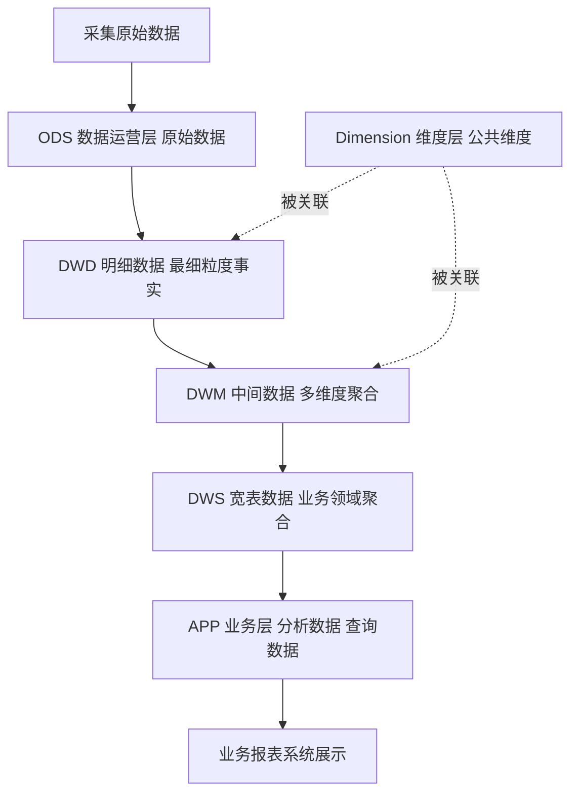

# 面试高频题：智慧学成的数据仓库是如何设计的

采集系统收进来的数据要存，清洗后的数据要存，统计分析完的结果还要存。这三类数据如果一股脑塞进同一个位置，很快就会互相污染：分不清哪张表是原始数据、哪张表是算完的结果，想重算一段历史也无从下手。数据仓库的设计要回答的就是这个问题，面试官问「你的数仓是怎么设计的」，答题骨架只有三段：分层怎么分、分区怎么切、存储格式怎么选。智慧学成的答案恰好可以在建库建表脚本里逐行验证，背概念与看实物是同一件事。

## 先给结论

- 分层为 ODS、DW、APP 三大层，DW 内部再分 DWD、DWM、DWS 三层，另有一个独立的 Dimension 维度层，每层只回答一类问题。
- 数仓用 Hive 建在 HDFS 上，5 个库 38 张表按业务主题分库：data_dimen 存维度、data_course 存课程事实、data_subject 与 data_agency 存学科与机构榜单、data_platform 存平台指标。
- 每层再按年、月、日分区存储，既能还原历史时间点的状态，也能按日期定点重算，不用全量回刷。
- 存储格式三种各管一段：TEXTFILE 存维度表，PARQUET 存 DW 层数据，ORC 开事务存采集自 MySQL、要响应增删改的数据。

## 分层：每一层只回答一个问题

ODS 层是数据运营层，与采集的原始数据一一对应，数据什么样进来就什么样存，不做任何加工。DW 层是数据仓库层，存经过清洗后的数据、初步聚合后的数据、为业务需求准备的宽表数据，它内部又分三层：DWD 存明细数据，是最细粒度的事实数据；DWM 存中间数据，是为统计需要建的中间表，一般是对多个维度的聚合，来源是 DWD；DWS 存宽表数据，是针对某个业务领域的聚合，把业务相关的数据统一汇集到一张表里方便业务层取用。APP 层是业务层，存业务最终要用的分析数据、查询数据。维度数据单独放 Dimension 层，它与前几条链路独立，不参与清洗、过滤、聚合，但清洗和统计都离不开它：



虚线是这张图的灵魂：维度层不在主链路上，却是每一步加工的依赖。统计课程访问量做初步聚合时，要关联用户维度拿到用户信息，关联区域维度拿到用户所属区域与 IP，这些维度通过维度 id 关联进来，只做只读引用，从不被修改。拿课程访问量把整条链路串一遍：埋点原始数据落在 ODS 对应的 source 表，SparkCore 清洗过滤去重、关联维度后写进 DWD 的事实表，统计分析按课程聚合算出当天的访问量写进 APP 层的业务表，最后同步到业务库展示。同一份数据的三次形态变化，靠分层各自落脚。

## 分库与建模：5 库 38 表的主题划分

分层的下一层是分库。课程的建库建表脚本一共 5 个库 38 张表，按业务主题划分：data_dimen 存 9 张维度表，课程、课程分类、区域、机构、用户、课程视频、时间等公共维度都在这里；data_course 存 16 张课程主题的表，原始 source 表、各指标事实表、中间表与业务表；data_subject 与 data_agency 各 6 张，存学科与机构的周榜、月榜业务表；data_platform 存 1 张平台离线指标表。找一张表先定位主题库，再看表名后缀判断层级，38 张表的组织逻辑一眼可辨。

建模思路是典型的维度建模：维度表提供分析视角，事实表记录业务动作。事实表里不存维度名称，只存各维度的 id 作外键，比如课程访问量事实表的主干字段全部是维度引用：

```sql
-- 维度表：文本格式，无分区（节选自课程建表脚本）
CREATE EXTERNAL TABLE IF NOT EXISTS data_dimen.course_dim
(course_dim_id String, name String, mt String, mt_name String,
 grade String, grade_name String, company_id String, company_name String,
 status String, status_name String)
ROW FORMAT DELIMITED FIELDS TERMINATED BY '\t'
STORED AS TEXTFILE
location '/user/hive/external/data_dimen/course_dimen';

-- 事实表：维度全部以 id 引用，按年月日分区，列式存储（节选）
CREATE EXTERNAL TABLE IF NOT EXISTS data_course.course_visit_fact
(course_visit_fact_id String, course_dim_id String, time_dim_id String,
 area_dim_id String, company_dim_id String, client_ip String,
 client_sessionid String, client_type String, visit_time bigint)
PARTITIONED BY (years String, months String, days String)
STORED AS PARQUET
location '/user/hive/external/data_course/course_visit_fact';
```

事实表只记动作与度量，描述性信息全在维度表里，课程改名只需要改维度表一行，事实表原封不动。这是维度建模最直接的收益，也是面试里「为什么事实表只存维度 id」的答案。

## 分区：按年月日切开海量数据

分层解决的是数据职责问题，分区解决的是海量数据的检索与维护问题。所有数据堆在一个目录里，数据少时查询无感，数据海量后检索明显变慢。在分层基础上每层再按年、月、日分区，一天一个分区，好处有三条：能够还原历史时间点上的产品状态、用户状态、用户行为，方便回溯历史、分析历史、跟踪用户行为；查询按天走分区裁剪，不必扫全量；统计出错时可以按日期定点重算，某一天算错了就重跑那一天的分区，不需要把所有历史全部重来。前面事实表 DDL 里的 `PARTITIONED BY (years, months, days)` 就是这条设计的落点，采集目录里看到的按天日期文件夹，正是分区在 HDFS 上的物理形态。

## 存储格式：三种格式各管一段

数仓用 Hive 存储在 HDFS 上，基于数据类型的不同采用三种格式。TEXTFILE 是文本格式，主要存维度数据，维度表行数少、要人工可读、加载直接，文本就够。PARQUET 是二进制列式存储，支持嵌套数据模型，主要存 DW 层数据，事实表与中间表行数巨大而查询只碰少数几列，列存的压缩比与扫描效率优势在这里最大化。ORC 也是二进制存储，主要特点是支持事务，用于存采集 MySQL 的数据：业务库的订单、选课记录随时会增删改，insert 之后又 update，如果数仓侧不能更新，数仓与源数据就不一致了，ORC 的事务能力让同步过来的变更也能落库修改。课程脚本里两张 source 表的建表语句把这一点写得很明白：

```sql
-- 采集自 MySQL 的原始表：分桶 + ORC 事务表，响应源库的增删改（节选）
CREATE EXTERNAL TABLE IF NOT EXISTS data_course.course_orders_source
(order_number String, price Float, status String, order_time BIGINT,
 user_id String, details String)
CLUSTERED BY (order_number) INTO 2 BUCKETS
STORED AS ORC
TBLPROPERTIES('transactional'='true');
```

ORC 的代价是不支持嵌套数据格式，特别复杂的嵌套类型支持得不友好，所以它与 PARQUET 按数据特征分工而不是互相替代。三种格式的分法可以记成一句话：人要看的是文本，机器要扫的是列存，要更新的是事务表。

## 常见误区

- **把维度数据卷进清洗链路。** 错例：清洗时顺手对维度表做过滤、更新。正解：Dimension 层是公共只读数据，只被关联引用不参与加工，维度数据的修正走维度采集自己的通道。
- **全库一种存储格式。** 错例：为省事全部建 TEXTFILE，或者觉得 ORC 高级就全用 ORC。正解：按数据特征选格式，维度表用文本，DW 层用 PARQUET 列存，采集自 MySQL 的表用事务 ORC，格式服务于读写特征。
- **建了分区却不用分区查。** 错例：SQL 不带日期条件，全表扫描还抱怨慢。正解：查询条件带上年月日分区列，让分区裁剪生效；重算也按分区定点进行。
- **用行业黑话硬套课程分层。** 错例：开口就是 ADS 层，与课程的 APP 层对不上号。正解：行业里 APP 层也常叫 ADS 或 DA 层，DWM 在不少公司的分层里会被合并进 DWS，名字有差异，分层的意图相通，答题时先讲意图再对名字。

## 面试可能被问到的问题

1. 面试官追问：「数据仓库为什么要分层，不分层行不行？」
   答：分层把一次加工拆成职责清晰的几段：ODS 留原貌保证可追溯，DWD 统一清洗口径，DWM 沉淀可复用的中间聚合，DWS 与 APP 面向业务出数。不分层时清洗逻辑与统计逻辑纠缠在一起，一处口径变更要动整条代码，中间结果无处沉淀导致重复计算；分层后每层可以独立重跑、独立复用，问题定位也能按层缩小范围。
2. 面试官追问：「DWM 层和 DWS 层都是聚合，区别在哪？」
   答：DWM 是面向统计过程的中间表，按多个维度做轻度聚合，目的是让上层统计不必每次都从明细算起；DWS 是面向业务领域的宽表，把某块业务关心的数据统一汇集起来，宽表的宽指业务字段齐全。在本项目里课程购买量先聚合出 DWM 中间表，热门学科排名再基于它算销售额、销售量、人数的周月榜，两层各干各的。
3. 面试官追问：「为什么采集 MySQL 的表要用带事务的 ORC，其他表不用？」
   答：源库的数据会增删改，binlog 里 insert 之后可能跟着 update 与 delete，如果数仓侧不可更新，源与仓很快就对不上。ORC 加 transactional 属性后支持 ACID 更新，同步变更时能原地修改。其余数据是追加型的事实与聚合结果，写一次不再改，用 PARQUET 拿列存收益即可，事务表维护成本高，按需使用。
4. 面试官追问：「按天分区带来什么实际问题，怎么处理？」
   答：分区多了元数据与小文件都会膨胀，调度与查询要先做分区裁剪，条件必须带日期；重算是分区的直接受益者，某天统计错了只重跑那一天，历史不受影响。本项目事实表按 years、months、days 三级分区，物理上就是 HDFS 按天的目录树，采集写入与统计读取都顺着这棵树走。
5. 面试官追问：「维度表为什么不和事实表放在一起清洗？」
   答：维度是共享数据，课程、用户、区域这些维度被所有指标的事实表引用，若随某条清洗链路改动，其他链路的关联结果全部被动变化。把维度独立成 Dimension 层，由专门的采集任务维护，事实表清洗时只读关联，引用与修改分离，数据一致性与职责边界都有保障。

## 配套资料

- 讲义：`materials/docs/08/智慧学成-项目就业指导.md`，第 4 节数据仓库是如何设计的（4.1 数据仓库分层、4.2 数据仓库分区、4.3 数据仓库存储）为本课出处。
- 资料：`materials/code/08/_散落资料/`，5 库 38 表的建库建表脚本 hive.sql 与维表说明 hive.md 在该目录（内层文件名带站点后缀，属元信息，按用途自取），正文 DDL 均为该脚本节选。
- 说明：分层图中 APP 层与行业常见称呼 ADS 的对应关系为补充说明；示例站点一律 example.com 占位。
