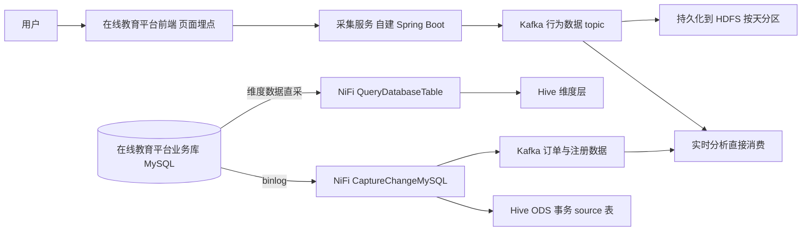

# 面试高频题：智慧学成的数据采集是如何实现的

> 🔒 安全提示：文中示例的口令/密钥均为课程教学环境演示口径，生产环境的安全要求见《安全与合规须知》。

数仓分层讲完，面试官通常会顺着往下追一句：「数据是怎么进到你数仓里的？」这一问最容易答空：只说「用 Kafka 采的」「用 NiFi 采的」，等于没说清楚。智慧学成的采集要同时面对两类性质完全不同的数据：用户在页面上的浏览、点击这类行为数据，业务库里根本不存在，只能靠埋点主动发出来；而课程、机构这些维度数据和订单、选课这类业务数据又实实在在存在 MySQL 里，等它写库再采，拿到的永远是过期的。两类数据用一套方案硬套是答不好这道题的根源。

## 先给结论

- 采集分两条线：JS 埋点采用户行为数据，MySQL 采维度数据与业务数据，后者统一用 NiFi 完成。
- 埋点线是「页面埋点、自建采集服务器、进 Kafka」：实时分析直接消费 Kafka，另有一路把 Kafka 数据持久化到 HDFS，为离线分析提供基础数据。
- MySQL 线分两种采法：变化少的维度数据用 QueryDatabaseTable 直接入仓；订单、选课这类随时增删改的数据用 CaptureChangeMySQL 监听 binlog 实时采集。
- 两条线的落地位置都在数仓 ODS 层，与分层、分区、存储格式的设计严丝合缝：行为数据按天落 HDFS 目录，binlog 数据落带事务的 ORC source 表。
- Kafka 中的订单、注册数据同时供实时分析消费，一份采集，离线与实时两路受益。

## 两条采集线的分工

埋点解决「业务库里没有的数据从哪来」，MySQL 采集解决「业务库里的数据怎么不丢变化地过来」。整条链路画出来是这样：



下半区是 MySQL 线的核心分歧：binlog 监听与直采并存，判断依据是数据变化频率，下文展开。上半区里 Kafka 是分水岭，它把一份行为数据喂给了两类消费者，实时分析要的是当分钟的增量，离线分析要的是按天的完整文件，两种诉求不该由采集服务分别实现，压进 Kafka 后各取所需。

## JS 埋点线：从页面点击到 Kafka

**第一，埋点是什么。** 在课程详情、视频播放这类页面里植入一段 JS 脚本，用户一发生访问、点击、观看行为，脚本就把行为数据打包发给采集服务器。行为数据只存在于浏览器里，不埋点就永远拿不到，这是它和业务数据的本质区别。

**第二，采集服务器为什么自建。** 项目用 Spring Boot 搭建自己的采集服务器，而不是接第三方统计。自建的好处是字段完全按数仓需求设计，IP、会话 id、浏览器类型这些清洗要用的字段在埋点时就能带全，数据也落在自己手里。

**第三，为什么先进 Kafka。** 采集服务收到数据后写入 Kafka，不在服务里做任何加工。流量高峰时埋点请求可能瞬间压垮下游，Kafka 把「收」和「用」解耦开；同时实时分析与离线持久化两个消费方互不干扰。实时侧 SparkStreaming 直接按 topic 消费；离线侧通过自定义 Kafka Connector 把数据持久化到 HDFS，按天落在 `course_visit_source` 这样的日期目录里，成为离线分析的原始数据。采集服务转发数据的部分可以简化成这样（按本课 Spring Boot 写法补全的示例）：

```java
package com.study.xc.collect;

import org.springframework.kafka.core.KafkaTemplate;
import org.springframework.web.bind.annotation.PostMapping;
import org.springframework.web.bind.annotation.RequestBody;
import org.springframework.web.bind.annotation.RestController;

@RestController
public class CollectController {

    private final KafkaTemplate<String, String> kafkaTemplate;

    public CollectController(KafkaTemplate<String, String> kafkaTemplate) {
        this.kafkaTemplate = kafkaTemplate;
    }

    @PostMapping("/collect/visit")
    public String collect(@RequestBody String log) {
        // 埋点数据原样入 Kafka，不做清洗，实时与离线各自消费
        kafkaTemplate.send("visit_topic", log);
        return "ok";
    }
}
```

订单、用户注册这两类业务数据的实时分析也要走 Kafka，topic 分别是 `course_buy` 与 `new_user`，数据来源是下面的 binlog 采集。

## MySQL 线：维度直采与 binlog 监听

**维度数据直采。** 课程、课程分类、区域、机构、用户这些维度数据变化频率低，今天改个课程简介，明天加个机构，没有高频变更，也就不需要盯变更。项目用 NiFi 的 QueryDatabaseTable 处理器配一个数据库连接池直接从业务库拉取，经 Avro 转 JSON、自定义 JsonToHive 处理器整理后，由 PutHiveQL 写入 Hive 维度表。课程模板里用户维度的配置是这样的：

```text
# 用户维度采集链路（课程 NiFi 模板配置节选）
QueryDatabaseTable
    Database Connection Pooling Service : MySQL 业务库连接池
    Table Name                          : xc_user
    SQL Query                           : SELECT u.id user_dim_id, username, u.name,
                                          userpic, utype, d.name utype_name, birthday,
                                          sex, email, phone, qq, ip, status, ...
ConvertAvroToJSON
JsonToHiveProcessor
    table_name : data_dimen.user_dim
PutHiveQL
```

链路里那个自定义 JsonToHive 处理器，是课程自己开发的 nar 包，负责按字段对应关系把 JSON 对齐到 Hive 表结构，安装脚本里能看到 `Json-To-Hive.nar` 与 `MySQL-BinLog-To-Hive.nar` 两个自定义包的部署。

**业务数据监听 binlog。** 订单、选课记录随时会增删改，订单先 insert 再 update 状态是常态。等数据写库后再来查，要么采到中间态，要么错过变更，所以项目用 NiFi 的 CaptureChangeMySQL 处理器直接监听 MySQL 的 binlog，把每一次行变更实时捕获下来。binlog 本来就是 MySQL 主从复制用的变更日志，打开它几乎没有额外成本，却让数仓侧拿到了与源库一致的变更流：

```text
# 订单数据 binlog 实时采集（课程 NiFi 模板配置节选）
CaptureChangeMySQL
    MySQL Hosts      : xc-online-mysql:3306
    Username         : root（密码按课程环境为 123456）
    Server ID        : 1
    Include DDL Events : true
RouteOnAttribute
    insert : ${cdc.event.type:equals('insert')}
    update : ${cdc.event.type:equals('update')}
MySQLBinLogToHiveProcessor
    mysql_db_table    : xc_order.xc_orders
    primary_key       : order_number:order_number
    fields_correspond : order_number:order_number, price:price, status:status,
                        order_time:start_time, user_id:user_id, details:details
    hive_table_name   : data_course.course_orders_source
PutHiveQL
```

CaptureChangeMySQL 捕获到事件后，先由 RouteOnAttribute 按事件类型分流，自定义的 MySQLBinLogToHive 处理器再按 `fields_correspond` 的映射把源库表 `xc_order.xc_orders` 的字段对到数仓 source 表 `data_course.course_orders_source`，主键映射保证同一条订单的多次变更落在同一行上。用户选课数据的采集同构，源表 `xc_learning.xc_learning_course` 对应数仓的 `learning_course_source`。位点管理由配套的 DistributedMapCacheClient 服务承担，处理器把消费进度记下来，重启后从上次位置继续，`retrieve-all-records` 属性则决定首次启动是否从头回放。

## 落到 ODS：采集的边界在哪里

采集的产物统一落 ODS 层，这一层只保原貌，不做清洗。行为数据按天分区落 HDFS，binlog 数据落进 `clustered by ... stored as orc TBLPROPERTIES('transactional'='true')` 的事务表：binlog 里 insert 之后跟着的 update 与 delete，要求数仓侧能原地修改，普通 PARQUET 表做不到，事务 ORC 表就是为此选的，这套格式选型的完整口径在数仓设计那一篇里展开过。把清洗留在后面的 Spark 程序里做，采集层出错可以按天重灌，清洗出错可以按天重算，两层互不牵连。

## 常见误区

- **行为数据绕过 Kafka 直写 HDFS。** 错例：采集服务收到埋点就落文件。正解：先进 Kafka 削峰，再由消费方各取所需，直写 HDFS 等于替实时分析把路堵死。
- **维度数据也上 binlog 监听。** 错例：所有 MySQL 表一律 CaptureChangeMySQL。正解：维度变化少，直采全量覆盖即可，binlog 监听留给要响应增删改的业务数据，采集方式跟着数据变化频率走。
- **在采集层顺手清洗。** 错例：采集时把脏数据过滤掉再入仓。正解：ODS 保原貌是数仓可追溯的前提，脏数据留给 ETL 环节处理，采错了还能重灌。
- **位点不管，重启重采。** 错例：binlog 采集程序每次从头消费。正解：用缓存服务记录消费位点，断点续采，首次全量用 `retrieve-all-records` 显式控制。

## 面试可能被问到的问题

1. 面试官追问：「你们项目的数据采集是怎么做的，为什么要分两条链路？」
   答：JS 埋点采用户行为数据，这类数据业务库里没有，只能页面脚本主动上报，经自建采集服务进 Kafka；MySQL 侧采维度数据与订单、选课等业务数据，统一用 NiFi。分两条链路是因为数据来源与变化特征完全不同，行为数据要削峰多路消费，业务数据要不丢变更，一套方案套不住两类问题。
2. 面试官追问：「埋点数据为什么要先进 Kafka，不直接写 HDFS？」
   答：Kafka 把采集的收与用解耦。流量高峰先进队列缓冲，避免压垮存储；实时分析直接消费当分钟增量，离线侧再由自定义 Kafka Connector 持久化到 HDFS。一份采集同时喂饱实时与离线两个场景，这是直接写 HDFS 给不了的。
3. 面试官追问：「MySQL 的数据为什么一部分直采、一部分监听 binlog？」
   答：按变化频率分流。课程、机构、用户这些维度数据变更少，QueryDatabaseTable 周期性直采全量覆盖就够了；订单、选课随时增删改，直采会漏掉 update 与 delete，用 CaptureChangeMySQL 监听 binlog 实时捕获行变更，数仓侧用事务表承接，源与仓才能一致。
4. 面试官追问：「binlog 采集怎么保证不丢不重？」
   答：不丢靠位点，处理器把 binlog 消费进度记在缓存服务里，重启续采，首次回放用配置显式控制；不重靠主键映射与事务表，同一条订单的多次变更按主键落到同一行做更新。极端情况下按天分区重灌也可以兜底。
5. 面试官追问：「采集到的数据最终落在数仓哪一层，为什么不顺便清洗？」
   答：统一落 ODS 层保原貌。清洗在 ETL 的 Spark 程序里做，错了可以按天重算；采集层要是动了数据，原始痕迹就没了，追溯与重算都失去依据。采集只负责搬运与落地，边界清楚，问题定位才快。

## 配套资料

- 讲义：`materials/docs/08/智慧学成-项目就业指导.md`，第 5 节数据采集是如何实现的（5.1 Js 埋点数据采集、5.2 MySQL 维度数据采集/业务数据采集）为本课出处。
- 资料：`materials/code/08/_散落资料/`，用户维度采集、课程购买量-MySQL实时采集、热门学科排名-数据采集__用户选课等 NiFi 采集模板与部署组件的 auto_build 脚本在该目录（内层文件名带站点后缀，属元信息，按用途自取），正文配置均为模板节选。
- 说明：采集服务接收埋点并转发 Kafka 的 Spring Boot 代码为按本课写法补全的示例；Kafka topic 名与 NiFi 处理器配置取自课程真实模板。
