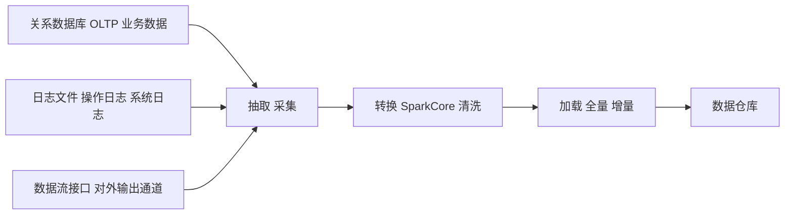

# 面试高频题：智慧学成的 ETL 是如何做的

「你们的 ETL 是怎么做的？」这一问的回答最容易背成名词解释：抽取、转换、加载，说完就没词了。面试官想听的是这三段在你的项目里各自落在什么组件、处理了什么脏数据、出了错怎么办。智慧学成采用标准的 ETL 开发规范，三段都有实指：抽取就是采集环节，转换就是 SparkCore 的清洗，加载就是把结果写回数仓。把三段各自的项目实例讲清楚，这道题就从背诵题变成了加分题。

## 先给结论

- 抽取对应数据采集：从关系数据库、日志文件、数据流接口三类来源获取原始数据，项目里分别对应 MySQL 采集与埋点日志。
- 原始数据不能直接用，脏数据有三类：错误的数据、不完整的数据、重复的数据。
- 转换分两种形式：数据格式转换与数据内容转换，项目里最有代表性的是把 IP 转换成区域 id。
- 清洗转换由 SparkCore 完成，处理后的数据重新存回数仓，进入 DWD、DWM 各层。
- 加载分全量与增量：维度数据用全量覆盖，业务数据按时间计划分批加载，同一天重跑即覆盖当天分区。

## 抽取：三种来源，一个目的

数据抽取是从数据源拿到分析需要的原始数据，方式由数据源的特点决定，讲义里归成三类：



**第一类，从关系数据库抽取。** OLTP 系统的业务操作数据都存在关系库里，这是最常见的一种。抽取后通常先以文件形式落到分布式文件系统上，方便 ETL 程序读取，也有直接写进数仓的，那要提前建好与原始数据同结构的表。项目里订单、选课数据经 binlog 监听落成 `course_orders_source` 这类 source 表，走的正是这条路。

**第二类，从日志文件抽取。** 用户操作日志、系统日志由专门的采集程序从服务器上取走，项目里埋点行为数据经 Kafka 持久化成 HDFS 上的日期文件，本质就是日志抽取。

**第三类，从数据流接口抽取。** 数据源对外提供一个输出通道，采集系统对接通道持续读取。三类方式名目不同，目的只有一个：把原始数据拿到手，后面两段才有加工对象。

## 转换：三类脏数据与两类转换

**错误的数据。** 数据内容本身就是错的，比如选课信息里课程标识非法、选课日志不符合规范，还有刷量的机器人访问，这类数据清洗时直接过滤。

**不完整的数据。** 信息缺字段，比如选课记录里缺学生或缺课程信息，不符合数据模型要求。埋点采集是重灾区，浏览器端能拿到的东西有限，缺字段要么补全、要么整条丢弃。

**重复的数据。** 这一类要按具体业务单独去重。课程访问量统计的是真实访问，用户在同一浏览器反复刷新页面，产生的就是重复记录；同一个课程学习会话里只允许有一条学习记录，就要按会话 id 去重。重复的定义永远来自业务口径，不是技术判断。

清洗之外还有两类转换。**格式转换**改形式不改内容，数仓要求的日期格式与采集来的不一致，就要做映射；**内容转换**改变的是数据的表达但保留含义，最典型的是区域归属：数仓要存用户所属区域，采集来的只有 IP 地址，需要拿 IP 去 IP 库查出对应区域再转成区域维度 id。课程购买量清洗代码里能看到这些动作（包名按本课规范书写，节选自讲义代码）：

```scala
package com.study.xc.analysis.buy

import com.alibaba.fastjson.JSON
import com.study.xc.common.EtlEnvironment
import com.study.xc.entity.{AreaDimen, CourseBuyFact, CourseDimen, CourseOrdersSource, UserDimen}
import com.study.xc.utils.{DateUtils, IpUtils}
import org.apache.spark.sql.SparkSession

object CourseBuyHiveToFact {
  val spark: SparkSession = EtlEnvironment.getSparkSession(this.getClass.getSimpleName)

  def main(args: Array[String]): Unit = {
    import spark.implicits._
    val dateInfo = args(0)
    // 预加载维度到内存映射，供逐行关联
    var areaMap = Map[String, String]()
    spark.sql(s"SELECT * FROM data_dimen.area_dim").as[AreaDimen].collect()
      .map(x => areaMap += (x.county_name -> x.area_dim_id.toString))
    var userMap = Map[String, String]()
    spark.sql(s"SELECT * FROM data_dimen.user_dim").as[UserDimen].collect()
      .map(x => userMap += (x.user_dim_id -> x.ip))
    var comMap = Map[String, String]()
    spark.sql(s"SELECT * FROM data_dimen.course_dim").as[CourseDimen].collect()
      .map(x => comMap += (x.course_dim_id -> x.company_id))
    // 按日期读 source 原始表
    val courseBuySource = spark.sql(
      s"""select * from data_course.course_orders_source
         |where from_unixtime(order_time, 'yyyy-MM-dd') = '$dateInfo'"""
        .stripMargin).as[CourseOrdersSource].collect()
    val cbsClean = courseBuySource.map(obj => {
      // 格式转换：时间戳转成时间维度 id
      val timeDimId = DateUtils.getDateStr(obj.order_time.toLong * 1000, "yyyy-MM-dd-H")
      // 内容转换：用户 IP 查区域库得到区域维度 id，查不到置 -1
      var areaId = "-1"
      try {
        areaId = areaMap.get(IpUtils.getArea(userMap.get(obj.user_id).get)).get
      } catch { case _: Exception => }
      // 解析订单明细 JSON，取课程与价格
      val json = JSON.parseArray(obj.details).getJSONObject(0)
      val companyDimId = comMap.get(json.getString("itemId")).get
      val ymd = timeDimId.split("-")
      CourseBuyFact(obj.order_number, json.getString("itemId"), timeDimId, areaId,
        companyDimId, json.getString("itemPrice").toFloat, obj.status, obj.user_id,
        ymd(0), ymd(1), ymd(2))
    })
    spark.createDataFrame(cbsClean)
      .repartition(1)
      .write
      .mode("overwrite")
      .insertInto("data_course.course_buy_fact")
    spark.close()
  }
}
```

一段清洗代码把三类脏数据的处理方式都带出来了：时间戳转时间维度 id 是格式转换，IP 转区域 id 是内容转换，查不到区域置 `-1` 是给不完整数据留的兜底，订单明细从 JSON 数组里解析是源头格式统一。课程访问量的清洗多一步去重，思路是先过滤字段不完整的行、再过滤机器人访问，最后按业务键去重（按本课 SparkCore 写法补全的示意）：

```scala
// 课程访问量清洗：过滤与去重示意
val parsed = rawLines.map(_.split("\t"))
  .filter(arr => arr.length == 7)                    // 不完整的数据直接丢弃
  .filter(arr => !robotPattern.matcher(arr(2)).find()) // 过滤机器人访问
  .map(arr => VisitLog(arr(0), arr(1), arr(2), arr(3), arr(4).toLong))
val df = spark.createDataFrame(parsed)
  // 同一课程、同一会话、同一 IP 只算一次真实访问
  .dropDuplicates("course_id", "client_sessionid", "client_ip")
```

## 加载：全量覆盖与增量叠加

清洗转换完的数据要存回数仓，加载方式有两种。全量加载相当于覆盖加载，每次把数据全部覆盖进去，通常用于维度数据：维度行数少，全量覆盖最省心，重跑永远得到正确结果。增量加载按时间计划分批叠加，每批数据都保留，通常用于 OLTP 的业务操作数据。项目里的事实表按年月日分区，重跑某一天时用动态分区覆盖：`mode("overwrite")` 配合 `insertInto`，加上 `spark.sql.sources.partitionOverwriteMode` 设为 dynamic，覆盖的只有目标日期那一个分区，历史分区原封不动。全量与增量在这里统一起来：对一天而言是全量覆盖，对整表而言是按天增量，这正是分区设计给加载方式留的余地。

## 常见误区

- **把清洗塞进采集层。** 错例：采集的时候顺手把脏数据过滤掉。正解：采集只负责搬运，ODS 保原貌；清洗独立成 Spark 程序，逻辑变更时按天重算即可，采集层动了数据就失去追溯依据。
- **去重按全字段一刀切。** 错例：不管业务口径，`distinct()` 整行去重完事。正解：重复的定义由业务给，访问量按课程、会话、IP 的组合去重，学习记录按会话 id 去重，两行内容完全相同只是重复的最劣情形。
- **脏数据一律删除。** 错例：看到字段缺失就整行丢。正解：能补的先补，IP 缺区域就查 IP 库补上区域 id，补不出来的才过滤，误删会直接拉低统计口径的覆盖面。
- **全量加载理解成每天刷全表。** 错例：以为全量覆盖会动历史数据。正解：全量针对当天分区，动态分区覆盖只重写目标日期，历史分区不动。

## 面试可能被问到的问题

1. 面试官追问：「ETL 三个字母在你们项目里分别对应什么？」
   答：抽取对应采集环节，MySQL 维度与业务数据、埋点行为日志两类来源；转换对应 SparkCore 清洗，过滤三类脏数据并做格式与内容转换；加载对应清洗结果写回数仓，维度全量覆盖、业务数据按天分区加载。每一段都能落到具体组件与代码。
2. 面试官追问：「你们清洗了哪些脏数据，能举例吗？」
   答：错误数据如非法课程标识与机器人刷量访问，直接过滤；不完整数据如埋点字段缺失，能补则补、补不了丢弃；重复数据按业务口径去重，同一浏览器反复刷新只算一次访问，学习会话按会话 id 保一条。
3. 面试官追问：「IP 转区域这种内容转换为什么放在清洗阶段做？」
   答：区域归属是所有按区域分析的公共依赖，在清洗成事实表时统一转换成区域维度 id，后面统计直接用 id 关联维度表，避免每个统计程序各自查一遍 IP 库，口径也只有一处。
4. 面试官追问：「全量加载和增量加载你们怎么选的？」
   答：维度数据量小且要可重跑，选全量覆盖；业务数据按天分批进仓，按天分区后重跑当天就是全量覆盖当天、增量叠加历史，两种方式在分区设计下不再对立。
5. 面试官追问：「清洗后的数据存到哪，原始数据还在吗？」
   答：原始数据留在 ODS 的 source 表与 HDFS 日期目录里，清洗结果写入 DWD 事实表，再往下轻度聚合进 DWM。原始与加工分层存放，任何一层算错都可以从上一层重算。

## 配套资料

- 讲义：`materials/docs/08/智慧学成-项目就业指导.md`，第 6 节项目 ETL 是如何做的（6.1 数据抽取、6.2 数据转换、6.3 数据加载）为本课出处。
- 讲义：`materials/docs/08/智慧学成-第3章-课程分析.md`，课程购买量 DWD 清洗代码 CourseBuyHiveToFact、课程访问量清洗与统计分析代码在该讲义，正文 Scala 为其节选改写。
- 资料：`materials/code/08/_散落资料/`，数据清洗统计类 NiFi 调度模板（数据清洗统计___用户学习、课程购买量_-_数据清洗统计程序调度）在该目录（内层文件名带站点后缀，属元信息，按用途自取）。
- 说明：课程访问量过滤去重的 Scala 片段为按本课 SparkCore 写法补全的示意，非讲义原文；Scala 包名已按本课规范统一书写。
